# AI Systems Deep Dive: from ASIC to agents, VLAs, tracking and RL infrastructure

_Exported conversation, 12 October 2026. Every question and answer is in its original order, with each diagram rendered as an image, its source code, and every code file written during the chat._

> Interactive diagrams are shown as static snapshots in their default state. Open the linked `.html` page next to each snapshot to use the sliders and controls.

## Contents

1. [ASIC daigram for AGI from LLM and all its layers](#turn-1)
2. [Explain the model layer (L5): transformer, MoE, KV cache, reasoning](#turn-2)
3. [How does HBM bandwidth limit LLM decode speed?](#turn-3)
4. [Explain grouped-query attention and how it reads the KV cache](#turn-4)
5. [Explain the agent loop layer (L7) of an AGI stack in depth](#turn-5)
6. [How do LLM agents plan: ReAct, plan-and-execute, tree search?](#turn-6)
7. [How do agents manage belief state: context compaction, memory, retrieval?](#turn-7)
8. [How do agent environments and observations work?](#turn-8)
9. [Why do MoE models need all expert weights in HBM even though few are active?](#turn-9)
10. [Explain the cognitive scaffold layer (L6): memory, tools, world model](#turn-10)
11. [Explain LLM sampling: temperature, top-p, speculative decoding](#turn-11)
12. [How do physical AI agents handle real-world environments and sensor observations?](#turn-12)
13. [How do robots represent belief state with uncertainty for planning and safety?](#turn-13)
14. [Explain the model layer (L5): transformer, MoE, KV cache, reasoning](#turn-14)
15. [How do vision-language-action models with action chunking and flow matching work?](#turn-15)
16. [Explain GRPO group-relative advantages vs PPO with a value function](#turn-16)
17. [Explain grouped-query attention and how it reads the KV cache](#turn-17)
18. [How big is the KV cache and how do paged attention and quantization shrink it?](#turn-18)
19. [How does the MoE top-k router choose experts and balance load?](#turn-19)
20. [Why do MoE models need all expert weights in HBM even though few are active?](#turn-20)
21. [How do factor graphs represent ego pose uncertainty compared to EKF?](#turn-21)
22. [How do occupancy grids and ESDFs represent geometric uncertainty from LiDAR?](#turn-22)
23. [How do multi-object trackers represent existence and state uncertainty: JPDA, MHT, random finite sets?](#turn-23)
24. [How are multimodal trajectory predictions of other agents represented and used in planning?](#turn-24)
25. [How do 3D scene graphs represent semantic uncertainty for robots?](#turn-25)
26. [How does belief-space planning use chance constraints and risk measures like CVaR?](#turn-26)
27. [How do reachability analysis and control barrier functions use worst-case state sets for robot safety?](#turn-27)
28. [How do NIS consistency tests and integrity monitoring detect when a robot belief is wrong?](#turn-28)
29. [How does FlashDecoding split-K parallelism work on GPUs?](#turn-29)
30. [How does FlashDecoding split-K parallelism work on GPUs?](#turn-30)
31. [How does FlashDecoding split-K parallelism work on GPUs?](#turn-31)
32. [What biases does GRPO std and length normalization introduce, and how do Dr. GRPO and DAPO fix them?](#turn-32)
33. [How is a pretrained VLM adapted as the backbone of a robot VLA, and how is language ability preserved?](#turn-33)
34. [Softmax vs sigmoid gating in MoE routers and why gate weights are renormalized](#turn-34)
35. [Walk through the flow matching math for robot action generation in detail](#turn-35)
36. [How do temporal ensembling and real-time chunking execute action chunks smoothly?](#turn-36)
37. [Explain the PMBM filter and how its Poisson component models undetected objects](#turn-37)
38. [How does track-oriented MHT score, prune and manage hypotheses?](#turn-38)
39. [Derive the JPDA update including the spread-of-innovations covariance term, and explain JIPDA existence](#turn-39)
40. [Softmax vs sigmoid gating in MoE routers and why gate weights are renormalized](#turn-40)
41. [How do MoE serving systems handle hot experts at inference, e.g. expert replication and placement?](#turn-41)
42. [Explain the online softmax rescaling math used to merge attention partials](#turn-42)
43. [How are verifiers and reward signals built for agent RL environments?](#turn-43)
44. [How are agent rollouts generated at scale for RL training?](#turn-44)
45. [How is web data co-training mixed with robot data in VLA training, and what ratios work?](#turn-45)
46. [How are vision encoder, projector and LLM layers handled when fine-tuning a VLM into a VLA: freeze, LoRA or full fine-tune?](#turn-46)
47. [Walk through the flow matching math for robot action generation in detail](#turn-47)
48. [How does the FAST action tokenizer work with DCT and BPE?](#turn-48)
49. [How do you build robust programmatic outcome verifiers for coding and tool-use agent tasks?](#turn-49)
50. [How do you validate an RL grader: gold solutions, no-op baselines and flakiness checks?](#turn-50)

---

<a id="turn-1"></a>
## 1. ASIC daigram for AGI from LLM and all its layers

> **Question:** ASIC daigram for AGI from LLM and all its layers

**Diagram: `agi_llm_asic_full_stack`** (static SVG diagram)

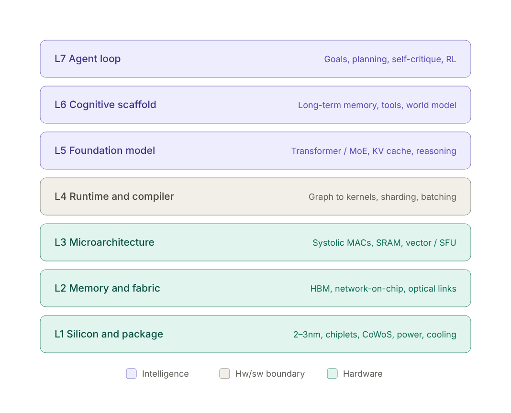

[Open standalone page](assets/01_agi_llm_asic_full_stack.html)

<details><summary>Diagram source</summary>

````svg
<svg width="100%" viewBox="0 0 680 540" role="img"><title>LLM to AGI full stack down to ASIC</title><desc>Seven layers from silicon and packaging up through memory fabric, microarchitecture, runtime, model, cognitive scaffold and agent loop.</desc>
<defs><marker id="arrow" viewBox="0 0 10 10" refX="8" refY="5" markerWidth="6" markerHeight="6" orient="auto-start-reverse"><path d="M2 1L8 5L2 9" fill="none" stroke="context-stroke" stroke-width="1.5" stroke-linecap="round" stroke-linejoin="round"/></marker></defs>
<g class="node c-purple" onclick="sendPrompt('Explain the agent loop layer (L7) of an AGI stack in depth')"><rect x="40" y="40" width="600" height="52" rx="8" stroke-width="0.5"/><text class="th" x="60" y="66" dominant-baseline="central">L7 Agent loop</text><text class="ts" x="620" y="66" text-anchor="end" dominant-baseline="central">Goals, planning, self-critique, RL</text></g>
<g class="node c-purple" onclick="sendPrompt('Explain the cognitive scaffold layer (L6): memory, tools, world model')"><rect x="40" y="104" width="600" height="52" rx="8" stroke-width="0.5"/><text class="th" x="60" y="130" dominant-baseline="central">L6 Cognitive scaffold</text><text class="ts" x="620" y="130" text-anchor="end" dominant-baseline="central">Long-term memory, tools, world model</text></g>
<g class="node c-purple" onclick="sendPrompt('Explain the model layer (L5): transformer, MoE, KV cache, reasoning')"><rect x="40" y="168" width="600" height="52" rx="8" stroke-width="0.5"/><text class="th" x="60" y="194" dominant-baseline="central">L5 Foundation model</text><text class="ts" x="620" y="194" text-anchor="end" dominant-baseline="central">Transformer / MoE, KV cache, reasoning</text></g>
<g class="node c-gray" onclick="sendPrompt('Explain the runtime and compiler layer (L4) for LLM ASICs')"><rect x="40" y="232" width="600" height="52" rx="8" stroke-width="0.5"/><text class="th" x="60" y="258" dominant-baseline="central">L4 Runtime and compiler</text><text class="ts" x="620" y="258" text-anchor="end" dominant-baseline="central">Graph to kernels, sharding, batching</text></g>
<g class="node c-teal" onclick="sendPrompt('Explain the ASIC microarchitecture layer (L3): systolic arrays, SRAM, vector units')"><rect x="40" y="296" width="600" height="52" rx="8" stroke-width="0.5"/><text class="th" x="60" y="322" dominant-baseline="central">L3 Microarchitecture</text><text class="ts" x="620" y="322" text-anchor="end" dominant-baseline="central">Systolic MACs, SRAM, vector / SFU</text></g>
<g class="node c-teal" onclick="sendPrompt('Explain the memory and fabric layer (L2): HBM, NoC, chip-to-chip links')"><rect x="40" y="360" width="600" height="52" rx="8" stroke-width="0.5"/><text class="th" x="60" y="386" dominant-baseline="central">L2 Memory and fabric</text><text class="ts" x="620" y="386" text-anchor="end" dominant-baseline="central">HBM, network-on-chip, optical links</text></g>
<g class="node c-teal" onclick="sendPrompt('Explain the silicon and packaging layer (L1) for AI ASICs')"><rect x="40" y="424" width="600" height="52" rx="8" stroke-width="0.5"/><text class="th" x="60" y="450" dominant-baseline="central">L1 Silicon and package</text><text class="ts" x="620" y="450" text-anchor="end" dominant-baseline="central">2–3nm, chiplets, CoWoS, power, cooling</text></g>
<rect class="c-purple" x="160" y="498" width="14" height="14" rx="3" stroke-width="0.5"/><text class="ts" x="182" y="505" dominant-baseline="central">Intelligence</text>
<rect class="c-gray" x="290" y="498" width="14" height="14" rx="3" stroke-width="0.5"/><text class="ts" x="312" y="505" dominant-baseline="central">Hw/sw boundary</text>
<rect class="c-teal" x="440" y="498" width="14" height="14" rx="3" stroke-width="0.5"/><text class="ts" x="462" y="505" dominant-baseline="central">Hardware</text>
</svg>
````

</details>

**Diagram: `llm_asic_package_floorplan`** (static SVG diagram)

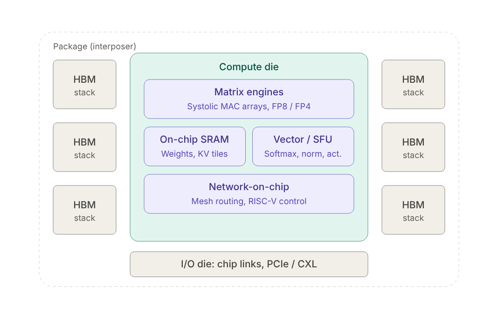

[Open standalone page](assets/02_llm_asic_package_floorplan.html)

<details><summary>Diagram source</summary>

````svg
<svg width="100%" viewBox="0 0 680 420" role="img"><title>LLM accelerator package floorplan</title><desc>Package with six HBM stacks around a compute die containing matrix engines, on-chip SRAM, vector units, network-on-chip, and an I/O die below.</desc>
<rect x="40" y="30" width="600" height="365" rx="20" fill="none" stroke="var(--border-strong)" stroke-width="0.5" stroke-dasharray="4 4"/>
<text class="ts" x="60" y="50" dominant-baseline="central">Package (interposer)</text>
<g class="node c-gray" onclick="sendPrompt('How does HBM bandwidth limit LLM decode speed?')"><rect x="60" y="70" width="90" height="70" rx="6" stroke-width="0.5"/><text class="th" x="105" y="98" text-anchor="middle" dominant-baseline="central">HBM</text><text class="ts" x="105" y="116" text-anchor="middle" dominant-baseline="central">stack</text></g>
<g class="node c-gray" onclick="sendPrompt('How does HBM bandwidth limit LLM decode speed?')"><rect x="60" y="160" width="90" height="70" rx="6" stroke-width="0.5"/><text class="th" x="105" y="188" text-anchor="middle" dominant-baseline="central">HBM</text><text class="ts" x="105" y="206" text-anchor="middle" dominant-baseline="central">stack</text></g>
<g class="node c-gray" onclick="sendPrompt('How does HBM bandwidth limit LLM decode speed?')"><rect x="60" y="250" width="90" height="70" rx="6" stroke-width="0.5"/><text class="th" x="105" y="278" text-anchor="middle" dominant-baseline="central">HBM</text><text class="ts" x="105" y="296" text-anchor="middle" dominant-baseline="central">stack</text></g>
<g class="node c-gray" onclick="sendPrompt('How does HBM bandwidth limit LLM decode speed?')"><rect x="530" y="70" width="90" height="70" rx="6" stroke-width="0.5"/><text class="th" x="575" y="98" text-anchor="middle" dominant-baseline="central">HBM</text><text class="ts" x="575" y="116" text-anchor="middle" dominant-baseline="central">stack</text></g>
<g class="node c-gray" onclick="sendPrompt('How does HBM bandwidth limit LLM decode speed?')"><rect x="530" y="160" width="90" height="70" rx="6" stroke-width="0.5"/><text class="th" x="575" y="188" text-anchor="middle" dominant-baseline="central">HBM</text><text class="ts" x="575" y="206" text-anchor="middle" dominant-baseline="central">stack</text></g>
<g class="node c-gray" onclick="sendPrompt('How does HBM bandwidth limit LLM decode speed?')"><rect x="530" y="250" width="90" height="70" rx="6" stroke-width="0.5"/><text class="th" x="575" y="278" text-anchor="middle" dominant-baseline="central">HBM</text><text class="ts" x="575" y="296" text-anchor="middle" dominant-baseline="central">stack</text></g>
<g class="c-teal"><rect x="170" y="60" width="340" height="270" rx="12" stroke-width="0.5"/><text class="th" x="340" y="80" text-anchor="middle" dominant-baseline="central">Compute die</text></g>
<g class="node c-purple" onclick="sendPrompt('How do systolic MAC arrays execute transformer matmuls on an ASIC?')"><rect x="190" y="98" width="300" height="56" rx="8" stroke-width="0.5"/><text class="th" x="340" y="116" text-anchor="middle" dominant-baseline="central">Matrix engines</text><text class="ts" x="340" y="136" text-anchor="middle" dominant-baseline="central">Systolic MAC arrays, FP8 / FP4</text></g>
<g class="node c-purple" onclick="sendPrompt('How is on-chip SRAM used for weights and KV cache in LLM ASICs?')"><rect x="190" y="166" width="145" height="56" rx="8" stroke-width="0.5"/><text class="th" x="262" y="184" text-anchor="middle" dominant-baseline="central">On-chip SRAM</text><text class="ts" x="262" y="204" text-anchor="middle" dominant-baseline="central">Weights, KV tiles</text></g>
<g class="node c-purple" onclick="sendPrompt('What do vector and special-function units do in an LLM accelerator?')"><rect x="345" y="166" width="145" height="56" rx="8" stroke-width="0.5"/><text class="th" x="417" y="184" text-anchor="middle" dominant-baseline="central">Vector / SFU</text><text class="ts" x="417" y="204" text-anchor="middle" dominant-baseline="central">Softmax, norm, act.</text></g>
<g class="node c-purple" onclick="sendPrompt('How does the network-on-chip and control processor schedule work in an AI ASIC?')"><rect x="190" y="234" width="300" height="56" rx="8" stroke-width="0.5"/><text class="th" x="340" y="252" text-anchor="middle" dominant-baseline="central">Network-on-chip</text><text class="ts" x="340" y="272" text-anchor="middle" dominant-baseline="central">Mesh routing, RISC-V control</text></g>
<g class="node c-gray" onclick="sendPrompt('How do chip-to-chip links scale LLM inference across many ASICs?')"><rect x="170" y="345" width="340" height="36" rx="6" stroke-width="0.5"/><text class="th" x="340" y="363" text-anchor="middle" dominant-baseline="central">I/O die: chip links, PCIe / CXL</text></g>
</svg>
````

</details>

The core idea is that each layer exists to remove the bottleneck of the layer above it:

- **L7 and L6** turn a next-token predictor into a closed-loop system. The structure is perceive, plan, act, and update memory. This is the same recursive estimation pattern as a Bayes filter, with the LLM serving as both the transition model and the observation model.
- **L5** is constrained by memory more than by FLOPs. Long context and the KV cache dominate.
- **L4 and L3** exist to keep weights and KV tiles in SRAM and to keep the MAC arrays saturated. Without that, decode stalls waiting on HBM.
- **L2 and L1** set the physical ceiling: bandwidth per watt, and how many chips can act as one.

The open question for "AGI silicon" is whether L6 (persistent memory and world models) eventually gets dedicated hardware. Examples would be near-memory compute, or state-space and recurrent blocks that replace the growing KV cache. A separate question is whether L6 stays a software scaffold running on L3-style matrix engines.

Click any block to go deeper on that layer.

---

<a id="turn-2"></a>
## 2. Explain the model layer (L5): transformer, MoE, KV cache, reasoning

> **Question:** Explain the model layer (L5): transformer, MoE, KV cache, reasoning

**Diagram: `llm_model_layer_l5_internals`** (static SVG diagram)

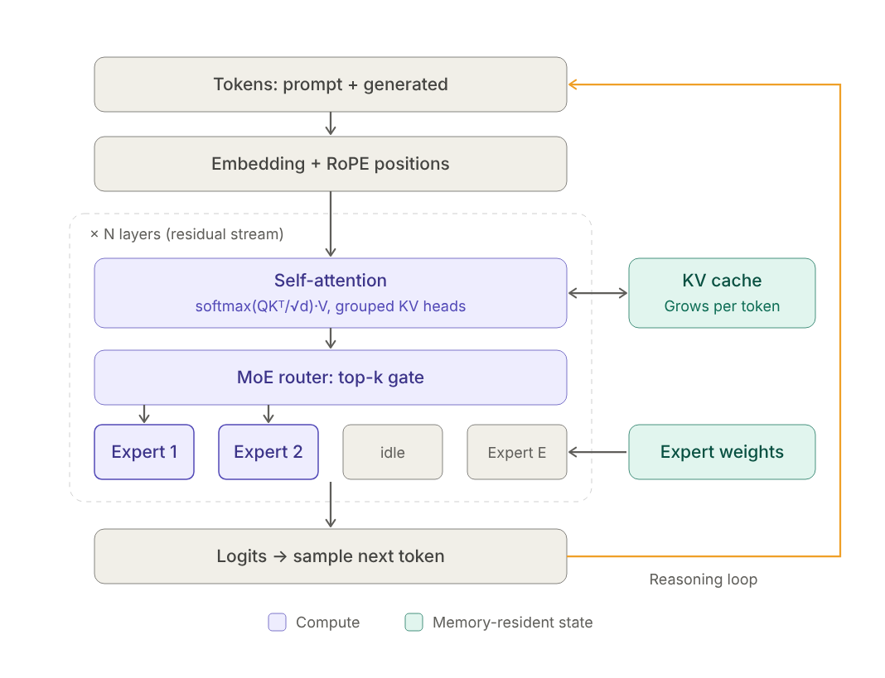

[Open standalone page](assets/03_llm_model_layer_l5_internals.html)

<details><summary>Diagram source</summary>

````svg
<svg width="100%" viewBox="0 0 680 510" role="img"><title>L5 model layer internals</title><desc>Tokens pass through embedding, then N layers of self-attention with a KV cache and a mixture-of-experts feed-forward block with a router, then logits and sampling, with generated tokens looping back as the reasoning loop.</desc>
<defs><marker id="arrow" viewBox="0 0 10 10" refX="8" refY="5" markerWidth="6" markerHeight="6" orient="auto-start-reverse"><path d="M2 1L8 5L2 9" fill="none" stroke="context-stroke" stroke-width="1.5" stroke-linecap="round" stroke-linejoin="round"/></marker></defs>
<g class="node c-gray" onclick="sendPrompt('How does tokenization work for LLMs?')"><rect x="60" y="30" width="380" height="44" rx="8" stroke-width="0.5"/><text class="th" x="250" y="52" text-anchor="middle" dominant-baseline="central">Tokens: prompt + generated</text></g>
<line x1="250" y1="74" x2="250" y2="92" class="arr" marker-end="url(#arrow)"/>
<g class="node c-gray" onclick="sendPrompt('Explain token embeddings and RoPE positional encoding')"><rect x="60" y="94" width="380" height="44" rx="8" stroke-width="0.5"/><text class="th" x="250" y="116" text-anchor="middle" dominant-baseline="central">Embedding + RoPE positions</text></g>
<rect x="40" y="156" width="420" height="232" rx="12" fill="none" stroke="var(--border-strong)" stroke-width="0.5" stroke-dasharray="4 4"/>
<text class="ts" x="56" y="172" dominant-baseline="central">× N layers (residual stream)</text>
<line x1="250" y1="138" x2="250" y2="190" class="arr" marker-end="url(#arrow)"/>
<g class="node c-purple" onclick="sendPrompt('Explain grouped-query attention and how it reads the KV cache')"><rect x="60" y="192" width="380" height="56" rx="8" stroke-width="0.5"/><text class="th" x="250" y="210" text-anchor="middle" dominant-baseline="central">Self-attention</text><text class="ts" x="250" y="230" text-anchor="middle" dominant-baseline="central">softmax(QKᵀ/√d)·V, grouped KV heads</text></g>
<line x1="250" y1="248" x2="250" y2="264" class="arr" marker-end="url(#arrow)"/>
<g class="node c-purple" onclick="sendPrompt('How does the MoE top-k router choose experts and balance load?')"><rect x="60" y="266" width="380" height="44" rx="8" stroke-width="0.5"/><text class="th" x="250" y="288" text-anchor="middle" dominant-baseline="central">MoE router: top-k gate</text></g>
<line x1="100" y1="310" x2="100" y2="324" class="arr" marker-end="url(#arrow)"/>
<line x1="200" y1="310" x2="200" y2="324" class="arr" marker-end="url(#arrow)"/>
<g class="c-purple"><rect x="60" y="326" width="80" height="44" rx="6" stroke-width="1"/><text class="th" x="100" y="348" text-anchor="middle" dominant-baseline="central">Expert 1</text></g>
<g class="c-purple"><rect x="160" y="326" width="80" height="44" rx="6" stroke-width="1"/><text class="th" x="200" y="348" text-anchor="middle" dominant-baseline="central">Expert 2</text></g>
<g class="c-gray"><rect x="260" y="326" width="80" height="44" rx="6" stroke-width="0.5"/><text class="ts" x="300" y="348" text-anchor="middle" dominant-baseline="central">idle</text></g>
<g class="c-gray"><rect x="360" y="326" width="80" height="44" rx="6" stroke-width="0.5"/><text class="ts" x="400" y="348" text-anchor="middle" dominant-baseline="central">Expert E</text></g>
<line x1="250" y1="372" x2="250" y2="408" class="arr" marker-end="url(#arrow)"/>
<g class="node c-gray" onclick="sendPrompt('Explain LLM sampling: temperature, top-p, speculative decoding')"><rect x="60" y="410" width="380" height="44" rx="8" stroke-width="0.5"/><text class="th" x="250" y="432" text-anchor="middle" dominant-baseline="central">Logits → sample next token</text></g>
<g class="node c-teal" onclick="sendPrompt('How big is the KV cache and how do paged attention and quantization shrink it?')"><rect x="490" y="192" width="150" height="56" rx="8" stroke-width="0.5"/><text class="th" x="565" y="210" text-anchor="middle" dominant-baseline="central">KV cache</text><text class="ts" x="565" y="230" text-anchor="middle" dominant-baseline="central">Grows per token</text></g>
<line x1="442" y1="220" x2="488" y2="220" class="arr" marker-start="url(#arrow)" marker-end="url(#arrow)"/>
<g class="node c-teal" onclick="sendPrompt('Why do MoE models need all expert weights in HBM even though few are active?')"><rect x="490" y="326" width="150" height="44" rx="8" stroke-width="0.5"/><text class="th" x="565" y="348" text-anchor="middle" dominant-baseline="central">Expert weights</text></g>
<line x1="488" y1="348" x2="442" y2="348" class="arr" marker-end="url(#arrow)"/>
<path d="M440 432 L660 432 L660 52 L442 52" fill="none" class="arr" stroke="#EF9F27" marker-end="url(#arrow)"/>
<text class="ts" x="550" y="450" text-anchor="middle" dominant-baseline="central">Reasoning loop</text>
<rect class="c-purple" x="200" y="478" width="14" height="14" rx="3" stroke-width="0.5"/><text class="ts" x="222" y="485" dominant-baseline="central">Compute</text>
<rect class="c-teal" x="310" y="478" width="14" height="14" rx="3" stroke-width="0.5"/><text class="ts" x="332" y="485" dominant-baseline="central">Memory-resident state</text>
</svg>
````

</details>

L5 can be described in four compressed ideas.

**1. Transformer: the residual stream is the state.**
Each layer reads a d-dimensional vector per token and adds a correction to it: x ← x + Attn(x), then x ← x + FFN(x). Each half has a distinct role:
- Attention moves information between tokens.
- The FFN (MoE) transforms information within a token.

Everything else in the layer is plumbing: RMSNorm, RoPE, and grouped-query attention.

**2. KV cache: the memory you pay for.**
Past tokens' K and V never change, so they are computed once and stored. Each new token then costs O(n) attention instead of recomputing O(n²). The price is memory:

```
KV bytes = 2 · L · n_kv_heads · d_head · bytes · T
70B-class (L=80, 8 KV heads, d=128, fp16):  ≈ 320 KB/token
128k context ≈ 43 GB per sequence
```

This is why the stack is shaped the way it is:
- Decode is memory-bandwidth bound.
- Grouped-query attention and multi-head latent attention exist to shrink the cache.
- Paged attention exists to manage the cache's memory layout.
- The ASIC from the previous diagrams is built around HBM.

In your terms, the KV cache is an uncompressed, ever-growing posterior over the context. State-space models and linear attention replace it with a fixed-size recursive state, much like a filter update in place of storing the full history. The tradeoff is the same one you know: exact recall versus bounded state.

**3. MoE: decouple knowledge from compute.**

```
y = Σ_{i ∈ topk(router(x))} g_i · E_i(x)
```

Typical settings are k = 2–8 active experts out of E = 64–256. Two different quantities scale with different parts of the model:
- FLOPs per token scale with the active parameters.
- Capacity and memory scale with the total parameters.

So a 1T-parameter MoE might run like a roughly 40B dense model. It still needs all of its weights resident in memory, which is the "Expert weights" box in the diagram. The hard parts are:
- Router load balancing, handled with auxiliary losses or bias terms.
- Expert parallelism, where all-to-all traffic across chips hits the L2 fabric.

**4. Reasoning: compute spent at inference time.**
The reasoning loop does not change the model's architecture. It runs the same forward pass more times, emitting thinking tokens before the answer. RL on verifiable rewards (math, code, tests) teaches the model to use those tokens well: decomposing the problem, checking its work, and backtracking. Accuracy then scales with tokens generated, not only with parameters.

The downstream consequence is that each additional thinking token grows the KV cache and adds another decode step at the bandwidth limit. Reasoning therefore pushes the bottleneck straight down the stack to L2 memory and fabric.

| | Prefill (reading the prompt) | Decode (generating) |
|---|---|---|
| Parallelism | All tokens at once | 1 token per step |
| Bound by | Compute (FLOPs) | Memory bandwidth |
| ASIC lever | MAC array utilization | HBM bandwidth, SRAM, batching |

Click any block in the diagram to drill further into that component.

---

<a id="turn-3"></a>
## 3. How does HBM bandwidth limit LLM decode speed?

> **Question:** How does HBM bandwidth limit LLM decode speed?

Decode generates one token per step. Each step has to stream every active weight, plus each sequence's KV cache, from HBM into the compute units, and it does very little math per byte moved. Speed is therefore set by bytes divided by bandwidth, not by FLOPs. Try it:

**Diagram: `hbm_decode_bandwidth_calculator`** (interactive HTML widget)

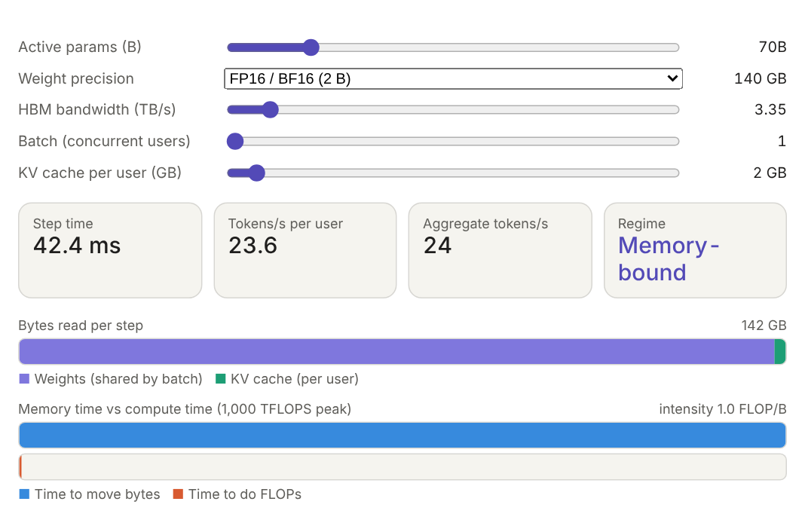

[Open standalone page](assets/04_hbm_decode_bandwidth_calculator.html)

<details><summary>Diagram source</summary>

````html
<h2 class="sr-only">Interactive calculator showing how HBM bandwidth, model size, precision, batch size and KV cache size bound LLM decode throughput.</h2>
<style>
.r{display:flex;align-items:center;gap:12px;font-size:13px;color:var(--text-secondary);margin:8px 0}
.r label{width:170px}.r input,.r select{flex:1}.r output{width:80px;text-align:right;color:var(--text-primary);font-variant-numeric:tabular-nums}
.g{display:grid;grid-template-columns:repeat(auto-fit,minmax(140px,1fr));gap:10px;margin:16px 0}
.c{background:var(--surface-1);border:0.5px solid var(--border);border-radius:12px;padding:10px 12px}
.c .k{font-size:12px;color:var(--text-secondary)}.c .v{font-size:20px;font-weight:500;color:var(--text-primary);font-variant-numeric:tabular-nums}
.bar{display:flex;height:22px;border-radius:6px;overflow:hidden;border:0.5px solid var(--border);background:var(--surface-1)}
.lab{font-size:12px;color:var(--text-secondary);margin:12px 0 4px;display:flex;justify-content:space-between}
</style>
<div style="padding:0.5rem 0">
<div class="r"><label for="p">Active params (B)</label><input id="p" type="range" min="1" max="400" value="70"><output id="po"></output></div>
<div class="r"><label for="b">Weight precision</label><select id="b"><option value="2">FP16 / BF16 (2 B)</option><option value="1">FP8 (1 B)</option><option value="0.5">FP4 (0.5 B)</option></select><output id="bo"></output></div>
<div class="r"><label for="w">HBM bandwidth (TB/s)</label><input id="w" type="range" min="1" max="30" step="0.05" value="3.35"><output id="wo"></output></div>
<div class="r"><label for="n">Batch (concurrent users)</label><input id="n" type="range" min="1" max="512" value="1"><output id="no"></output></div>
<div class="r"><label for="k">KV cache per user (GB)</label><input id="k" type="range" min="0" max="40" step="0.5" value="2"><output id="ko"></output></div>
<div class="g">
<div class="c"><div class="k">Step time</div><div class="v" id="st"></div></div>
<div class="c"><div class="k">Tokens/s per user</div><div class="v" id="tu"></div></div>
<div class="c"><div class="k">Aggregate tokens/s</div><div class="v" id="ta"></div></div>
<div class="c"><div class="k">Regime</div><div class="v" id="rg"></div></div>
</div>
<div class="lab"><span>Bytes read per step</span><span id="bt"></span></div>
<div class="bar"><div id="bw" style="background:#7F77DD"></div><div id="bk" style="background:#1D9E75"></div></div>
<div style="font-size:12px;color:var(--text-secondary);margin-top:4px"><span style="color:#7F77DD">■</span> Weights (shared by batch) &nbsp; <span style="color:#1D9E75">■</span> KV cache (per user)</div>
<div class="lab"><span>Memory time vs compute time (1,000 TFLOPS peak)</span><span id="ai"></span></div>
<div class="bar" style="margin-bottom:4px"><div id="mt" style="background:#378ADD"></div></div>
<div class="bar"><div id="ct" style="background:#D85A30"></div></div>
<div style="font-size:12px;color:var(--text-secondary);margin-top:4px"><span style="color:#378ADD">■</span> Time to move bytes &nbsp; <span style="color:#D85A30">■</span> Time to do FLOPs</div>
</div>
<script>
const $=id=>document.getElementById(id);
const f=(x,d=1)=>x>=1000?(x/1000).toFixed(1)+'k':x.toFixed(d);
function u(){
const P=+$('p').value,B=+$('b').value,W=+$('w').value,N=+$('n').value,K=+$('k').value;
$('po').textContent=P+'B';$('bo').textContent=(P*B).toFixed(0)+' GB';$('wo').textContent=W.toFixed(2);$('no').textContent=N;$('ko').textContent=K+' GB';
const wb=P*1e9*B,kb=N*K*1e9,tot=wb+kb;
const mem=tot/(W*1e12),comp=2*P*1e9*N/1e15,step=Math.max(mem,comp);
$('st').textContent=(step*1000).toFixed(1)+' ms';
$('tu').textContent=f(1/step);
$('ta').textContent=f(N/step,0);
$('rg').textContent=mem>comp?'Memory-bound':'Compute-bound';
$('rg').style.color=mem>comp?'var(--text-accent)':'var(--text-warning)';
$('bt').textContent=(tot/1e9).toFixed(0)+' GB';
$('bw').style.width=(wb/tot*100)+'%';$('bk').style.width=(kb/tot*100)+'%';
const m=Math.max(mem,comp);
$('mt').style.width=(mem/m*100)+'%';$('ct').style.width=(comp/m*100)+'%';
$('ai').textContent='intensity '+(2*P*1e9*N/tot).toFixed(1)+' FLOP/B';
}
['p','b','w','n','k'].forEach(i=>$(i).addEventListener('input',u));u();
</script>
````

</details>

**The core inequality.** For one decode step at batch B:

```
t_mem  = (W + B·KV) / BW_hbm          W  = active params × bytes/param
t_comp = 2 · P_active · B / FLOPS_peak
t_step ≈ max(t_mem, t_comp)
```

Arithmetic intensity is about 2B / bytes-per-param FLOP per byte. An H100-class chip (about 1,000 TFLOPS, 3.35 TB/s) has a ridge point near 300 FLOP/B. At batch 1 with FP16 weights, decode runs at roughly 1 FLOP/B, so the matrix engines sit about 99% idle waiting on memory.

**The ceiling at batch 1.** A 70B FP16 model reads 140 GB per token, and 3.35 / 140 gives about 24 tokens/s. No amount of extra compute changes that number; only fewer bytes or more bandwidth do. (The 140 GB doesn't fit on one 80 GB H100, so read 3.35 TB/s as aggregate bandwidth across the tensor-parallel group. Eight GPUs at 26.8 TB/s give about 190 tokens/s, minus communication overhead.)

**Why batching helps, and then stops helping.**
- Weights are read once per step and shared by every sequence in the batch, so aggregate throughput rises almost linearly with B at first.
- KV cache is per sequence, so its bytes grow linearly with B times context length.
- At long context, KV traffic dominates. Batching then stops amortizing anything: each sequence is effectively streaming its own private model. Set KV to 20 GB and batch to 64 in the calculator to see this.
- Larger batches also cost latency. Per-user tokens/s falls once you cross the ridge point and become compute-bound.

**Levers, grouped by what they attack:**

| Attack | Technique | Effect |
|---|---|---|
| Fewer weight bytes | FP8/FP4 quantization, MoE (only active experts read) | Directly raises tokens/s |
| Fewer KV bytes | GQA/MLA, KV quantization, sliding window, SSM state | Lets batching keep working at long context |
| More FLOPs per byte | Speculative decoding (verify k draft tokens per weight read), larger batch | Moves toward the ridge point |
| More bandwidth | HBM3e/HBM4, more stacks, large on-chip SRAM (Groq, Cerebras) | Raises the ceiling itself |
| Hide the rest | Prefill/decode disaggregation, paged KV | Keeps HBM saturated with useful bytes |

This ties back to the ASIC floorplan: it is surrounded by HBM stacks because decode speed is roughly bandwidth / bytes per token. The die exists to spend that bandwidth, not to provide FLOPs. Speculative decoding is the cleanest algorithmic workaround, since it turns one memory-bound step into several tokens at nearly the same byte cost.

---

<a id="turn-4"></a>
## 4. Explain grouped-query attention and how it reads the KV cache

> **Question:** Explain grouped-query attention and how it reads the KV cache

Grouped-query attention (GQA) keeps many query heads but lets them share a smaller number of key/value heads. That shrinks the KV cache, and the KV cache is what decode has to stream from HBM every step.

**Diagram: `mha_gqa_mqa_head_sharing`** (static SVG diagram)

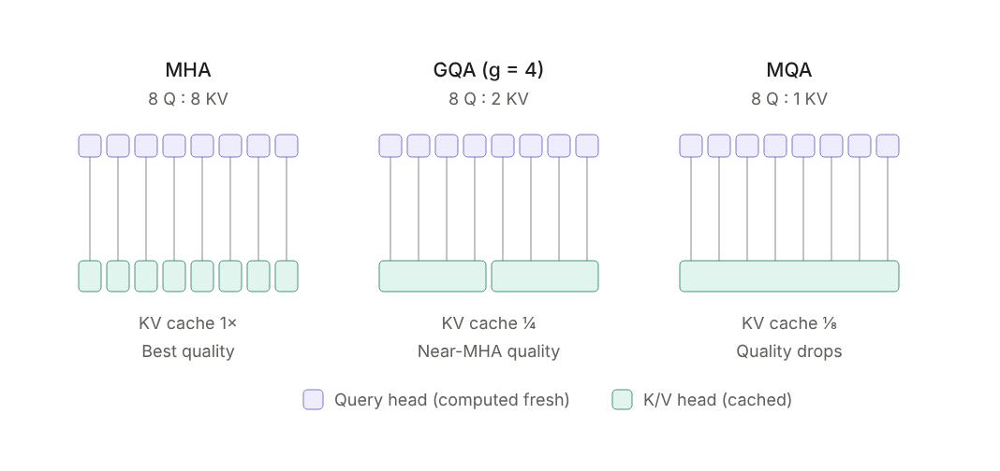

[Open standalone page](assets/05_mha_gqa_mqa_head_sharing.html)

<details><summary>Diagram source</summary>

````svg
<svg width="100%" viewBox="0 0 680 300" role="img"><title>MHA vs GQA vs MQA</title><desc>Eight query heads each map to their own KV head in multi-head attention, to two shared KV heads in grouped-query attention, and to one shared KV head in multi-query attention, reducing KV cache size by 4x and 8x.</desc>
<text class="th" x="118" y="34" text-anchor="middle" dominant-baseline="central">MHA</text>
<text class="ts" x="118" y="54" text-anchor="middle" dominant-baseline="central">8 Q : 8 KV</text>
<text class="th" x="332" y="34" text-anchor="middle" dominant-baseline="central">GQA (g = 4)</text>
<text class="ts" x="332" y="54" text-anchor="middle" dominant-baseline="central">8 Q : 2 KV</text>
<text class="th" x="546" y="34" text-anchor="middle" dominant-baseline="central">MQA</text>
<text class="ts" x="546" y="54" text-anchor="middle" dominant-baseline="central">8 Q : 1 KV</text>
<g stroke="var(--border-stronger)" stroke-width="0.75">
<line x1="48" y1="96" x2="48" y2="170"/><line x1="68" y1="96" x2="68" y2="170"/><line x1="88" y1="96" x2="88" y2="170"/><line x1="108" y1="96" x2="108" y2="170"/><line x1="128" y1="96" x2="128" y2="170"/><line x1="148" y1="96" x2="148" y2="170"/><line x1="168" y1="96" x2="168" y2="170"/><line x1="188" y1="96" x2="188" y2="170"/>
<line x1="262" y1="96" x2="262" y2="170"/><line x1="282" y1="96" x2="282" y2="170"/><line x1="302" y1="96" x2="302" y2="170"/><line x1="322" y1="96" x2="322" y2="170"/><line x1="342" y1="96" x2="342" y2="170"/><line x1="362" y1="96" x2="362" y2="170"/><line x1="382" y1="96" x2="382" y2="170"/><line x1="402" y1="96" x2="402" y2="170"/>
<line x1="476" y1="96" x2="476" y2="170"/><line x1="496" y1="96" x2="496" y2="170"/><line x1="516" y1="96" x2="516" y2="170"/><line x1="536" y1="96" x2="536" y2="170"/><line x1="556" y1="96" x2="556" y2="170"/><line x1="576" y1="96" x2="576" y2="170"/><line x1="596" y1="96" x2="596" y2="170"/><line x1="616" y1="96" x2="616" y2="170"/>
</g>
<g class="c-purple">
<rect x="40" y="80" width="16" height="16" rx="3" stroke-width="0.5"/><rect x="60" y="80" width="16" height="16" rx="3" stroke-width="0.5"/><rect x="80" y="80" width="16" height="16" rx="3" stroke-width="0.5"/><rect x="100" y="80" width="16" height="16" rx="3" stroke-width="0.5"/><rect x="120" y="80" width="16" height="16" rx="3" stroke-width="0.5"/><rect x="140" y="80" width="16" height="16" rx="3" stroke-width="0.5"/><rect x="160" y="80" width="16" height="16" rx="3" stroke-width="0.5"/><rect x="180" y="80" width="16" height="16" rx="3" stroke-width="0.5"/>
<rect x="254" y="80" width="16" height="16" rx="3" stroke-width="0.5"/><rect x="274" y="80" width="16" height="16" rx="3" stroke-width="0.5"/><rect x="294" y="80" width="16" height="16" rx="3" stroke-width="0.5"/><rect x="314" y="80" width="16" height="16" rx="3" stroke-width="0.5"/><rect x="334" y="80" width="16" height="16" rx="3" stroke-width="0.5"/><rect x="354" y="80" width="16" height="16" rx="3" stroke-width="0.5"/><rect x="374" y="80" width="16" height="16" rx="3" stroke-width="0.5"/><rect x="394" y="80" width="16" height="16" rx="3" stroke-width="0.5"/>
<rect x="468" y="80" width="16" height="16" rx="3" stroke-width="0.5"/><rect x="488" y="80" width="16" height="16" rx="3" stroke-width="0.5"/><rect x="508" y="80" width="16" height="16" rx="3" stroke-width="0.5"/><rect x="528" y="80" width="16" height="16" rx="3" stroke-width="0.5"/><rect x="548" y="80" width="16" height="16" rx="3" stroke-width="0.5"/><rect x="568" y="80" width="16" height="16" rx="3" stroke-width="0.5"/><rect x="588" y="80" width="16" height="16" rx="3" stroke-width="0.5"/><rect x="608" y="80" width="16" height="16" rx="3" stroke-width="0.5"/>
</g>
<g class="c-teal">
<rect x="40" y="170" width="16" height="22" rx="3" stroke-width="0.5"/><rect x="60" y="170" width="16" height="22" rx="3" stroke-width="0.5"/><rect x="80" y="170" width="16" height="22" rx="3" stroke-width="0.5"/><rect x="100" y="170" width="16" height="22" rx="3" stroke-width="0.5"/><rect x="120" y="170" width="16" height="22" rx="3" stroke-width="0.5"/><rect x="140" y="170" width="16" height="22" rx="3" stroke-width="0.5"/><rect x="160" y="170" width="16" height="22" rx="3" stroke-width="0.5"/><rect x="180" y="170" width="16" height="22" rx="3" stroke-width="0.5"/>
<rect x="254" y="170" width="76" height="22" rx="3" stroke-width="0.5"/><rect x="334" y="170" width="76" height="22" rx="3" stroke-width="0.5"/>
<rect x="468" y="170" width="156" height="22" rx="3" stroke-width="0.5"/>
</g>
<text class="ts" x="118" y="214" text-anchor="middle" dominant-baseline="central">KV cache 1×</text>
<text class="ts" x="332" y="214" text-anchor="middle" dominant-baseline="central">KV cache ¼</text>
<text class="ts" x="546" y="214" text-anchor="middle" dominant-baseline="central">KV cache ⅛</text>
<text class="ts" x="118" y="234" text-anchor="middle" dominant-baseline="central">Best quality</text>
<text class="ts" x="332" y="234" text-anchor="middle" dominant-baseline="central">Near-MHA quality</text>
<text class="ts" x="546" y="234" text-anchor="middle" dominant-baseline="central">Quality drops</text>
<rect class="c-purple" x="200" y="262" width="14" height="14" rx="3" stroke-width="0.5"/><text class="ts" x="222" y="269" dominant-baseline="central">Query head (computed fresh)</text>
<rect class="c-teal" x="420" y="262" width="14" height="14" rx="3" stroke-width="0.5"/><text class="ts" x="442" y="269" dominant-baseline="central">K/V head (cached)</text>
</svg>
````

</details>

**The asymmetry GQA exploits**

During decode, queries exist only for the current token. They are computed fresh and then thrown away. Keys and values exist for every past token and must stay in HBM.

So the number of query heads Hq costs only FLOPs, while the number of KV heads Hkv costs memory on every step:

```
KV bytes / token / layer = 2 · Hkv · d_head · bytes
group size g = Hq / Hkv     (MHA: g=1,  MQA: g=Hq,  GQA: in between)
```

Llama-3-70B is a real example: Hq = 64 and Hkv = 8, so g = 8. That gives an 8× smaller cache than MHA, which is why the earlier figure was about 320 KB per token rather than about 2.6 MB.

**How a decode kernel reads the cache**

```
cache layout (per layer):  [kv_head][token][d_head]     paged → blocks of 16 tokens

step t, for KV head h  (serves query heads h·g … h·g+g−1):
  1. new token → q[g × d], k[d], v[d];  append k,v at slot t
  2. for each tile of T tokens:
       HBM ──► SRAM :  K[T × d], V[T × d]          ← loaded ONCE
       S = q · Kᵀ          (g × T)                  ← g queries share it
       online softmax (running max m, sum ℓ)
       acc += softmax(S) · V      (g × d)
  3. FlashDecoding: tiles run in parallel, merge partial (m, ℓ, acc)
```

The key effect is in step 2. With MHA, each query head reads its own K and V, which makes the operation a matrix-vector product at about 1 FLOP/byte. With GQA, one K/V tile in SRAM feeds g query rows at once, turning it into a skinny matrix-matrix product:

```
intensity ≈ 2g / bytes_per_elem   FLOP/B     (FP16: MHA ≈ 1,  GQA-8 ≈ 8)
```

GQA therefore helps decode twice: it reads g× fewer bytes, and it does g× more math per byte. Attention is still memory-bound, since about 8 FLOP/B is far below the roughly 300 FLOP/B ridge point. But both the bandwidth wall and the per-user cache footprint drop by g, so batching keeps working at much longer contexts.

**Supporting pieces**

- **Paged attention (vLLM):** the logical token sequence maps to physical cache blocks through a block table, like virtual memory. The kernel gathers tiles through that indirection, which removes fragmentation and lets prompts share prefixes.
- **FlashDecoding (split-K):** at batch 1 there are too few heads to fill the chip, so the sequence dimension is split across compute blocks and the results are reduced at the end.
- **Getting GQA:** you can train with it from scratch, or "uptrain" an MHA checkpoint by mean-pooling KV heads within each group and fine-tuning briefly (Ainslie et al., 2023).

**Beyond GQA**

DeepSeek's MLA goes further. Instead of sharing heads, it caches one low-rank latent vector c per token, around 512 dimensions, and up-projects to per-head K and V on the fly. The up-projection can be absorbed into the query side. The cache gets smaller than GQA's, at the cost of extra compute. That trade suits decode, because there is spare FLOP capacity and no spare bandwidth.

In filtering terms, all of these compress the stored history while still letting each query run exact attention over all past tokens. Each one picks a different compressed basis for the KV cache: shared heads for GQA, and a low-rank latent for MLA.

---

<a id="turn-5"></a>
## 5. Explain the agent loop layer (L7) of an AGI stack in depth

> **Question:** Explain the agent loop layer (L7) of an AGI stack in depth

The agent loop is the layer that turns a next-token predictor into something that pursues goals over time. Formally it is a POMDP controller: the agent never sees the true state of the world, only observations. It keeps a belief, picks actions with a policy, and updates the belief from what comes back. That puts it in the same family as your recursive filters, with one important difference covered under "Why it's hard" below.

**Diagram: `agi_agent_loop_l7`** (static SVG diagram)

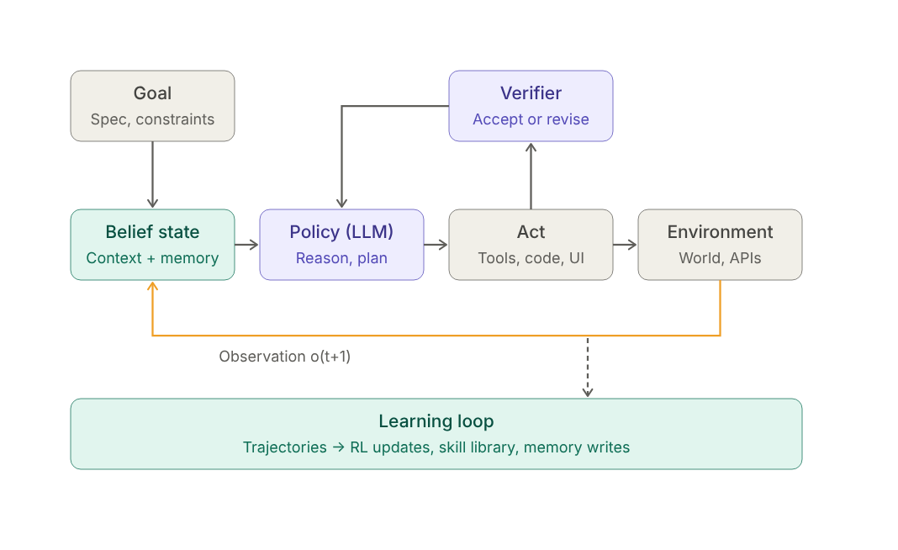

[Open standalone page](assets/06_agi_agent_loop_l7.html)

<details><summary>Diagram source</summary>

````svg
<svg width="100%" viewBox="0 0 680 400" role="img"><title>L7 agent loop</title><desc>Goal feeds the belief state; the LLM policy reasons and plans, proposes an action checked by a verifier, acts on the environment, and the observation returns to update the belief. An outer learning loop improves the policy from trajectories.</desc>
<defs><marker id="arrow" viewBox="0 0 10 10" refX="8" refY="5" markerWidth="6" markerHeight="6" orient="auto-start-reverse"><path d="M2 1L8 5L2 9" fill="none" stroke="context-stroke" stroke-width="1.5" stroke-linecap="round" stroke-linejoin="round"/></marker></defs>
<g class="node c-gray" onclick="sendPrompt('How should goals and constraints be specified for long-horizon agents?')"><rect x="40" y="40" width="130" height="56" rx="8" stroke-width="0.5"/><text class="th" x="105" y="58" text-anchor="middle" dominant-baseline="central">Goal</text><text class="ts" x="105" y="78" text-anchor="middle" dominant-baseline="central">Spec, constraints</text></g>
<g class="node c-purple" onclick="sendPrompt('How do verifiers and critics work in agent loops?')"><rect x="340" y="40" width="130" height="56" rx="8" stroke-width="0.5"/><text class="th" x="405" y="58" text-anchor="middle" dominant-baseline="central">Verifier</text><text class="ts" x="405" y="78" text-anchor="middle" dominant-baseline="central">Accept or revise</text></g>
<line x1="105" y1="96" x2="105" y2="148" class="arr" marker-end="url(#arrow)"/>
<line x1="405" y1="150" x2="405" y2="98" class="arr" marker-end="url(#arrow)"/>
<path d="M340 68 L255 68 L255 148" fill="none" class="arr" marker-end="url(#arrow)"/>
<g class="node c-teal" onclick="sendPrompt('How do agents manage belief state: context compaction, memory, retrieval?')"><rect x="40" y="150" width="130" height="56" rx="8" stroke-width="0.5"/><text class="th" x="105" y="168" text-anchor="middle" dominant-baseline="central">Belief state</text><text class="ts" x="105" y="188" text-anchor="middle" dominant-baseline="central">Context + memory</text></g>
<g class="node c-purple" onclick="sendPrompt('How do LLM agents plan: ReAct, plan-and-execute, tree search?')"><rect x="190" y="150" width="130" height="56" rx="8" stroke-width="0.5"/><text class="th" x="255" y="168" text-anchor="middle" dominant-baseline="central">Policy (LLM)</text><text class="ts" x="255" y="188" text-anchor="middle" dominant-baseline="central">Reason, plan</text></g>
<g class="node c-gray" onclick="sendPrompt('What action spaces do agents use: tools, code execution, computer use, sub-agents?')"><rect x="340" y="150" width="130" height="56" rx="8" stroke-width="0.5"/><text class="th" x="405" y="168" text-anchor="middle" dominant-baseline="central">Act</text><text class="ts" x="405" y="188" text-anchor="middle" dominant-baseline="central">Tools, code, UI</text></g>
<g class="node c-gray" onclick="sendPrompt('How do agent environments and observations work?')"><rect x="490" y="150" width="130" height="56" rx="8" stroke-width="0.5"/><text class="th" x="555" y="168" text-anchor="middle" dominant-baseline="central">Environment</text><text class="ts" x="555" y="188" text-anchor="middle" dominant-baseline="central">World, APIs</text></g>
<line x1="170" y1="178" x2="188" y2="178" class="arr" marker-end="url(#arrow)"/>
<line x1="320" y1="178" x2="338" y2="178" class="arr" marker-end="url(#arrow)"/>
<line x1="470" y1="178" x2="488" y2="178" class="arr" marker-end="url(#arrow)"/>
<path d="M555 206 L555 250 L105 250 L105 208" fill="none" class="arr" stroke="#EF9F27" marker-end="url(#arrow)"/>
<text class="ts" x="210" y="266" text-anchor="middle" dominant-baseline="central">Observation o(t+1)</text>
<line x1="450" y1="252" x2="450" y2="298" class="arr" stroke-dasharray="4 3" marker-end="url(#arrow)"/>
<g class="node c-teal" onclick="sendPrompt('How does RL on agent trajectories improve the policy?')"><rect x="40" y="300" width="580" height="56" rx="8" stroke-width="0.5"/><text class="th" x="330" y="318" text-anchor="middle" dominant-baseline="central">Learning loop</text><text class="ts" x="330" y="338" text-anchor="middle" dominant-baseline="central">Trajectories → RL updates, skill library, memory writes</text></g>
</svg>
````

</details>

**The loop in code (ReAct-style, with control):**

```
b ← init(goal, memory.retrieve(goal))          # prior belief
while not done(b):
    plan ← π_think(b)                           # reasoning tokens (L5 decode)
    a    ← π_act(b, plan)                       # tool call / code / message
    if not verifier.accept(b, a):               # pre-action check
        b ← b ⊕ critique;  continue
    o    ← env.step(a)                          # result, error, or nothing
    b    ← update(b, a, o)                      # append → compact → write memory
    if over_budget(b) or stuck(b): replan() or escalate_to_human()
memory.consolidate(trajectory)                  # feeds the learning loop
```

**The seven subsystems**

| Subsystem | Job | Current techniques |
|---|---|---|
| Planning | Decompose the goal into subgoals and order them | Plan-and-execute, hierarchical subgoals, tree search (ToT, MCTS over thoughts) |
| Acting | Touch the world | Function calls, code execution, computer/browser use, spawning sub-agents |
| Observing | Turn results into usable evidence | Structured tool outputs, error messages, screenshots |
| Belief management | Keep the right things in context | Compaction/summarization, retrieval, scratchpad files, KV prefix reuse |
| Verification | Catch errors before they compound | Unit tests, self-consistency, critic models, formal checks, human approval gates |
| Control | Decide when to stop, retry, replan, or ask | Step and token budgets, stuck detection, escalation policies |
| Learning | Improve across episodes | RL on outcome rewards, skill and procedure libraries, episodic memory |

**Why it's hard: compounding error.** If each step succeeds with probability p, an n-step task succeeds with p^n. At 99% per step, a 100-step task succeeds only about 37% of the time. Two consequences follow:

- Detecting and recovering from errors matters more than raw per-step accuracy. A loop that notices a failure and backtracks converts the p^n decay into something closer to a sum of recoverable local errors.
- This is why verifiers and environments with checkable feedback (code, math, tests) are where agents work best today.

**The filtering lens.** Your background makes this the sharpest way to see the current weakness. A Kalman or particle filter carries uncertainty along with its estimate, using a covariance or a particle spread. An LLM agent's belief is just a context window: a point estimate with no covariance.

- **Filter divergence.** The agent becomes confidently wrong. It trusts a stale observation or its own earlier hallucination and never "inflates the covariance" to go re-check.
- **Lossy belief update.** Compaction drops information without tracking what was lost. It resembles reduced-order modeling with no error estimate on the truncation.
- **No predictive model.** Most agents are reactive: they act, then look. An agent with a model-based policy would simulate outcomes before acting, playing the role of the predict step.

**Timescales: the nested loops map onto the stack**

```
token loop      ~ms     L5 decode            reasoning tokens
action loop     ~s      L7 inner loop        tool call → observation
task loop       min–hrs L7 + L6 memory       plan, subgoals, replanning
learning loop   days    training (RL)        policy improves from trajectories
```

**What separates current agents from an AGI-grade L7.** These are the open problems, not solved features:

1. **Calibrated uncertainty.** The agent knows when it doesn't know, and acts to gather information instead of guessing. This is the covariance it is missing.
2. **A world model for lookahead.** Plan by simulation rather than trial-and-error in the real environment.
3. **Memory consolidation.** Turn experience into durable, retrievable skills without the context window as a bottleneck.
4. **Reliable self-verification** outside domains with ground-truth checkers, such as research, design, and open-ended judgment.
5. **Oversight that scales.** Humans can approve and audit long autonomous runs without reviewing every step.

**Down-stack consequences**

- Agent loops consist of many short, sequential calls that share long prefixes. That makes them latency-bound (decode speed is HBM-bound, as covered above) and heavy on prefix and KV cache reuse across steps.
- To cut wall-clock time, agents parallelize: sub-agents running concurrently, and speculative tool execution. That raises batch size and is exactly what moves decode back toward the compute roofline.

So the hardware story and the agent story meet at the same constraint: tokens per second per dollar under a memory-bandwidth ceiling.

---

<a id="turn-6"></a>
## 6. How do LLM agents plan: ReAct, plan-and-execute, tree search?

> **Question:** How do LLM agents plan: ReAct, plan-and-execute, tree search?

These are three ways of trading planning cost against adaptivity, and they differ mainly in how far ahead the agent commits before looking at the world.

**Diagram: `agent_planning_react_plan_execute_tree`** (static SVG diagram)

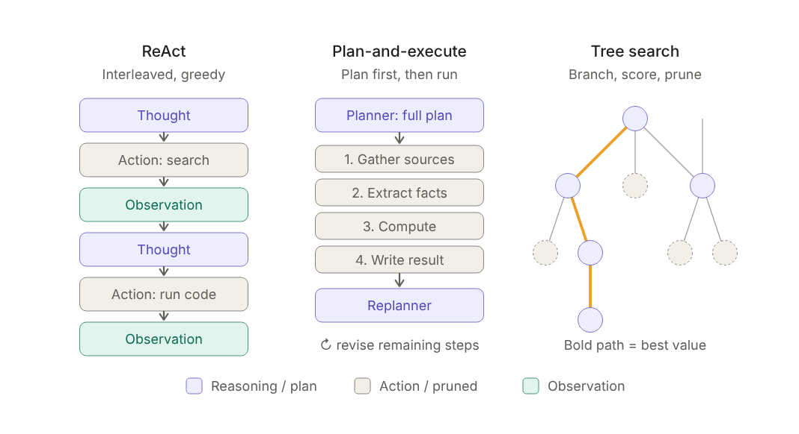

[Open standalone page](assets/07_agent_planning_react_plan_execute_tree.html)

<details><summary>Diagram source</summary>

````svg
<svg width="100%" viewBox="0 0 680 352" role="img"><title>Three agent planning paradigms</title><desc>ReAct interleaves thought, action and observation one step at a time. Plan-and-execute writes a full step list first, runs it, and replans on failure. Tree search branches over candidate thoughts or actions, scores them, prunes weak branches and follows the best path.</desc>
<defs><marker id="arrow" viewBox="0 0 10 10" refX="8" refY="5" markerWidth="6" markerHeight="6" orient="auto-start-reverse"><path d="M2 1L8 5L2 9" fill="none" stroke="context-stroke" stroke-width="1.5" stroke-linecap="round" stroke-linejoin="round"/></marker></defs>
<text class="th" x="130" y="30" text-anchor="middle" dominant-baseline="central">ReAct</text>
<text class="ts" x="130" y="50" text-anchor="middle" dominant-baseline="central">Interleaved, greedy</text>
<text class="th" x="340" y="30" text-anchor="middle" dominant-baseline="central">Plan-and-execute</text>
<text class="ts" x="340" y="50" text-anchor="middle" dominant-baseline="central">Plan first, then run</text>
<text class="th" x="550" y="30" text-anchor="middle" dominant-baseline="central">Tree search</text>
<text class="ts" x="550" y="50" text-anchor="middle" dominant-baseline="central">Branch, score, prune</text>
<g class="c-purple"><rect x="55" y="72" width="150" height="30" rx="6" stroke-width="0.5"/><text class="ts" x="130" y="87" text-anchor="middle" dominant-baseline="central">Thought</text></g>
<line x1="130" y1="102" x2="130" y2="110" class="arr" marker-end="url(#arrow)"/>
<g class="c-gray"><rect x="55" y="112" width="150" height="30" rx="6" stroke-width="0.5"/><text class="ts" x="130" y="127" text-anchor="middle" dominant-baseline="central">Action: search</text></g>
<line x1="130" y1="142" x2="130" y2="150" class="arr" marker-end="url(#arrow)"/>
<g class="c-teal"><rect x="55" y="152" width="150" height="30" rx="6" stroke-width="0.5"/><text class="ts" x="130" y="167" text-anchor="middle" dominant-baseline="central">Observation</text></g>
<line x1="130" y1="182" x2="130" y2="190" class="arr" marker-end="url(#arrow)"/>
<g class="c-purple"><rect x="55" y="192" width="150" height="30" rx="6" stroke-width="0.5"/><text class="ts" x="130" y="207" text-anchor="middle" dominant-baseline="central">Thought</text></g>
<line x1="130" y1="222" x2="130" y2="230" class="arr" marker-end="url(#arrow)"/>
<g class="c-gray"><rect x="55" y="232" width="150" height="30" rx="6" stroke-width="0.5"/><text class="ts" x="130" y="247" text-anchor="middle" dominant-baseline="central">Action: run code</text></g>
<line x1="130" y1="262" x2="130" y2="270" class="arr" marker-end="url(#arrow)"/>
<g class="c-teal"><rect x="55" y="272" width="150" height="30" rx="6" stroke-width="0.5"/><text class="ts" x="130" y="287" text-anchor="middle" dominant-baseline="central">Observation</text></g>
<g class="c-purple"><rect x="265" y="72" width="150" height="30" rx="6" stroke-width="0.5"/><text class="ts" x="340" y="87" text-anchor="middle" dominant-baseline="central">Planner: full plan</text></g>
<line x1="340" y1="102" x2="340" y2="112" class="arr" marker-end="url(#arrow)"/>
<g class="c-gray"><rect x="265" y="114" width="150" height="24" rx="6" stroke-width="0.5"/><text class="ts" x="340" y="126" text-anchor="middle" dominant-baseline="central">1. Gather sources</text></g>
<g class="c-gray"><rect x="265" y="144" width="150" height="24" rx="6" stroke-width="0.5"/><text class="ts" x="340" y="156" text-anchor="middle" dominant-baseline="central">2. Extract facts</text></g>
<g class="c-gray"><rect x="265" y="174" width="150" height="24" rx="6" stroke-width="0.5"/><text class="ts" x="340" y="186" text-anchor="middle" dominant-baseline="central">3. Compute</text></g>
<g class="c-gray"><rect x="265" y="204" width="150" height="24" rx="6" stroke-width="0.5"/><text class="ts" x="340" y="216" text-anchor="middle" dominant-baseline="central">4. Write result</text></g>
<line x1="340" y1="228" x2="340" y2="240" class="arr" marker-end="url(#arrow)"/>
<g class="c-purple"><rect x="265" y="242" width="150" height="30" rx="6" stroke-width="0.5"/><text class="ts" x="340" y="257" text-anchor="middle" dominant-baseline="central">Replanner</text></g>
<text class="ts" x="340" y="292" text-anchor="middle" dominant-baseline="central">↻ revise remaining steps</text>
<g stroke="var(--border-stronger)" stroke-width="0.75">
<line x1="550" y1="90" x2="550" y2="150"/>
<line x1="610" y1="90" x2="610" y2="150"/>
<line x1="610" y1="150" x2="590" y2="210"/>
<line x1="610" y1="150" x2="630" y2="210"/>
<line x1="490" y1="150" x2="470" y2="210"/>
</g>
<path d="M550 90 L610 150" fill="none" stroke="var(--border-stronger)" stroke-width="0.75"/>
<path d="M550 90 L490 150 L510 210 L510 270" fill="none" stroke="#EF9F27" stroke-width="2.5" stroke-linecap="round"/>
<circle class="c-purple" cx="550" cy="90" r="11" stroke-width="0.5"/>
<circle class="c-purple" cx="490" cy="150" r="11" stroke-width="0.5"/>
<circle class="c-gray" cx="550" cy="150" r="11" stroke-width="0.5" stroke-dasharray="2 2"/>
<circle class="c-purple" cx="610" cy="150" r="11" stroke-width="0.5"/>
<circle class="c-gray" cx="470" cy="210" r="11" stroke-width="0.5" stroke-dasharray="2 2"/>
<circle class="c-purple" cx="510" cy="210" r="11" stroke-width="0.5"/>
<circle class="c-gray" cx="590" cy="210" r="11" stroke-width="0.5" stroke-dasharray="2 2"/>
<circle class="c-gray" cx="630" cy="210" r="11" stroke-width="0.5" stroke-dasharray="2 2"/>
<circle class="c-purple" cx="510" cy="270" r="11" stroke-width="0.5"/>
<text class="ts" x="550" y="292" text-anchor="middle" dominant-baseline="central">Bold path = best value</text>
<rect class="c-purple" x="150" y="322" width="14" height="14" rx="3" stroke-width="0.5"/><text class="ts" x="172" y="329" dominant-baseline="central">Reasoning / plan</text>
<rect class="c-gray" x="300" y="322" width="14" height="14" rx="3" stroke-width="0.5"/><text class="ts" x="322" y="329" dominant-baseline="central">Action / pruned</text>
<rect class="c-teal" x="450" y="322" width="14" height="14" rx="3" stroke-width="0.5"/><text class="ts" x="472" y="329" dominant-baseline="central">Observation</text>
</svg>
````

</details>

**The control-theory map.** These three are familiar controllers:

| Paradigm | Control analogue | Lookahead | Adapts to surprises | Cost |
|---|---|---|---|---|
| ReAct | Greedy closed-loop feedback | 1 step | Every step | Low per step, many LLM calls |
| Plan-and-execute | MPC: plan horizon H, execute, replan | Whole task | At replan points | Cheap execution, one expensive plan |
| Tree search | Lookahead search with a value function (MCTS) | k branches × depth d | Via backtracking | Exponential; needs a good scorer |

---

**1. ReAct** (Yao et al., 2022)

```
loop:
  thought ← LLM(context)          # "I need the 2024 figure; search for it"
  action  ← LLM(context, thought) # search("...")
  obs     ← env(action)
  context += thought, action, obs
```

- **Strength:** grounded at every step. Each thought conditions on real observations, so hallucinated facts get corrected quickly.
- **Failure modes:** myopia (no global plan, so it wanders or loops), context bloat (the full history accumulates), and no backtracking (a bad early choice persists).
- **Status:** the default inner loop of nearly every production agent, including coding agents, browsing agents, and this conversation's tool use.

**2. Plan-and-execute** (Plan-and-Solve, ReWOO, LLMCompiler)

```
plan ← Planner(goal)                         # [s1, s2, s3, s4]  or a DAG
for step in plan:
    result[step] ← Executor(step, deps)      # small model or plain tool call
    if failed(result): plan ← Replanner(goal, plan, results)
return Solver(goal, results)
```

- **Strength:** global structure up front. Steps can be run by a cheaper executor. ReWOO avoids feeding every observation back into the big model. LLMCompiler runs independent steps of a DAG in parallel, which raises batch size and helps the HBM-bound decode issue from earlier.
- **Failure mode:** open-loop brittleness. The plan is written before the world is seen, so step 3 may rest on a wrong assumption about step 1's output. Replanning frequency is the dial: replan after every step and you're back to ReAct; never replan and it's fully open-loop.
- **Status:** visible as todo lists and task decomposition in long-running agents, usually with ReAct running inside each step.

**3. Tree search** (Tree of Thoughts, RAP, LATS)

```
frontier ← {root}
repeat budget:
    node     ← select(frontier)              # UCB / best-first / beam
    children ← LLM.propose(node, k)          # k candidate thoughts or actions
    for c in children:
        c.value ← evaluate(c)                # LLM judge, verifier, or rollout
    backpropagate values; prune low-value branches
return best path
```

- **Strength:** the only one of the three that can explore alternatives and back out of a dead end. That directly attacks the p^n compounding-error problem.
- **Requirements:**
  - A cheap, accurate value function. LLM self-evaluation is noisy; real verifiers (unit tests, proof checkers, game rules) work much better.
  - Reversible actions, or a simulator. You can't branch on "send email" or "delete database" in the real world.
- **Variants:**
  - Tree of Thoughts searches over reasoning steps.
  - RAP uses the LLM itself as a world model and runs MCTS.
  - LATS combines MCTS with ReAct-style environment feedback and reflection.
- **Status:** strong in math, code, and games; rarely used raw in open-world agents because of cost and irreversibility.

---

**What changed recently: search moved inside the model.** Reasoning models trained with RL on verifiable rewards now perform much of this branching implicitly in their thinking tokens: proposing an approach, checking it, abandoning it, trying another. One long chain of thought amounts to a linearized tree search, with the model's own judgment as the value function. As a result, explicit external tree search matters less than it did in 2023, and the practical stack has converged on a hybrid:

```
Plan-and-execute   (outer: task list, subgoals, sub-agents in parallel)
   └── ReAct       (inner: think → tool → observe per subgoal)
         └── implicit search in reasoning tokens (per decision)
   + Reflexion-style memory of failures across attempts
   + explicit search only where a verifier exists (tests, proofs)
```

**Which to use when**

- **Uncertain environment, cheap actions:** ReAct.
- **Long, decomposable task with predictable steps:** plan-and-execute, with ReAct inside each step.
- **Hard reasoning, a reliable scorer, and reversible moves:** tree search, or a reasoning model with a large thinking budget.

**The gap still open.** None of the three has what MPC actually depends on: a trustworthy dynamics model for predicting consequences before acting. Today's agents mostly predict through the LLM's priors, then learn the truth from the environment. Learned world models that support real lookahead, with uncertainty attached, are the piece that would let the "plan" in plan-and-execute become more than an educated guess.

---

<a id="turn-7"></a>
## 7. How do agents manage belief state: context compaction, memory, retrieval?

> **Question:** How do agents manage belief state: context compaction, memory, retrieval?

An agent's belief state is whatever is in its context window right now. Anything else it "knows" exists only if it gets written somewhere and retrieved back in at the right moment. Belief management is the policy that decides what stays in context, what gets compressed, what goes to storage, and what comes back.

**Diagram: `agent_belief_state_memory_hierarchy`** (static SVG diagram)

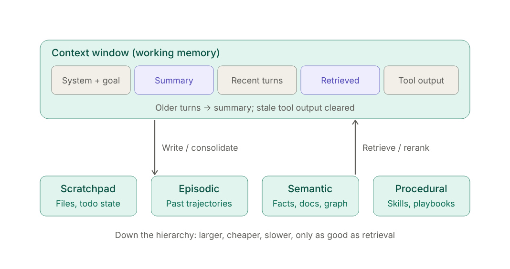

[Open standalone page](assets/08_agent_belief_state_memory_hierarchy.html)

<details><summary>Diagram source</summary>

````svg
<svg width="100%" viewBox="0 0 680 340" role="img"><title>Agent belief state and memory hierarchy</title><desc>The context window holds system and goal, a compacted summary, recent turns, retrieved items and tool output. Write and consolidate flows down into scratchpad, episodic, semantic and procedural memory stores; retrieve and rerank flows back up into the context.</desc>
<defs><marker id="arrow" viewBox="0 0 10 10" refX="8" refY="5" markerWidth="6" markerHeight="6" orient="auto-start-reverse"><path d="M2 1L8 5L2 9" fill="none" stroke="context-stroke" stroke-width="1.5" stroke-linecap="round" stroke-linejoin="round"/></marker></defs>
<g class="c-teal"><rect x="40" y="40" width="600" height="110" rx="12" stroke-width="0.5"/><text class="th" x="56" y="58" dominant-baseline="central">Context window (working memory)</text></g>
<g class="c-gray"><rect x="56" y="76" width="110" height="40" rx="6" stroke-width="0.5"/><text class="ts" x="111" y="96" text-anchor="middle" dominant-baseline="central">System + goal</text></g>
<g class="node c-purple" onclick="sendPrompt('How does context compaction and rolling summarization work in agents?')"><rect x="172" y="76" width="110" height="40" rx="6" stroke-width="0.5"/><text class="ts" x="227" y="96" text-anchor="middle" dominant-baseline="central">Summary</text></g>
<g class="c-gray"><rect x="288" y="76" width="110" height="40" rx="6" stroke-width="0.5"/><text class="ts" x="343" y="96" text-anchor="middle" dominant-baseline="central">Recent turns</text></g>
<g class="node c-purple" onclick="sendPrompt('How does agentic retrieval decide what to inject into context?')"><rect x="404" y="76" width="110" height="40" rx="6" stroke-width="0.5"/><text class="ts" x="459" y="96" text-anchor="middle" dominant-baseline="central">Retrieved</text></g>
<g class="c-gray"><rect x="520" y="76" width="104" height="40" rx="6" stroke-width="0.5"/><text class="ts" x="572" y="96" text-anchor="middle" dominant-baseline="central">Tool output</text></g>
<text class="ts" x="340" y="134" text-anchor="middle" dominant-baseline="central">Older turns → summary; stale tool output cleared</text>
<line x1="200" y1="152" x2="200" y2="228" class="arr" marker-end="url(#arrow)"/>
<text class="ts" x="210" y="190" dominant-baseline="central">Write / consolidate</text>
<line x1="480" y1="228" x2="480" y2="152" class="arr" marker-end="url(#arrow)"/>
<text class="ts" x="490" y="190" dominant-baseline="central">Retrieve / rerank</text>
<g class="node c-teal" onclick="sendPrompt('How do agents use scratchpad files and todo state as memory?')"><rect x="40" y="230" width="135" height="56" rx="8" stroke-width="0.5"/><text class="th" x="107" y="248" text-anchor="middle" dominant-baseline="central">Scratchpad</text><text class="ts" x="107" y="268" text-anchor="middle" dominant-baseline="central">Files, todo state</text></g>
<g class="node c-teal" onclick="sendPrompt('How does episodic memory of past trajectories work for agents?')"><rect x="195" y="230" width="135" height="56" rx="8" stroke-width="0.5"/><text class="th" x="262" y="248" text-anchor="middle" dominant-baseline="central">Episodic</text><text class="ts" x="262" y="268" text-anchor="middle" dominant-baseline="central">Past trajectories</text></g>
<g class="node c-teal" onclick="sendPrompt('How is semantic memory stored: vector stores, knowledge graphs, hybrid search?')"><rect x="350" y="230" width="135" height="56" rx="8" stroke-width="0.5"/><text class="th" x="417" y="248" text-anchor="middle" dominant-baseline="central">Semantic</text><text class="ts" x="417" y="268" text-anchor="middle" dominant-baseline="central">Facts, docs, graph</text></g>
<g class="node c-teal" onclick="sendPrompt('How do agents build procedural memory and skill libraries?')"><rect x="505" y="230" width="135" height="56" rx="8" stroke-width="0.5"/><text class="th" x="572" y="248" text-anchor="middle" dominant-baseline="central">Procedural</text><text class="ts" x="572" y="268" text-anchor="middle" dominant-baseline="central">Skills, playbooks</text></g>
<text class="ts" x="340" y="312" text-anchor="middle" dominant-baseline="central">Down the hierarchy: larger, cheaper, slower, only as good as retrieval</text>
</svg>
````

</details>

**Why the context can't just grow**

- **Cost:** every token in context sits in the KV cache and is re-read on every decode step. That is the HBM wall from earlier, paid on every action the agent takes.
- **Quality:** recall degrades as context fills. Models attend less reliably to the middle of long contexts ("lost in the middle"), and irrelevant tokens dilute the relevant ones.

So the goal is the smallest context that is still sufficient for the next decision. Long context windows help, but they don't remove the need for this.

---

**1. Context compaction: shrink working memory in place**

| Technique | What it does | Loses |
|---|---|---|
| Tool-output clearing | Drop raw results once they've been used, and keep a one-line note | Detail you might need again (keep a pointer) |
| Rolling summarization | At a token threshold, replace old turns with a summary | Exact numbers, paths, and nuance, which drift each time the summary is rewritten |
| Structured state | Keep invariants verbatim: goal, decisions, constraints, open items, file paths | Little, if the schema is right |
| Sub-agent isolation | A child agent spends its own context on a subtask and returns only the result | The child's reasoning trace |
| KV-level eviction | Drop low-attention tokens, keep attention sinks and recent tokens (StreamingLLM, H2O) | Can't be inspected; can drop something that later matters |

Rule of thumb: summarize narrative, but never summarize identifiers. Things like IDs, numbers, paths, and user constraints get copied verbatim or stored with a pointer.

**2. Memory: what lives outside the window**

| Store | Holds | Written when | Read via |
|---|---|---|---|
| Scratchpad | Plan, todo list, notes, intermediate files | Continuously during the task | Direct file read |
| Episodic | What happened: trajectories, outcomes, failures (Reflexion) | End of episode or on failure | Similarity to the current situation |
| Semantic | Facts about the world or the user, documents | Extracted from interactions or ingested | Search: vector + keyword + graph |
| Procedural | How to do things: skills, scripts, playbooks | When a procedure succeeds repeatedly | Matched by task type |

The write policy is the hard part. It has to answer four questions:
- What is worth keeping? Most turns are not.
- How do you deduplicate it and merge it with what already exists?
- How do you handle contradictions, where a newer fact should supersede an older one?
- How do you attach provenance and timestamps so stale or untrusted entries can be discounted later?

Bad writes are worse than no writes, because they come back later as confident false context.

**3. Retrieval: bringing the right thing back**

- **Hybrid search.** Dense embeddings catch meaning; BM25 catches exact terms like names and error codes. A cross-encoder reranker then reorders the merged results.
- **Scoring beyond similarity.** The Generative Agents paper uses `score = α·recency + β·importance + γ·relevance`.
- **Just-in-time over pre-loaded.** Coding agents increasingly skip a pre-built vector index. They search the live source with grep, file reads, and listings at the moment of need, because an index goes stale while the source stays current.
- **Agentic retrieval.** The agent itself decides whether to retrieve, rewrites the query, and runs multi-hop lookups, instead of being handed a fixed top-k.
- **Pointers, not payloads.** Keep a reference such as `results saved to analysis.csv` in context, and load the content only when needed.

---

**The filtering view**

| Filter concept | Agent equivalent |
|---|---|
| Belief b_t | Context window contents |
| Exact Bayes update (intractable) | Appending everything forever |
| Projection onto a tractable family (ADF, moment matching, reduced-order model) | Compaction or summarization |
| Sufficient statistic | What a good summary tries to be |
| Re-observing past measurements / smoothing | Retrieval from episodic or semantic memory |
| Outlier rejection | Mostly missing; this is why memory poisoning works |
| Covariance | Missing; provenance, timestamps, and confidence tags are crude proxies |

The core weakness has the same shape as the one in the agent loop. Compaction is a lossy projection with no error estimate. A reduced-order model at least has a truncation-error bound. A summary has no such bound, so the agent cannot know what it has forgotten, and it treats summarized beliefs as certain.

**Failure modes to design against**

- **Summary drift.** Repeated re-summarization works like the telephone game.
- **Silent detail loss.** A summary might say "the user wanted a specific format" without stating which format.
- **Retrieval miss.** The right memory exists, but the query never finds it.
- **Stale memory.** An old fact outranks a newer correction.
- **Persistent injection.** Malicious text gets written into memory and is re-injected in every future session.
- **Over-retrieval.** Retrieved items crowd out the reasoning they were supposed to support.

**Design rules**

1. Keep invariants verbatim and narrative compressed.
2. Store pointers in context and payloads outside it.
3. Retrieve just-in-time, from the freshest source available.
4. Write rarely, with provenance and timestamps, and supersede rather than append.
5. Isolate exploratory work in sub-agents.
6. Evaluate compaction by downstream task success, not by how good the summary reads.

**Where it points**

The AGI-grade version of this layer would track uncertainty per belief, consolidate experience into weights or skills rather than only into text, and know what it no longer remembers. That is memory as a calibrated filter, not as a growing log. Down-stack, it is also the motivation for recurrent and state-space hybrid architectures: a fixed-size learned state is compaction done in the model's weights instead of in prose.

---

<a id="turn-8"></a>
## 8. How do agent environments and observations work?

> **Question:** How do agent environments and observations work?

The environment is everything outside the agent's weights and context. The agent can't see it directly: it acts, and what comes back is an observation. Most of an agent's real-world reliability is decided in that return channel, more than in the model itself.

**Diagram: `agent_environment_observation_channel`** (static SVG diagram)

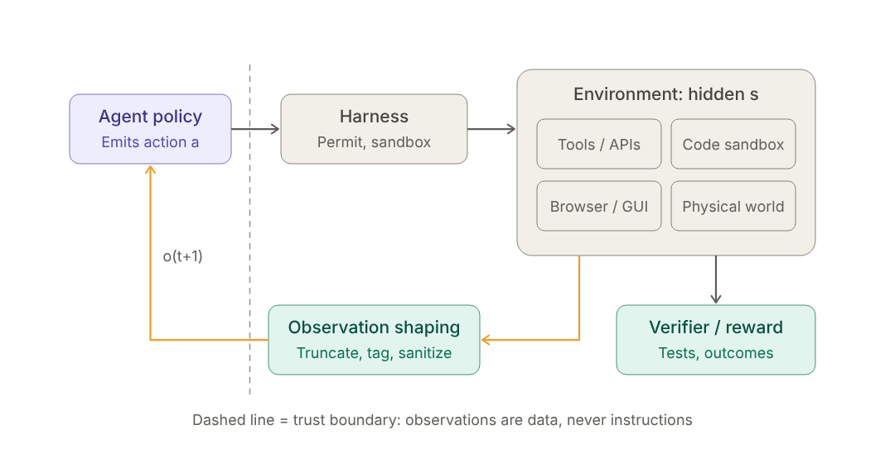

[Open standalone page](assets/09_agent_environment_observation_channel.html)

<details><summary>Diagram source</summary>

````svg
<svg width="100%" viewBox="0 0 680 345" role="img"><title>Agent environment and observation channel</title><desc>The agent emits an action through a harness that routes, permits and sandboxes it into an environment with hidden state, such as tools, code sandboxes, browsers or the physical world. Raw results pass through observation shaping back into the agent's context, and a verifier produces reward. A trust boundary separates the agent from everything it observes.</desc>
<defs><marker id="arrow" viewBox="0 0 10 10" refX="8" refY="5" markerWidth="6" markerHeight="6" orient="auto-start-reverse"><path d="M2 1L8 5L2 9" fill="none" stroke="context-stroke" stroke-width="1.5" stroke-linecap="round" stroke-linejoin="round"/></marker></defs>
<line x1="185" y1="36" x2="185" y2="304" stroke="var(--border-stronger)" stroke-width="1" stroke-dasharray="5 4"/>
<g class="node c-purple" onclick="sendPrompt('How should an agent choose information-gathering actions before irreversible ones?')"><rect x="40" y="60" width="130" height="56" rx="8" stroke-width="0.5"/><text class="th" x="105" y="78" text-anchor="middle" dominant-baseline="central">Agent policy</text><text class="ts" x="105" y="98" text-anchor="middle" dominant-baseline="central">Emits action a</text></g>
<g class="node c-gray" onclick="sendPrompt('How do agent harnesses handle permissions, sandboxing and tool routing?')"><rect x="210" y="60" width="150" height="56" rx="8" stroke-width="0.5"/><text class="th" x="285" y="78" text-anchor="middle" dominant-baseline="central">Harness</text><text class="ts" x="285" y="98" text-anchor="middle" dominant-baseline="central">Permit, sandbox</text></g>
<line x1="170" y1="88" x2="208" y2="88" class="arr" marker-end="url(#arrow)"/>
<line x1="360" y1="88" x2="398" y2="88" class="arr" marker-end="url(#arrow)"/>
<g class="c-gray"><rect x="400" y="40" width="240" height="150" rx="12" stroke-width="0.5"/><text class="th" x="520" y="60" text-anchor="middle" dominant-baseline="central">Environment: hidden s</text></g>
<g class="node c-gray" onclick="sendPrompt('How do tool and API environments work for agents?')"><rect x="416" y="80" width="100" height="40" rx="6" stroke-width="0.5"/><text class="ts" x="466" y="100" text-anchor="middle" dominant-baseline="central">Tools / APIs</text></g>
<g class="node c-gray" onclick="sendPrompt('How do code sandbox environments work for agents?')"><rect x="524" y="80" width="100" height="40" rx="6" stroke-width="0.5"/><text class="ts" x="574" y="100" text-anchor="middle" dominant-baseline="central">Code sandbox</text></g>
<g class="node c-gray" onclick="sendPrompt('Screenshots vs accessibility tree: how do browser and GUI agents observe?')"><rect x="416" y="130" width="100" height="40" rx="6" stroke-width="0.5"/><text class="ts" x="466" y="150" text-anchor="middle" dominant-baseline="central">Browser / GUI</text></g>
<g class="node c-gray" onclick="sendPrompt('How do physical AI agents handle real-world environments and sensor observations?')"><rect x="524" y="130" width="100" height="40" rx="6" stroke-width="0.5"/><text class="ts" x="574" y="150" text-anchor="middle" dominant-baseline="central">Physical world</text></g>
<path d="M450 190 L450 258 L372 258" fill="none" class="arr" stroke="#EF9F27" marker-end="url(#arrow)"/>
<line x1="560" y1="190" x2="560" y2="228" class="arr" marker-end="url(#arrow)"/>
<g class="node c-teal" onclick="sendPrompt('How should tool outputs be shaped into good observations for agents?')"><rect x="200" y="230" width="170" height="56" rx="8" stroke-width="0.5"/><text class="th" x="285" y="248" text-anchor="middle" dominant-baseline="central">Observation shaping</text><text class="ts" x="285" y="268" text-anchor="middle" dominant-baseline="central">Truncate, tag, sanitize</text></g>
<g class="node c-teal" onclick="sendPrompt('How are verifiers and reward signals built for agent RL environments?')"><rect x="480" y="230" width="160" height="56" rx="8" stroke-width="0.5"/><text class="th" x="560" y="248" text-anchor="middle" dominant-baseline="central">Verifier / reward</text><text class="ts" x="560" y="268" text-anchor="middle" dominant-baseline="central">Tests, outcomes</text></g>
<path d="M200 258 L105 258 L105 118" fill="none" class="arr" stroke="#EF9F27" marker-end="url(#arrow)"/>
<text class="ts" x="115" y="190" dominant-baseline="central">o(t+1)</text>
<text class="ts" x="340" y="322" text-anchor="middle" dominant-baseline="central">Dashed line = trust boundary: observations are data, never instructions</text>
</svg>
````

</details>

**Formal frame.** An environment is a tuple (S, A, T, O, R). The agent only ever receives o. It never sees s.

```
s'  ~ T(s' | s, a)      dynamics      what the action actually did
o   ~ O(o | s', a)      sensor model  what the agent gets to see
r   =  R(s, a, s')      reward        often sparse, often only at the end
```

This is your perception setting, with tools in place of the LiDAR. O is the sensor model: field of view, resolution, noise, latency. Most agent failures come from a bad sensor model, not from a bad policy.

**Environment types**

| Env | Hidden state | Observation | Reversible? | Main difficulty |
|---|---|---|---|---|
| Tools / APIs | Remote DBs, services | JSON or text responses | Sometimes (reads yes, writes no) | Silent failures, rate limits, schema drift |
| Code sandbox | Filesystem, processes | stdout/stderr, exit code, test results | Yes, via container snapshots | Huge outputs, flaky tests |
| Browser / GUI | DOM, app state, server | Screenshot, accessibility tree, or DOM | Partially | Non-stationary pages, popups, pixel grounding |
| Physical world | Full physics | Cameras, LiDAR, proprioception | No | Noise, latency, real-time limits, safety |
| Humans / other agents | Their intentions | Messages | No | Strategic, ambiguous, slow |

Code sandboxes are where agents perform best because they have all of the following at once:
- Cheap, reversible actions.
- Deterministic-ish dynamics.
- A built-in verifier: tests.

**What makes observations hard (the sensor-model view)**

- **Partial observability.** `ls` shows names, not contents, and a screenshot shows one viewport. Every observation is a slice of s.
- **Aliasing.** Different states produce the same observation. A `200 OK` can come back from a request that did the wrong thing.
- **Silent failure.** No error message, but the state is wrong. This is the most dangerous case because nothing triggers a correction.
- **Volume.** A 40k-line log is valid data that destroys the context budget.
- **Latency and non-stationarity.** The world changes between observe and act: other users, async jobs, or a moving robot.

**Observation shaping (harness engineering)**

This is the cheapest lever for reliability:

- **Structure over prose.** Return `{"status": "error", "code": 404, "hint": ...}`, not a stack-trace dump.
- **Truncate with pointers.** "Showing 50 of 2,341 lines; full output saved to `run.log`."
- **Actionable errors.** "File not found. Did you mean `src/utils.py`?" turns a dead end into one more step.
- **Diffs, not dumps.** After an edit, return what changed rather than the whole file.
- **Pick the right modality.** Prefer an accessibility tree over raw pixels when possible; use screenshots for layout and visual checks.
- **Tag provenance.** Record the source, the time, and whether the source is trusted.

The action side needs the same care:
- Make actions idempotent where possible.
- Offer dry-run modes.
- Require confirmation gates on irreversible actions.

**Active perception**

Good agents spend cheap observation actions to reduce uncertainty before taking expensive or irreversible ones: `ls`, read a file, run the tests, take a screenshot, check the current state. This is sensor tasking or active SLAM in your terms: choose actions for their information gain, not only for task progress. A useful rule of thumb is that the cost of verifying should scale with how irreversible the next action is.

**Trust boundary**

Observations come from the world, and the world includes adversaries. A web page, email, or file can contain text crafted to look like instructions ("ignore previous instructions and…"). This is prompt injection. Defenses:
- Treat all observed content as data. Only the user and the system prompt give instructions.
- Sandbox execution and allowlist network egress.
- Grant least-privilege credentials.
- Require human approval for irreversible or outward-facing actions: sending, paying, deleting.

The harness in this conversation follows the same pattern. Tool results reach me as data, not as commands.

**Environments for training**

RL on agents needs environments at scale. Each training environment combines:

```
task distribution  +  resettable sandbox  +  automatic grader
(repo + issue)        (container snapshot)    (hidden unit tests)
```

- **Typical forms:** SWE-style repo tasks, replicas of real websites, math and proof checkers, physics simulators.
- **Reward hacking.** A weak grader gets exploited. If the reward is "tests pass," a capable agent may edit the tests instead of fixing the bug. Grader quality caps what the agent can learn.
- **Sim-to-real gap.** Policies trained in clean environments fail on the messiness of real APIs and real UIs. It is the same gap robotics faces.

**The Physical AI case**

Robotics is this layer under the hardest settings: continuous high-bandwidth observations, real-time deadlines, no undo, and safety constraints. The current approach is to train in simulators and digital twins, using domain randomization and system identification to close the gap. A learned world model, roughly an approximation of T, lets the agent imagine outcomes before acting. For LLM agents, that same missing piece is what would turn the "act, then look" loop into "predict, act, then check against the prediction." That last step is innovation monitoring, the filtering idea that a sensor reading which deviates from the forecast signals that something has gone wrong.

---

<a id="turn-9"></a>
## 9. Why do MoE models need all expert weights in HBM even though few are active?

> **Question:** Why do MoE models need all expert weights in HBM even though few are active?

The short answer is that "few experts active" holds per token, but the hardware serves batches, and it doesn't learn which experts a token needs until microseconds before it needs them. Sparse compute does not translate into sparse memory.

**Reason 1: across a batch, nearly every expert gets used.** Each token in a batch picks its own top-k experts, independently at every layer. If routing is roughly uniform (which load-balancing losses push toward), the fraction of experts touched at least once in one step is 1 − (1 − k/E)^B:

**Chart: Experts touched per layer per decode step (uniform routing)**

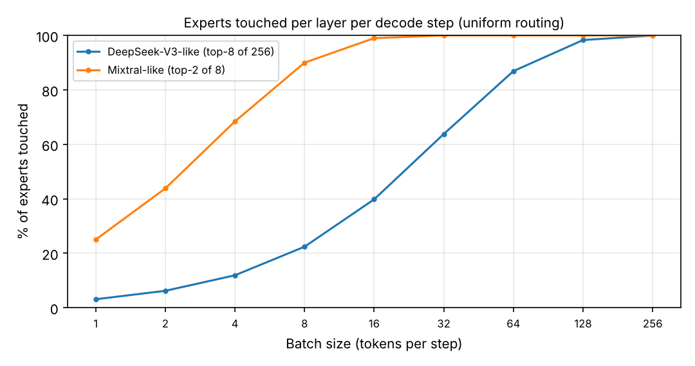

<details><summary>Chart data</summary>

| Batch size (tokens per step) | DeepSeek-V3-like (top-8 of 256) | Mixtral-like (top-2 of 8) |
|---|---|---|
| 1 | 3.1 | 25 |
| 2 | 6.2 | 43.8 |
| 4 | 11.9 | 68.4 |
| 8 | 22.4 | 90 |
| 16 | 39.8 | 99 |
| 32 | 63.8 | 100 |
| 64 | 86.9 | 100 |
| 128 | 98.3 | 100 |
| 256 | 99.97 | 100 |

</details>

At the batch sizes needed to escape the memory-bound regime (as in the HBM discussion), effectively the whole model is read every step. Real routing is skewed rather than uniform, but the skew is per token and per layer, so it doesn't give you a stable small set of experts to keep resident.

**Reason 2: the routing decision arrives too late to fetch from slower memory.**

```
layer ℓ:  attention ─► router(h) picks top-k ─► expert FFN needed NOW
                          └─ lead time: microseconds

DeepSeek-V3-ish, FP8: one expert ≈ 3 · 7168 · 2048 ≈ 44 MB
per layer, top-8      ≈ 350 MB      × 58 MoE layers ≈ 20 GB per token

from HBM      (3.35 TB/s) ≈   6 ms / token
over PCIe 5   (~64 GB/s)  ≈ 310 ms / token   → ~50× slower, ~3 tok/s
```

You only learn which experts are needed after layer ℓ's attention has run. To fetch on demand, every miss stalls the pipeline at host-link bandwidth. Prefetching would require predicting the router's output before its input exists.

**Reason 3: specialization is weak and shifts quickly.** Experts don't map cleanly to topics like "the math expert" or "the French expert." Routing tends to specialize on token-level and syntactic features, and it changes from one token to the next and from one layer to the next. There is some locality between adjacent tokens, but not enough to support a small cache with a high hit rate.

**The real trade.** MoE decouples compute from capacity: it cuts FLOPs (and, at small batch, bytes read) to the active parameters, but capacity still scales with total parameters.

| | Dense 70B | MoE, 671B total / 37B active |
|---|---|---|
| FLOPs per token | 70B-scale | 37B-scale |
| Bytes read per token, batch 1 | 70B | ~37B |
| Bytes read per step, large batch | 70B | approaches 671B |
| Memory that must be resident | 70B | 671B |

MoE is a good deal when you have abundant aggregate HBM and serve large batches. The total parameters then buy quality, while per-token FLOPs stay low. It is a bad deal on a single device with limited memory.

**How systems cope**

| Approach | Idea | Catch |
|---|---|---|
| Expert parallelism | Spread experts across many GPUs, so all weights still sit in HBM, just pooled | All-to-all token shuffling every layer stresses the interconnect (the L2 fabric) |
| Offloading (llama.cpp, Mixtral offload) | Keep experts in CPU RAM and stream them in | Fine for local batch-1 use, but PCIe-bound and slow |
| Predictive prefetch / expert cache | Guess next-layer experts from the current hidden state; cache hot experts | A miss costs a full stall, and hit rates are modest |
| Aggressive expert quantization | Experts tolerate 4-bit or lower better than attention does | Reduces capacity pressure; doesn't remove it |
| Expert pruning or merging | Drop or fold rarely used experts after training | Quality loss on rare inputs |
| Unified or coherent memory | Grace-Hopper NVLink-C2C (~900 GB/s), Apple unified memory | Slower memory gets close enough to HBM that the cliff becomes a slope |

**Back to the ASIC.** MoE moves the bottleneck from bandwidth per token toward capacity per system plus interconnect bandwidth. That is why MoE-era accelerators emphasize larger HBM stacks, fast chip-to-chip fabrics for all-to-all traffic, and tight CPU–GPU memory coherence. The memory hierarchy has to hold the whole model close to compute, even though each token touches only a sliver of it.

---

<a id="turn-10"></a>
## 10. Explain the cognitive scaffold layer (L6): memory, tools, world model

> **Question:** Explain the cognitive scaffold layer (L6): memory, tools, world model

L6 is the set of capabilities the agent loop calls on. L7 decides when to act; L6 decides what the agent can remember, touch, and predict. Each L6 component exists to fill one specific gap in a bare LLM, which on its own is a stateless function from context to tokens.

**Diagram: `cognitive_scaffold_l6_memory_tools_world_model`** (static SVG diagram)

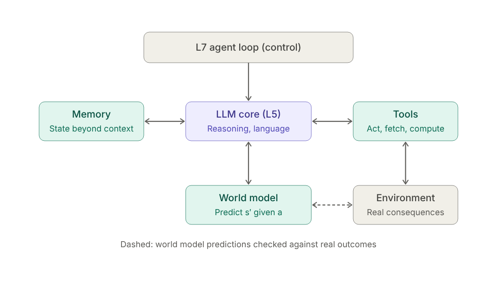

[Open standalone page](assets/10_cognitive_scaffold_l6_memory_tools_world_model.html)

<details><summary>Diagram source</summary>

````svg
<svg width="100%" viewBox="0 0 680 370" role="img"><title>L6 cognitive scaffold</title><desc>The L7 agent loop drives the LLM core. Around the core sit three L6 modules: memory for state beyond the context window, tools for acting, fetching and exact computation against the real environment, and a world model that predicts the next state given an action and is calibrated against real outcomes.</desc>
<defs><marker id="arrow" viewBox="0 0 10 10" refX="8" refY="5" markerWidth="6" markerHeight="6" orient="auto-start-reverse"><path d="M2 1L8 5L2 9" fill="none" stroke="context-stroke" stroke-width="1.5" stroke-linecap="round" stroke-linejoin="round"/></marker></defs>
<g class="node c-gray" onclick="sendPrompt('Explain the agent loop layer (L7) of an AGI stack in depth')"><rect x="190" y="30" width="300" height="44" rx="8" stroke-width="0.5"/><text class="th" x="340" y="52" text-anchor="middle" dominant-baseline="central">L7 agent loop (control)</text></g>
<line x1="340" y1="74" x2="340" y2="128" class="arr" marker-end="url(#arrow)"/>
<g class="node c-purple" onclick="sendPrompt('Explain the model layer (L5): transformer, MoE, KV cache, reasoning')"><rect x="250" y="130" width="180" height="56" rx="8" stroke-width="0.5"/><text class="th" x="340" y="148" text-anchor="middle" dominant-baseline="central">LLM core (L5)</text><text class="ts" x="340" y="168" text-anchor="middle" dominant-baseline="central">Reasoning, language</text></g>
<g class="node c-teal" onclick="sendPrompt('How do agents manage belief state: context compaction, memory, retrieval?')"><rect x="40" y="130" width="150" height="56" rx="8" stroke-width="0.5"/><text class="th" x="115" y="148" text-anchor="middle" dominant-baseline="central">Memory</text><text class="ts" x="115" y="168" text-anchor="middle" dominant-baseline="central">State beyond context</text></g>
<g class="node c-teal" onclick="sendPrompt('How should agent tools be designed: schemas, code-as-action, MCP, tool retrieval?')"><rect x="490" y="130" width="150" height="56" rx="8" stroke-width="0.5"/><text class="th" x="565" y="148" text-anchor="middle" dominant-baseline="central">Tools</text><text class="ts" x="565" y="168" text-anchor="middle" dominant-baseline="central">Act, fetch, compute</text></g>
<g class="node c-teal" onclick="sendPrompt('How do learned world models like Dreamer, MuZero and JEPA work, and how do agents plan with them?')"><rect x="250" y="250" width="180" height="56" rx="8" stroke-width="0.5"/><text class="th" x="340" y="268" text-anchor="middle" dominant-baseline="central">World model</text><text class="ts" x="340" y="288" text-anchor="middle" dominant-baseline="central">Predict s′ given a</text></g>
<g class="node c-gray" onclick="sendPrompt('How do agent environments and observations work?')"><rect x="490" y="250" width="150" height="56" rx="8" stroke-width="0.5"/><text class="th" x="565" y="268" text-anchor="middle" dominant-baseline="central">Environment</text><text class="ts" x="565" y="288" text-anchor="middle" dominant-baseline="central">Real consequences</text></g>
<line x1="192" y1="158" x2="248" y2="158" class="arr" marker-start="url(#arrow)" marker-end="url(#arrow)"/>
<line x1="432" y1="158" x2="488" y2="158" class="arr" marker-start="url(#arrow)" marker-end="url(#arrow)"/>
<line x1="340" y1="188" x2="340" y2="248" class="arr" marker-start="url(#arrow)" marker-end="url(#arrow)"/>
<line x1="565" y1="188" x2="565" y2="248" class="arr" marker-start="url(#arrow)" marker-end="url(#arrow)"/>
<line x1="432" y1="278" x2="488" y2="278" class="arr" stroke-dasharray="4 3" marker-start="url(#arrow)" marker-end="url(#arrow)"/>
<text class="ts" x="340" y="334" text-anchor="middle" dominant-baseline="central">Dashed: world model predictions checked against real outcomes</text>
</svg>
````

</details>

**Each module fills one gap:**

| A bare LLM… | L6 module | Estimation analogue |
|---|---|---|
| Forgets everything beyond its context window | **Memory** | State storage and history |
| Can't act, has frozen knowledge, is bad at exact computation | **Tools** | Sensors and actuators |
| Predicts consequences implicitly, without calibration | **World model** | Process model p(s′ \| s, a) |

Put together, L6 is a data assimilation system wrapped around a language model. Memory holds the state, tools are the observation operator and the controls, the world model is the forecast step, and L7 runs the assimilation cycle.

---

**1. Memory**

The previous answer covered context compaction, the episodic/semantic/procedural stores, and retrieval. The L6-level question is where memory lives:

- **In text** (non-parametric): inspectable and editable, but bounded by retrieval quality and context budget. This is today's default.
- **In weights** (parametric): consolidation through fine-tuning or test-time training. Memory is compressed and generalizes, but it is opaque and hard to delete.
- **In architecture**: recurrent or state-space layers with a fixed-size state that carries across the sequence. This is compaction learned end-to-end.

The trajectory resembles biology. Fast episodic writes happen in text; slow consolidation happens in weights.

**2. Tools**

Anatomy of a tool: a schema (name, natural-language description, JSON arguments), a call, and a returned observation. Four categories:

- **Information:** search, retrieval, database queries. Addresses frozen knowledge.
- **Computation:** a code interpreter, solvers, calculators. Addresses unreliable exact math and logic.
- **Actuation:** APIs, GUI control, robots. Addresses the inability to act.
- **Delegation:** sub-agents, specialist models (vision, physics simulators). Addresses limited context and narrow skill.

Design principles that matter in practice:

- **The tool description is a prompt.** The model chooses tools from their descriptions, so a vague description leads to wrong calls.
- **Few, composable, high-level tools beat many thin ones.** "Create a calendar event" is better than raw HTTP access.
- **Code as action (CodeAct).** Letting the model write a short program that calls several tools with loops and variables collapses many round-trips into one step. That means fewer decode cycles and fewer observations polluting the context.
- **Standard protocols.** MCP turns tools into pluggable servers, so capabilities can be added without retraining.
- **Tool retrieval at scale.** With hundreds of tools, schemas are loaded on demand rather than all kept in context. This harness does exactly that: most connectors here are deferred until searched.

**3. World model: the least mature module, and the most important for AGI**

A world model predicts the next state and observation given an action, so the agent can try actions in imagination before trying them in reality. There are three kinds today:

| Kind | Examples | Strength | Weakness |
|---|---|---|---|
| Implicit, inside the LLM | "If I delete this file, then…" reasoned in text | Very broad, zero setup | Uncalibrated, no physics, can't tell when it's wrong |
| Explicit simulator as a tool | Physics engines, digital twins, code execution as the "world model" of software | Exact within its domain | Narrow; expensive to build |
| Learned latent model | DreamerV3 (RSSM), MuZero, V-JEPA, video/world foundation models (Genie, NVIDIA Cosmos) | Learned from data, supports fast imagined rollouts | Compounding rollout error, sim-to-real gap |

What a world model enables:

- **Planning by imagination:** MPC or MCTS over predicted futures instead of real trial and error.
- **Safety gating:** predict the consequences of an irreversible action before executing it.
- **Surprise detection:** compare each real observation to the prediction. A large innovation means the beliefs are wrong.
- **Training in imagination:** generate synthetic experience where real interaction is expensive, as in robotics.

Your background gives you an advantage here. Dreamer's RSSM is a learned nonlinear state-space model with an explicit prior (predict) and posterior (update). Structurally it is a deep Kalman filter. Every hard problem in world models is a data assimilation problem:

- **Model error growth over rollout horizon.** Long imagined trajectories drift.
- **Uncertainty quantification.** Ensembles and stochastic latents act as the covariance.
- **Partial observability.** You need a belief over latent state, not only a prediction.
- **Choice of state representation.** Pixels, latents, or symbols; this is the reduced-order modeling question.
- **Keeping the model honest with observations.** That is assimilation itself.

---

**How the three combine in one step**

```
a*        ← LLM proposes action (using memory for context)
ŝ', ô     ← world model predicts outcome            # forecast
if ŝ' violates constraints: revise a*               # safety gate in imagination
o         ← tool executes a* in the real environment
ν = o − ô                                           # innovation
if |ν| large: flag surprise, re-plan, distrust belief
memory.write(a*, o, ν)                              # surprises are what's worth storing
```

That last line is a principled answer to the memory write-policy problem from before: store what surprised you. It is also what a good filter does, since high-innovation observations carry the most information.

**Where L6 is heading: scaffolds get absorbed**

| Component | Likely future |
|---|---|
| Reasoning scaffolds | Already absorbed: chain-of-thought prompting became reasoning models |
| Memory | Partly absorbed into long context, state-space hybrids, and test-time training; external stores remain for auditability and deletion |
| Tools | Stay external. Actuation, fresh data, and exact computation can't live in weights |
| World model | Converging with foundation models: multimodal models that predict video and action jointly, with physical simulators kept as ground-truth tools |

The rule underneath: anything that is a pattern eventually moves into the model, and anything that is contact with reality stays a tool. The world model sits on that boundary. Learning it inside the model, with calibrated uncertainty, is close to the central open problem between today's agents and something meaningfully more general.

---

<a id="turn-11"></a>
## 11. Explain LLM sampling: temperature, top-p, speculative decoding

> **Question:** Explain LLM sampling: temperature, top-p, speculative decoding

Generation is a sampling loop. At each step the model outputs a logit z_i for every vocabulary token, a sampler turns those into one chosen token, and the token is appended to the context. Temperature and top-p change which token gets chosen. Speculative decoding leaves the output distribution untouched and only makes the loop faster.

Below, the logits are fixed for one context. Move the sliders to see how temperature reshapes the distribution and how top-k and top-p cut off the tail:

**Diagram: `llm_sampling_temperature_top_p_explorer`** (interactive HTML widget)

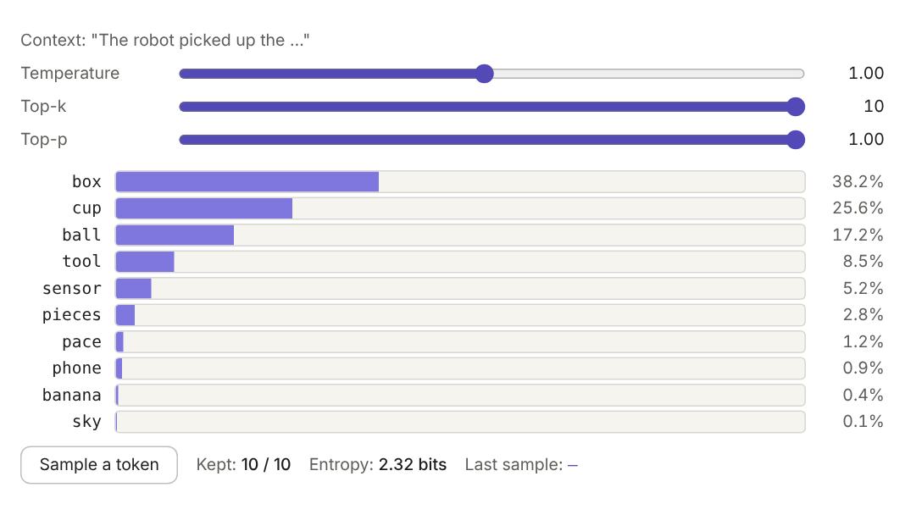

[Open standalone page](assets/11_llm_sampling_temperature_top_p_explorer.html)

<details><summary>Diagram source</summary>

````html
<h2 class="sr-only">Interactive explorer showing how temperature, top-k and top-p reshape a next-token probability distribution, with a button to draw a sample.</h2>
<style>
.r{display:flex;align-items:center;gap:12px;font-size:13px;color:var(--text-secondary);margin:6px 0}
.r label{width:110px}.r input{flex:1}.r output{width:48px;text-align:right;color:var(--text-primary);font-variant-numeric:tabular-nums}
.tk{display:flex;align-items:center;gap:10px;font-size:13px;margin:3px 0}
.tk .n{width:64px;text-align:right;color:var(--text-primary);font-family:var(--font-mono)}
.tk .tr{flex:1;height:16px;background:var(--surface-1);border-radius:4px;overflow:hidden;border:0.5px solid var(--border)}
.tk .f{height:100%;transition:width .15s}
.tk .v{width:52px;text-align:right;color:var(--text-secondary);font-variant-numeric:tabular-nums}
button.s{font:inherit;font-size:13px;padding:6px 14px;border-radius:var(--radius);border:0.5px solid var(--border-strong);background:var(--surface-2);color:var(--text-primary);cursor:pointer}
</style>
<div style="padding:0.5rem 0">
<div style="font-size:13px;color:var(--text-secondary);margin-bottom:8px">Context: "The robot picked up the …"</div>
<div class="r"><label for="t">Temperature</label><input id="t" type="range" min="0.05" max="2" step="0.05" value="1"><output id="to"></output></div>
<div class="r"><label for="k">Top-k</label><input id="k" type="range" min="1" max="10" step="1" value="10"><output id="ko"></output></div>
<div class="r"><label for="p">Top-p</label><input id="p" type="range" min="0.05" max="1" step="0.01" value="1"><output id="po"></output></div>
<div id="rows" style="margin:14px 0 10px"></div>
<div style="display:flex;align-items:center;gap:14px;font-size:13px;color:var(--text-secondary);flex-wrap:wrap">
<button class="s" id="go">Sample a token</button>
<span>Kept: <b id="kc" style="font-weight:500;color:var(--text-primary)"></b></span>
<span>Entropy: <b id="en" style="font-weight:500;color:var(--text-primary)"></b></span>
<span>Last sample: <b id="out" style="font-weight:500;color:var(--text-accent);font-family:var(--font-mono)">—</b></span>
</div>
</div>
<script>
const T0=[["box",5],["cup",4.6],["ball",4.2],["tool",3.5],["sensor",3],["pieces",2.4],["pace",1.5],["phone",1.2],["banana",.5],["sky",-1]];
const $=i=>document.getElementById(i);let q=[];
const rows=$('rows');
T0.forEach(([w],i)=>{const d=document.createElement('div');d.className='tk';d.innerHTML='<span class="n">'+w+'</span><div class="tr"><div class="f" id="f'+i+'"></div></div><span class="v" id="v'+i+'"></span>';rows.appendChild(d);});
function u(){
const T=+$('t').value,K=+$('k').value,P=+$('p').value;
$('to').textContent=T.toFixed(2);$('ko').textContent=K;$('po').textContent=P.toFixed(2);
const z=T0.map(x=>x[1]/T),m=Math.max(...z),e=z.map(v=>Math.exp(v-m)),s=e.reduce((a,b)=>a+b,0),pr=e.map(v=>v/s);
let cum=0;const keep=pr.map((v,i)=>{if(i<K&&cum<P){cum+=v;return true}return false});
q=pr.map((v,i)=>keep[i]?v/cum:0);
let H=0;q.forEach(v=>{if(v>0)H-=v*Math.log2(v)});
pr.forEach((v,i)=>{const f=$('f'+i);
if(keep[i]){f.style.width=(q[i]*100)+'%';f.style.background='#7F77DD';f.style.opacity=1;$('v'+i).textContent=(q[i]*100).toFixed(1)+'%';}
else{f.style.width=(v*100)+'%';f.style.background='var(--border-stronger)';f.style.opacity=.5;$('v'+i).textContent='cut';}});
$('kc').textContent=keep.filter(Boolean).length+' / 10';$('en').textContent=H.toFixed(2)+' bits';
}
$('go').onclick=()=>{let r=Math.random(),c=0;for(let i=0;i<q.length;i++){c+=q[i];if(r<=c&&q[i]>0){$('out').textContent=T0[i][0];return}}};
['t','k','p'].forEach(i=>$(i).addEventListener('input',u));u();
</script>
````

</details>

**1. Temperature: reshape the distribution**

```
p_i = exp(z_i / T) / Σ_j exp(z_j / T)
```

Temperature is a Boltzmann distribution with energy −z.
- As T → 0, sampling becomes greedy: all mass goes to the argmax token.
- At T = 1, you sample the model's own distribution.
- At T > 1, the distribution flattens and the tail gains mass.

Temperature never changes the ranking of tokens. It only changes how sharp the distribution is.

**2. Truncation: cut the tail**

The tail contains thousands of tokens that are each very unlikely, but together they can hold real probability mass. Sample long enough and you will eventually draw one of them, and that one bad token can derail everything after it. Truncation removes the tail before sampling:

| Method | Rule | Behaviour |
|---|---|---|
| Top-k | Keep the k most likely tokens | Fixed size: too many when the model is confident, too few when it is uncertain |
| Top-p (nucleus) | Keep the smallest set whose cumulative mass ≥ p | Adaptive: wide when uncertain, narrow when confident |
| Min-p | Keep tokens with p_i ≥ min_p · p_max | Scales with confidence; stays robust at high T |

The order of operations is: temperature → truncate → renormalize → sample. You can see this in the widget. At T = 2 with top-p = 0.9, the nucleus fills with many tokens because temperature has already flattened the distribution.

Other logit processors run at the same stage:
- Repetition and frequency penalties lower the logits of tokens already used.
- Constrained decoding masks every token that would break a grammar, so JSON or a tool-call schema is valid by construction. For agents (L6 tools), this matters more than any temperature setting.

**Typical regimes**

| Task | Setting | Why |
|---|---|---|
| Code, math, tool calls | T ≈ 0–0.3 | One correct answer; variance only hurts |
| Chat | T ≈ 0.7, top-p ≈ 0.9–0.95 | Natural, without drifting |
| Creative writing | T ≈ 0.9–1.1 plus min-p | Diversity, with the junk tail cut |
| Reasoning, self-consistency | T > 0, sample N chains, vote | Diversity across chains is the point; greedy decoding can loop in long chains of thought |

---

**3. Speculative decoding: same distribution, fewer expensive steps**

From the HBM discussion: decode reads every weight just to produce one token, and the compute sits mostly idle. Verifying k tokens in one forward pass costs about the same weight traffic as generating one. Speculative decoding exploits that:

**Diagram: `speculative_decoding_draft_verify`** (static SVG diagram)

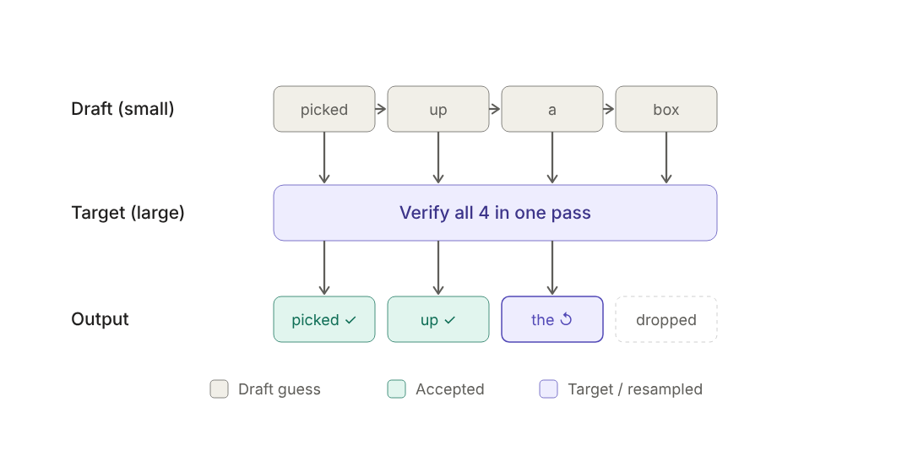

[Open standalone page](assets/12_speculative_decoding_draft_verify.html)

<details><summary>Diagram source</summary>

````svg
<svg width="100%" viewBox="0 0 680 320" role="img"><title>Speculative decoding</title><desc>A small draft model generates four tokens sequentially. The large target model verifies all four in one parallel forward pass. The first two are accepted, the third is rejected and resampled from the target, and the fourth is discarded, so three tokens are emitted for one large-model pass.</desc>
<defs><marker id="arrow" viewBox="0 0 10 10" refX="8" refY="5" markerWidth="6" markerHeight="6" orient="auto-start-reverse"><path d="M2 1L8 5L2 9" fill="none" stroke="context-stroke" stroke-width="1.5" stroke-linecap="round" stroke-linejoin="round"/></marker></defs>
<text class="th" x="40" y="70" dominant-baseline="central">Draft (small)</text>
<text class="th" x="40" y="152" dominant-baseline="central">Target (large)</text>
<text class="th" x="40" y="236" dominant-baseline="central">Output</text>
<g class="c-gray"><rect x="200" y="52" width="80" height="36" rx="6" stroke-width="0.5"/><text class="ts" x="240" y="70" text-anchor="middle" dominant-baseline="central">picked</text></g>
<g class="c-gray"><rect x="290" y="52" width="80" height="36" rx="6" stroke-width="0.5"/><text class="ts" x="330" y="70" text-anchor="middle" dominant-baseline="central">up</text></g>
<g class="c-gray"><rect x="380" y="52" width="80" height="36" rx="6" stroke-width="0.5"/><text class="ts" x="420" y="70" text-anchor="middle" dominant-baseline="central">a</text></g>
<g class="c-gray"><rect x="470" y="52" width="80" height="36" rx="6" stroke-width="0.5"/><text class="ts" x="510" y="70" text-anchor="middle" dominant-baseline="central">box</text></g>
<line x1="280" y1="70" x2="288" y2="70" class="arr" marker-end="url(#arrow)"/>
<line x1="370" y1="70" x2="378" y2="70" class="arr" marker-end="url(#arrow)"/>
<line x1="460" y1="70" x2="468" y2="70" class="arr" marker-end="url(#arrow)"/>
<line x1="240" y1="88" x2="240" y2="128" class="arr" marker-end="url(#arrow)"/>
<line x1="330" y1="88" x2="330" y2="128" class="arr" marker-end="url(#arrow)"/>
<line x1="420" y1="88" x2="420" y2="128" class="arr" marker-end="url(#arrow)"/>
<line x1="510" y1="88" x2="510" y2="128" class="arr" marker-end="url(#arrow)"/>
<g class="c-purple"><rect x="200" y="130" width="350" height="44" rx="8" stroke-width="0.5"/><text class="th" x="375" y="152" text-anchor="middle" dominant-baseline="central">Verify all 4 in one pass</text></g>
<line x1="240" y1="174" x2="240" y2="216" class="arr" marker-end="url(#arrow)"/>
<line x1="330" y1="174" x2="330" y2="216" class="arr" marker-end="url(#arrow)"/>
<line x1="420" y1="174" x2="420" y2="216" class="arr" marker-end="url(#arrow)"/>
<g class="c-teal"><rect x="200" y="218" width="80" height="36" rx="6" stroke-width="0.5"/><text class="ts" x="240" y="236" text-anchor="middle" dominant-baseline="central">picked ✓</text></g>
<g class="c-teal"><rect x="290" y="218" width="80" height="36" rx="6" stroke-width="0.5"/><text class="ts" x="330" y="236" text-anchor="middle" dominant-baseline="central">up ✓</text></g>
<g class="c-purple"><rect x="380" y="218" width="80" height="36" rx="6" stroke-width="1"/><text class="ts" x="420" y="236" text-anchor="middle" dominant-baseline="central">the ↺</text></g>
<rect x="470" y="218" width="80" height="36" rx="6" fill="none" stroke="var(--border-strong)" stroke-width="0.5" stroke-dasharray="3 3"/>
<text class="ts" x="510" y="236" text-anchor="middle" dominant-baseline="central">dropped</text>
<rect class="c-gray" x="150" y="284" width="14" height="14" rx="3" stroke-width="0.5"/><text class="ts" x="172" y="291" dominant-baseline="central">Draft guess</text>
<rect class="c-teal" x="290" y="284" width="14" height="14" rx="3" stroke-width="0.5"/><text class="ts" x="312" y="291" dominant-baseline="central">Accepted</text>
<rect class="c-purple" x="410" y="284" width="14" height="14" rx="3" stroke-width="0.5"/><text class="ts" x="432" y="291" dominant-baseline="central">Target / resampled</text>
</svg>
````

</details>

**The acceptance rule, which makes it lossless.** For each drafted token x, with q the draft model's probability and p the target model's probability:

```
accept x with probability  min(1, p(x) / q(x))
on first rejection: resample from  normalize( max(0, p − q) )
if all k accepted: sample one bonus token from p
```

This is rejection sampling with q as the proposal distribution. The emitted tokens follow exactly p, the target model's distribution at the chosen temperature and top-p, so quality is unchanged. Speed depends only on how well q matches p. In particle-filter terms, it is the proposal-distribution problem: a better proposal gives a higher acceptance rate, the analogue of a higher effective sample size.

**Expected speedup.** Let α be the per-token acceptance rate and c = cost(draft) / cost(target).

```
tokens per target pass   E = (1 − α^(k+1)) / (1 − α)
speedup                  ≈ E / (1 + k·c)

α = 0.8, k = 4, c = 0.05  →  E ≈ 3.36,  speedup ≈ 2.8×
```

**Variants, grouped by where the draft comes from**

| Method | Draft source | Notes |
|---|---|---|
| Classic | A separate small model from the same family | Simple; needs a shared tokenizer |
| Medusa | Extra heads on the target that predict tokens t+2, t+3, … | Verifies a tree of candidates with tree attention |
| EAGLE | A light autoregressive head over the target's hidden features | High acceptance rate; widely deployed |
| Self-speculative | The target with some layers skipped | No second model needed |
| Prompt lookup / n-gram | Copies spans from the context | Nearly free; very effective for code edits and RAG, where output repeats input |

**When it helps less**

- **Large batches.** Decode is already near compute-bound, so the extra verification FLOPs compete with real work.
- **High temperature or creative text.** p and q diverge, α drops, and the speedup shrinks.
- **Hardware with huge on-chip SRAM** (Groq, Cerebras). There is less memory stall to hide in the first place.

**Tie back down the stack**

- Temperature and top-p decide which future you get.
- Speculative decoding decides how quickly you get it, by spending idle FLOPs to raise arithmetic intensity by up to about k+1.

This matters most in the L7 agent loop: long chains of small, sequential, latency-bound calls, often reusing tool output verbatim. That is exactly where drafting and prompt lookup pay off.

---

<a id="turn-12"></a>
## 12. How do physical AI agents handle real-world environments and sensor observations?

> **Question:** How do physical AI agents handle real-world environments and sensor observations?

> **Question:** How does RL on agent trajectories improve the policy?

These two questions meet in one place: physical agents are where learning from trajectories is hardest, because real-world trajectories are scarce, slow, and irreversible. I'll take them in order.

#### Part 1: Physical AI agents

The stack has the same loop as a digital agent. What differs is the observation channel and the clock: continuous, noisy, high-bandwidth sensing; hard real-time deadlines; no undo. The standard answer is to split the policy by timescale.

**Diagram: `physical_ai_agent_timescale_stack`** (static SVG diagram)

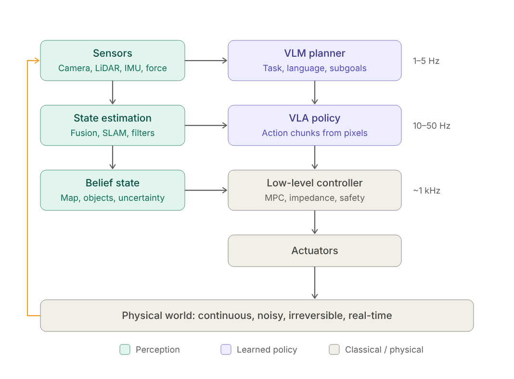

[Open standalone page](assets/13_physical_ai_agent_timescale_stack.html)

<details><summary>Diagram source</summary>

````svg
<svg width="100%" viewBox="0 0 680 490" role="img"><title>Physical AI agent stack by timescale</title><desc>Sensors feed state estimation and a belief state on the perception side. On the policy side a slow VLM planner at 1 to 5 Hz sets subgoals, a vision-language-action policy at 10 to 50 Hz outputs action chunks, and a low-level controller near 1 kHz drives actuators. Actuators act on the physical world, which is observed again by sensors.</desc>
<defs><marker id="arrow" viewBox="0 0 10 10" refX="8" refY="5" markerWidth="6" markerHeight="6" orient="auto-start-reverse"><path d="M2 1L8 5L2 9" fill="none" stroke="context-stroke" stroke-width="1.5" stroke-linecap="round" stroke-linejoin="round"/></marker></defs>
<g class="node c-teal" onclick="sendPrompt('How should multi-sensor timing, calibration and fusion be handled for robot policies?')"><rect x="40" y="40" width="200" height="56" rx="8" stroke-width="0.5"/><text class="th" x="140" y="58" text-anchor="middle" dominant-baseline="central">Sensors</text><text class="ts" x="140" y="78" text-anchor="middle" dominant-baseline="central">Camera, LiDAR, IMU, force</text></g>
<g class="node c-teal" onclick="sendPrompt('How do classical state estimation and learned perception combine in modern robots?')"><rect x="40" y="130" width="200" height="56" rx="8" stroke-width="0.5"/><text class="th" x="140" y="148" text-anchor="middle" dominant-baseline="central">State estimation</text><text class="ts" x="140" y="168" text-anchor="middle" dominant-baseline="central">Fusion, SLAM, filters</text></g>
<g class="node c-teal" onclick="sendPrompt('How do robots represent belief state with uncertainty for planning and safety?')"><rect x="40" y="220" width="200" height="56" rx="8" stroke-width="0.5"/><text class="th" x="140" y="238" text-anchor="middle" dominant-baseline="central">Belief state</text><text class="ts" x="140" y="258" text-anchor="middle" dominant-baseline="central">Map, objects, uncertainty</text></g>
<line x1="140" y1="96" x2="140" y2="128" class="arr" marker-end="url(#arrow)"/>
<line x1="140" y1="186" x2="140" y2="218" class="arr" marker-end="url(#arrow)"/>
<g class="node c-purple" onclick="sendPrompt('How do VLM planners act as System 2 for robots?')"><rect x="300" y="40" width="240" height="56" rx="8" stroke-width="0.5"/><text class="th" x="420" y="58" text-anchor="middle" dominant-baseline="central">VLM planner</text><text class="ts" x="420" y="78" text-anchor="middle" dominant-baseline="central">Task, language, subgoals</text></g>
<g class="node c-purple" onclick="sendPrompt('How do vision-language-action models with action chunking and flow matching work?')"><rect x="300" y="130" width="240" height="56" rx="8" stroke-width="0.5"/><text class="th" x="420" y="148" text-anchor="middle" dominant-baseline="central">VLA policy</text><text class="ts" x="420" y="168" text-anchor="middle" dominant-baseline="central">Action chunks from pixels</text></g>
<g class="node c-gray" onclick="sendPrompt('How do low-level controllers and safety filters wrap learned robot policies?')"><rect x="300" y="220" width="240" height="56" rx="8" stroke-width="0.5"/><text class="th" x="420" y="238" text-anchor="middle" dominant-baseline="central">Low-level controller</text><text class="ts" x="420" y="258" text-anchor="middle" dominant-baseline="central">MPC, impedance, safety</text></g>
<g class="c-gray"><rect x="300" y="310" width="240" height="44" rx="8" stroke-width="0.5"/><text class="th" x="420" y="332" text-anchor="middle" dominant-baseline="central">Actuators</text></g>
<text class="ts" x="556" y="68" dominant-baseline="central">1–5 Hz</text>
<text class="ts" x="556" y="158" dominant-baseline="central">10–50 Hz</text>
<text class="ts" x="556" y="248" dominant-baseline="central">~1 kHz</text>
<line x1="420" y1="96" x2="420" y2="128" class="arr" marker-end="url(#arrow)"/>
<line x1="420" y1="186" x2="420" y2="218" class="arr" marker-end="url(#arrow)"/>
<line x1="420" y1="276" x2="420" y2="308" class="arr" marker-end="url(#arrow)"/>
<line x1="240" y1="68" x2="298" y2="68" class="arr" marker-end="url(#arrow)"/>
<line x1="240" y1="158" x2="298" y2="158" class="arr" marker-end="url(#arrow)"/>
<line x1="240" y1="248" x2="298" y2="248" class="arr" marker-end="url(#arrow)"/>
<line x1="420" y1="354" x2="420" y2="398" class="arr" marker-end="url(#arrow)"/>
<g class="c-gray"><rect x="40" y="400" width="600" height="44" rx="8" stroke-width="0.5"/><text class="th" x="340" y="422" text-anchor="middle" dominant-baseline="central">Physical world: continuous, noisy, irreversible, real-time</text></g>
<path d="M40 422 L22 422 L22 68 L38 68" fill="none" class="arr" stroke="#EF9F27" marker-end="url(#arrow)"/>
<rect class="c-teal" x="150" y="462" width="14" height="14" rx="3" stroke-width="0.5"/><text class="ts" x="172" y="469" dominant-baseline="central">Perception</text>
<rect class="c-purple" x="290" y="462" width="14" height="14" rx="3" stroke-width="0.5"/><text class="ts" x="312" y="469" dominant-baseline="central">Learned policy</text>
<rect class="c-gray" x="440" y="462" width="14" height="14" rx="3" stroke-width="0.5"/><text class="ts" x="462" y="469" dominant-baseline="central">Classical / physical</text>
</svg>
````

</details>

**What changes from a software agent to a physical one**

| Software agent | Physical agent | Consequence |
|---|---|---|
| Discrete text observations | Continuous, high-dimensional sensor streams | Perception and state estimation become a layer of their own |
| Waits for the tool to return | The world keeps moving | Latency compensation: predict the state at actuation time, not at capture time |
| Container snapshots allow undo | Irreversible, and can hurt people | A safety filter sits outside the learned policy |
| Unlimited cheap rollouts | Slow, expensive, wear-inducing data | Simulation, teleoperation, and cross-embodiment data |
| Tokens as actions | Torques, poses, gripper commands | Action chunking with diffusion or flow-matching heads |

**The main design moves**

1. **Hierarchy by timescale ("System 2 / System 1").** A slow VLM reasons about the task and sets subgoals. A fast VLA maps pixels plus the subgoal to action chunks. A classical controller tracks those chunks at about 1 kHz. Recent systems in this family include π0, NVIDIA GR00T N1, Gemini Robotics, and Figure's Helix. Each loop can only be as slow as what it controls allows.

2. **Action chunking.** The policy predicts the next H actions at once, then executes them with temporal ensembling or re-plans partway through. This absorbs inference latency, smooths motion, and lets a slow network drive a fast robot. Diffusion and flow-matching heads represent multimodal action distributions; for example, grasping from the left and grasping from the right are both valid, and averaging them would be wrong.

3. **Explicit state estimation persists alongside end-to-end learning.**
   - VLAs consume raw pixels.
   - Underneath, calibration, time synchronization, sensor fusion, and filtered estimates still feed the controller and the safety layer.

   That underlying work is your LiDAR world. Learned policies are fragile to small mistakes in that substrate: a few milliseconds of timestamp skew or an extrinsic calibration that has drifted will cause failures that look like "the policy is bad."

4. **Uncertainty is not optional.** A software agent's missing covariance (from the earlier discussion) is an inconvenience. A robot that is overconfident about an object's pose collides with things. Explicit belief representations feed planning and safety: occupancy with uncertainty, object pose with covariance.

5. **Safety outside the learned policy.** Control barrier functions, speed and force limits, workspace bounds, and an e-stop form a layer that a neural network cannot override.

6. **Data strategy.**
   - Teleoperation for high-quality demonstrations.
   - Cross-embodiment datasets such as Open X-Embodiment.
   - Human video for priors.
   - Simulation, digital twins, and video world models for scale.

   Closing the sim-to-real gap relies on domain randomization, system identification, and real-to-sim-to-real loops. All three are data assimilation problems.

---

#### Part 2: How RL on trajectories improves the policy

The core idea: let the policy act, score the outcome, and shift probability toward the actions that preceded high scores.

**Diagram: `agent_rl_trajectory_training_loop`** (static SVG diagram)

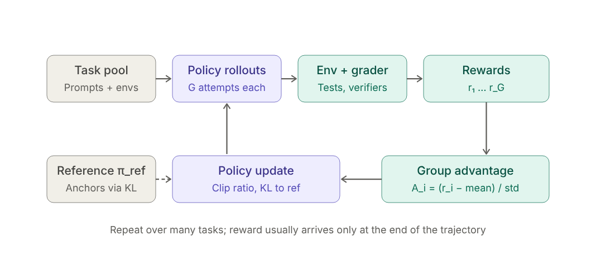

[Open standalone page](assets/14_agent_rl_trajectory_training_loop.html)

<details><summary>Diagram source</summary>

````svg
<svg width="100%" viewBox="0 0 680 285" role="img"><title>RL on agent trajectories</title><desc>Tasks are drawn from a pool, the policy produces a group of trajectories per task in the environment, a grader scores them, group-relative advantages are computed, and the policy is updated with a clipped objective and a KL penalty to a reference model, then the loop repeats.</desc>
<defs><marker id="arrow" viewBox="0 0 10 10" refX="8" refY="5" markerWidth="6" markerHeight="6" orient="auto-start-reverse"><path d="M2 1L8 5L2 9" fill="none" stroke="context-stroke" stroke-width="1.5" stroke-linecap="round" stroke-linejoin="round"/></marker></defs>
<g class="c-gray"><rect x="40" y="50" width="130" height="56" rx="8" stroke-width="0.5"/><text class="th" x="105" y="68" text-anchor="middle" dominant-baseline="central">Task pool</text><text class="ts" x="105" y="88" text-anchor="middle" dominant-baseline="central">Prompts + envs</text></g>
<g class="node c-purple" onclick="sendPrompt('How are agent rollouts generated at scale for RL training?')"><rect x="190" y="50" width="130" height="56" rx="8" stroke-width="0.5"/><text class="th" x="255" y="68" text-anchor="middle" dominant-baseline="central">Policy rollouts</text><text class="ts" x="255" y="88" text-anchor="middle" dominant-baseline="central">G attempts each</text></g>
<g class="node c-teal" onclick="sendPrompt('How are verifiers and reward signals built for agent RL environments?')"><rect x="340" y="50" width="130" height="56" rx="8" stroke-width="0.5"/><text class="th" x="405" y="68" text-anchor="middle" dominant-baseline="central">Env + grader</text><text class="ts" x="405" y="88" text-anchor="middle" dominant-baseline="central">Tests, verifiers</text></g>
<g class="c-teal"><rect x="490" y="50" width="150" height="56" rx="8" stroke-width="0.5"/><text class="th" x="565" y="68" text-anchor="middle" dominant-baseline="central">Rewards</text><text class="ts" x="565" y="88" text-anchor="middle" dominant-baseline="central">r₁ … r_G</text></g>
<line x1="170" y1="78" x2="188" y2="78" class="arr" marker-end="url(#arrow)"/>
<line x1="320" y1="78" x2="338" y2="78" class="arr" marker-end="url(#arrow)"/>
<line x1="470" y1="78" x2="488" y2="78" class="arr" marker-end="url(#arrow)"/>
<line x1="565" y1="106" x2="565" y2="168" class="arr" marker-end="url(#arrow)"/>
<g class="node c-teal" onclick="sendPrompt('Explain GRPO group-relative advantages vs PPO with a value function')"><rect x="440" y="170" width="200" height="56" rx="8" stroke-width="0.5"/><text class="th" x="540" y="188" text-anchor="middle" dominant-baseline="central">Group advantage</text><text class="ts" x="540" y="208" text-anchor="middle" dominant-baseline="central">A_i = (r_i − mean) / std</text></g>
<line x1="440" y1="198" x2="392" y2="198" class="arr" marker-end="url(#arrow)"/>
<g class="node c-purple" onclick="sendPrompt('Why do RL policy updates for LLMs use clipping and KL penalties?')"><rect x="190" y="170" width="200" height="56" rx="8" stroke-width="0.5"/><text class="th" x="290" y="188" text-anchor="middle" dominant-baseline="central">Policy update</text><text class="ts" x="290" y="208" text-anchor="middle" dominant-baseline="central">Clip ratio, KL to ref</text></g>
<line x1="255" y1="168" x2="255" y2="108" class="arr" marker-end="url(#arrow)"/>
<g class="c-gray"><rect x="40" y="170" width="130" height="56" rx="8" stroke-width="0.5"/><text class="th" x="105" y="188" text-anchor="middle" dominant-baseline="central">Reference π_ref</text><text class="ts" x="105" y="208" text-anchor="middle" dominant-baseline="central">Anchors via KL</text></g>
<line x1="170" y1="198" x2="188" y2="198" class="arr" stroke-dasharray="4 3" marker-end="url(#arrow)"/>
<text class="ts" x="340" y="258" text-anchor="middle" dominant-baseline="central">Repeat over many tasks; reward usually arrives only at the end of the trajectory</text>
</svg>
````

</details>

**The objective**

```
J(θ) = E_τ~π_θ [ R(τ) ] − β · KL(π_θ ‖ π_ref)

∇J ≈ E [ Σ_t  A_t · ∇_θ log π_θ(a_t | h_t) ]
```

- The actions a_t are the model's own tokens: thoughts, tool calls, and messages.
- Tool outputs and environment observations are in the history h_t but are masked out of the loss. The model learns what to do, not what the world said back.
- In words: raise the log-probability of every token in trajectories that scored above average, and lower it in those that scored below.

**Where RL sits in the training pipeline**

```
pretraining         → knows things           (next-token on the web)
SFT / imitation     → knows the format       (behavior cloning on demos)
RL (outcome reward) → learns what works      (trial, score, reinforce)
```

- Imitation copies a demonstrator and inherits its mistakes and its ceiling.
- RL optimizes the result directly. That makes it the only stage that can discover behaviors no demonstration contains.

**GRPO vs PPO: how the advantage is computed**

| | PPO | GRPO |
|---|---|---|
| Baseline | Learned value network V(h) | Mean reward of G samples for the same prompt |
| Cost | A second large network to train | None beyond sampling G rollouts |
| Fit | Dense rewards, continuous control | Sparse, verifiable outcome rewards (code, math, agent tasks) |

The baseline is a control variate: it doesn't change the expected gradient, but it cuts variance sharply. Clipping the probability ratio and the KL penalty together form a trust region, so each update stays close to the policy that generated the data. This is the same role natural gradient plays.

**What actually improves**

- **Behaviors get reweighted toward success.** Checking work, backtracking, reading before editing, running tests before declaring done. These appear more often in winning trajectories, so they become more likely everywhere.
- **Emergent long reasoning.** DeepSeek-R1-Zero showed that outcome-only RL on math produced longer chains of thought with self-verification, without anyone demonstrating them.
- **An honest caveat.** There is an active debate about whether RL with verifiable rewards creates new capability or mainly concentrates probability on paths the base model could already find. The evidence: pass@1 rises sharply, but pass@k at large k improves much less. Most likely it does both, with sharpening dominating at current scales.

**Agent-specific difficulties**

| Problem | Why | Mitigation |
|---|---|---|
| Credit assignment | One reward for a 200-step trajectory | Turn-level advantages, process reward models, shorter subtasks |
| Environment cost | Every rollout runs real tools in sandboxes | Asynchronous rollout workers, cached environments, parallel containers |
| Off-policy staleness | The policy changes while slow rollouts are still running | Importance-ratio clipping, bounded staleness |
| Reward hacking | The agent edits tests or special-cases the grader | Hidden graders, locked sandboxes, adversarial checks |
| Entropy collapse | The policy becomes deterministic and stops exploring | Entropy bonuses, temperature during rollouts, diverse task pools |
| Capability drift | Narrow RL erodes general skills | KL to the reference, mixing in other data |

---

#### Where the two halves meet

Physical AI is where RL already has its biggest success and its hardest problem.

- **Locomotion is the success.** PPO with domain randomization over thousands of parallel simulated environments (Isaac Gym/Lab) produces controllers that transfer zero-shot to real robots. This works because simulated legs and terrain are close enough to reality, and reward shaping is tractable.
- **Manipulation is the hard problem.** Contact physics, deformable objects, and vision are poorly simulated, and real rollouts are expensive and slow. The current recipe:
  1. Imitation (VLA plus teleoperation demonstrations) for the prior.
  2. RL fine-tuning in simulation or a world model.
  3. Small amounts of careful real-world RL, with resets and safety handled by humans or scripts.

The general rule: RL is only as good as the environment it trains in. For digital agents, that means grader quality. For physical agents, it means simulator fidelity. In both cases the bottleneck is a model of the world that is accurate enough to learn from, which is why learned world models keep recurring as the key missing piece across this whole stack.

---

<a id="turn-13"></a>
## 13. How do robots represent belief state with uncertainty for planning and safety?

> **Question:** How do robots represent belief state with uncertainty for planning and safety?

A robot's belief is the posterior p(x_t | z_1:t, u_1:t) over everything the planner cares about. No single representation can hold all of it, so real systems keep a layered belief, choosing a different uncertainty form for each kind of quantity. That belief is then consumed in two different ways: probabilistically, to plan well, and conservatively, to stay safe.

**Diagram: `robot_belief_state_uncertainty_stack`** (static SVG diagram)

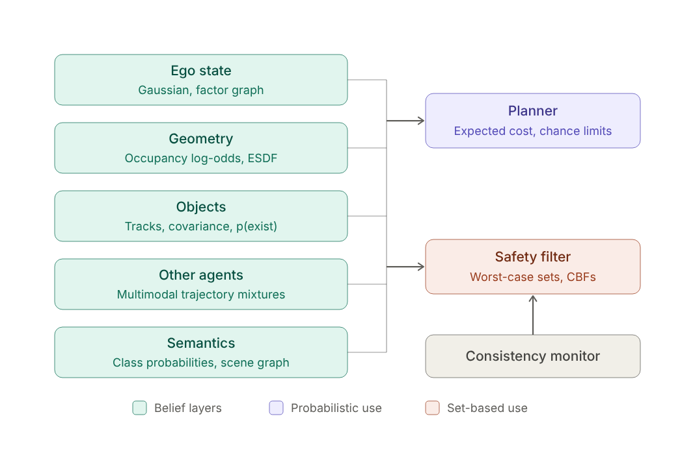

[Open standalone page](assets/15_robot_belief_state_uncertainty_stack.html)

<details><summary>Diagram source</summary>

````svg
<svg width="100%" viewBox="0 0 680 425" role="img"><title>Layered robot belief state and its consumers</title><desc>Five belief layers: ego state as Gaussian or factor graph, geometry as occupancy and distance fields, objects as tracks with covariance and existence probability, other agents as multimodal trajectory mixtures, and semantics as class probabilities and scene graphs. These feed a planner using expected cost and chance constraints, and a safety filter using worst-case sets and control barrier functions, which is also fed by a consistency monitor.</desc>
<defs><marker id="arrow" viewBox="0 0 10 10" refX="8" refY="5" markerWidth="6" markerHeight="6" orient="auto-start-reverse"><path d="M2 1L8 5L2 9" fill="none" stroke="context-stroke" stroke-width="1.5" stroke-linecap="round" stroke-linejoin="round"/></marker></defs>
<g class="node c-teal" onclick="sendPrompt('How do factor graphs represent ego pose uncertainty compared to EKF?')"><rect x="40" y="40" width="300" height="52" rx="8" stroke-width="0.5"/><text class="th" x="190" y="57" text-anchor="middle" dominant-baseline="central">Ego state</text><text class="ts" x="190" y="76" text-anchor="middle" dominant-baseline="central">Gaussian, factor graph</text></g>
<g class="node c-teal" onclick="sendPrompt('How do occupancy grids and ESDFs represent geometric uncertainty from LiDAR?')"><rect x="40" y="110" width="300" height="52" rx="8" stroke-width="0.5"/><text class="th" x="190" y="127" text-anchor="middle" dominant-baseline="central">Geometry</text><text class="ts" x="190" y="146" text-anchor="middle" dominant-baseline="central">Occupancy log-odds, ESDF</text></g>
<g class="node c-teal" onclick="sendPrompt('How do multi-object trackers represent existence and state uncertainty: JPDA, MHT, random finite sets?')"><rect x="40" y="180" width="300" height="52" rx="8" stroke-width="0.5"/><text class="th" x="190" y="197" text-anchor="middle" dominant-baseline="central">Objects</text><text class="ts" x="190" y="216" text-anchor="middle" dominant-baseline="central">Tracks, covariance, p(exist)</text></g>
<g class="node c-teal" onclick="sendPrompt('How are multimodal trajectory predictions of other agents represented and used in planning?')"><rect x="40" y="250" width="300" height="52" rx="8" stroke-width="0.5"/><text class="th" x="190" y="267" text-anchor="middle" dominant-baseline="central">Other agents</text><text class="ts" x="190" y="286" text-anchor="middle" dominant-baseline="central">Multimodal trajectory mixtures</text></g>
<g class="node c-teal" onclick="sendPrompt('How do 3D scene graphs represent semantic uncertainty for robots?')"><rect x="40" y="320" width="300" height="52" rx="8" stroke-width="0.5"/><text class="th" x="190" y="337" text-anchor="middle" dominant-baseline="central">Semantics</text><text class="ts" x="190" y="356" text-anchor="middle" dominant-baseline="central">Class probabilities, scene graph</text></g>
<g stroke="var(--border-stronger)" stroke-width="0.75" fill="none">
<line x1="340" y1="66" x2="380" y2="66"/><line x1="340" y1="136" x2="380" y2="136"/><line x1="340" y1="206" x2="380" y2="206"/><line x1="340" y1="276" x2="380" y2="276"/><line x1="340" y1="346" x2="380" y2="346"/>
<line x1="380" y1="66" x2="380" y2="346"/>
</g>
<line x1="380" y1="108" x2="418" y2="108" class="arr" marker-end="url(#arrow)"/>
<line x1="380" y1="258" x2="418" y2="258" class="arr" marker-end="url(#arrow)"/>
<g class="node c-purple" onclick="sendPrompt('How does belief-space planning use chance constraints and risk measures like CVaR?')"><rect x="420" y="80" width="220" height="56" rx="8" stroke-width="0.5"/><text class="th" x="530" y="98" text-anchor="middle" dominant-baseline="central">Planner</text><text class="ts" x="530" y="118" text-anchor="middle" dominant-baseline="central">Expected cost, chance limits</text></g>
<g class="node c-coral" onclick="sendPrompt('How do reachability analysis and control barrier functions use worst-case state sets for robot safety?')"><rect x="420" y="230" width="220" height="56" rx="8" stroke-width="0.5"/><text class="th" x="530" y="248" text-anchor="middle" dominant-baseline="central">Safety filter</text><text class="ts" x="530" y="268" text-anchor="middle" dominant-baseline="central">Worst-case sets, CBFs</text></g>
<g class="node c-gray" onclick="sendPrompt('How do NIS consistency tests and integrity monitoring detect when a robot belief is wrong?')"><rect x="420" y="328" width="220" height="44" rx="8" stroke-width="0.5"/><text class="th" x="530" y="350" text-anchor="middle" dominant-baseline="central">Consistency monitor</text></g>
<line x1="530" y1="328" x2="530" y2="288" class="arr" marker-end="url(#arrow)"/>
<rect class="c-teal" x="120" y="396" width="14" height="14" rx="3" stroke-width="0.5"/><text class="ts" x="142" y="403" dominant-baseline="central">Belief layers</text>
<rect class="c-purple" x="260" y="396" width="14" height="14" rx="3" stroke-width="0.5"/><text class="ts" x="282" y="403" dominant-baseline="central">Probabilistic use</text>
<rect class="c-coral" x="420" y="396" width="14" height="14" rx="3" stroke-width="0.5"/><text class="ts" x="442" y="403" dominant-baseline="central">Set-based use</text>
</svg>
````

</details>

**1. Representations: match the form to the shape of the uncertainty**

| Form | Captures | Used for | Breaks when |
|---|---|---|---|
| Gaussian (EKF/UKF, factor graph marginals) | Unimodal, locally linear uncertainty | Ego pose, track states | Multimodality, strong nonlinearity, kidnapped robot |
| Particles | Arbitrary, multimodal | Global localization, ambiguous data association | High dimensions; particle depletion |
| Occupancy grid (log-odds) | Per-cell p(occupied), including the free/occupied/unknown split | Navigation from LiDAR and depth | Cell-independence assumption gives overconfidence; dynamic objects smear |
| Distance fields (TSDF/ESDF) | Surface geometry with fusion weights | Gradient-based planning and collision checking | Weights are not calibrated probabilities |
| Track sets (JPDA, MHT, random finite sets / PHD) | State and existence uncertainty, plus association ambiguity | Detection and tracking | Clutter, occlusion, track births and deaths |
| Mixtures over trajectories | Discrete intent × continuous motion | Predicting other agents | Mode collapse; missing rare intents |
| Semantic probabilities / scene graphs | Class and relation uncertainty | Task-level reasoning | Softmax scores are not calibrated |
| Sets (intervals, zonotopes, reachable sets) | Bounded error, no distribution assumed | Safety guarantees | Overly conservative sets freeze the robot |
| Learned latents (BEV features, RSSM) | Implicit, rich uncertainty | End-to-end policies | Uncertainty unreadable unless ensembles or stochastic latents are added |

For LiDAR specifically, the belief starts at the point level: range noise, beam divergence, and mixed pixels at depth edges. Ray-casting through an inverse sensor model is what turns returns into evidence of free space. Treating free space as "unknown" rather than "observed empty" is one of the most consequential modeling choices downstream.

**2. Consuming the belief: two different philosophies**

*Planning, which optimizes expected performance:*

```
min_u   E_b[ cost(x, u) ]                       expected cost under belief
s.t.    P_b( x_t ∈ collision ) ≤ ε             chance constraint
        or  CVaR_α(cost) ≤ c                    tail-risk instead of mean
```

- **Inflate by covariance.** For a Gaussian, the chance constraint reduces to padding obstacles by k·σ along the relevant direction (the covariance ellipse), which is cheap and common.
- **Contingency planning.** For multimodal agent predictions, plan one shared prefix that remains safe under every likely mode, then branch once the uncertainty resolves.
- **Active perception.** Choose actions for information gain: next-best-view, slowing down at an occluded corner, or looking before committing. This is belief-space planning in the full POMDP sense, usually approximated.

*Safety, which guarantees bounds rather than optimizing averages:*

- Convert probabilistic beliefs into conservative sets, such as a 3σ ellipsoid, a conformal set, or "unknown = occupied."
- Propagate those sets forward with reachability (Hamilton–Jacobi or zonotope-based).
- Enforce constraints with control barrier functions in a minimal-intervention filter: `u_safe = argmin ‖u − u_policy‖  s.t.  ḣ(x,u) ≥ −α h(x)  ∀x ∈ X_belief`.
- The learned policy proposes an action, and the safety filter modifies it only when needed.

The split matters. Probabilistic beliefs make the robot efficient; set-based beliefs make it certifiable. Most deployed systems run both on the same estimates.

**3. Knowing when the belief itself is wrong**

The consistency monitor in the diagram is the piece most often missing.

- **Innovation tests.** NIS = νᵀS⁻¹ν should follow a χ² distribution. Sustained violations mean the model or sensors are inconsistent: calibration drift, timestamp skew, or an unmodeled dynamic.
- **Integrity monitoring.** Borrowed from GNSS and aviation, this computes a protection level, a bound on position error at a required integrity risk. If that bound exceeds the alert limit, the system declares the localization unusable, rather than trusting a small covariance.
- **Degrade gracefully.** When confidence drops, reduce speed, widen margins, fall back to a simpler controller, or come to a safe stop.

**4. Sources of overconfidence**

Overconfidence is the dangerous failure: an overconfident covariance is worse than having none, because the planner acts on it.

| Source | Mechanism |
|---|---|
| Independence assumptions | Occupancy cells, or correlated measurements counted twice in fusion |
| Linearization | EKF covariance shrinks while the estimate is actually biased |
| Unmodeled errors | Extrinsic calibration drift, clock skew, rolling shutter, LiDAR motion distortion |
| Learned perception | Softmax and regression outputs are not probabilities |
| Marginalization | A factor graph that drops old states without consistent marginal priors |

Remedies:
- Covariance intersection when correlations are unknown.
- Inflated process noise and robust kernels.
- Ensembles or evidential heads on learned components.
- Conformal prediction, which wraps any learned detector or predictor in prediction sets with distribution-free coverage guarantees. It is increasingly the bridge from learned perception to set-based safety.

**5. Compressed design rules**

1. Choose the uncertainty form by the shape of the ambiguity: Gaussian for local noise, mixtures or particles for discrete hypotheses, sets for guarantees.
2. Keep "unknown" distinct from "free." Never let the absence of evidence become evidence of absence.
3. Plan on probabilities and certify on sets, derived from the same estimates.
4. Monitor consistency continuously. A belief needs a check on its own validity, not just a covariance.
5. Calibrate every learned component before its output enters the belief.

**The link back to LLM agents**

This is exactly what the earlier sections found missing in LLM agents: a belief with a covariance, a consistency monitor driven by the innovation, and a safety layer that treats unknown as dangerous. Robotics was forced to build these because physics punishes overconfidence immediately. Software agents will need the same machinery as their actions become harder to undo.

---

<a id="turn-14"></a>
## 14. Explain the model layer (L5): transformer, MoE, KV cache, reasoning

> **Question:** Explain the model layer (L5): transformer, MoE, KV cache, reasoning

Earlier I gave the overview. This answer goes one level deeper: what happens inside a single block, where the parameters and FLOPs go, and the architectural choices that differ between today's frontier models.

**Diagram: `transformer_moe_block_internals`** (static SVG diagram)

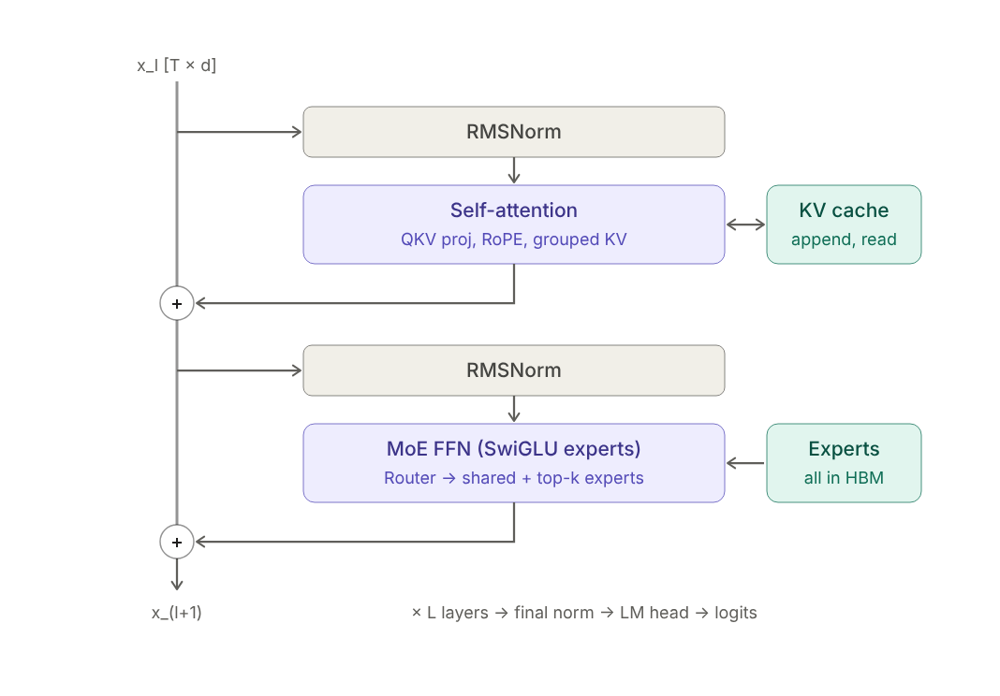

[Open standalone page](assets/16_transformer_moe_block_internals.html)

<details><summary>Diagram source</summary>

````svg
<svg width="100%" viewBox="0 0 680 460" role="img"><title>Inside one transformer MoE block</title><desc>The residual stream runs down the left. A pre-norm branch goes through RMSNorm and self-attention with QKV projection, RoPE and grouped KV heads, which appends to and reads the KV cache, then adds back to the stream. A second pre-norm branch goes through a mixture-of-experts feed-forward block with a router, a shared expert and top-k routed experts, then adds back. The block repeats L times before the final norm and language-model head.</desc>
<defs><marker id="arrow" viewBox="0 0 10 10" refX="8" refY="5" markerWidth="6" markerHeight="6" orient="auto-start-reverse"><path d="M2 1L8 5L2 9" fill="none" stroke="context-stroke" stroke-width="1.5" stroke-linecap="round" stroke-linejoin="round"/></marker></defs>
<text class="ts" x="110" y="30" text-anchor="middle" dominant-baseline="central">x_l  [T × d]</text>
<line x1="110" y1="42" x2="110" y2="188" stroke="var(--border-stronger)" stroke-width="2"/>
<line x1="110" y1="212" x2="110" y2="358" stroke="var(--border-stronger)" stroke-width="2"/>
<line x1="110" y1="382" x2="110" y2="404" class="arr" stroke-width="2" marker-end="url(#arrow)"/>
<text class="ts" x="110" y="420" text-anchor="middle" dominant-baseline="central">x_(l+1)</text>
<circle cx="110" cy="200" r="12" fill="none" stroke="var(--border-stronger)" stroke-width="1"/>
<text class="th" x="110" y="200" text-anchor="middle" dominant-baseline="central">+</text>
<circle cx="110" cy="370" r="12" fill="none" stroke="var(--border-stronger)" stroke-width="1"/>
<text class="th" x="110" y="370" text-anchor="middle" dominant-baseline="central">+</text>
<line x1="110" y1="78" x2="198" y2="78" class="arr" marker-end="url(#arrow)"/>
<g class="c-gray"><rect x="200" y="60" width="300" height="36" rx="6" stroke-width="0.5"/><text class="th" x="350" y="78" text-anchor="middle" dominant-baseline="central">RMSNorm</text></g>
<line x1="350" y1="96" x2="350" y2="114" class="arr" marker-end="url(#arrow)"/>
<g class="node c-purple" onclick="sendPrompt('Explain grouped-query attention and how it reads the KV cache')"><rect x="200" y="116" width="300" height="56" rx="8" stroke-width="0.5"/><text class="th" x="350" y="134" text-anchor="middle" dominant-baseline="central">Self-attention</text><text class="ts" x="350" y="154" text-anchor="middle" dominant-baseline="central">QKV proj, RoPE, grouped KV</text></g>
<g class="node c-teal" onclick="sendPrompt('How big is the KV cache and how do paged attention and quantization shrink it?')"><rect x="530" y="116" width="110" height="56" rx="8" stroke-width="0.5"/><text class="th" x="585" y="134" text-anchor="middle" dominant-baseline="central">KV cache</text><text class="ts" x="585" y="154" text-anchor="middle" dominant-baseline="central">append, read</text></g>
<line x1="502" y1="144" x2="528" y2="144" class="arr" marker-start="url(#arrow)" marker-end="url(#arrow)"/>
<path d="M350 172 L350 200 L124 200" fill="none" class="arr" marker-end="url(#arrow)"/>
<line x1="110" y1="248" x2="198" y2="248" class="arr" marker-end="url(#arrow)"/>
<g class="c-gray"><rect x="200" y="230" width="300" height="36" rx="6" stroke-width="0.5"/><text class="th" x="350" y="248" text-anchor="middle" dominant-baseline="central">RMSNorm</text></g>
<line x1="350" y1="266" x2="350" y2="284" class="arr" marker-end="url(#arrow)"/>
<g class="node c-purple" onclick="sendPrompt('How does the MoE top-k router choose experts and balance load?')"><rect x="200" y="286" width="300" height="56" rx="8" stroke-width="0.5"/><text class="th" x="350" y="304" text-anchor="middle" dominant-baseline="central">MoE FFN (SwiGLU experts)</text><text class="ts" x="350" y="324" text-anchor="middle" dominant-baseline="central">Router → shared + top-k experts</text></g>
<g class="node c-teal" onclick="sendPrompt('Why do MoE models need all expert weights in HBM even though few are active?')"><rect x="530" y="286" width="110" height="56" rx="8" stroke-width="0.5"/><text class="th" x="585" y="304" text-anchor="middle" dominant-baseline="central">Experts</text><text class="ts" x="585" y="324" text-anchor="middle" dominant-baseline="central">all in HBM</text></g>
<line x1="528" y1="314" x2="502" y2="314" class="arr" marker-end="url(#arrow)"/>
<path d="M350 342 L350 370 L124 370" fill="none" class="arr" marker-end="url(#arrow)"/>
<text class="ts" x="400" y="420" text-anchor="middle" dominant-baseline="central">× L layers → final norm → LM head → logits</text>
</svg>
````

</details>

**1. The block in equations**

```
h  = x + Attn( RMSNorm(x) )                 # tokens exchange information
x' = h + FFN ( RMSNorm(h) )                 # each token transformed in place

Attn:  Q = xW_Q  (H heads),  K,V = xW_K, xW_V  (H_kv heads)
       apply RoPE to Q,K;  softmax(QKᵀ/√d_h + mask) V;  concat → W_O
FFN:   SwiGLU  W_2( SiLU(xW_1) ⊙ xW_3 ),   MoE = Σ_topk g_i·Expert_i(x) [+ shared]
```

Each design choice here is a stability or efficiency fix:

- **Pre-norm.** Normalizing before each sublayer keeps the residual path an identity, which is what lets models with 100+ layers train stably.
- **RMSNorm.** Cheaper than LayerNorm, with no measurable quality loss.
- **SwiGLU.** A gated FFN that is better than a plain MLP per parameter.
- **RoPE.** Encodes relative position by rotating Q and K, so attention scores depend on token distance. It is extended to long contexts by rescaling frequencies (YaRN, NTK scaling).
- **Shared expert.** One always-on expert handles common knowledge, which lets the routed experts specialize further (DeepSeek-style).

**2. Parameter accounting.** With d_kv = H_kv · d_h:

```
attention / layer  ≈ 2d² + 2·d·d_kv          (Q,O full;  K,V shrunk by GQA)
dense FFN / layer  ≈ 3·d·d_ff                (SwiGLU has three matrices)
MoE / layer        ≈ E · 3·d·d_expert        (total)   vs   k · 3·d·d_expert (active)
```

A Llama-3-70B-like check (d = 8192, L = 80, H_kv = 8, d_ff = 28,672):

```
attention ≈ 134M + 17M ≈ 151M      FFN ≈ 705M      → ≈ 856M / layer
× 80 layers ≈ 68.5B  + embeddings/head ≈ 2B   →  ≈ 70B  ✓
```

Two takeaways:
- About 80% of the parameters sit in the FFN. That is why MoE targets the FFN rather than attention.
- GQA makes the K/V projections nearly free in parameters. Its real payoff is the cache.

**3. FLOP and memory accounting**

```
forward FLOPs / token  ≈ 2·N_active  +  ~4·L·T·d_attn       (weights  +  attention over context)
training FLOPs         ≈ 6 · N_active · tokens
KV cache / token       = 2 · L · H_kv · d_h · bytes
```

At short context the weight term dominates. Past tens of thousands of tokens, the attention term and the KV bytes take over. That crossover drives the next set of design choices.

**4. Where frontier architectures differ**

| Axis | Choices | Motivation |
|---|---|---|
| Attention span | Full everywhere vs sliding-window layers interleaved with global ones | Cuts KV cache and compute at long context |
| KV compression | MHA → GQA → MQA → MLA (latent KV) | Cache bytes per token |
| Sequence mixer | Pure attention vs hybrid attention + linear attention/SSM (e.g. Jamba-style) | Fixed-size recurrent state alongside exact recall |
| FFN | Dense vs fine-grained MoE (many small experts + shared) | Capacity per FLOP |
| Output head | Next-token only vs multi-token prediction (DeepSeek-V3) | Denser training signal; the MTP head can serve as a speculative draft |
| Precision | BF16 → FP8 training → FP4 inference | Bandwidth and throughput |

**5. Reasoning: what is new at L5**

Reasoning is not a separate module. It is the same block run for many more decode steps, made useful by training:

```
base model ──SFT on long CoT──► knows the format of extended thinking
           ──RL (verifiable)──► learns which thinking actually leads to correct answers
inference: accuracy ∝ log(thinking tokens), roughly, up to a budget
```

- **Sequential compute.** One long chain lets the model revise, check, and backtrack: implicit search, as in the planning answer.
- **Parallel compute.** Sample N chains and take a majority vote or verifier-selected best. This improves reliability and batches well on hardware.
- **Cost.** Thinking tokens are serial decode steps. Each one adds latency, rereads the weights, and grows the KV cache. Reasoning is therefore the workload that stresses the memory-bound regime hardest, which is why budget control (how much to think) is becoming a first-class parameter.

**The whole layer in one line**

L5 is a residual stream that attention writes into, using cached keys and values from the past, and that the FFN or MoE transforms using stored knowledge. Reasoning is that same machine iterated over its own outputs. Nearly every recent architectural change exists to reduce one of three costs: bytes per token (GQA/MLA, quantization), FLOPs per token (MoE), or state per token (sliding windows, SSM hybrids).

---

<a id="turn-15"></a>
## 15. How do vision-language-action models with action chunking and flow matching work?

> **Question:** How do vision-language-action models with action chunking and flow matching work?

A vision-language-action model (VLA) is a pretrained vision-language model fine-tuned to output robot actions instead of, or as well as, text. Two design choices make it work at control rates. Action chunking predicts a short trajectory of future actions per inference instead of one action. Flow matching generates that trajectory as a continuous sample from a learned distribution, rather than as discrete tokens or a regressed average.

**Diagram: `vla_flow_matching_action_chunking`** (static SVG diagram)

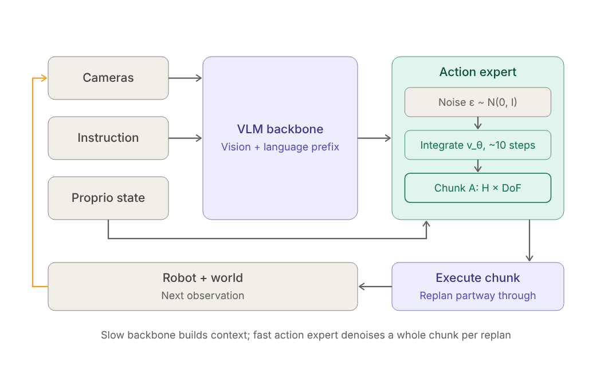

[Open standalone page](assets/17_vla_flow_matching_action_chunking.html)

<details><summary>Diagram source</summary>

````svg
<svg width="100%" viewBox="0 0 680 400" role="img"><title>VLA with flow-matching action expert</title><desc>Camera images and a language instruction go into a VLM backbone. Its prefix conditions an action expert, which also receives proprioceptive state, starts from Gaussian noise and integrates a learned velocity field over about ten steps to produce an action chunk of H steps. The chunk is executed and the policy replans partway through, observing the robot and world again.</desc>
<defs><marker id="arrow" viewBox="0 0 10 10" refX="8" refY="5" markerWidth="6" markerHeight="6" orient="auto-start-reverse"><path d="M2 1L8 5L2 9" fill="none" stroke="context-stroke" stroke-width="1.5" stroke-linecap="round" stroke-linejoin="round"/></marker></defs>
<g class="c-gray"><rect x="40" y="50" width="140" height="50" rx="8" stroke-width="0.5"/><text class="th" x="110" y="75" text-anchor="middle" dominant-baseline="central">Cameras</text></g>
<g class="c-gray"><rect x="40" y="120" width="140" height="50" rx="8" stroke-width="0.5"/><text class="th" x="110" y="145" text-anchor="middle" dominant-baseline="central">Instruction</text></g>
<g class="c-gray"><rect x="40" y="190" width="140" height="50" rx="8" stroke-width="0.5"/><text class="th" x="110" y="215" text-anchor="middle" dominant-baseline="central">Proprio state</text></g>
<line x1="180" y1="75" x2="218" y2="75" class="arr" marker-end="url(#arrow)"/>
<line x1="180" y1="145" x2="218" y2="145" class="arr" marker-end="url(#arrow)"/>
<g class="node c-purple" onclick="sendPrompt('How is a pretrained VLM adapted as the backbone of a robot VLA, and how is language ability preserved?')"><rect x="220" y="50" width="180" height="190" rx="10" stroke-width="0.5"/><text class="th" x="310" y="135" text-anchor="middle" dominant-baseline="central">VLM backbone</text><text class="ts" x="310" y="155" text-anchor="middle" dominant-baseline="central">Vision + language prefix</text></g>
<line x1="400" y1="145" x2="438" y2="145" class="arr" marker-end="url(#arrow)"/>
<g class="c-teal"><rect x="440" y="50" width="200" height="190" rx="10" stroke-width="0.5"/><text class="th" x="540" y="68" text-anchor="middle" dominant-baseline="central">Action expert</text></g>
<g class="c-gray"><rect x="455" y="86" width="170" height="34" rx="6" stroke-width="0.5"/><text class="ts" x="540" y="103" text-anchor="middle" dominant-baseline="central">Noise ε ~ N(0, I)</text></g>
<line x1="540" y1="120" x2="540" y2="134" class="arr" marker-end="url(#arrow)"/>
<g class="node c-teal" onclick="sendPrompt('Walk through the flow matching math for robot action generation in detail')"><rect x="455" y="136" width="170" height="34" rx="6" stroke-width="0.5"/><text class="ts" x="540" y="153" text-anchor="middle" dominant-baseline="central">Integrate v_θ, ~10 steps</text></g>
<line x1="540" y1="170" x2="540" y2="184" class="arr" marker-end="url(#arrow)"/>
<g class="c-teal"><rect x="455" y="186" width="170" height="34" rx="6" stroke-width="1"/><text class="ts" x="540" y="203" text-anchor="middle" dominant-baseline="central">Chunk A: H × DoF</text></g>
<path d="M110 240 L110 262 L480 262 L480 242" fill="none" class="arr" marker-end="url(#arrow)"/>
<line x1="600" y1="240" x2="600" y2="288" class="arr" marker-end="url(#arrow)"/>
<g class="node c-purple" onclick="sendPrompt('How do temporal ensembling and real-time chunking execute action chunks smoothly?')"><rect x="440" y="290" width="200" height="56" rx="8" stroke-width="0.5"/><text class="th" x="540" y="308" text-anchor="middle" dominant-baseline="central">Execute chunk</text><text class="ts" x="540" y="328" text-anchor="middle" dominant-baseline="central">Replan partway through</text></g>
<line x1="440" y1="318" x2="402" y2="318" class="arr" marker-end="url(#arrow)"/>
<g class="c-gray"><rect x="40" y="290" width="360" height="56" rx="8" stroke-width="0.5"/><text class="th" x="220" y="308" text-anchor="middle" dominant-baseline="central">Robot + world</text><text class="ts" x="220" y="328" text-anchor="middle" dominant-baseline="central">Next observation</text></g>
<path d="M40 318 L22 318 L22 75 L38 75" fill="none" class="arr" stroke="#EF9F27" marker-end="url(#arrow)"/>
<text class="ts" x="340" y="374" text-anchor="middle" dominant-baseline="central">Slow backbone builds context; fast action expert denoises a whole chunk per replan</text>
</svg>
````

</details>

**Diagram: `multimodal_actions_regression_vs_flow`** (static SVG diagram)

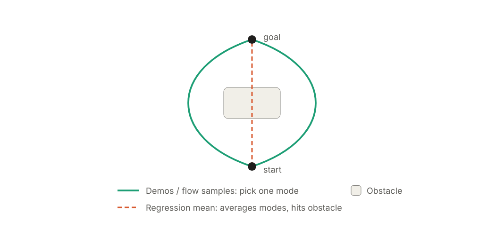

[Open standalone page](assets/18_multimodal_actions_regression_vs_flow.html)

<details><summary>Diagram source</summary>

````svg
<svg width="100%" viewBox="0 0 680 300" role="img"><title>Mode averaging vs sampling</title><desc>From a start point to a goal with an obstacle in between, demonstrations go around either the left or the right. A regression policy averages them into a straight path through the obstacle, while a flow-matching policy samples one of the two valid paths.</desc>
<rect x="300" y="108" width="80" height="44" rx="6" class="c-gray" stroke-width="0.5"/>
<path d="M340 220 C220 180 220 80 340 40" fill="none" stroke="#1D9E75" stroke-width="2.5" stroke-linecap="round"/>
<path d="M340 220 C460 180 460 80 340 40" fill="none" stroke="#1D9E75" stroke-width="2.5" stroke-linecap="round"/>
<line x1="340" y1="220" x2="340" y2="40" stroke="#D85A30" stroke-width="2" stroke-dasharray="6 4"/>
<circle cx="340" cy="220" r="6" fill="var(--text-primary)"/>
<circle cx="340" cy="40" r="6" fill="var(--text-primary)"/>
<text class="ts" x="356" y="224" dominant-baseline="central">start</text>
<text class="ts" x="356" y="36" dominant-baseline="central">goal</text>
<line x1="150" y1="254" x2="180" y2="254" stroke="#1D9E75" stroke-width="2.5"/>
<text class="ts" x="190" y="254" dominant-baseline="central">Demos / flow samples: pick one mode</text>
<line x1="150" y1="278" x2="180" y2="278" stroke="#D85A30" stroke-width="2" stroke-dasharray="6 4"/>
<text class="ts" x="190" y="278" dominant-baseline="central">Regression mean: averages modes, hits obstacle</text>
<rect class="c-gray" x="480" y="247" width="14" height="14" rx="3" stroke-width="0.5"/>
<text class="ts" x="502" y="254" dominant-baseline="central">Obstacle</text>
</svg>
````

</details>

**3. Flow matching: how the chunk is generated**

Learn a velocity field that transports Gaussian noise to the action distribution along straight lines:

```
training (rectified-flow / conditional FM):
  sample  A ~ demos,  ε ~ N(0, I),  τ ~ p(τ) on [0,1]
  A_τ = τ·A + (1 − τ)·ε                       # point on the straight path
  loss = ‖ v_θ(A_τ, τ, o) − (A − ε) ‖²        # regress the path's velocity

inference:
  A ← ε;   for τ = 0, δ, 2δ, …, 1:   A ← A + δ · v_θ(A, τ, o)     # ~10 Euler steps
```

How this compares to diffusion (DDPM):
- **Same expressive power.** Both are continuous generative models over the whole chunk, so they capture multimodality, correlations across DoF and across time, and smoothness.
- **Fewer inference steps.** The training paths are straight, so the learned flow is close to straight and a coarse ODE integration of about 10 steps is enough. DDPM typically needs tens to hundreds.
- **Lower latency per step.** Each step reuses the cached VLM prefix, so it costs one pass of the small action expert, not the full model.

**4. Action chunking: why predict H steps at once**

π0-style policies predict about 50 steps at about 50 Hz, which is roughly one second of motion per inference.

- **Fewer decisions means less compounding error.** Errors compound over the number of policy queries, not the number of motor ticks. Chunks shorten the effective horizon by a factor of H.
- **Temporal consistency.** Each chunk is one coherent sample, so it avoids the jitter you get when independent per-step predictions flip between modes.
- **Latency hiding.** A 100–300 ms inference can drive a 50 Hz or faster controller.
- **Non-Markovian demos.** Pauses and multi-phase motions in human teleoperation are easier to model as whole segments.

Three ways to execute chunks:

```
receding horizon     execute first k of H, replan          (MPC-like; k trades reactivity vs smoothness)
temporal ensembling  average overlapping chunk predictions (ACT; smooth but can blur modes)
real-time chunking   run inference asynchronously while executing; constrain the new chunk
                     to match the already-committed prefix (inpainting-style guidance)
```

The trade-off is that the executed portion of a chunk is open-loop. A shove, or an object slipping mid-chunk, isn't corrected until the next replan. This is why the safety layer and the low-level controller from the physical-AI stack still sit underneath the VLA.

**5. Training recipe**

```
1. VLM pretraining          web image-text            → semantics, grounding
2. Robot pretraining        cross-embodiment data      → general manipulation priors
   (+ web co-training)      keep language/vision alive → avoids catastrophic forgetting
3. Task post-training       high-quality teleop        → dexterity on target tasks
```

One refinement trains the backbone on discrete FAST action tokens while stopping the action expert's gradients from flowing into the VLM. The flow head gets clean continuous control, and the backbone's semantic knowledge isn't overwritten by noisy regression gradients. Physical Intelligence calls this "knowledge insulation" in the π0.5-era work.

**6. Open problems, seen from the belief-state side**

- **Mostly memoryless.** Most VLAs condition on the current frame or a short history. There is no persistent belief, so occlusions and long tasks break them. The memory problem from the agent stack reappears here.
- **Implicit uncertainty that goes unused.** Because flow matching is generative, you can draw N chunks and measure their spread: agreement means confidence, divergence means ambiguity. That spread is a free uncertainty signal that safety filters and active-perception policies could consume. Most stacks currently discard it.
- **Weak 3D.** Inputs are mostly RGB plus proprioception. Depth, point clouds, and LiDAR geometry are rarely integrated end-to-end, even though contact-rich manipulation is fundamentally 3D. Lifting 3D features into the VLM token stream, rather than relying on 2D image patches, is an active and underexplored direction.
- **Reactivity vs smoothness.** Chunk length and replan rate are still hand-tuned. Learning when to replan, triggered by innovation between the predicted and observed state, is the filtering answer and is mostly unexplored.

**In one line**

A VLA is a VLM whose output head became a conditional ODE. The backbone decides what to do; the flow head samples how to move, one coherent chunk at a time. Chunking turns slow inference into smooth, fast control at the price of being open-loop between replans.

---

<a id="turn-16"></a>
## 16. Explain GRPO group-relative advantages vs PPO with a value function

> **Question:** Explain GRPO group-relative advantages vs PPO with a value function

Both are policy-gradient methods with the same clipped surrogate objective. They differ in one thing: where the baseline comes from. PPO learns a critic network that predicts the expected reward. GRPO estimates the expected reward empirically, by sampling a group of answers to the same prompt and comparing them to each other.

**Diagram: `ppo_vs_grpo_advantage_pipeline`** (static SVG diagram)

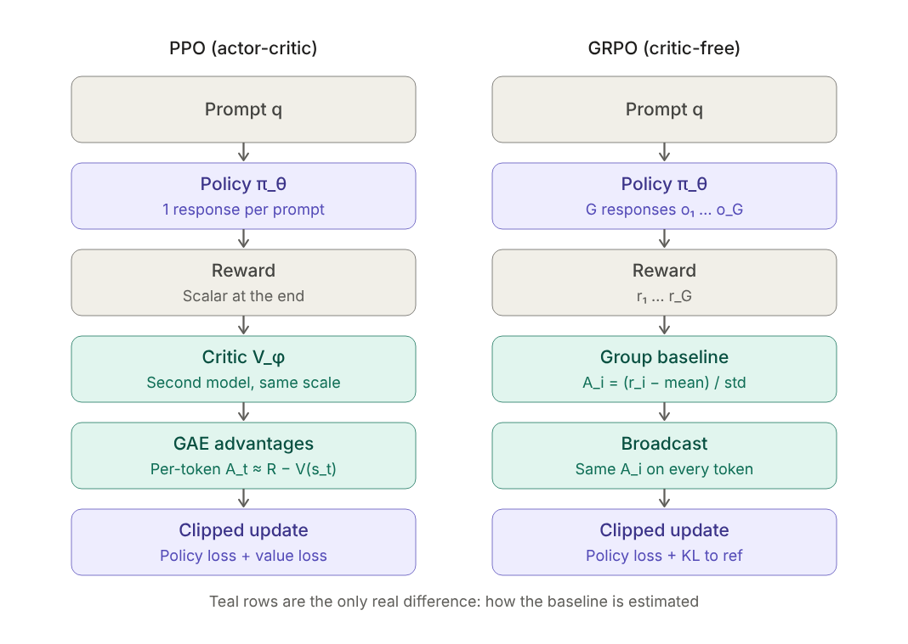

[Open standalone page](assets/19_ppo_vs_grpo_advantage_pipeline.html)

<details><summary>Diagram source</summary>

````svg
<svg width="100%" viewBox="0 0 680 470" role="img"><title>PPO vs GRPO advantage computation</title><desc>PPO samples one response per prompt, scores it, uses a learned critic of similar size to the policy to estimate per-token values, computes per-token GAE advantages, and updates both policy and critic. GRPO samples a group of responses per prompt, scores each, normalizes rewards within the group to get advantages, broadcasts each response's advantage to all its tokens, and updates the policy with a KL penalty to a reference model.</desc>
<defs><marker id="arrow" viewBox="0 0 10 10" refX="8" refY="5" markerWidth="6" markerHeight="6" orient="auto-start-reverse"><path d="M2 1L8 5L2 9" fill="none" stroke="context-stroke" stroke-width="1.5" stroke-linecap="round" stroke-linejoin="round"/></marker></defs>
<text class="th" x="175" y="22" text-anchor="middle" dominant-baseline="central">PPO (actor-critic)</text>
<text class="th" x="505" y="22" text-anchor="middle" dominant-baseline="central">GRPO (critic-free)</text>
<g class="c-gray"><rect x="40" y="44" width="270" height="52" rx="8" stroke-width="0.5"/><text class="th" x="175" y="70" text-anchor="middle" dominant-baseline="central">Prompt q</text></g>
<g class="c-purple"><rect x="40" y="112" width="270" height="52" rx="8" stroke-width="0.5"/><text class="th" x="175" y="129" text-anchor="middle" dominant-baseline="central">Policy π_θ</text><text class="ts" x="175" y="148" text-anchor="middle" dominant-baseline="central">1 response per prompt</text></g>
<g class="c-gray"><rect x="40" y="180" width="270" height="52" rx="8" stroke-width="0.5"/><text class="th" x="175" y="197" text-anchor="middle" dominant-baseline="central">Reward</text><text class="ts" x="175" y="216" text-anchor="middle" dominant-baseline="central">Scalar at the end</text></g>
<g class="node c-teal" onclick="sendPrompt('How is the value network trained in PPO for LLMs and why is it hard?')"><rect x="40" y="248" width="270" height="52" rx="8" stroke-width="0.5"/><text class="th" x="175" y="265" text-anchor="middle" dominant-baseline="central">Critic V_φ</text><text class="ts" x="175" y="284" text-anchor="middle" dominant-baseline="central">Second model, same scale</text></g>
<g class="node c-teal" onclick="sendPrompt('Explain GAE generalized advantage estimation and the bias-variance tradeoff of lambda')"><rect x="40" y="316" width="270" height="52" rx="8" stroke-width="0.5"/><text class="th" x="175" y="333" text-anchor="middle" dominant-baseline="central">GAE advantages</text><text class="ts" x="175" y="352" text-anchor="middle" dominant-baseline="central">Per-token A_t ≈ R − V(s_t)</text></g>
<g class="c-purple"><rect x="40" y="384" width="270" height="52" rx="8" stroke-width="0.5"/><text class="th" x="175" y="401" text-anchor="middle" dominant-baseline="central">Clipped update</text><text class="ts" x="175" y="420" text-anchor="middle" dominant-baseline="central">Policy loss + value loss</text></g>
<g class="c-gray"><rect x="370" y="44" width="270" height="52" rx="8" stroke-width="0.5"/><text class="th" x="505" y="70" text-anchor="middle" dominant-baseline="central">Prompt q</text></g>
<g class="c-purple"><rect x="370" y="112" width="270" height="52" rx="8" stroke-width="0.5"/><text class="th" x="505" y="129" text-anchor="middle" dominant-baseline="central">Policy π_θ</text><text class="ts" x="505" y="148" text-anchor="middle" dominant-baseline="central">G responses o₁ … o_G</text></g>
<g class="c-gray"><rect x="370" y="180" width="270" height="52" rx="8" stroke-width="0.5"/><text class="th" x="505" y="197" text-anchor="middle" dominant-baseline="central">Reward</text><text class="ts" x="505" y="216" text-anchor="middle" dominant-baseline="central">r₁ … r_G</text></g>
<g class="node c-teal" onclick="sendPrompt('What biases does GRPO std and length normalization introduce, and how do Dr. GRPO and DAPO fix them?')"><rect x="370" y="248" width="270" height="52" rx="8" stroke-width="0.5"/><text class="th" x="505" y="265" text-anchor="middle" dominant-baseline="central">Group baseline</text><text class="ts" x="505" y="284" text-anchor="middle" dominant-baseline="central">A_i = (r_i − mean) / std</text></g>
<g class="c-teal"><rect x="370" y="316" width="270" height="52" rx="8" stroke-width="0.5"/><text class="th" x="505" y="333" text-anchor="middle" dominant-baseline="central">Broadcast</text><text class="ts" x="505" y="352" text-anchor="middle" dominant-baseline="central">Same A_i on every token</text></g>
<g class="c-purple"><rect x="370" y="384" width="270" height="52" rx="8" stroke-width="0.5"/><text class="th" x="505" y="401" text-anchor="middle" dominant-baseline="central">Clipped update</text><text class="ts" x="505" y="420" text-anchor="middle" dominant-baseline="central">Policy loss + KL to ref</text></g>
<line x1="175" y1="96" x2="175" y2="110" class="arr" marker-end="url(#arrow)"/><line x1="175" y1="164" x2="175" y2="178" class="arr" marker-end="url(#arrow)"/><line x1="175" y1="232" x2="175" y2="246" class="arr" marker-end="url(#arrow)"/><line x1="175" y1="300" x2="175" y2="314" class="arr" marker-end="url(#arrow)"/><line x1="175" y1="368" x2="175" y2="382" class="arr" marker-end="url(#arrow)"/>
<line x1="505" y1="96" x2="505" y2="110" class="arr" marker-end="url(#arrow)"/><line x1="505" y1="164" x2="505" y2="178" class="arr" marker-end="url(#arrow)"/><line x1="505" y1="232" x2="505" y2="246" class="arr" marker-end="url(#arrow)"/><line x1="505" y1="300" x2="505" y2="314" class="arr" marker-end="url(#arrow)"/><line x1="505" y1="368" x2="505" y2="382" class="arr" marker-end="url(#arrow)"/>
<text class="ts" x="340" y="456" text-anchor="middle" dominant-baseline="central">Teal rows are the only real difference: how the baseline is estimated</text>
</svg>
````

</details>

**The shared core.** Both maximize the same clipped surrogate objective:

```
ρ_t(θ) = π_θ(a_t | s_t) / π_old(a_t | s_t)
L      = E_t [ min( ρ_t · A_t,  clip(ρ_t, 1−ε, 1+ε) · A_t ) ]
```

The clip forms a trust region: each step can't move token probabilities too far from the policy that generated the data. The only open question is what A_t is.

**PPO: a learned per-token baseline**

```
δ_t = r_t + γ·V_φ(s_{t+1}) − V_φ(s_t)
A_t = Σ_l (γλ)^l · δ_{t+l}                    # GAE
critic loss = ( V_φ(s_t) − R̂_t )²
```

With LLMs, typically γ = λ = 1 and the reward arrives only at the end. The advantage then collapses to A_t = R − V_φ(s_t): "how much better did this end up than the critic expected from this partial response?"

- **In principle:** per-token credit assignment. If V jumps after a key step, tokens around that step receive more credit.
- **In practice:**
  - The critic is usually initialized from a model about the size of the policy, so you pay double the memory and compute.
  - The critic must learn to predict the final outcome from a partial text, which is hard and noisy.
  - A badly fit critic injects bias directly into every advantage.

**GRPO: an empirical per-prompt baseline**

```
sample o_1 … o_G ~ π_old(· | q),   rewards r_1 … r_G
Â_i,t = ( r_i − mean(r) ) / std(r)        for every token t of o_i
L = mean_i  mean_t [ clipped surrogate with Â_i ]  −  β · KL(π_θ ‖ π_ref)
```

The KL term is usually the k3 estimator, π_ref/π_θ − log(π_ref/π_θ) − 1, added to the loss rather than folded into the reward.

- **No critic:** about half the training memory, and one less model to tune.
- **An unbiased baseline for the prompt's difficulty:** the group mean is a Monte Carlo estimate of E[R | q].
- **No intra-sequence credit:** every token in a good answer gets the same push, including the tokens that didn't matter.

**Worked example (G = 4, binary verifier)**

```
rewards [1, 0, 0, 1]  → mean 0.50, std 0.50 → A = [+1.00, −1.00, −1.00, +1.00]
rewards [1, 0, 0, 0]  → mean 0.25, std 0.43 → A = [+1.73, −0.58, −0.58, −0.58]
rewards [0, 0, 0, 0]  → std 0              → A = 0  → zero gradient, compute wasted
rewards [1, 1, 1, 1]  → same: nothing to learn from
```

GRPO learns only from prompts at the edge of the model's ability, where it sometimes succeeds and sometimes fails. A rare success on a hard prompt gets amplified, which is useful. Prompts that are too easy or too hard produce no gradient at all.

**Side by side**

| | PPO | GRPO |
|---|---|---|
| Baseline | Learned V_φ(s_t) | Group mean of G samples for the same prompt |
| Credit assignment | Per token, in principle | Per sequence (broadcast) |
| Extra model | Critic of similar size | None |
| Samples per prompt | 1 is enough | G (typically 4–64) |
| Bias source | Critic approximation error | Normalization choices (below) |
| Variance source | Single-sample returns | Finite G |
| Best fit | Dense or shaped rewards, continuous control, long horizons | Sparse verifiable outcomes: math, code, agent task success |

**Known biases in GRPO and their fixes**

| Issue | Cause | Fix |
|---|---|---|
| Length bias | Dividing each sequence's loss by its length weakens the per-token penalty on long wrong answers | Token-level aggregation across the batch (Dr. GRPO, DAPO) |
| Difficulty bias | Dividing by std upweights prompts with low variance | Drop the std normalization (Dr. GRPO), or use RLOO's leave-one-out mean |
| Dead groups | All-correct or all-wrong groups give zero signal | Dynamic sampling: filter or resample those prompts (DAPO) |
| Entropy collapse | Symmetric clipping limits how much rare good tokens can grow | "Clip-higher": an asymmetric, larger upper ε (DAPO) |
| Self-inclusion | A sample's own reward is part of its baseline | RLOO: the baseline is the mean of the other G−1 samples, which is unbiased |

**The estimation-theory view**

The baseline is a control variate. Subtracting any function b(s) that doesn't depend on the action leaves the gradient unbiased and only changes its variance. The two methods choose different estimators of the same quantity, E[R | state]:

- **PPO is the parametric choice.** It fits a model V_φ, like an EKF carrying a linearized model of the dynamics. Its accuracy depends on that model, and model error becomes bias.
- **GRPO is the ensemble choice.** It estimates the statistic from G samples drawn from the current policy, like an EnKF using ensemble statistics instead of an analytic model. It has no model bias but has sampling variance, and it degenerates when the ensemble collapses: zero spread means a zero advantage.

The fixes map over as well. Dropping the std division resembles removing a misguided normalization of the ensemble. Dynamic sampling resembles resampling a degenerate ensemble. Larger G reduces variance at linear cost, just like adding ensemble members.

**Practical guidance**

- Use **GRPO or RLOO-style group baselines** for LLM reasoning and agent RL with outcome verifiers. Apply the Dr. GRPO and DAPO fixes, and size G so most prompts land in mixed groups.
- Use **PPO with a critic** when rewards are dense or shaped, when the horizon is long and per-step credit matters (robotics locomotion, multi-turn agents with intermediate rewards), or when sampling G rollouts per state is impossible, as in physical systems that can't be reset to the same state.
- **For long agentic trajectories,** neither is ideal on its own. The trend is toward hybrids: group baselines for the outcome plus turn-level or process rewards for credit assignment, which reintroduce some of what the critic was meant to provide.

---

<a id="turn-17"></a>
## 17. Explain grouped-query attention and how it reads the KV cache

> **Question:** Explain grouped-query attention and how it reads the KV cache

The earlier answer covered the concept: H_q query heads share H_kv cached K/V heads, with group size g = H_q / H_kv. This one goes one level down, into what a decode kernel actually does with the cache in memory.

**Diagram: `gqa_decode_kernel_kv_cache_read_path`** (static SVG diagram)

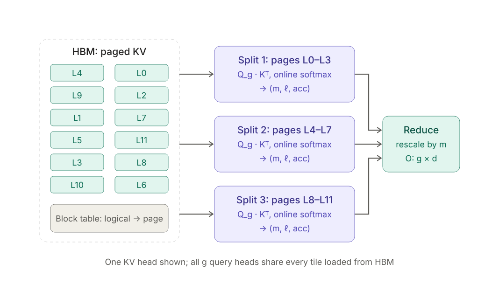

[Open standalone page](assets/20_gqa_decode_kernel_kv_cache_read_path.html)

<details><summary>Diagram source</summary>

````svg
<svg width="100%" viewBox="0 0 680 380" role="img"><title>GQA decode kernel read path</title><desc>The KV cache for one KV head lives in HBM as scattered pages located through a block table. The sequence is split across parallel compute blocks; each loads its K and V tiles into SRAM once, computes scores for all g grouped query heads, and keeps an online-softmax partial result. A final reduction rescales and merges the partials into the output for the g heads.</desc>
<defs><marker id="arrow" viewBox="0 0 10 10" refX="8" refY="5" markerWidth="6" markerHeight="6" orient="auto-start-reverse"><path d="M2 1L8 5L2 9" fill="none" stroke="context-stroke" stroke-width="1.5" stroke-linecap="round" stroke-linejoin="round"/></marker></defs>
<rect x="40" y="40" width="200" height="290" rx="12" fill="none" stroke="var(--border-strong)" stroke-width="0.5" stroke-dasharray="4 4"/>
<text class="th" x="140" y="58" text-anchor="middle" dominant-baseline="central">HBM: paged KV</text>
<g class="c-teal">
<rect x="56" y="76" width="76" height="24" rx="4" stroke-width="0.5"/><rect x="148" y="76" width="76" height="24" rx="4" stroke-width="0.5"/>
<rect x="56" y="108" width="76" height="24" rx="4" stroke-width="0.5"/><rect x="148" y="108" width="76" height="24" rx="4" stroke-width="0.5"/>
<rect x="56" y="140" width="76" height="24" rx="4" stroke-width="0.5"/><rect x="148" y="140" width="76" height="24" rx="4" stroke-width="0.5"/>
<rect x="56" y="172" width="76" height="24" rx="4" stroke-width="0.5"/><rect x="148" y="172" width="76" height="24" rx="4" stroke-width="0.5"/>
<rect x="56" y="204" width="76" height="24" rx="4" stroke-width="0.5"/><rect x="148" y="204" width="76" height="24" rx="4" stroke-width="0.5"/>
<rect x="56" y="236" width="76" height="24" rx="4" stroke-width="0.5"/><rect x="148" y="236" width="76" height="24" rx="4" stroke-width="0.5"/>
<text class="ts" x="94" y="88" text-anchor="middle" dominant-baseline="central">L4</text><text class="ts" x="186" y="88" text-anchor="middle" dominant-baseline="central">L0</text>
<text class="ts" x="94" y="120" text-anchor="middle" dominant-baseline="central">L9</text><text class="ts" x="186" y="120" text-anchor="middle" dominant-baseline="central">L2</text>
<text class="ts" x="94" y="152" text-anchor="middle" dominant-baseline="central">L1</text><text class="ts" x="186" y="152" text-anchor="middle" dominant-baseline="central">L7</text>
<text class="ts" x="94" y="184" text-anchor="middle" dominant-baseline="central">L5</text><text class="ts" x="186" y="184" text-anchor="middle" dominant-baseline="central">L11</text>
<text class="ts" x="94" y="216" text-anchor="middle" dominant-baseline="central">L3</text><text class="ts" x="186" y="216" text-anchor="middle" dominant-baseline="central">L8</text>
<text class="ts" x="94" y="248" text-anchor="middle" dominant-baseline="central">L10</text><text class="ts" x="186" y="248" text-anchor="middle" dominant-baseline="central">L6</text>
</g>
<g class="c-gray"><rect x="56" y="276" width="168" height="40" rx="6" stroke-width="0.5"/><text class="ts" x="140" y="296" text-anchor="middle" dominant-baseline="central">Block table: logical → page</text></g>
<line x1="240" y1="90" x2="288" y2="90" class="arr" marker-end="url(#arrow)"/>
<line x1="240" y1="190" x2="288" y2="190" class="arr" marker-end="url(#arrow)"/>
<line x1="240" y1="290" x2="288" y2="290" class="arr" marker-end="url(#arrow)"/>
<g class="node c-purple" onclick="sendPrompt('How does FlashDecoding split-K parallelism work on GPUs?')"><rect x="290" y="50" width="200" height="80" rx="8" stroke-width="0.5"/><text class="th" x="390" y="70" text-anchor="middle" dominant-baseline="central">Split 1: pages L0–L3</text><text class="ts" x="390" y="90" text-anchor="middle" dominant-baseline="central">Q_g · Kᵀ, online softmax</text><text class="ts" x="390" y="110" text-anchor="middle" dominant-baseline="central">→ (m, ℓ, acc)</text></g>
<g class="node c-purple" onclick="sendPrompt('How does FlashDecoding split-K parallelism work on GPUs?')"><rect x="290" y="150" width="200" height="80" rx="8" stroke-width="0.5"/><text class="th" x="390" y="170" text-anchor="middle" dominant-baseline="central">Split 2: pages L4–L7</text><text class="ts" x="390" y="190" text-anchor="middle" dominant-baseline="central">Q_g · Kᵀ, online softmax</text><text class="ts" x="390" y="210" text-anchor="middle" dominant-baseline="central">→ (m, ℓ, acc)</text></g>
<g class="node c-purple" onclick="sendPrompt('How does FlashDecoding split-K parallelism work on GPUs?')"><rect x="290" y="250" width="200" height="80" rx="8" stroke-width="0.5"/><text class="th" x="390" y="270" text-anchor="middle" dominant-baseline="central">Split 3: pages L8–L11</text><text class="ts" x="390" y="290" text-anchor="middle" dominant-baseline="central">Q_g · Kᵀ, online softmax</text><text class="ts" x="390" y="310" text-anchor="middle" dominant-baseline="central">→ (m, ℓ, acc)</text></g>
<path d="M490 90 L510 90 L510 170 L528 170" fill="none" class="arr" marker-end="url(#arrow)"/>
<line x1="490" y1="190" x2="528" y2="190" class="arr" marker-end="url(#arrow)"/>
<path d="M490 290 L510 290 L510 210 L528 210" fill="none" class="arr" marker-end="url(#arrow)"/>
<g class="node c-teal" onclick="sendPrompt('Explain the online softmax rescaling math used to merge attention partials')"><rect x="530" y="150" width="110" height="80" rx="8" stroke-width="0.5"/><text class="th" x="585" y="170" text-anchor="middle" dominant-baseline="central">Reduce</text><text class="ts" x="585" y="190" text-anchor="middle" dominant-baseline="central">rescale by m</text><text class="ts" x="585" y="210" text-anchor="middle" dominant-baseline="central">O: g × d</text></g>
<text class="ts" x="340" y="358" text-anchor="middle" dominant-baseline="central">One KV head shown; all g query heads share every tile loaded from HBM</text>
</svg>
````

</details>

**1. Pack the group into one matrix**

During decode each query head has a single row, q ∈ ℝ^d. The kernel stacks the g heads that share a KV head into Q_g ∈ ℝ^(g×d). The score computation then becomes a small matrix-matrix product instead of g separate matrix-vector products:

```
S = Q_g · K_tileᵀ        (g × T)       one K tile, g queries
O += P · V_tile          (g × d)
```

This matters on tensor cores. Their MMA instructions have a minimum M dimension (16 on many NVIDIA GPUs). With g = 8, half of each MMA is padding, so kernels pack extra rows from other batch sequences or other KV heads to fill it. GQA is what makes M > 1 possible in the first place.

**2. Split the sequence for parallelism (FlashDecoding)**

At batch 1 there are only H_kv × L independent units of work, which is far too few to fill around 100 SMs. So the kernel splits the context length t across thread blocks. Each block streams its pages into SRAM and keeps a running online-softmax state:

```
m' = max(m, rowmax(S))
ℓ' = ℓ·e^(m − m') + Σ e^(S − m')
acc' = acc·e^(m − m') + e^(S − m')·V
```

A final reduction merges the split results with weights e^(m_i − m*), then divides by the combined ℓ. The result is mathematically identical to one global softmax.

**3. Indirection through paged memory**

The cache is stored in fixed blocks (often 16 tokens). A per-sequence block table maps logical token positions to physical pages, which is why the HBM grid in the diagram is scrambled.

- **Benefit:** no fragmentation, cheap growth, and prefix sharing (several requests pointing at the same physical pages, copy-on-write).
- **Cost:** gather loads instead of contiguous streaming. Kernels hide this by making each page large enough to amortize the lookup.

**4. Bytes per decode step**

Llama-3-70B-like dimensions (L = 80, H_kv = 8, d_h = 128, FP16), at 32k context:

```
per layer, per sequence:  2 · 8 · 128 · 32,768 · 2 B ≈ 134 MB
× 80 layers              ≈ 10.7 GB read per decode step, per sequence

batch 1:   10.7 GB KV   vs 140 GB weights   → weights dominate
batch 32:  343 GB KV    vs 140 GB weights   → KV dominates
```

That crossover is where GQA earns its keep. With full MHA (H_kv = 64) the KV traffic would be 8× higher, so long-context batching would hit the bandwidth wall eight times sooner.

**5. Prefill vs decode, same cache, different kernels**

| | Prefill | Decode |
|---|---|---|
| Queries | Thousands of rows per head | 1 row per head (g rows per KV head) |
| Kernel | FlashAttention: tile Q and K/V | FlashDecoding: split along K/V, pack g |
| Bound by | Compute | HBM bandwidth (cache + weights) |
| Cache | Written | Read in full, then one row appended |

**6. The limit case: absorbed MLA**

DeepSeek's MLA at decode time folds the up-projection into the query side. Every query head (128 of them) then attends to the same cached latent (about 512 + 64 dimensions). Structurally that is MQA with a very wide head and g = 128, so tiles are fully dense with no packing tricks needed, and arithmetic intensity is far higher than GQA-8.

The direction across GQA, MQA, and MLA is the same. Each grows the number of query rows that consume every K/V byte loaded from HBM.

**ASIC implications**

From the earlier floorplan, the GQA decode path wants three things from hardware:
- SRAM tiles sized to hold a page of K/V plus g query rows.
- A gather engine that follows block tables without stalling.
- A small reduction unit for merging split partials.

Groq- and Etched-style designs, and the newer GPU tensor-memory features, are largely about making this exact access pattern run at full HBM speed.

---

<a id="turn-18"></a>
## 18. How big is the KV cache and how do paged attention and quantization shrink it?

> **Question:** How big is the KV cache and how do paged attention and quantization shrink it?

The cache has to hold, for every layer and every token so far, one key vector and one value vector per KV head. Paged attention and quantization attack its size in different ways:

- Paged attention doesn't make any single token's entry smaller. It removes the memory that gets reserved but never used, and lets sequences share common pages.
- Quantization makes each stored number smaller.

The two effects multiply. Try it:

**Diagram: `kv_cache_size_paging_quantization_calculator`** (interactive HTML widget)

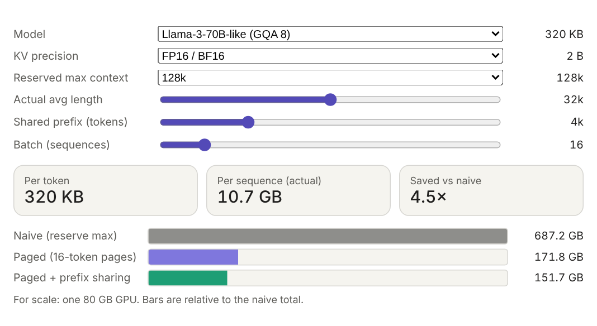

[Open standalone page](assets/21_kv_cache_size_paging_quantization_calculator.html)

<details><summary>Diagram source</summary>

````html
<h2 class="sr-only">Calculator for KV cache memory across model presets, context length, batch size and precision, comparing naive max-length reservation against paged allocation and prefix sharing.</h2>
<style>
.r{display:flex;align-items:center;gap:12px;font-size:13px;color:var(--text-secondary);margin:7px 0}
.r label{width:160px}.r input,.r select{flex:1}.r output{width:84px;text-align:right;color:var(--text-primary);font-variant-numeric:tabular-nums}
.g{display:grid;grid-template-columns:repeat(auto-fit,minmax(140px,1fr));gap:10px;margin:14px 0}
.c{background:var(--surface-1);border:0.5px solid var(--border);border-radius:12px;padding:10px 12px}
.c .k{font-size:12px;color:var(--text-secondary)}.c .v{font-size:20px;font-weight:500;color:var(--text-primary);font-variant-numeric:tabular-nums}
.b{display:flex;align-items:center;gap:10px;font-size:13px;margin:5px 0}
.b .n{width:150px;color:var(--text-secondary)}.b .t{flex:1;height:18px;background:var(--surface-1);border:0.5px solid var(--border);border-radius:4px;overflow:hidden}
.b .f{height:100%;transition:width .15s}.b .v{width:80px;text-align:right;font-variant-numeric:tabular-nums;color:var(--text-primary)}
</style>
<div style="padding:0.5rem 0">
<div class="r"><label for="m">Model</label><select id="m">
<option value="524288">Llama-2-7B-like (MHA, 32 heads)</option>
<option value="131072">Llama-3-8B-like (GQA 8)</option>
<option value="327680" selected>Llama-3-70B-like (GQA 8)</option>
<option value="70272">DeepSeek-V3-like (MLA latent)</option>
</select><output id="mo"></output></div>
<div class="r"><label for="q">KV precision</label><select id="q">
<option value="2">FP16 / BF16</option><option value="1">FP8</option><option value="0.5">INT4</option><option value="0.25">2-bit</option>
</select><output id="qo"></output></div>
<div class="r"><label for="x">Reserved max context</label><select id="x">
<option value="8192">8k</option><option value="32768">32k</option><option value="131072" selected>128k</option><option value="1048576">1M</option>
</select><output id="xo"></output></div>
<div class="r"><label for="a">Actual avg length</label><input id="a" type="range" min="10" max="20" step="0.25" value="15"><output id="ao"></output></div>
<div class="r"><label for="p">Shared prefix (tokens)</label><input id="p" type="range" min="0" max="16384" step="512" value="4096"><output id="po"></output></div>
<div class="r"><label for="n">Batch (sequences)</label><input id="n" type="range" min="1" max="128" value="16"><output id="no"></output></div>
<div class="g">
<div class="c"><div class="k">Per token</div><div class="v" id="pt"></div></div>
<div class="c"><div class="k">Per sequence (actual)</div><div class="v" id="ps"></div></div>
<div class="c"><div class="k">Saved vs naive</div><div class="v" id="sv"></div></div>
</div>
<div class="b"><span class="n">Naive (reserve max)</span><div class="t"><div class="f" id="f1" style="background:var(--border-stronger)"></div></div><span class="v" id="v1"></span></div>
<div class="b"><span class="n">Paged (16-token pages)</span><div class="t"><div class="f" id="f2" style="background:#7F77DD"></div></div><span class="v" id="v2"></span></div>
<div class="b"><span class="n">Paged + prefix sharing</span><div class="t"><div class="f" id="f3" style="background:#1D9E75"></div></div><span class="v" id="v3"></span></div>
<div style="font-size:12px;color:var(--text-secondary);margin-top:8px">For scale: one 80 GB GPU. Bars are relative to the naive total.</div>
</div>
<script>
const $=i=>document.getElementById(i);
const fmtB=b=>b>=1e12?(b/1e12).toFixed(2)+' TB':b>=1e9?(b/1e9).toFixed(1)+' GB':(b/1e6).toFixed(0)+' MB';
const fmtT=t=>t>=1048576?(t/1048576).toFixed(1)+'M':t>=1024?Math.round(t/1024)+'k':t;
function u(){
const base=+$('m').value,prec=+$('q').value,mx=+$('x').value,B=+$('n').value;
let L=Math.min(Math.round(Math.pow(2,+$('a').value)),mx);
let P=Math.min(+$('p').value,L);
const per=base*prec/2;
$('mo').textContent=(base/1024).toFixed(0)+' KB';$('qo').textContent=prec+' B';$('xo').textContent=fmtT(mx);
$('ao').textContent=fmtT(L);$('po').textContent=fmtT(P);$('no').textContent=B;
const pg=t=>Math.ceil(t/16)*16;
const naive=B*mx*per, paged=B*pg(L)*per, shared=(pg(P)+B*pg(L-P))*per;
$('pt').textContent=(per/1024).toFixed(per<10240?1:0)+' KB';
$('ps').textContent=fmtB(L*per);
$('sv').textContent=(naive/shared).toFixed(1)+'×';
[[naive,'1'],[paged,'2'],[shared,'3']].forEach(([v,i])=>{$('f'+i).style.width=Math.max(v/naive*100,0.5)+'%';$('v'+i).textContent=fmtB(v);});
}
['m','q','x','a','p','n'].forEach(i=>$(i).addEventListener('input',u));u();
</script>
````

</details>

**1. The size formula**

```
KV bytes = 2 · L · H_kv · d_h · bytes_per_elem · tokens · sequences
           ↑   ↑     ↑                  ↑
          K+V layers  heads      ← architecture    ← precision   ← workload
```

| Model (FP16) | Per token | 128k context, 1 sequence |
|---|---|---|
| Llama-2-7B-like (MHA) | 512 KB | 69 GB |
| Llama-3-8B-like (GQA 8) | 128 KB | 17 GB |
| Llama-3-70B-like (GQA 8) | 320 KB | 43 GB |
| DeepSeek-V3-like (MLA, 576-dim latent) | ~69 KB | 9 GB |

At long context, a single sequence's cache can match or exceed the size of the weights. With batching it is usually the largest memory consumer on the device.

**2. Paged attention: removing waste, not shrinking tokens**

Before vLLM, servers reserved a contiguous buffer per request sized for the maximum possible length. That wasted memory in three ways:

- **Reservation:** space set aside for tokens never generated.
- **Internal fragmentation:** the unused tail of each buffer.
- **External fragmentation:** gaps between buffers too small to reuse.

The vLLM paper reported that existing systems wasted most of their KV memory this way.

Paging borrows virtual memory from operating systems:

```
logical tokens:   [0..15][16..31][32..47] …     per sequence
block table:        → p7    → p2    → p19        indirection
physical pages:   fixed-size blocks anywhere in HBM, allocated on demand
```

- **Waste:** under one page (at most 15 tokens) per sequence, instead of the full gap between max and actual length.
- **Prefix sharing:** requests with the same system prompt or few-shot examples point at the same physical pages, with a reference count and copy-on-write. This is the third bar in the calculator. Beam search and parallel sampling (GRPO's G samples) share their prompt the same way.
- **Preemption:** under memory pressure, pages can be swapped to CPU memory or dropped and recomputed later.
- **Payoff:** more sequences fit in the same memory, so batch size goes up. As covered under HBM, larger batches are what move decode toward the compute roofline. Paging saves memory, but its real benefit is throughput.

**3. Quantization: fewer bits per element**

| Precision | Shrink vs FP16 | Quality | Notes |
|---|---|---|---|
| FP8 (E4M3) | 2× | Near-lossless | Per-tensor or per-head scales; widely deployed |
| INT4 | 4× | Small loss | Needs the per-channel/per-token trick below |
| 2-bit | 8× | Degrades long-context retrieval | Research, plus mixed-precision schemes |

The key insight comes from KIVI and KVQuant: keys and values have different statistics.

- **Keys** have a few outlier channels with consistently large values, so quantize them per channel.
- **Values** have no channel structure, but their errors are mixed by the attention weights, so quantize them per token.
- **Residual window:** keep the most recent tokens in full precision, since attention usually weights them heavily, and quantize older ones as they age out.
- **Pre-RoPE keys:** quantizing keys before the rotary embedding makes the outlier pattern more regular.

Dequantization is fused into the attention kernel, and its cost is close to zero. Decode is memory-bound, so the compute units are idle anyway. Every halving of bytes is close to a halving of KV read time.

**4. Everything else that shrinks the cache**

| Lever | Term it reduces | Examples |
|---|---|---|
| Architecture | H_kv · d_h | GQA, MQA, MLA |
| Layer sharing | L | Cross-layer KV sharing (CLA), YOCO |
| Window | Tokens | Sliding-window layers interleaved with global layers |
| Eviction | Tokens | StreamingLLM (attention sinks + recent), H2O, SnapKV |
| Quantization | Bytes per element | FP8, KIVI, KVQuant |
| Paging + sharing | Wasted and duplicate tokens | vLLM, SGLang's RadixAttention |
| Tiering | Where it lives, not its size | Offload to CPU memory or SSD; KV reuse caches across requests |

**5. Multiplying the levers**

The 70B-like model at a 128k reservation, 32k actual average, batch 16:

```
naive FP16, reserve 128k        ≈ 687 GB
paged (actual 32k)              ≈ 172 GB     4×
+ 4k shared prefix              ≈ 152 GB
+ FP8                           ≈  76 GB     → fits on one 80 GB GPU (alongside a sharded model)
+ INT4                          ≈  38 GB
```

These factors are independent, so they multiply: architecture × occupancy × precision. Each lever buys a larger batch or a longer context, and those buy throughput.

**A caveat from the filtering side**

Eviction and aggressive quantization are lossy compression of the model's memory, with no error estimate attached. It is the same issue as summary-based context compaction one level up. They tend to fail precisely on needle-in-a-haystack retrieval, where one old token suddenly matters. Paging and FP8 are close to free; below 4 bits, evaluate on your actual long-context tasks rather than on perplexity.

---

<a id="turn-19"></a>
## 19. How does the MoE top-k router choose experts and balance load?

> **Question:** How does the MoE top-k router choose experts and balance load?

The router is a tiny linear layer that scores every expert for every token. Selection takes the top k scores. The hard part is the feedback loop: experts that get picked get trained more, so they get picked more. Load balancing breaks that loop without degrading what the router has learned.

**Diagram: `moe_router_topk_load_balancing`** (static SVG diagram)

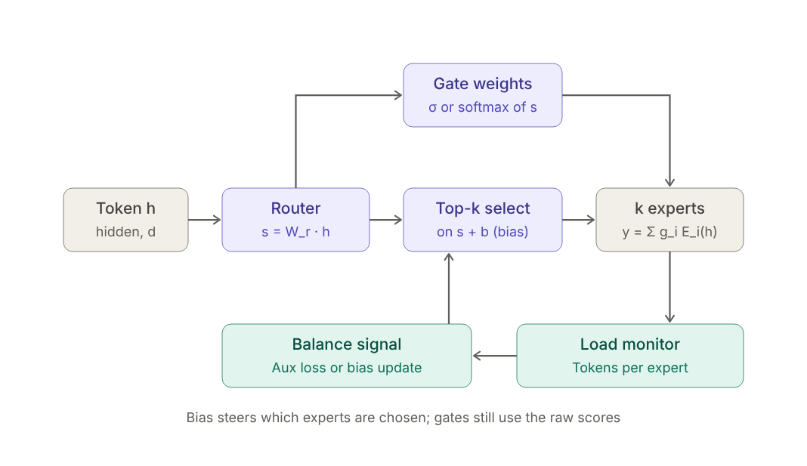

[Open standalone page](assets/22_moe_router_topk_load_balancing.html)

<details><summary>Diagram source</summary>

````svg
<svg width="100%" viewBox="0 0 680 375" role="img"><title>MoE top-k routing with load balancing</title><desc>A token's hidden state goes to a linear router that produces one score per expert. Top-k selection uses the scores plus a balancing bias; gate weights are computed from the raw scores of the selected experts. The selected experts' outputs are combined with those gate weights. A load monitor counts tokens per expert and drives a balance signal, either an auxiliary loss or a bias update, back into selection.</desc>
<defs><marker id="arrow" viewBox="0 0 10 10" refX="8" refY="5" markerWidth="6" markerHeight="6" orient="auto-start-reverse"><path d="M2 1L8 5L2 9" fill="none" stroke="context-stroke" stroke-width="1.5" stroke-linecap="round" stroke-linejoin="round"/></marker></defs>
<g class="node c-purple" onclick="sendPrompt('Softmax vs sigmoid gating in MoE routers and why gate weights are renormalized')"><rect x="340" y="40" width="140" height="56" rx="8" stroke-width="0.5"/><text class="th" x="410" y="58" text-anchor="middle" dominant-baseline="central">Gate weights</text><text class="ts" x="410" y="78" text-anchor="middle" dominant-baseline="central">σ or softmax of s</text></g>
<g class="c-gray"><rect x="40" y="150" width="110" height="56" rx="8" stroke-width="0.5"/><text class="th" x="95" y="168" text-anchor="middle" dominant-baseline="central">Token h</text><text class="ts" x="95" y="188" text-anchor="middle" dominant-baseline="central">hidden, d</text></g>
<g class="c-purple"><rect x="180" y="150" width="130" height="56" rx="8" stroke-width="0.5"/><text class="th" x="245" y="168" text-anchor="middle" dominant-baseline="central">Router</text><text class="ts" x="245" y="188" text-anchor="middle" dominant-baseline="central">s = W_r · h</text></g>
<g class="c-purple"><rect x="340" y="150" width="140" height="56" rx="8" stroke-width="0.5"/><text class="th" x="410" y="168" text-anchor="middle" dominant-baseline="central">Top-k select</text><text class="ts" x="410" y="188" text-anchor="middle" dominant-baseline="central">on s + b (bias)</text></g>
<g class="c-gray"><rect x="510" y="150" width="130" height="56" rx="8" stroke-width="0.5"/><text class="th" x="575" y="168" text-anchor="middle" dominant-baseline="central">k experts</text><text class="ts" x="575" y="188" text-anchor="middle" dominant-baseline="central">y = Σ g_i E_i(h)</text></g>
<line x1="150" y1="178" x2="178" y2="178" class="arr" marker-end="url(#arrow)"/>
<line x1="310" y1="178" x2="338" y2="178" class="arr" marker-end="url(#arrow)"/>
<line x1="480" y1="178" x2="508" y2="178" class="arr" marker-end="url(#arrow)"/>
<path d="M245 150 L245 68 L338 68" fill="none" class="arr" marker-end="url(#arrow)"/>
<path d="M480 68 L575 68 L575 148" fill="none" class="arr" marker-end="url(#arrow)"/>
<line x1="575" y1="206" x2="575" y2="268" class="arr" marker-end="url(#arrow)"/>
<g class="node c-teal" onclick="sendPrompt('How do MoE serving systems handle hot experts at inference, e.g. expert replication and placement?')"><rect x="440" y="270" width="200" height="56" rx="8" stroke-width="0.5"/><text class="th" x="540" y="288" text-anchor="middle" dominant-baseline="central">Load monitor</text><text class="ts" x="540" y="308" text-anchor="middle" dominant-baseline="central">Tokens per expert</text></g>
<line x1="440" y1="298" x2="402" y2="298" class="arr" marker-end="url(#arrow)"/>
<g class="node c-teal" onclick="sendPrompt('Explain auxiliary-loss-free load balancing in DeepSeek-V3 as dual ascent')"><rect x="180" y="270" width="220" height="56" rx="8" stroke-width="0.5"/><text class="th" x="290" y="288" text-anchor="middle" dominant-baseline="central">Balance signal</text><text class="ts" x="290" y="308" text-anchor="middle" dominant-baseline="central">Aux loss or bias update</text></g>
<line x1="380" y1="270" x2="380" y2="208" class="arr" marker-end="url(#arrow)"/>
<text class="ts" x="340" y="352" text-anchor="middle" dominant-baseline="central">Bias steers which experts are chosen; gates still use the raw scores</text>
</svg>
````

</details>

**1. Choosing experts**

```
s   = W_r · h                         # E scores; W_r is just d × E parameters
T   = topk(score_i, k)                # which experts run
g_i = normalize over T                # how much each selected expert counts
y   = Σ_{i∈T} g_i · E_i(h)  (+ shared expert)
```

| Variant | Score used to select | Gate value |
|---|---|---|
| Switch (k = 1) | softmax(s) | p_i |
| Mixtral (top-2 of 8) | s | softmax over the top-k logits |
| DeepSeek-V3 (top-8 of 256 + 1 shared) | sigmoid(s_i) + b_i | sigmoid(s_i) / Σ_T sigmoid(s_j), with no bias |

Top-k selection is not differentiable. The router learns only through the gate values g_i of the experts it already picked; unpicked experts get no signal saying they would have been better. That is the root of the imbalance problem.

**2. Why imbalance is self-reinforcing**

```
expert i slightly better → picked more → trained more → better still → picked more …
```

Left alone, routers collapse onto a few experts, and the remaining capacity is wasted parameters. Imbalance also hurts the system directly:

- **Training:** with expert parallelism, step time is set by the most loaded device, and over-capacity tokens get dropped.
- **Inference:** hot experts become per-layer bandwidth hotspots.

**3. Balancing methods**

| Method | Mechanism | Trade-off |
|---|---|---|
| Auxiliary loss (Switch, GShard) | `L_aux = α · E · Σ_i f_i · P_i`, where f_i is the fraction of tokens routed to expert i and P_i is its mean router probability. Minimized when routing is uniform. | Its gradient fights the language-modeling gradient. Too large an α measurably hurts quality. |
| Router z-loss (ST-MoE) | Penalize `(log Σ e^{s})²` to keep logits small | Numerical stability, not balance itself |
| Capacity factor | Each expert accepts at most cf · tokens · k / E tokens; overflow is dropped and passed through on the residual path | Hard cap, but dropped tokens lose computation |
| Noisy top-k | Add noise to the scores before selection | Exploration; mostly historical |
| Expert-choice routing | Experts pick their top tokens, not the reverse | Perfect balance, but the number of experts per token varies, and it depends on other tokens in the batch, which breaks causal decoding |
| Aux-loss-free bias (DeepSeek-V3) | A per-expert bias b_i affects selection only; after each step, b_i ← b_i − γ if overloaded, + γ if underloaded | No gradient interference; a tiny sequence-level aux loss is kept as a backstop |

Two refinements are now common:
- **Fine-grained experts plus shared experts.** Many small experts let routing combine specialists, while always-on shared experts absorb common knowledge, so routed experts don't all learn the same basics.
- **Balance over larger windows.** Enforcing balance per micro-batch forces uniformity even on batches that are legitimately skewed, such as a batch of all-code tokens. Balancing over a global batch has been reported (by the Qwen team, among others) to allow clearer expert specialization.

**4. The control-theory view**

The two main approaches correspond to the two textbook ways of enforcing a constraint:

- **Auxiliary loss = penalty method.** Add α·(constraint violation) to the objective. It is soft, it distorts the optimum, and α must be tuned.
- **Bias update = dual ascent.** b_i acts as a Lagrange multiplier on the load constraint for expert i. The multiplier rises while the constraint is violated and falls once it is satisfied. As a controller it is a sign-based integral controller on load error. Because b_i enters only the selection and not the gate, the main objective's gradients stay clean. That separation is why the aux-loss-free scheme beats the penalty approach.

**5. At inference**

- **Dropless MoE.** No capacity cap at serving time. MegaBlocks-style block-sparse kernels handle variable token counts per expert.
- **Hot-expert replication.** Real traffic is skewed per layer, so systems duplicate the busiest experts across devices. DeepSeek's EPLB plans this redundancy and placement.
- **Node-limited routing.** Each token's experts are restricted to a few nodes (DeepSeek-V3 caps it at 4), so all-to-all traffic stays on fast intra-node links.

**6. What experts end up specializing in**

Mostly token-level and syntactic patterns, such as punctuation, code tokens, numbers, and particular languages' morphology, rather than clean topics. Fine-grained experts with shared experts and global-batch balancing sharpen this somewhat. It is also why predicting which experts will be needed ahead of time (for offloading) remains hard, as discussed earlier.

**In short:** the router decides with a cheap dot product, learns only from the experts it picked, and is kept honest by a constraint on load. The best current scheme enforces that constraint with a Lagrange multiplier on selection rather than a penalty in the loss.

---

<a id="turn-20"></a>
## 20. Why do MoE models need all expert weights in HBM even though few are active?

> **Question:** Why do MoE models need all expert weights in HBM even though few are active?

The earlier answer gave three reasons: across a batch, the union of experts used covers nearly all of them; the router decides only microseconds before an expert is needed; and expert usage is too unpredictable to cache. The calculator below adds the quantitative version: if some experts live off-HBM, how good does your expert cache (or prefetcher) need to be?

**Diagram: `moe_expert_offload_hit_rate_calculator`** (interactive HTML widget)

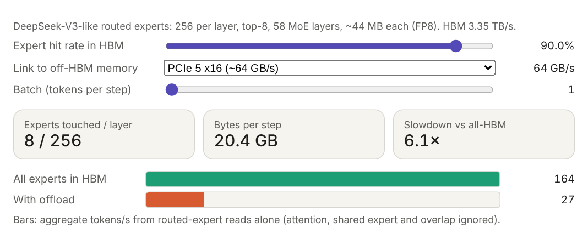

[Open standalone page](assets/23_moe_expert_offload_hit_rate_calculator.html)

<details><summary>Diagram source</summary>

````html
<h2 class="sr-only">Calculator showing how MoE decode throughput collapses when expert weights are partly offloaded, as a function of cache hit rate, host link bandwidth and batch size.</h2>
<style>
.r{display:flex;align-items:center;gap:12px;font-size:13px;color:var(--text-secondary);margin:7px 0}
.r label{width:170px}.r input,.r select{flex:1}.r output{width:84px;text-align:right;color:var(--text-primary);font-variant-numeric:tabular-nums}
.g{display:grid;grid-template-columns:repeat(auto-fit,minmax(140px,1fr));gap:10px;margin:14px 0}
.c{background:var(--surface-1);border:0.5px solid var(--border);border-radius:12px;padding:10px 12px}
.c .k{font-size:12px;color:var(--text-secondary)}.c .v{font-size:20px;font-weight:500;color:var(--text-primary);font-variant-numeric:tabular-nums}
.b{display:flex;align-items:center;gap:10px;font-size:13px;margin:5px 0}
.b .n{width:150px;color:var(--text-secondary)}.b .t{flex:1;height:18px;background:var(--surface-1);border:0.5px solid var(--border);border-radius:4px;overflow:hidden}
.b .f{height:100%;transition:width .15s}.b .v{width:80px;text-align:right;font-variant-numeric:tabular-nums;color:var(--text-primary)}
</style>
<div style="padding:0.5rem 0">
<div style="font-size:12px;color:var(--text-secondary);margin-bottom:6px">DeepSeek-V3-like routed experts: 256 per layer, top-8, 58 MoE layers, ~44 MB each (FP8). HBM 3.35 TB/s.</div>
<div class="r"><label for="h">Expert hit rate in HBM</label><input id="h" type="range" min="0" max="1" step="0.005" value="0.9"><output id="ho"></output></div>
<div class="r"><label for="l">Link to off-HBM memory</label><select id="l">
<option value="64">PCIe 5 x16 (~64 GB/s)</option><option value="128">PCIe 6 x16 (~128 GB/s)</option><option value="900">NVLink-C2C (~900 GB/s)</option>
</select><output id="lo"></output></div>
<div class="r"><label for="n">Batch (tokens per step)</label><input id="n" type="range" min="1" max="256" value="1"><output id="no"></output></div>
<div class="g">
<div class="c"><div class="k">Experts touched / layer</div><div class="v" id="et"></div></div>
<div class="c"><div class="k">Bytes per step</div><div class="v" id="bp"></div></div>
<div class="c"><div class="k">Slowdown vs all-HBM</div><div class="v" id="sd"></div></div>
</div>
<div class="b"><span class="n">All experts in HBM</span><div class="t"><div class="f" id="f1" style="background:#1D9E75"></div></div><span class="v" id="v1"></span></div>
<div class="b"><span class="n">With offload</span><div class="t"><div class="f" id="f2" style="background:#D85A30"></div></div><span class="v" id="v2"></span></div>
<div style="font-size:12px;color:var(--text-secondary);margin-top:6px">Bars: aggregate tokens/s from routed-expert reads alone (attention, shared expert and overlap ignored).</div>
</div>
<script>
const $=i=>document.getElementById(i);
function u(){
const h=+$('h').value,L=+$('l').value,B=+$('n').value,E=256,k=8,S=44e6,Ly=58,HBM=3350;
const touched=E*(1-Math.pow(1-k/E,B));
const bytes=touched*S*Ly;
const tH=bytes/(HBM*1e9), tO=bytes*(h/(HBM*1e9)+(1-h)/(L*1e9));
const a=B/tH,b=B/tO;
$('ho').textContent=(h*100).toFixed(1)+'%';$('lo').textContent=L+' GB/s';$('no').textContent=B;
$('et').textContent=touched.toFixed(0)+' / 256';
$('bp').textContent=(bytes/1e9).toFixed(1)+' GB';
$('sd').textContent=(tO/tH).toFixed(1)+'×';
$('f1').style.width='100%';$('f2').style.width=Math.max(b/a*100,0.5)+'%';
$('v1').textContent=a>=1000?(a/1000).toFixed(1)+'k':a.toFixed(0);
$('v2').textContent=b>=1000?(b/1000).toFixed(1)+'k':b.toFixed(b<10?1:0);
}
['h','l','n'].forEach(i=>$(i).addEventListener('input',u));u();
</script>
````

</details>

What the numbers show:

- **The penalty is set by the miss rate times the bandwidth ratio.** Step time ≈ bytes · [h/BW_HBM + (1−h)/BW_link]. With PCIe at roughly 50× slower than HBM, a 90% hit rate still means a slowdown of about 6×. To stay within 2× of all-HBM you need a hit rate around 98% or better. Real router predictability is nowhere near that.
- **Batching makes it worse, not better.** Raise the batch slider: the experts touched per layer approach all 256. Off-HBM bytes per step grow until each step effectively streams most of the model over the slow link. The batching that rescues dense decode is exactly what defeats MoE offload.
- **A faster link turns the cliff into a slope.** At NVLink-C2C's roughly 900 GB/s, only about 4× slower than HBM, offloading becomes a reasonable capacity trade rather than a disaster. That is why coherent CPU–GPU memory matters so much for MoE serving.

**Conclusion.** "All experts in HBM" really means: the whole model must sit in memory fast enough to read at decode speed, at whatever batch size you serve. For large-batch serving that means pooled HBM across devices with expert parallelism. Offloading over PCIe makes sense only for small-batch local inference, where low throughput is acceptable.

---

<a id="turn-21"></a>
## 21. How do factor graphs represent ego pose uncertainty compared to EKF?

> **Question:** How do factor graphs represent ego pose uncertainty compared to EKF?

An EKF carries uncertainty in one place: the covariance of the current state, with every past state marginalized out and every past linearization frozen. A factor graph keeps the history as a sparse network of constraints. Uncertainty is encoded implicitly in the information matrix (the Hessian of that network), and covariance is recovered only when you ask for it. One is a filter; the other is a smoother. Most of the practical differences follow from that.

**Diagram: `ekf_vs_factor_graph_pose_uncertainty`** (static SVG diagram)

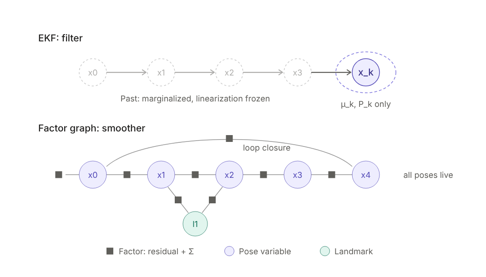

[Open standalone page](assets/24_ekf_vs_factor_graph_pose_uncertainty.html)

<details><summary>Diagram source</summary>

````svg
<svg width="100%" viewBox="0 0 680 370" role="img"><title>EKF vs factor graph</title><desc>Top: an EKF keeps only the current pose x_k with mean and covariance; past poses are marginalized with fixed linearization. Bottom: a factor graph keeps poses x0 to x4 as variables connected by odometry factors, a prior factor on x0, measurement factors to a landmark, and a loop-closure factor from x4 back to x0.</desc>
<defs><marker id="arrow" viewBox="0 0 10 10" refX="8" refY="5" markerWidth="6" markerHeight="6" orient="auto-start-reverse"><path d="M2 1L8 5L2 9" fill="none" stroke="context-stroke" stroke-width="1.5" stroke-linecap="round" stroke-linejoin="round"/></marker></defs>
<text class="th" x="40" y="40" dominant-baseline="central">EKF: filter</text>
<g opacity="0.5">
<circle cx="120" cy="90" r="20" fill="none" stroke="var(--border-stronger)" stroke-width="1" stroke-dasharray="3 3"/><text class="ts" x="120" y="90" text-anchor="middle" dominant-baseline="central">x0</text>
<circle cx="220" cy="90" r="20" fill="none" stroke="var(--border-stronger)" stroke-width="1" stroke-dasharray="3 3"/><text class="ts" x="220" y="90" text-anchor="middle" dominant-baseline="central">x1</text>
<circle cx="320" cy="90" r="20" fill="none" stroke="var(--border-stronger)" stroke-width="1" stroke-dasharray="3 3"/><text class="ts" x="320" y="90" text-anchor="middle" dominant-baseline="central">x2</text>
<circle cx="420" cy="90" r="20" fill="none" stroke="var(--border-stronger)" stroke-width="1" stroke-dasharray="3 3"/><text class="ts" x="420" y="90" text-anchor="middle" dominant-baseline="central">x3</text>
<line x1="140" y1="90" x2="198" y2="90" class="arr" marker-end="url(#arrow)"/>
<line x1="240" y1="90" x2="298" y2="90" class="arr" marker-end="url(#arrow)"/>
<line x1="340" y1="90" x2="398" y2="90" class="arr" marker-end="url(#arrow)"/>
</g>
<line x1="440" y1="90" x2="498" y2="90" class="arr" marker-end="url(#arrow)"/>
<g class="c-purple"><circle cx="520" cy="90" r="20" stroke-width="1"/><text class="th" x="520" y="90" text-anchor="middle" dominant-baseline="central">x_k</text></g>
<ellipse cx="520" cy="90" rx="44" ry="30" fill="none" stroke="#7F77DD" stroke-width="1" stroke-dasharray="4 3"/>
<text class="ts" x="520" y="136" text-anchor="middle" dominant-baseline="central">μ_k, P_k only</text>
<text class="ts" x="270" y="128" text-anchor="middle" dominant-baseline="central">Past: marginalized, linearization frozen</text>
<text class="th" x="40" y="172" dominant-baseline="central">Factor graph: smoother</text>
<path d="M140 228 C200 175 440 175 500 228" fill="none" stroke="var(--border-stronger)" stroke-width="1"/>
<rect x="315" y="182" width="10" height="10" fill="var(--s)"/>
<text class="ts" x="340" y="200" dominant-baseline="central">loop closure</text>
<line x1="80" y1="240" x2="100" y2="240" stroke="var(--border-stronger)" stroke-width="1"/>
<rect x="65" y="235" width="10" height="10" fill="var(--s)"/>
<g stroke="var(--border-stronger)" stroke-width="1">
<line x1="140" y1="240" x2="200" y2="240"/><line x1="240" y1="240" x2="300" y2="240"/><line x1="340" y1="240" x2="400" y2="240"/><line x1="440" y1="240" x2="500" y2="240"/>
<line x1="230" y1="258" x2="260" y2="296"/><line x1="310" y1="258" x2="280" y2="296"/>
</g>
<rect x="165" y="235" width="10" height="10" fill="var(--s)"/><rect x="265" y="235" width="10" height="10" fill="var(--s)"/><rect x="365" y="235" width="10" height="10" fill="var(--s)"/><rect x="465" y="235" width="10" height="10" fill="var(--s)"/>
<rect x="240" y="272" width="10" height="10" fill="var(--s)"/><rect x="290" y="272" width="10" height="10" fill="var(--s)"/>
<g class="c-purple"><circle cx="120" cy="240" r="20" stroke-width="0.5"/><text class="ts" x="120" y="240" text-anchor="middle" dominant-baseline="central">x0</text></g>
<g class="c-purple"><circle cx="220" cy="240" r="20" stroke-width="0.5"/><text class="ts" x="220" y="240" text-anchor="middle" dominant-baseline="central">x1</text></g>
<g class="c-purple"><circle cx="320" cy="240" r="20" stroke-width="0.5"/><text class="ts" x="320" y="240" text-anchor="middle" dominant-baseline="central">x2</text></g>
<g class="c-purple"><circle cx="420" cy="240" r="20" stroke-width="0.5"/><text class="ts" x="420" y="240" text-anchor="middle" dominant-baseline="central">x3</text></g>
<g class="c-purple"><circle cx="520" cy="240" r="20" stroke-width="0.5"/><text class="ts" x="520" y="240" text-anchor="middle" dominant-baseline="central">x4</text></g>
<g class="c-teal"><circle cx="270" cy="312" r="18" stroke-width="0.5"/><text class="ts" x="270" y="312" text-anchor="middle" dominant-baseline="central">l1</text></g>
<text class="ts" x="575" y="240" dominant-baseline="central">all poses live</text>
<rect x="140" y="347" width="10" height="10" fill="var(--s)"/><text class="ts" x="158" y="352" dominant-baseline="central">Factor: residual + Σ</text>
<circle class="c-purple" cx="320" cy="352" r="7" stroke-width="0.5"/><text class="ts" x="334" y="352" dominant-baseline="central">Pose variable</text>
<circle class="c-teal" cx="460" cy="352" r="7" stroke-width="0.5"/><text class="ts" x="474" y="352" dominant-baseline="central">Landmark</text>
</svg>
````

</details>

**1. Two forms of the same Gaussian**

```
EKF  (covariance form, current state only)
  predict:  μ⁻ = f(μ),          P⁻ = F P Fᵀ + Q
  update:   K = P⁻Hᵀ(HP⁻Hᵀ + R)⁻¹,  μ = μ⁻ + K(z − h(μ⁻)),  P = (I − KH)P⁻

Factor graph  (information form, whole trajectory)
  X* = argmin_X  Σ_i ‖ r_i(X) ‖²_{Σ_i}          # MAP = nonlinear least squares
  Λ  = Jᵀ Σ⁻¹ J      (Gauss–Newton Hessian at X*)
  p(X | Z) ≈ N(X*, Λ⁻¹)                          # Laplace approximation
  Cov(x_k) = [Λ⁻¹]_kk   via Schur complement / sparse marginal recovery
```

Each factor is a residual with its noise model: a prior, odometry or IMU preintegration, a landmark or scan-match measurement, or a loop closure. Pose uncertainty is not stored anywhere. It emerges from how tightly the factors constrain each variable.

**2. The key structural fact**

- **Sparsity lives in the information form.** Λ is sparse: nonzero only where a factor links two variables. Its inverse, the full covariance, is dense, because every pose ends up correlated with every other.
- **Marginalization destroys sparsity.** An EKF that marginalizes the past at every step is a factor graph that turns the sparse Λ into a dense P over the surviving variables. That is cheap with one pose and few landmarks, and quadratic or worse once landmarks enter the state (the classic EKF-SLAM scaling wall).
- **Smoothers keep the past.** Factor graphs stay sparse, and solvers such as Cholesky or QR with good variable ordering, or iSAM2's Bayes tree, exploit that sparsity.

**3. Linearization: where the consistency gap comes from**

| | EKF | Factor graph |
|---|---|---|
| Linearization point | Each Jacobian evaluated once, at the estimate available then | Relinearized around the current best estimate on every iteration |
| Past errors | Frozen into P permanently | Corrected when new information arrives |
| Loop closure | Updates only the current state, plus correlations if they are carried | Re-optimizes the whole trajectory; past poses move |
| Typical failure | Overconfidence: P shrinks while the estimate is biased | Wrong data association or a bad initial guess gives a confident wrong minimum |

The inconsistency in EKF-SLAM and visual-inertial odometry is well documented. Linearizing at different estimates for the same state gives the filter spurious information along directions that should be unobservable (global yaw and position), so P shrinks along exactly the axes where it should grow. Fixes include first-estimate Jacobians (FEJ), observability-constrained EKF, and the invariant EKF. Factor graphs avoid most of this by relinearizing, but they reintroduce it whenever they marginalize.

**4. The practical middle ground: fixed-lag smoothing**

Real-time systems such as VINS-Mono, OKVIS, and LIO-SAM-style LiDAR odometry keep a sliding window of recent poses as a factor graph and marginalize older ones into a prior factor.

```
window [x_{k−N} … x_k]  +  marginal prior on the oldest boundary  (dense, linearized once)
```

That prior is effectively an EKF embedded inside a smoother, and it inherits the EKF's problems:
- **Fill-in.** The prior links all variables it touches.
- **Frozen linearization.** You need FEJ on the variables the prior touches, or consistency suffers.
- **Double counting.** Re-adding information already absorbed by the prior makes the estimate overconfident.

**5. Uncertainty on the manifold**

Both represent pose uncertainty in the tangent space of SE(3):

```
x = x̂ ⊕ ξ,    ξ ~ N(0, Σ),    ξ ∈ ℝ⁶
```

- **Error-state EKF / IEKF** propagate Σ in the error state.
- **Factor graphs** optimize over ξ and retract onto the manifold. IMU preintegration factors (Forster et al.) carry their own covariance and bias Jacobians, so the integration doesn't need redoing when biases change.

One subtlety: a pose covariance is only meaningful together with its frame and its gauge. Without a prior factor, the information matrix is rank-deficient, because the absolute position and yaw are unobservable. Covariances therefore have to be reported relative to an anchor.

**6. Getting usable uncertainty out of each**

| Need | EKF | Factor graph |
|---|---|---|
| Current pose covariance | Free (P) | Marginal recovery: iSAM2 does this efficiently; a full solve is costly |
| Cross-covariance between distant poses | Usually lost | Available, at a price |
| Calibration of the covariance | Often overconfident | Laplace approximation: exact only if the posterior is near-Gaussian around the MAP |
| Outlier handling | χ² gating on the innovation (NIS) | Robust kernels (Huber, Cauchy), switchable constraints, graduated non-convexity |
| Multimodality | Not representable | Not representable; you need particles or multi-hypothesis methods |

For the safety and integrity concerns raised earlier, both need help. Treat the covariance as a hypothesis to test (NIS/NEES checks, protection levels), not as ground truth. A factor graph's covariance is the curvature of the cost at a local minimum. If data association is wrong, that minimum is the wrong one, and the reported uncertainty can look excellent while the estimate is bad.

**7. When to use which**

- **EKF / ESKF / IEKF:** compact states (ego pose, velocity, biases), high-rate IMU propagation, tight compute or latency budgets, embedded targets. Often the front-end that feeds a smoother.
- **Factor graph (fixed-lag or full):** LiDAR or visual SLAM, loop closures, multi-sensor fusion with delayed or out-of-order measurements, offline mapping, and calibration (extrinsics and time offsets as variables, which matters for LiDAR–camera–IMU rigs).
- **Common hybrid:** an ESKF at IMU rate for low-latency pose output, plus a factor-graph back-end at keyframe rate that corrects drift and feeds back.

**In one line:** the EKF is a factor graph that marginalizes eagerly and linearizes once. It is fast and compact, but its covariance quietly absorbs every past linearization error. A factor graph defers both decisions, so it can fix the past when new evidence arrives, at the cost of solving a sparse optimization and paying separately to read the uncertainty back out.

---

<a id="turn-22"></a>
## 22. How do occupancy grids and ESDFs represent geometric uncertainty from LiDAR?

> **Question:** How do occupancy grids and ESDFs represent geometric uncertainty from LiDAR?

The three representations answer different questions about the same LiDAR returns:

- An occupancy grid stores, per cell, the probability that something is there. That is uncertainty about existence.
- A TSDF stores a weighted average of the distance to the nearest surface along each ray. That is uncertainty about where the surface is, though only implicitly, through the averaging weights.
- An ESDF stores the Euclidean distance to the nearest obstacle for planning, and by default carries no uncertainty at all. Uncertainty has to be added back deliberately.

The widget below simulates one LiDAR ray hitting a surface 6 m away, accumulating noisy returns into both an occupancy profile and a TSDF profile:

**Diagram: `lidar_ray_occupancy_tsdf_uncertainty`** (interactive HTML widget)

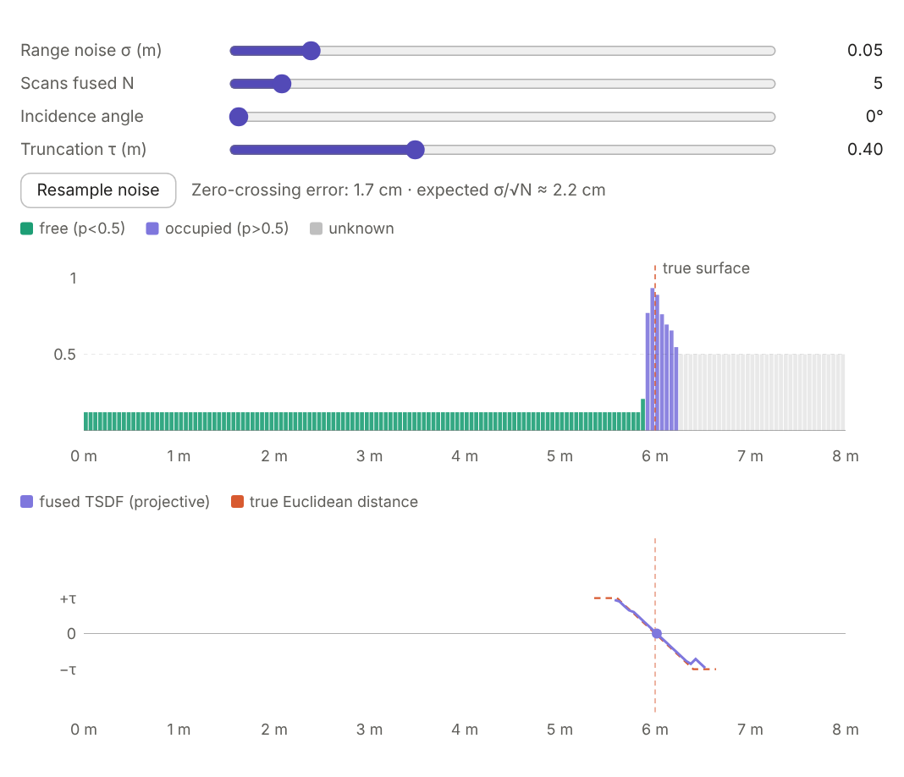

[Open standalone page](assets/25_lidar_ray_occupancy_tsdf_uncertainty.html)

<details><summary>Diagram source</summary>

````html
<h2 class="sr-only">Interactive one-dimensional LiDAR ray simulation showing how noisy range returns accumulate into occupancy log-odds and a truncated signed distance field, including the bias from oblique incidence.</h2>
<style>
.r{display:flex;align-items:center;gap:12px;font-size:13px;color:var(--text-secondary);margin:6px 0}
.r label{width:150px}.r input{flex:1}.r output{width:70px;text-align:right;color:var(--text-primary);font-variant-numeric:tabular-nums}
.lg{display:flex;gap:16px;flex-wrap:wrap;font-size:12px;color:var(--text-secondary);margin:4px 0 2px}
.sw{display:inline-block;width:10px;height:10px;border-radius:2px;margin-right:5px;vertical-align:-1px}
button.s{font:inherit;font-size:13px;padding:5px 12px;border-radius:var(--radius);border:0.5px solid var(--border-strong);background:var(--surface-2);color:var(--text-primary);cursor:pointer}
</style>
<div style="padding:0.5rem 0">
<div class="r"><label for="sg">Range noise σ (m)</label><input id="sg" type="range" min="0.01" max="0.3" step="0.01" value="0.05"><output id="sgo"></output></div>
<div class="r"><label for="n">Scans fused N</label><input id="n" type="range" min="1" max="50" value="5"><output id="no"></output></div>
<div class="r"><label for="th">Incidence angle</label><input id="th" type="range" min="0" max="75" step="5" value="0"><output id="tho"></output></div>
<div class="r"><label for="tau">Truncation τ (m)</label><input id="tau" type="range" min="0.1" max="1" step="0.05" value="0.4"><output id="tauo"></output></div>
<div style="display:flex;gap:12px;align-items:center;margin:8px 0"><button class="s" id="rs">Resample noise</button><span id="st" style="font-size:13px;color:var(--text-secondary)"></span></div>
<div class="lg"><span><span class="sw" style="background:#1D9E75"></span>free (p&lt;0.5)</span><span><span class="sw" style="background:#7F77DD"></span>occupied (p&gt;0.5)</span><span><span class="sw" style="background:var(--border-strong)"></span>unknown</span></div>
<div id="occ"></div>
<div class="lg"><span><span class="sw" style="background:#7F77DD"></span>fused TSDF (projective)</span><span><span class="sw" style="background:#D85A30"></span>true Euclidean distance</span></div>
<div id="tsdf"></div>
</div>
<script>
const $=i=>document.getElementById(i);let seed=7;
function rng(s){return function(){s|=0;s=s+0x6D2B79F5|0;let t=Math.imul(s^s>>>15,1|s);t=t+Math.imul(t^t>>>7,61|t)^t;return((t^t>>>14)>>>0)/4294967296}}
function gauss(r){let u=0,v=0;while(!u)u=r();while(!v)v=r();return Math.sqrt(-2*Math.log(u))*Math.cos(2*Math.PI*v)}
const X0=50,X1=650,M=8,sx=x=>X0+x*(X1-X0)/M,res=0.05,NC=M/res,Z=6;
function u(){
const sg=+$('sg').value,N=+$('n').value,th=+$('th').value*Math.PI/180,tau=+$('tau').value;
$('sgo').textContent=sg.toFixed(2);$('no').textContent=N;$('tho').textContent=$('th').value+'°';$('tauo').textContent=tau.toFixed(2);
const r=rng(seed),se=sg/Math.cos(th),sm=Math.max(se,res);
const L=new Array(NC).fill(0),T=new Array(NC).fill(false),D=new Array(NC).fill(0),W=new Array(NC).fill(0);
const zs=[];
for(let k=0;k<N;k++){const z=Z+se*gauss(r);zs.push(z);
for(let i=0;i<NC;i++){const x=(i+.5)*res;
if(x<z-2*sm){L[i]+=-0.4;T[i]=true}else if(x<=z+2*sm){L[i]+=0.85*Math.exp(-((x-z)**2)/(2*sm*sm));T[i]=true}
if(x>=z-tau&&x<=z+tau){D[i]+=Math.max(-tau,Math.min(tau,z-x));W[i]+=1}}}
let s='<svg width="100%" viewBox="0 0 680 190" role="img"><title>Occupancy probability along the ray</title>';
for(let i=0;i<NC;i++){const x=sx(i*res),w=sx(res)-sx(0);const l=Math.max(-3,Math.min(3,L[i]));const p=1/(1+Math.exp(-l));
const h=T[i]?p*120:60,fill=!T[i]?'var(--border-strong)':(p>0.5?'#7F77DD':'#1D9E75');
s+='<rect x="'+x.toFixed(1)+'" y="'+(150-h).toFixed(1)+'" width="'+(w-0.6).toFixed(2)+'" height="'+h.toFixed(1)+'" fill="'+fill+'" opacity="'+(T[i]?0.9:0.35)+'"/>';}
s+='<line x1="50" y1="150" x2="650" y2="150" stroke="var(--border-stronger)" stroke-width="0.5"/><line x1="50" y1="90" x2="650" y2="90" stroke="var(--border)" stroke-width="0.5" stroke-dasharray="3 3"/>';
s+='<text class="ts" x="44" y="90" text-anchor="end" dominant-baseline="central">0.5</text><text class="ts" x="44" y="30" text-anchor="end" dominant-baseline="central">1</text>';
for(let m=0;m<=M;m++)s+='<text class="ts" x="'+sx(m)+'" y="170" text-anchor="middle" dominant-baseline="central">'+m+' m</text>';
s+='<line x1="'+sx(Z)+'" y1="20" x2="'+sx(Z)+'" y2="150" stroke="#D85A30" stroke-width="1" stroke-dasharray="4 3"/><text class="ts" x="'+(sx(Z)+6)+'" y="22" dominant-baseline="central">true surface</text></svg>';
$('occ').innerHTML=s;
const yc=95,ys=70/1;const xs0=Z-1.2,xs1=Z+1.2;let path='',tpath='',zc=null,prev=null;
for(let i=0;i<NC;i++){const x=(i+.5)*res;if(W[i]>0){const d=D[i]/W[i];const px=sx(x),py=yc-d/1*ys;path+=(path?'L':'M')+px.toFixed(1)+' '+py.toFixed(1);
if(prev&&prev.d>0&&d<=0)zc=prev.x+(x-prev.x)*prev.d/(prev.d-d);prev={x,d}}}
for(let x=Z-tau*1.6;x<=Z+tau*1.6;x+=0.02){const dt=Math.max(-tau,Math.min(tau,(Z-x)*Math.cos(th)));tpath+=(tpath?'L':'M')+sx(x).toFixed(1)+' '+(yc-dt*ys).toFixed(1)}
let t='<svg width="100%" viewBox="0 0 680 180" role="img"><title>Fused TSDF along the ray</title>';
t+='<line x1="50" y1="'+yc+'" x2="650" y2="'+yc+'" stroke="var(--border-stronger)" stroke-width="0.5"/>';
t+='<text class="ts" x="44" y="'+(yc-tau*ys)+'" text-anchor="end" dominant-baseline="central">+τ</text><text class="ts" x="44" y="'+(yc+tau*ys)+'" text-anchor="end" dominant-baseline="central">−τ</text><text class="ts" x="44" y="'+yc+'" text-anchor="end" dominant-baseline="central">0</text>';
t+='<path d="'+tpath+'" fill="none" stroke="#D85A30" stroke-width="1.5" stroke-dasharray="5 4"/>';
if(path)t+='<path d="'+path+'" fill="none" stroke="#7F77DD" stroke-width="2"/>';
for(let m=0;m<=M;m++)t+='<text class="ts" x="'+sx(m)+'" y="'+(yc+75)+'" text-anchor="middle" dominant-baseline="central">'+m+' m</text>';
t+='<line x1="'+sx(Z)+'" y1="20" x2="'+sx(Z)+'" y2="160" stroke="#D85A30" stroke-width="1" stroke-dasharray="4 3" opacity="0.6"/>';
if(zc!==null)t+='<circle cx="'+sx(zc).toFixed(1)+'" cy="'+yc+'" r="4" fill="#7F77DD"/>';
t+='</svg>';$('tsdf').innerHTML=t;
$('st').textContent='Zero-crossing error: '+(zc!==null?((zc-Z)*100).toFixed(1)+' cm':'—')+'  ·  expected σ/√N ≈ '+(se/Math.sqrt(N)*100).toFixed(1)+' cm';
}
$('rs').onclick=()=>{seed=Math.floor(Math.random()*1e9);u()};
['sg','n','th','tau'].forEach(i=>$(i).addEventListener('input',u));u();
</script>
````

</details>

Things to notice in the widget:
- **More scans sharpen the occupied band.** Raising N narrows it and pulls the TSDF zero crossing toward the true surface at about σ/√N.
- **Higher noise smears both representations.** Raising σ widens the occupied band and makes the zero crossing jitter.
- **Incidence angle adds a bias that averaging can't remove.** The fused TSDF slope stays at 1 while the true Euclidean distance flattens to cos θ. That is the projective-distance error, and it is systematic.
- **Cells behind the surface stay unknown.** The grid never treats "not seen" as "free."

**1. Occupancy grid: existence uncertainty**

Each cell holds a binary Bayes filter in log-odds form:

```
L_t(m) = L_{t−1}(m) + log[ p(m | z_t) / (1 − p(m | z_t)) ] − L_0          clamp to [L_min, L_max]
```

The inverse sensor model p(m | z) is where LiDAR physics enters:
- Cells the beam passed through get a free update.
- Cells within about ±2σ of the return get an occupied update.
- Cells behind the return get nothing; they stay unknown.

Range noise σ and beam footprint set the width of the occupied band. Beam divergence matters at range: at 3 mrad, the footprint is about 15 cm at 50 m, which can be larger than a cell.

What it represents well:
- Free, occupied, and unknown as three distinct states. This is the property safety cares about most.
- Accumulating evidence over many scans.
- Dynamic change, because clamping keeps cells able to flip.

What it misses:
- **Correlation between cells.** Cells are updated as independent Bernoullis, but one noisy return moves a whole band of cells together. The product of per-cell beliefs is overconfident, and correlated errors from pose or calibration are invisible.
- **Sub-cell surface position.** The surface location is quantized to cell resolution.
- **Calibrated probabilities.** Log-odds increments are hand-tuned, so the output p is a score, not a calibrated probability.

**2. TSDF: surface-location uncertainty, implicit**

```
D(v) = Σ w_i · clamp(z_i − x_v, −τ, τ) / Σ w_i        updated only within the truncation band
```

- **Weights act as inverse variances.** A principled weight is w ∝ 1/σ²(range, incidence, intensity). Many systems also drop the weight behind the surface. With proper weights, the zero crossing is a weighted least-squares estimate of the surface, with variance about σ²_eff / Σw.
- **The stored weight is a confidence proxy.** Low weight means few observations. But the weight is not a variance unless you made it one.

Systematic errors that weights cannot fix:
- **Projective vs Euclidean distance.** The stored distance runs along the ray, so it overestimates the true distance by 1/cos θ at oblique surfaces.
- **Thin structures.** Opposite sides of a thin object fight inside one truncation band.
- **Surfaces closer together than τ.** The band blurs them.

**3. ESDF: planning geometry with no built-in uncertainty**

An ESDF is computed from TSDF zero crossings (Voxblox, nvblox) or directly from occupancy (FIESTA) by a wavefront distance transform. Planners use the distance d(x) and its gradient for collision costs and trajectory optimization. It is one deterministic number per voxel, derived from a thresholded, uncertain input.

Ways to add uncertainty back:

| Approach | What it gives |
|---|---|
| Treat unknown as occupied before the transform | Conservative free space (safety default) |
| Threshold at a high p(occ), or use distance to {p > p_th} | A chance-constrained obstacle set |
| Inflate by robot radius + k·σ_local(range, incidence) | A covariance-aware margin |
| Two ESDFs (optimistic and conservative) | Performance planning plus a safety check |
| Gaussian-process distance fields (GPIS, log-GPIS) | Mean and variance of the distance, plus gradients, so chance constraints come directly |
| Conformal calibration on held-out geometry | A distribution-free guarantee on distance error |

**4. LiDAR error budget: which errors average out**

| Source | Random or systematic | Averages with N? |
|---|---|---|
| Range noise | Random | Yes, about 1/√N |
| Beam footprint / divergence | Grows with range | Partially |
| Mixed pixels at depth edges | Systematic (ghost points between foreground and background) | No; filter them |
| Incidence angle | Systematic (more noise plus projective bias) | No |
| Low reflectivity, dropouts, max-range returns | Missing data | No; a missing return means "no evidence," not "free" |
| Motion distortion | Systematic | No; deskew with IMU or odometry |
| Extrinsic calibration and time offset | Systematic | No; estimate them in the factor graph |
| Ego-pose uncertainty | Correlated across the whole scan | No; it shifts all points together |

The last row ties back to factor graphs. A map voxel's real uncertainty is roughly σ²_range + (r·σ_angle)² + J_pose Σ_pose J_poseᵀ. Grids and TSDFs drop the pose term entirely, because they integrate points as if the poses were exact. Submap-based mapping (Voxblox++, nvblox submaps, LIO-SAM-style keyframe maps) partly recovers it: when a loop closure corrects past poses, submaps are re-anchored instead of leaving corrupted voxels in place.

**5. A practical stack**

```
deskew + filter (mixed pixels, intensity, multi-return)
  → occupancy (log-odds, unknown ≠ free)          → safety: conservative set
  → TSDF (inverse-variance weights)                → surface for mapping and meshing
  → ESDF on conservative set + kσ inflation        → planner cost and gradients
  monitor: weight / observation-count maps         → steer sensing toward low-confidence regions
```

The last line suits steerable-beam LiDAR. If the scan pattern is programmable, the weight map and the unknown mask tell you where to point the beam next. That turns mapping uncertainty from something you report into something you act on: active perception at the sensor level.

**In one line:** occupancy grids carry existence uncertainty but assume cells are independent. TSDFs carry surface-position uncertainty implicitly through weights, with systematic biases that averaging can't remove. ESDFs carry none until you build in a conservative set and a margin. Sensor pose and calibration uncertainty, often the dominant terms, are invisible to all three unless the map is tied back to the estimator that knows about them.

---

<a id="turn-23"></a>
## 23. How do multi-object trackers represent existence and state uncertainty: JPDA, MHT, random finite sets?

> **Question:** How do multi-object trackers represent existence and state uncertainty: JPDA, MHT, random finite sets?

Multi-object tracking carries three layers of uncertainty at once:

- **State:** where each object is (mean and covariance).
- **Association:** which detection came from which object.
- **Existence:** how many objects there are, and whether each track is real.

JPDA, MHT, and random finite sets mainly differ in how they handle the second and third layers. The diagram shows one scan handled three ways.

**Diagram: `mot_jpda_mht_rfs_association`** (static SVG diagram)

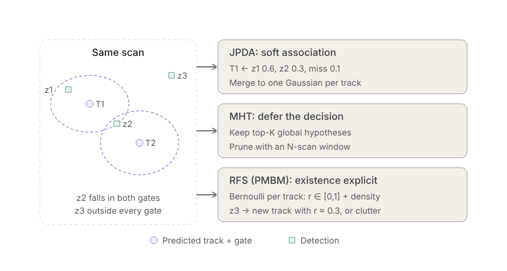

[Open standalone page](assets/26_mot_jpda_mht_rfs_association.html)

<details><summary>Diagram source</summary>

````svg
<svg width="100%" viewBox="0 0 680 345" role="img"><title>JPDA vs MHT vs RFS on one scan</title><desc>One scan with two predicted tracks and their gates. Detection z1 is inside only T1's gate, z2 lies inside both gates, and z3 lies outside every gate. JPDA spreads z2 softly across tracks and merges into one Gaussian per track. MHT keeps the top-K global association hypotheses and prunes over an N-scan window. RFS methods such as PMBM carry an explicit existence probability per Bernoulli track and can spawn z3 as a new low-existence track.</desc>
<defs><marker id="arrow" viewBox="0 0 10 10" refX="8" refY="5" markerWidth="6" markerHeight="6" orient="auto-start-reverse"><path d="M2 1L8 5L2 9" fill="none" stroke="context-stroke" stroke-width="1.5" stroke-linecap="round" stroke-linejoin="round"/></marker></defs>
<rect x="40" y="40" width="220" height="260" rx="12" fill="none" stroke="var(--border-strong)" stroke-width="0.5" stroke-dasharray="4 4"/>
<text class="th" x="150" y="58" text-anchor="middle" dominant-baseline="central">Same scan</text>
<ellipse cx="110" cy="130" rx="55" ry="40" fill="none" stroke="#7F77DD" stroke-width="1" stroke-dasharray="4 3"/>
<ellipse cx="180" cy="185" rx="55" ry="45" fill="none" stroke="#7F77DD" stroke-width="1" stroke-dasharray="4 3"/>
<circle class="c-purple" cx="110" cy="130" r="5" stroke-width="0.5"/>
<text class="ts" x="118" y="130" dominant-baseline="central">T1</text>
<circle class="c-purple" cx="180" cy="185" r="5" stroke-width="0.5"/>
<text class="ts" x="188" y="185" dominant-baseline="central">T2</text>
<rect class="c-teal" x="76" y="106" width="8" height="8" stroke-width="0.5"/>
<text class="ts" x="58" y="110" text-anchor="end" dominant-baseline="central">z1</text>
<rect class="c-teal" x="144" y="154" width="8" height="8" stroke-width="0.5"/>
<text class="ts" x="156" y="158" dominant-baseline="central">z2</text>
<rect class="c-teal" x="221" y="86" width="8" height="8" stroke-width="0.5"/>
<text class="ts" x="233" y="90" dominant-baseline="central">z3</text>
<text class="ts" x="150" y="262" text-anchor="middle" dominant-baseline="central">z2 falls in both gates</text>
<text class="ts" x="150" y="280" text-anchor="middle" dominant-baseline="central">z3 outside every gate</text>
<line x1="260" y1="78" x2="288" y2="78" class="arr" marker-end="url(#arrow)"/>
<line x1="260" y1="168" x2="288" y2="168" class="arr" marker-end="url(#arrow)"/>
<line x1="260" y1="258" x2="288" y2="258" class="arr" marker-end="url(#arrow)"/>
<g class="node c-gray" onclick="sendPrompt('Derive the JPDA update including the spread-of-innovations covariance term, and explain JIPDA existence')"><rect x="290" y="40" width="350" height="76" rx="8" stroke-width="0.5"/><text class="th" x="306" y="58" dominant-baseline="central">JPDA: soft association</text><text class="ts" x="306" y="80" dominant-baseline="central">T1 ← z1 0.6, z2 0.3, miss 0.1</text><text class="ts" x="306" y="100" dominant-baseline="central">Merge to one Gaussian per track</text></g>
<g class="node c-gray" onclick="sendPrompt('How does track-oriented MHT score, prune and manage hypotheses?')"><rect x="290" y="130" width="350" height="76" rx="8" stroke-width="0.5"/><text class="th" x="306" y="148" dominant-baseline="central">MHT: defer the decision</text><text class="ts" x="306" y="170" dominant-baseline="central">Keep top-K global hypotheses</text><text class="ts" x="306" y="190" dominant-baseline="central">Prune with an N-scan window</text></g>
<g class="node c-gray" onclick="sendPrompt('Explain the PMBM filter and how its Poisson component models undetected objects')"><rect x="290" y="220" width="350" height="76" rx="8" stroke-width="0.5"/><text class="th" x="306" y="238" dominant-baseline="central">RFS (PMBM): existence explicit</text><text class="ts" x="306" y="260" dominant-baseline="central">Bernoulli per track: r ∈ [0,1] + density</text><text class="ts" x="306" y="280" dominant-baseline="central">z3 → new track with r ≈ 0.3, or clutter</text></g>
<circle class="c-purple" cx="200" cy="322" r="5" stroke-width="0.5"/><text class="ts" x="212" y="322" dominant-baseline="central">Predicted track + gate</text>
<rect class="c-teal" x="390" y="318" width="8" height="8" stroke-width="0.5"/><text class="ts" x="406" y="322" dominant-baseline="central">Detection</text>
</svg>
````

</details>

**The shared measurement model.** All three methods assume the same generative model:

```
each object detected with prob P_D(x), else missed
detection  z ~ N(Hx, R)
clutter    ~ Poisson(λ_c) spread over the field of view
births     ~ Poisson intensity λ_b(x),   survival P_S
```

They differ in how much of the resulting posterior they keep.

**1. JPDA: average over associations now**

```
β_ij = Σ_{θ ∋ (i←j)} P(θ | Z)      over feasible joint events θ
P(θ) ∝ Π_assigned P_D·N(z_j; ẑ_i, S_i) · Π_missed (1 − P_D) · λ_c^{−#assigned}

x_i = x̂_i + K_i Σ_j β_ij ν_ij
P_i = β_i0 P̂_i + (1 − β_i0) P_c + K_i [ Σ_j β_ij ν_ij ν_ijᵀ − ν̄ν̄ᵀ ] K_iᵀ
```

- **State uncertainty absorbs association uncertainty.** The bracketed spread-of-innovations term inflates the covariance when it is unclear which detection belongs to the track.
- **Existence:** plain JPDA assumes the number of targets is known. JIPDA adds a per-track existence probability, propagated through survival, detection, and clutter likelihoods.
- **Failure mode: coalescence.** When targets travel close together, their tracks share detections and merge. Since only one hypothesis survives each scan, a wrong merge can't be undone.

**2. MHT: defer the decision**

- **Branching:** each scan creates branches for every feasible assignment, including missed detection, new track, and clutter.
- **Scoring:** each global hypothesis is scored by a cumulative log-likelihood ratio.
- **Pruning:** keep the K best hypotheses (Murty's K-best assignments) and prune with an N-scan window. A decision made N scans ago is final once later evidence settles it.
- **Existence is implicit in the track score.** A track's LLR maps to an existence probability through a logistic function, and tracks are confirmed or deleted on score thresholds.
- **Strength:** it can resolve crossings and ambiguities using future data. In principle it is close to the optimal Bayesian tracker.
- **Weakness:** combinatorial cost and hand-tuned pruning. It dominates radar and defense, and is used less in automotive LiDAR because of real-time budgets.

**3. Random finite sets: the whole posterior as one object**

The multi-object state is a set X = {x_1 … x_n}, with n itself random. The building blocks:

```
Bernoulli:        f(∅) = 1 − r,     f({x}) = r · p(x)        ← existence r is first-class
Multi-Bernoulli:  union of independent Bernoullis            ← one per potential track
Poisson:          intensity D(x);  ∫_A D = expected # in A   ← objects never detected
PMBM:             Poisson ∪ mixture of multi-Bernoullis       ← conjugate prior for the model above
```

| RFS filter | Keeps | Trade-off |
|---|---|---|
| PHD | First moment D(x) only | Very cheap; no identities; noisy cardinality estimate |
| CPHD | D(x) plus the cardinality distribution | Better count estimates; still no identities |
| LMB / GLMB | Labeled Bernoullis (GLMB also keeps association hypotheses) | Track identities; GLMB is exact for its model; LMB is the real-time approximation |
| PMBM | Poisson (undetected) + MB mixture (detected) | Conjugate; MHT-like hypotheses plus explicit existence; state of the art in many benchmarks |

Two properties make PMBM especially useful:
- **Existence is explicit.** Each track carries r. In the diagram, z3 becomes a new Bernoulli with low r, neither forced into a track nor thrown away.
- **The Poisson component models undetected objects.** It encodes "objects may exist here that I have never seen," which turns occlusion risk into a quantity a planner can use.

**Side-by-side**

| | JPDA (JIPDA) | MHT | RFS (PMBM / GLMB) |
|---|---|---|---|
| Association | Averaged each scan | Enumerated, best K kept | Enumerated in the mixture |
| Existence | Per-track r (JIPDA) | Implicit via track score | Explicit r per Bernoulli |
| Undetected objects | Not modeled | Not modeled | Poisson intensity |
| State per track | One Gaussian | One Gaussian per hypothesis | Density per Bernoulli per hypothesis |
| Main failure | Coalescence; irreversible | Combinatorics, pruning tuning | Complexity; approximations (LMB) |
| Typical use | Dense radar, simple scenes | Defense radar, crossings | Automotive research, extended objects |

**4. LiDAR practice**

- **Standard pipeline: tracking by detection.** A 3D detector (CenterPoint-class) feeds Kalman filters (constant velocity or CTRV) with Hungarian or greedy matching on 3D IoU or Mahalanobis distance. Examples: AB3DMOT, SimpleTrack. Existence is handled by heuristics: confirm after N hits, delete after M misses, keep a track score. That is a crude, uncalibrated JIPDA.
- **Use the detection score.** Calibrated detector confidence can enter the likelihood directly, as a score-dependent P_D and clutter density. Several PMBM-based 3D trackers on nuScenes do exactly this and are competitive with learned trackers.
- **Extended objects.** A LiDAR object returns many points, not one detection. Extended-object RFS models jointly estimate a Poisson point rate, kinematics, and extent: the Gamma–Gaussian–inverse-Wishart (GGIW) model, or random-matrix shape models. This is closer to the sensor physics than clustering points into a box first.
- **Learned end-to-end trackers** (query propagation, MOTR-style) carry existence as a learned query score. It is powerful, but uncalibrated unless explicitly trained and checked.

**5. Feeding planning and safety**

This connects to the earlier belief-state discussion:

```
P(collision with track i) ≈ r_i · P( footprint overlap | x_i ~ N(μ_i, Σ_i) )
occlusion risk           ≈ ∫_{occluded region ∩ path} D_undetected(x) dx
```

- **Don't drop low-r tracks for safety.** A track at r = 0.3 is a hazard with weight 0.3. The confirm/delete thresholds suit display and logging, not collision checking.
- **Use the Poisson component for occluded zones.** It formalizes "something may be behind that truck," and it is the probabilistic counterpart of treating unknown space as occupied in the grid.
- **Check consistency on tracks too.** Run NIS tests per track: persistent innovation outliers mean the motion model or association is wrong, not just that measurements are noisy.

**In one line:** JPDA collapses association uncertainty into a wider covariance each scan. MHT keeps alternative hypotheses alive until the data decides. RFS methods make the number of objects, including unseen ones, part of the posterior, so existence becomes a calibrated probability rather than a heuristic counter.

---

<a id="turn-24"></a>
## 24. How are multimodal trajectory predictions of other agents represented and used in planning?

> **Question:** How are multimodal trajectory predictions of other agents represented and used in planning?

Other agents' futures are not a single prediction but a distribution with a few distinct modes: the pedestrian keeps walking, or the pedestrian crosses. That distribution is typically represented as a weighted set of trajectories with growing uncertainty. A good planner avoids two mistakes with it: averaging the modes together, and treating every mode as certain.

**Diagram: `multimodal_prediction_contingency_planning`** (static SVG diagram)

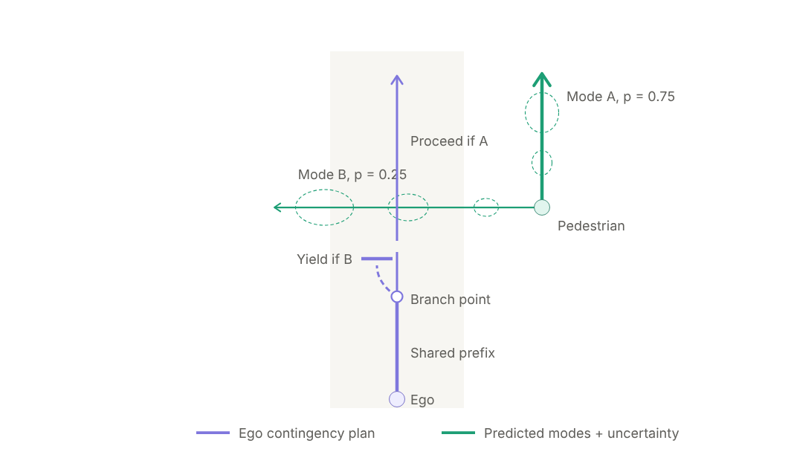

[Open standalone page](assets/27_multimodal_prediction_contingency_planning.html)

<details><summary>Diagram source</summary>

````svg
<svg width="100%" viewBox="0 0 680 390" role="img"><title>Multimodal prediction and contingency planning</title><desc>A pedestrian on the right sidewalk has two predicted modes: walking on along the sidewalk with probability 0.75, or crossing the road with probability 0.25, each with uncertainty ellipses that grow over time. The ego vehicle plans a shared prefix that is safe for both modes up to a branch point where the modes become distinguishable, then either proceeds if the pedestrian walks on or yields before the crossing if the pedestrian crosses.</desc>
<defs><marker id="arrow" viewBox="0 0 10 10" refX="8" refY="5" markerWidth="6" markerHeight="6" orient="auto-start-reverse"><path d="M2 1L8 5L2 9" fill="none" stroke="context-stroke" stroke-width="1.5" stroke-linecap="round" stroke-linejoin="round"/></marker></defs>
<rect class="c-gray" x="280" y="30" width="120" height="320" stroke="none" opacity="0.55"/>
<path d="M470 170 L470 50" fill="none" stroke="#1D9E75" stroke-width="3" marker-end="url(#arrow)"/>
<path d="M470 170 L230 170" fill="none" stroke="#1D9E75" stroke-width="1.5" marker-end="url(#arrow)"/>
<ellipse cx="470" cy="130" rx="9" ry="11" fill="none" stroke="#1D9E75" stroke-width="0.75" stroke-dasharray="3 2"/>
<ellipse cx="470" cy="85" rx="15" ry="18" fill="none" stroke="#1D9E75" stroke-width="0.75" stroke-dasharray="3 2"/>
<ellipse cx="420" cy="170" rx="11" ry="8" fill="none" stroke="#1D9E75" stroke-width="0.75" stroke-dasharray="3 2"/>
<ellipse cx="350" cy="170" rx="18" ry="12" fill="none" stroke="#1D9E75" stroke-width="0.75" stroke-dasharray="3 2"/>
<ellipse cx="275" cy="170" rx="26" ry="16" fill="none" stroke="#1D9E75" stroke-width="0.75" stroke-dasharray="3 2"/>
<circle class="c-teal" cx="470" cy="170" r="7" stroke-width="0.5"/>
<text class="ts" x="484" y="186" dominant-baseline="central">Pedestrian</text>
<text class="ts" x="492" y="70" dominant-baseline="central">Mode A, p = 0.75</text>
<text class="ts" x="300" y="140" text-anchor="middle" dominant-baseline="central">Mode B, p = 0.25</text>
<line x1="340" y1="335" x2="340" y2="252" stroke="#7F77DD" stroke-width="3"/>
<path d="M340 248 L340 210" fill="none" stroke="#7F77DD" stroke-width="2"/>
<path d="M340 200 L340 52" fill="none" stroke="#7F77DD" stroke-width="2" stroke-dasharray="1 0" marker-end="url(#arrow)"/>
<path d="M340 250 Q322 238 322 222" fill="none" stroke="#7F77DD" stroke-width="2" stroke-dasharray="5 3"/>
<line x1="308" y1="216" x2="336" y2="216" stroke="#7F77DD" stroke-width="3"/>
<circle class="c-purple" cx="340" cy="342" r="7" stroke-width="0.5"/>
<circle cx="340" cy="250" r="5" fill="var(--surface-2)" stroke="#7F77DD" stroke-width="1.5"/>
<text class="ts" x="352" y="300" dominant-baseline="central">Shared prefix</text>
<text class="ts" x="352" y="252" dominant-baseline="central">Branch point</text>
<text class="ts" x="300" y="216" text-anchor="end" dominant-baseline="central">Yield if B</text>
<text class="ts" x="352" y="110" dominant-baseline="central">Proceed if A</text>
<text class="ts" x="352" y="342" dominant-baseline="central">Ego</text>
<line x1="160" y1="372" x2="190" y2="372" stroke="#7F77DD" stroke-width="2.5"/><text class="ts" x="198" y="372" dominant-baseline="central">Ego contingency plan</text>
<line x1="380" y1="372" x2="410" y2="372" stroke="#1D9E75" stroke-width="2.5"/><text class="ts" x="418" y="372" dominant-baseline="central">Predicted modes + uncertainty</text>
</svg>
````

</details>

**1. Representations**

| Form | What it carries | Examples | Watch out for |
|---|---|---|---|
| Weighted trajectory set / GMM | K modes, each with mean μ_k(t), covariance Σ_k(t), and weight π_k | MultiPath++, MTR, Wayformer | Per-timestep Gaussians are usually independent across time, so trajectory-level correlation is lost |
| Goal- or intent-conditioned | Discrete goals or intents first, then trajectories given each | TNT, DenseTNT | Coverage is only as good as the goal set |
| Samples from a generative model | Arbitrary distributions via CVAE, diffusion, or flows | MotionDiffuser-style | Needs many samples; weights implicit |
| Occupancy / flow fields | Probability that each cell is occupied at time t, without identities | Occupancy flow | Easy for grid planners; no per-agent reasoning |
| Joint (scene-level) | K consistent futures for all agents together | Scene transformers, MotionLM | Costlier, but no collisions between predicted agents |
| Conditional on ego plan | p(others' futures \| ego plan) | Conditional / interactive predictors | Needed for interaction; risk of self-serving assumptions |

The marginal-versus-joint distinction matters a lot. Combining per-agent marginals can produce futures that are each likely alone but impossible together, for example two cars that both "go first" through the same gap. Planners that use marginals tend to be over-cautious in dense traffic.

**2. A training pitfall**

Most predictors are trained and benchmarked with best-of-K metrics (minADE/minFDE, miss rate). A winner-takes-all loss rewards covering the possibilities but says nothing about whether π_k are calibrated. For a planner, π_k is exactly what goes into risk calculations. Before trusting the weights:
- Check reliability diagrams on mode probabilities.
- Track NLL or Brier-style metrics alongside minADE.
- Measure coverage of rare modes, such as a sudden cut-in or a jaywalker.

**3. Five ways planners consume predictions**

```
(a) expected cost         J(τ) = Σ_k π_k · c(τ, Y_k)
(b) chance constraint     Σ_k π_k · P( overlap(τ, Y_k) | N(μ_k, Σ_k) ) ≤ ε     (or CVaR)
(c) contingency           shared prefix τ_0:t_b feasible for all likely modes,
                          then branch τ^k optimized for mode k
(d) interactive           evaluate τ against p(Y | τ): ego actions change others' behavior
(e) safety fallback       worst case over reachable sets / responsibility rules, as a filter on (a)–(d)
```

- **(a) Expected cost** is risk-neutral. A 2% chance of hitting a pedestrian gets averaged into a small number. Fine for comfort and progress terms, wrong for safety.
- **(b) Chance constraints** fix that, but treating every mode as a hard constraint leads to the frozen-robot problem: some low-probability mode always blocks the path.
- **(c) Contingency planning** is the diagram. The ego commits now only to what is safe under every plausible mode (slow down, cover the brake), and defers the binary decision to the branch time t_b, when observations will reveal which mode is real. It avoids betting on the likely mode and also avoids freezing because of the unlikely one.
- **(d) Interactive planning** models how ego actions affect others, for example as a Stackelberg game where ego leads and others follow, or with differentiable joint prediction and planning. The risk is an assertive ego that assumes everyone will yield, so it needs bounds on how much influence it assumes it has.
- **(e) Safety fallback** runs underneath everything. Reachable-set or responsibility-based checks ignore probabilities and ask whether some legal behavior of the other agent could make the plan unsafe.

**4. The filtering view: predictions are priors, not facts**

- **Mode weights should update online.** Each new observation of the pedestrian (heading, speed, gaze) reweights π_k, just as model probabilities update in an IMM filter. The predictor gives the prior, and the tracker supplies the likelihood.
- **The branch time is a value-of-information calculation.** Ego should commit only once the expected mode separation exceeds the noise in the observations.
- **Active perception helps.** Creeping forward to see around an occluder, or approaching a little more slowly to gain observation time, are actions that buy information sooner, so the branch point arrives earlier.
- **Combine with tracking existence.** Collision risk is P = r · Σ_k π_k · P(overlap | mode k), where r is the track existence probability from the previous answer. Add the Poisson "undetected" intensity in occluded areas, so agents not yet seen also get predicted futures.

**5. Failure modes**

| Failure | Consequence |
|---|---|
| Mode collapse | A real but rare maneuver is missing, so the planner is confidently wrong |
| Miscalibrated π_k | Risk budget spent on the wrong modes |
| Time-independent Gaussians | Implausible zig-zag combinations; the uncertainty tube is misestimated |
| Marginal-only predictions | Inconsistent futures and an over-cautious ego in dense traffic |
| Ignoring ego influence | Either overly timid (others never yield) or overly assertive (others always yield) |
| Prediction not updated on new data | Branch decisions made on stale priors |

**In one line:** represent the future as a calibrated set of modes with uncertainty that grows over time. Plan a shared prefix that is safe under all plausible modes, branch once observations separate them, and run a worst-case safety filter underneath. It is the same pattern as belief-space planning elsewhere in the stack: act on the posterior, and act to sharpen it.

---

<a id="turn-25"></a>
## 25. How do 3D scene graphs represent semantic uncertainty for robots?

> **Question:** How do 3D scene graphs represent semantic uncertainty for robots?

A 3D scene graph turns geometry into a hierarchy of entities: building → rooms → places → objects, built on top of a mesh or TSDF, with edges for spatial relations (Kimera and Hydra are the reference systems). Semantic uncertainty attaches at every level: what an object is, whether it is really one object, where it is, how it relates to other things, and whether it is still there.

**Diagram: `scene_graph_semantic_uncertainty_node`** (static SVG diagram)

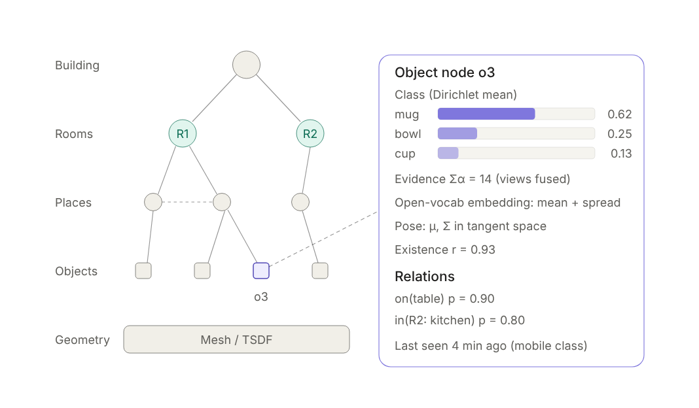

[Open standalone page](assets/28_scene_graph_semantic_uncertainty_node.html)

<details><summary>Diagram source</summary>

````svg
<svg width="100%" viewBox="0 0 680 380" role="img"><title>3D scene graph with an uncertain object node</title><desc>A layered scene graph with a building, two rooms, three places, four objects and a geometry layer. Object o3 is expanded into a card showing its class distribution (mug 0.62, bowl 0.25, cup 0.13), Dirichlet evidence, open-vocabulary embedding, pose covariance, existence probability, probabilistic relations and last-seen time.</desc>
<text class="ts" x="40" y="50" dominant-baseline="central">Building</text>
<text class="ts" x="40" y="120" dominant-baseline="central">Rooms</text>
<text class="ts" x="40" y="190" dominant-baseline="central">Places</text>
<text class="ts" x="40" y="260" dominant-baseline="central">Objects</text>
<text class="ts" x="40" y="330" dominant-baseline="central">Geometry</text>
<g stroke="var(--border-stronger)" stroke-width="0.75">
<line x1="225" y1="60" x2="180" y2="108"/><line x1="245" y1="60" x2="290" y2="108"/>
<line x1="163" y1="133" x2="145" y2="182"/><line x1="177" y1="133" x2="205" y2="182"/><line x1="300" y1="134" x2="292" y2="181"/>
<line x1="140" y1="199" x2="134" y2="252"/><line x1="213" y1="199" x2="196" y2="252"/><line x1="216" y1="198" x2="246" y2="252"/><line x1="292" y1="199" x2="308" y2="252"/>
</g>
<line x1="149" y1="190" x2="201" y2="190" stroke="var(--border-stronger)" stroke-width="0.75" stroke-dasharray="3 3"/>
<circle class="c-gray" cx="235" cy="50" r="14" stroke-width="0.5"/>
<g class="c-teal"><circle cx="170" cy="120" r="14" stroke-width="0.5"/><text class="ts" x="170" y="120" text-anchor="middle" dominant-baseline="central">R1</text></g>
<g class="c-teal"><circle cx="300" cy="120" r="14" stroke-width="0.5"/><text class="ts" x="300" y="120" text-anchor="middle" dominant-baseline="central">R2</text></g>
<circle class="c-gray" cx="140" cy="190" r="9" stroke-width="0.5"/>
<circle class="c-gray" cx="210" cy="190" r="9" stroke-width="0.5"/>
<circle class="c-gray" cx="290" cy="190" r="9" stroke-width="0.5"/>
<rect class="c-gray" x="122" y="252" width="16" height="16" rx="3" stroke-width="0.5"/>
<rect class="c-gray" x="182" y="252" width="16" height="16" rx="3" stroke-width="0.5"/>
<rect class="c-purple" x="242" y="252" width="16" height="16" rx="3" stroke-width="1"/>
<rect class="c-gray" x="302" y="252" width="16" height="16" rx="3" stroke-width="0.5"/>
<text class="ts" x="250" y="286" text-anchor="middle" dominant-baseline="central">o3</text>
<g class="c-gray"><rect x="110" y="316" width="230" height="28" rx="6" stroke-width="0.5"/><text class="ts" x="225" y="330" text-anchor="middle" dominant-baseline="central">Mesh / TSDF</text></g>
<line x1="258" y1="256" x2="368" y2="200" stroke="var(--border-stronger)" stroke-width="0.75" stroke-dasharray="4 3"/>
<rect x="370" y="40" width="270" height="318" rx="12" fill="none" stroke="#7F77DD" stroke-width="0.75"/>
<text class="th" x="386" y="58" dominant-baseline="central">Object node o3</text>
<text class="ts" x="386" y="80" dominant-baseline="central">Class (Dirichlet mean)</text>
<text class="ts" x="386" y="100" dominant-baseline="central">mug</text><rect x="430" y="94" width="160" height="12" rx="3" fill="var(--bg2)" stroke="var(--border)" stroke-width="0.5"/><rect x="430" y="94" width="99" height="12" rx="3" fill="#7F77DD"/><text class="ts" x="628" y="100" text-anchor="end" dominant-baseline="central">0.62</text>
<text class="ts" x="386" y="120" dominant-baseline="central">bowl</text><rect x="430" y="114" width="160" height="12" rx="3" fill="var(--bg2)" stroke="var(--border)" stroke-width="0.5"/><rect x="430" y="114" width="40" height="12" rx="3" fill="#7F77DD" opacity="0.7"/><text class="ts" x="628" y="120" text-anchor="end" dominant-baseline="central">0.25</text>
<text class="ts" x="386" y="140" dominant-baseline="central">cup</text><rect x="430" y="134" width="160" height="12" rx="3" fill="var(--bg2)" stroke="var(--border)" stroke-width="0.5"/><rect x="430" y="134" width="21" height="12" rx="3" fill="#7F77DD" opacity="0.5"/><text class="ts" x="628" y="140" text-anchor="end" dominant-baseline="central">0.13</text>
<text class="ts" x="386" y="166" dominant-baseline="central">Evidence Σα = 14 (views fused)</text>
<text class="ts" x="386" y="190" dominant-baseline="central">Open-vocab embedding: mean + spread</text>
<text class="ts" x="386" y="214" dominant-baseline="central">Pose: μ, Σ in tangent space</text>
<text class="ts" x="386" y="238" dominant-baseline="central">Existence r = 0.93</text>
<text class="th" x="386" y="266" dominant-baseline="central">Relations</text>
<text class="ts" x="386" y="288" dominant-baseline="central">on(table)  p = 0.90</text>
<text class="ts" x="386" y="310" dominant-baseline="central">in(R2: kitchen)  p = 0.80</text>
<text class="ts" x="386" y="336" dominant-baseline="central">Last seen 4 min ago (mobile class)</text>
</svg>
````

</details>

**1. Six kinds of semantic uncertainty, and where each lives**

| Uncertainty | Lives on | Typical representation |
|---|---|---|
| Class ("mug or bowl?") | Object node | Categorical distribution, often a Dirichlet over observation counts |
| Meaning (open-vocabulary) | Object node | Fused CLIP-style embedding plus a spread or similarity margin |
| Instance / existence ("one object or two? real or a false detection?") | Object nodes and their merges | Existence probability r; association hypotheses |
| Geometry | Object node | Pose mean and covariance, box extent |
| Relations ("on", "in", "next to") | Edges | Probability per relation, derived from geometry under uncertainty |
| Time ("is it still there?") | Every node | Last-seen time plus a class-dependent mobility prior |

**2. Class fusion: a Bayes filter per node**

```
Dirichlet evidence:   α_c ← α_c + w_view · p_det(c | view)
belief:               p(c) = α_c / Σα          confidence ∝ Σα
```

- **Σα separates "uncertain because ambiguous" from "uncertain because rarely seen."** Ten views split 50/50 and one view split 50/50 have the same mean but very different evidence. A softmax average loses that distinction.
- **Calibrate the detector first.** Raw softmax scores are overconfident; temperature-scale them or use conformal sets.
- **Down-weight correlated views.** Fifty frames from nearly the same viewpoint are not fifty independent observations. Weight by viewpoint diversity, or the node becomes confidently wrong. This is the occupancy grid's independence problem appearing at the semantic level.

**3. Open-vocabulary semantics**

Systems such as ConceptGraphs and HOV-SG fuse per-view embeddings into each node (a mean, often with a count), so the robot can query arbitrary phrases like "something to pour into."

- **Similarity is not probability.** A cosine score has no meaning on its own scale. Turn query scores into decisions using margins over competing phrases, plus thresholds calibrated on held-out data.
- **Spread is a proxy for confusion.** High variance across views suggests occlusion, mixed instances, or genuine ambiguity.

**4. Instance and existence uncertainty: tracking at the object level**

Merging and splitting objects across views is the data-association problem from multi-object tracking.
- Over-merging fuses two mugs into one node.
- Over-splitting duplicates a chair.

Robust systems keep existence probabilities and reversible merges, or explicit association hypotheses (the MHT idea, applied to objects). They avoid committing irreversibly on the first overlap.

**5. Relations and hierarchy: inference across the graph**

- **Relations come from geometry under uncertainty.** p(on(table)) is computed from the two poses and covariances (support-plane contact, overlap), not set by a hard threshold.
- **The hierarchy couples the labels.** A room's type and its objects inform each other: a stove raises p(kitchen), and a kitchen raises p(mug) over p(bowl) for an ambiguous cylinder. Joint inference over the graph, with a CRF or a factor graph over discrete labels, beats labeling each node independently. This is the semantic counterpart of the pose factor graph: local evidence plus relational priors gives a consistent posterior.

**6. Time: semantic beliefs decay**

```
uncertainty(t) grows with  (t − t_last_seen) × mobility(class)
```

Fridges stay put; mugs, chairs, and people move. A good scene graph widens beliefs over time per class, and marks nodes "stale" so the planner knows to re-observe before acting on them.

**7. How planners use it**

- **LLM or task planners over the graph** (SayPlan-style). Give the planner probabilities, not only argmax labels. "Pick up the mug" should become: the best candidate is o3 at p = 0.62; also consider o7; verify o3 first.
- **Expected task success.** Choose the plan that maximizes Σ p(correct object) × p(success | object), with cheap verification steps (look closer, rotate the gripper camera) when the top-1 margin is small.
- **Active semantic search.** Use the hierarchy to decide where to look: open the kitchen cabinets before the office drawers, ranked by p(object | room) × visibility.
- **Ask when ambiguity is irreducible.** If two candidates stay close after observation, a clarifying question costs less than a wrong grasp.
- **Asymmetric thresholds for safety.** For "person," "glass," or "knife," use low thresholds for caution and high thresholds for convenience. Treat an uncertain person as a person.

**8. Pitfalls**

| Pitfall | Effect |
|---|---|
| Storing only the argmax label | Planner can't see ambiguity; brittle task plans |
| Treating correlated views as independent | Confident wrong labels |
| Using raw similarity scores as probabilities | Random-seeming query thresholds |
| Irreversible instance merges | Permanent semantic corruption |
| No temporal decay | Plans built on objects that have moved |
| Ignoring the pose term | Relations ("on", "in") wrong near boundaries |

**In one line:** a 3D scene graph is a belief over what exists, what it is, where it is, and how things relate, with each node acting as a small filter. It is useful for planning only if the planner receives calibrated distributions with evidence counts and staleness, so it can choose to look, verify, or ask before acting on a guess.

---

<a id="turn-26"></a>
## 26. How does belief-space planning use chance constraints and risk measures like CVaR?

> **Question:** How does belief-space planning use chance constraints and risk measures like CVaR?

Belief-space planning optimizes over distributions of future states instead of single nominal states. Because the future is a distribution, constraints and costs have to be stated as risk statements:

- A **chance constraint** limits how often a bad thing happens: P(collision) ≤ ε.
- **CVaR** limits how bad things are on average when they do go wrong: the expected cost in the worst (1−α) tail.

The two can choose different plans. Below, plan A is usually cheap but has a rare bad outcome; plan B is a little worse on average with a thin tail. Move α and watch which plan each criterion picks.

**Diagram: `mean_var_cvar_plan_choice`** (interactive HTML widget)

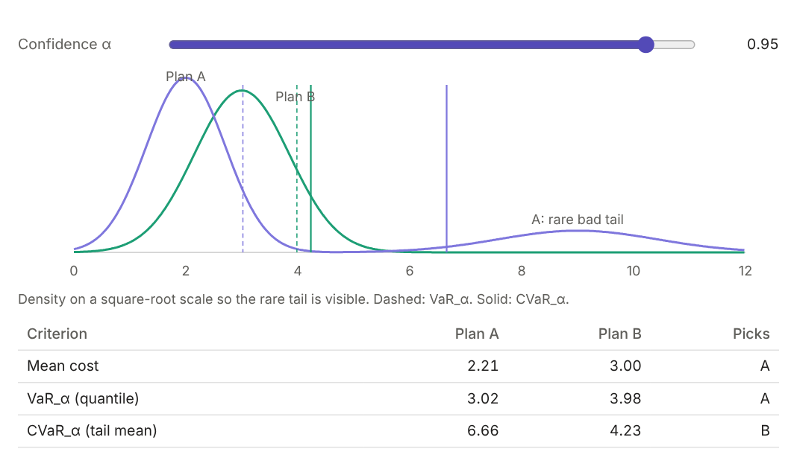

[Open standalone page](assets/29_mean_var_cvar_plan_choice.html)

<details><summary>Diagram source</summary>

````html
<h2 class="sr-only">Interactive comparison of two plans' cost distributions showing how the mean, value-at-risk and conditional value-at-risk at a chosen confidence level can select different plans.</h2>
<style>
.r{display:flex;align-items:center;gap:12px;font-size:13px;color:var(--text-secondary);margin:6px 0}
.r label{width:120px}.r input{flex:1}.r output{width:60px;text-align:right;color:var(--text-primary);font-variant-numeric:tabular-nums}
table.m{width:100%;border-collapse:collapse;font-size:13px;margin-top:10px;font-variant-numeric:tabular-nums}
table.m th,table.m td{padding:6px 8px;border-bottom:0.5px solid var(--border);text-align:right;color:var(--text-primary);font-weight:400}
table.m th{color:var(--text-secondary);font-weight:500}
table.m td:first-child,table.m th:first-child{text-align:left}
.w{color:var(--text-accent);font-weight:500}
</style>
<div style="padding:0.5rem 0">
<div class="r"><label for="a">Confidence α</label><input id="a" type="range" min="0.5" max="0.99" step="0.01" value="0.95"><output id="ao"></output></div>
<div id="pl"></div>
<div style="font-size:12px;color:var(--text-secondary)">Density on a square-root scale so the rare tail is visible. Dashed: VaR_α. Solid: CVaR_α.</div>
<table class="m"><thead><tr><th>Criterion</th><th>Plan A</th><th>Plan B</th><th>Picks</th></tr></thead><tbody id="tb"></tbody></table>
</div>
<script>
const $=i=>document.getElementById(i);
const N=(x,m,s)=>Math.exp(-.5*((x-m)/s)**2)/(s*Math.sqrt(2*Math.PI));
const dx=0.005,xs=[];for(let x=0;x<=13;x+=dx)xs.push(x);
const pA=xs.map(x=>.97*N(x,2,.5)+.03*N(x,9,1)),pB=xs.map(x=>N(x,3,.6));
function stats(p,a){let c=0,v=null,mean=0;for(let i=0;i<xs.length;i++){mean+=xs[i]*p[i]*dx}
for(let i=0;i<xs.length;i++){c+=p[i]*dx;if(v===null&&c>=a){v=i;break}}
let t=0,m=0;for(let i=v;i<xs.length;i++){t+=p[i]*dx;m+=xs[i]*p[i]*dx}
return{mean,var:xs[v],cvar:m/t}}
const X=x=>50+x*600/12,Y=p=>170-Math.sqrt(p)*160/0.9;
function path(p){let s='';for(let i=0;i<xs.length;i+=4){if(xs[i]>12)break;s+=(s?'L':'M')+X(xs[i]).toFixed(1)+' '+Y(p[i]).toFixed(1)}return s}
const PA=path(pA),PB=path(pB);
function u(){
const a=+$('a').value;$('ao').textContent=a.toFixed(2);
const A=stats(pA,a),B=stats(pB,a);
let s='<svg width="100%" viewBox="0 0 680 200" role="img"><title>Cost distributions of plan A and plan B</title>';
s+='<line x1="50" y1="170" x2="650" y2="170" stroke="var(--border-stronger)" stroke-width="0.5"/>';
for(let k=0;k<=12;k+=2)s+='<text class="ts" x="'+X(k)+'" y="186" text-anchor="middle" dominant-baseline="central">'+k+'</text>';
s+='<path d="'+PB+'" fill="none" stroke="#1D9E75" stroke-width="2"/><path d="'+PA+'" fill="none" stroke="#7F77DD" stroke-width="2"/>';
[[A,'#7F77DD'],[B,'#1D9E75']].forEach(([S,c])=>{s+='<line x1="'+X(S.var)+'" y1="20" x2="'+X(S.var)+'" y2="170" stroke="'+c+'" stroke-width="1" stroke-dasharray="4 3"/>';
s+='<line x1="'+X(Math.min(S.cvar,12))+'" y1="20" x2="'+X(Math.min(S.cvar,12))+'" y2="170" stroke="'+c+'" stroke-width="1.5"/>'});
s+='<text class="ts" x="'+X(2)+'" y="12" text-anchor="middle" dominant-baseline="central">Plan A</text><text class="ts" x="'+X(9)+'" y="140" text-anchor="middle" dominant-baseline="central">A: rare bad tail</text><text class="ts" x="'+X(3.6)+'" y="30" text-anchor="start" dominant-baseline="central">Plan B</text></svg>';
$('pl').innerHTML=s;
const row=(n,a,b)=>'<tr><td>'+n+'</td><td'+(a<=b?' class="w"':'')+'>'+a.toFixed(2)+'</td><td'+(b<a?' class="w"':'')+'>'+b.toFixed(2)+'</td><td>'+(a<=b?'A':'B')+'</td></tr>';
$('tb').innerHTML=row('Mean cost',A.mean,B.mean)+row('VaR_α (quantile)',A.var,B.var)+row('CVaR_α (tail mean)',A.cvar,B.cvar);
}
$('a').addEventListener('input',u);u();
</script>
````

</details>

At α = 0.95, the mean and VaR both pick A, because the 3% disaster sits beyond the quantile, so VaR literally cannot see it. CVaR picks B. Lower α toward 0.8 and CVaR switches back to A, since the tail being averaged then contains mostly ordinary outcomes. The choice of α is a statement about which tail you care about.

**1. The belief-space setup**

```
belief dynamics:   b_{t+1} = τ(b_t, u_t, z_{t+1})          (a filter step)
Gaussian case:     μ_{t+1} = f(μ_t, u_t)  (+ expected innovation)
                   Σ_{t+1} = Riccati(Σ_t, F, H, Q, R)       ← depends on u through F, H
plan:              min_u  ρ[ cost(x_0:T, u) ]   s.t.  risk constraints on x_t ~ b_t
```

What makes this belief-space planning rather than stochastic MPC with fixed noise is that Σ depends on the actions. Paths that pass landmarks, keep a target in the LiDAR's field of view, or slow down for better scan matching shrink Σ. The planner can therefore choose to gain information.

Common approximations:
- **Maximum-likelihood observations** (Platt et al.): assume each future measurement equals its predicted value, so the mean follows a deterministic path while Σ still updates.
- **LQG-MP** (van den Berg et al.): compute in advance the state distribution under a nominal plan tracked by an LQG controller.
- **Covariance steering:** treat Σ_t as a decision variable and steer it directly.

**2. Chance constraints: limiting the probability of a violation**

For a linear constraint and a Gaussian belief, the chance constraint reduces exactly to a deterministic one:

```
P( aᵀx_t ≤ b ) ≥ 1 − ε      ⇔      aᵀμ_t + Φ⁻¹(1−ε) · √(aᵀ Σ_t a)  ≤  b
                                                └── back-off, grows with Σ ──┘
```

- **Uncertainty becomes geometry.** The constraint is pulled inward by k·σ along the constraint normal: the earlier "inflate obstacles by kσ" idea, made exact.
- **Information gathering emerges automatically.** A narrow doorway is infeasible while Σ is large, so the optimizer finds that it must first localize (look at a wall or a landmark) to shrink Σ until the back-off fits. No explicit "explore" term is needed.

From per-step constraints to the whole trajectory:

```
P( any violation over t = 0..T ) ≤ ε     ⇐     Σ_t ε_t ≤ ε    (Boole's inequality)
```

Risk allocation (Blackmore, Ono, Williams) optimizes how the ε budget is spent: little where the path is open, more at the bottleneck. The fixed split ε/T is far more conservative.

When the belief is not Gaussian:
- **Mixtures**, such as multimodal predictions: P(violation) = Σ_k π_k P_k(violation). Each mode gets its own tightening, weighted by π_k.
- **Particles or samples:** the scenario approach. Require the constraint to hold for N sampled scenarios. With N on the order of (2/ε)(ln(1/β) + d), where d is the number of decision variables, the true violation probability is at most ε with confidence 1−β.

A limitation: a chance constraint is a VaR-type constraint. It counts how often violations happen and ignores how severe they are. A grazing contact and a high-speed impact count equally.

**3. Risk measures: what matters in the tail**

```
VaR_α(Z)  = inf{ z : P(Z ≤ z) ≥ α }                        quantile
CVaR_α(Z) = E[ Z | Z ≥ VaR_α ]
          = min_η  { η + E[(Z − η)_+] / (1 − α) }            Rockafellar–Uryasev
```

Why CVaR is the workhorse:

| Property | VaR / chance constraint | CVaR |
|---|---|---|
| Sees tail magnitude | No | Yes |
| Convex in the decision (for convex losses) | No | Yes |
| With samples | Mixed-integer | A linear program via the η formula |
| Coherent (subadditive, monotone, etc.) | No | Yes |
| Relation | — | CVaR_α(Z) ≤ c ⇒ P(Z > c) ≤ 1−α, a convex, conservative inner approximation of the chance constraint |

In motion planning, the loss Z is often a safety margin shortfall, such as max(0, d_safe − signed distance). CVaR then constrains the expected penetration in the worst (1−α) fraction of futures, which penalizes deep collisions much more than near-misses.

Extensions:
- **Distributionally robust CVaR:** take the worst case over a Wasserstein ball around the empirical distribution. This hedges against the belief itself being wrong, which matters given how often covariances are overconfident.
- **Dynamic programming needs time-consistent risk.** Static CVaR over the whole trajectory is not time-consistent: replanning midway can contradict the original plan. Nested (Markov) risk measures restore consistency, at the cost of compounding conservatism.
- **EVaR** gives tighter, more tractable upper bounds in some settings.

**4. Where these appear in practice**

| Setting | Formulation |
|---|---|
| Stochastic MPC (drones, AVs) | Gaussian chance-constraint tightening plus risk allocation; QP/SOCP solved in real time |
| Sampling-based MPC (MPPI) | CVaR over rollout costs (risk-aware MPPI) |
| Planning against multimodal predictions | Chance or CVaR constraints per mode, combined by π_k, with contingency branches |
| Perception-aware planning | Σ propagated through the planned path; field-of-view and landmark visibility in the cost |
| RL | Distributional RL with CVaR objectives for risk-averse policies |

**5. The spectrum of risk attitudes**

```
expected cost    →   chance constraint   →   CVaR                →   worst case / reachable set
"on average"         "how often"             "how bad, when bad"     "never, for any admissible disturbance"
cheap, unsafe        intuitive, non-convex   convex, tail-aware      certifiable, can freeze the robot
```

Real stacks combine levels: CVaR or chance constraints in the planner for performance under risk, and a worst-case safety filter (reachability, control barrier functions) underneath for guarantees.

**6. Pitfalls**

- **Garbage Σ makes every guarantee meaningless.** All of this is only as good as the calibration of the belief. An overconfident covariance gives a back-off that is too small, and "ε = 10⁻⁴" becomes fiction. Run NIS/NEES checks, or inflate Σ when they fail.
- **Gaussian tightening on non-Gaussian beliefs** underestimates heavy tails. Use mixtures, scenarios, or CVaR on samples.
- **The union bound is conservative** over long horizons with correlated violations. Risk allocation or joint sampling helps.
- **ε and α need operational meaning.** Is it per maneuver, per hour, or per kilometer? Is the loss a collision indicator or penetration depth? These choices matter more than the solver.
- **Too much risk aversion freezes the robot.** Pair it with contingency planning, so caution applies to the shared prefix rather than the whole plan.

**In one line:** belief-space planning propagates uncertainty along the candidate plan and turns it into risk statements. Chance constraints back the plan away from obstacles by kσ and make information gathering emerge on their own. CVaR adds sensitivity to how bad the tail is, while staying convex. Both rest on a calibrated belief, and the earlier tools (consistency monitoring, conformal calibration, distributionally robust margins) exist to keep that belief honest.

---

<a id="turn-27"></a>
## 27. How do reachability analysis and control barrier functions use worst-case state sets for robot safety?

> **Question:** How do reachability analysis and control barrier functions use worst-case state sets for robot safety?

Both methods answer the same question: from which states can the robot still guarantee staying safe, against every disturbance and every estimation error within assumed bounds? They then intervene minimally to keep the robot inside that set.

- **Hamilton–Jacobi (HJ) reachability** computes the set directly, as a differential game between control and disturbance.
- **Control barrier functions (CBFs)** certify a set given by a function h(x) ≥ 0, and enforce it with a cheap quadratic-program filter at each control step.

The example below is a robot driving toward a wall, in the phase plane (position, velocity). The nominal controller keeps accelerating; the CBF filter overrides it only when it must.

**Diagram: `reachability_cbf_braking_phase_plane`** (interactive HTML widget)

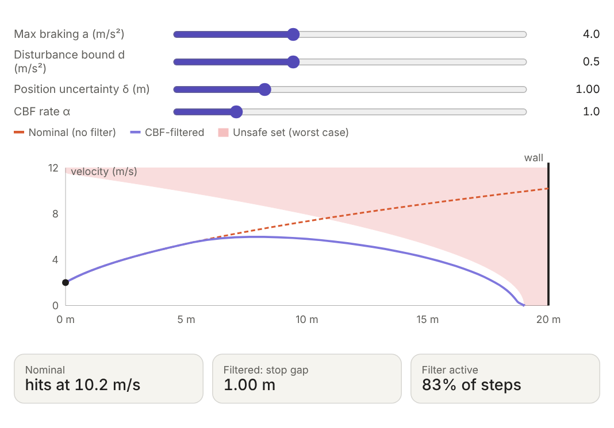

[Open standalone page](assets/30_reachability_cbf_braking_phase_plane.html)

<details><summary>Diagram source</summary>

````html
<h2 class="sr-only">Phase-plane simulation of a robot approaching a wall, showing the worst-case backward reachable unsafe set and how a control barrier function safety filter keeps the trajectory outside it under disturbance and position uncertainty.</h2>
<style>
.r{display:flex;align-items:center;gap:12px;font-size:13px;color:var(--text-secondary);margin:6px 0}
.r label{width:170px}.r input{flex:1}.r output{width:70px;text-align:right;color:var(--text-primary);font-variant-numeric:tabular-nums}
.g{display:grid;grid-template-columns:repeat(auto-fit,minmax(150px,1fr));gap:10px;margin:12px 0 4px}
.c{background:var(--surface-1);border:0.5px solid var(--border);border-radius:12px;padding:10px 12px}
.c .k{font-size:12px;color:var(--text-secondary)}.c .v{font-size:18px;font-weight:500;color:var(--text-primary);font-variant-numeric:tabular-nums}
.lg{display:flex;gap:16px;flex-wrap:wrap;font-size:12px;color:var(--text-secondary);margin:4px 0}
.sw{display:inline-block;width:12px;height:3px;margin-right:5px;vertical-align:3px}
</style>
<div style="padding:0.5rem 0">
<div class="r"><label for="a">Max braking a (m/s²)</label><input id="a" type="range" min="2" max="8" step="0.5" value="4"><output id="ao"></output></div>
<div class="r"><label for="d">Disturbance bound d (m/s²)</label><input id="d" type="range" min="0" max="1.5" step="0.1" value="0.5"><output id="do"></output></div>
<div class="r"><label for="e">Position uncertainty δ (m)</label><input id="e" type="range" min="0" max="4" step="0.25" value="1"><output id="eo"></output></div>
<div class="r"><label for="al">CBF rate α</label><input id="al" type="range" min="0.2" max="5" step="0.1" value="1"><output id="alo"></output></div>
<div class="lg"><span><span class="sw" style="background:#D85A30"></span>Nominal (no filter)</span><span><span class="sw" style="background:#7F77DD"></span>CBF-filtered</span><span><span class="sw" style="background:#E24B4A;opacity:.35;height:10px;vertical-align:-1px"></span>Unsafe set (worst case)</span></div>
<div id="pl"></div>
<div class="g">
<div class="c"><div class="k">Nominal</div><div class="v" id="r1"></div></div>
<div class="c"><div class="k">Filtered: stop gap</div><div class="v" id="r2"></div></div>
<div class="c"><div class="k">Filter active</div><div class="v" id="r3"></div></div>
</div>
</div>
<script>
const $=i=>document.getElementById(i);const D=20,VM=12;
const X=p=>60+p*560/D,Y=v=>190-v*160/VM;
function sim(f,a,d,de,al){let p=0,v=2,path=[[p,v]],act=0,n=0,hit=false;const ae=a-d,dt=0.005;
for(let k=0;k<20000;k++){let u=2;
if(f){const h=D-de-p-v*v/(2*ae);if(v>1e-3){const us=(ae/v)*(al*h-v)-d;if(us<u){u=us;act++}}}
u=Math.max(-a,Math.min(a,u));v+=(u+d)*dt;if(v<0)v=0;p+=v*dt;n++;
if(k%20==0)path.push([p,v]);if(p>=D){hit=true;p=D;path.push([p,v]);break}if(v===0&&k>10)break}
path.push([p,v]);return{path,p,v,hit,act:act/n}}
function u(){
const a=+$('a').value,d=+$('d').value,de=+$('e').value,al=+$('al').value;
$('ao').textContent=a.toFixed(1);$('do').textContent=d.toFixed(1);$('eo').textContent=de.toFixed(2);$('alo').textContent=al.toFixed(1);
const ae=a-d;let poly='M'+X(D)+' '+Y(0);
for(let v=0;v<=VM;v+=0.1){const p=Math.max(0,D-de-v*v/(2*ae));poly+='L'+X(p).toFixed(1)+' '+Y(v).toFixed(1)}
poly+='L'+X(D)+' '+Y(VM)+'Z';
const N=sim(false,a,d,de,al),F=sim(true,a,d,de,al);
const pth=P=>P.map((q,i)=>(i?'L':'M')+X(q[0]).toFixed(1)+' '+Y(Math.min(q[1],VM)).toFixed(1)).join('');
let s='<svg width="100%" viewBox="0 0 680 230" role="img"><title>Phase plane: position vs velocity</title>';
s+='<path d="'+poly+'" fill="#E24B4A" opacity="0.18" stroke="#E24B4A" stroke-width="0.75"/>';
s+='<line x1="60" y1="190" x2="620" y2="190" stroke="var(--border-stronger)" stroke-width="0.5"/><line x1="60" y1="30" x2="60" y2="190" stroke="var(--border-stronger)" stroke-width="0.5"/>';
s+='<line x1="'+X(D)+'" y1="24" x2="'+X(D)+'" y2="190" stroke="var(--text-primary)" stroke-width="2.5"/><text class="ts" x="'+(X(D)-6)+'" y="18" text-anchor="end" dominant-baseline="central">wall</text>';
for(let k=0;k<=D;k+=5)s+='<text class="ts" x="'+X(k)+'" y="206" text-anchor="middle" dominant-baseline="central">'+k+' m</text>';
for(let k=0;k<=VM;k+=4)s+='<text class="ts" x="52" y="'+Y(k)+'" text-anchor="end" dominant-baseline="central">'+k+'</text>';
s+='<text class="ts" x="66" y="34" dominant-baseline="central">velocity (m/s)</text>';
s+='<path d="'+pth(N.path)+'" fill="none" stroke="#D85A30" stroke-width="2" stroke-dasharray="5 3"/>';
s+='<path d="'+pth(F.path)+'" fill="none" stroke="#7F77DD" stroke-width="2.5"/>';
s+='<circle cx="'+X(0)+'" cy="'+Y(2)+'" r="4" fill="var(--text-primary)"/></svg>';
$('pl').innerHTML=s;
$('r1').textContent=N.hit?'hits at '+N.v.toFixed(1)+' m/s':'stops';
$('r2').textContent=F.hit?'collision':(D-F.p).toFixed(2)+' m';
$('r3').textContent=(F.act*100).toFixed(0)+'% of steps';
}
['a','d','e','al'].forEach(i=>$(i).addEventListener('input',u));u();
</script>
````

</details>

The red region is the backward reachable set. From any state inside it, the worst-case disturbance pushing toward the wall, combined with maximum braking, still ends in a collision. Its boundary is

```
p = D − δ − v² / (2(a − d))
```

Things to try:
- **Raise d or δ:** the unsafe set grows and the filtered stop moves away from the wall.
- **Lower α:** the filter starts braking earlier and more gently.
- **Raise α:** it waits and brakes hard along the boundary.

In every case the filtered path never enters the red region, because the filter guards against the worst case within the assumed bounds.

**1. HJ reachability: compute the unsafe set as a game**

```
failure set     F = { x : l(x) ≤ 0 }
BRT(T)          = { x_0 : ∀u(·) ∃d(·) such that x(t) ∈ F for some t ≤ T }
value function  min{ ∂V/∂t + max_u min_d ∇V · f(x,u,d),  l(x) − V } = 0      (HJI variational inequality)
safe set        { x : V(x) > 0 }
safety control  u* = argmax_u min_d ∇V · f(x,u,d)
```

- **Strengths:** exact for nonlinear dynamics with bounded disturbances. It produces the set and the optimal safety controller together. The value function V is itself a valid CBF, the least conservative one possible for the model.
- **Weakness:** the curse of dimensionality. Grid solvers handle roughly 4–6 dimensions.
- **Ways around it:**
  - System decomposition.
  - Neural approximations (DeepReach).
  - Offline computation for a reduced relative-state model, such as car versus obstacle.
- **Forward reachable sets** answer a different question: where can something end up? Zonotope or polytope tools (CORA, JuliaReach) verify that a closed-loop plan stays safe. Reachable sets of other agents (bounding every legal behavior over time) give worst-case occupancy for planning.

**2. Control barrier functions: certify a set, then filter**

```
safe set        C = { x : h(x) ≥ 0 }
CBF condition   sup_u [ L_f h(x) + L_g h(x) u ] ≥ −α(h(x))      ⇒  C is forward invariant
safety filter   u = argmin ‖u − u_nom‖²   s.t.   L_f h + L_g h · u ≥ −α(h),   u ∈ U
```

- The filter is a small QP solved at control rate, often under 1 ms. It is minimally invasive: it leaves the nominal action untouched unless the barrier constraint is active.
- α sets how fast the system may approach the boundary, trading smoothness against how late the filter intervenes. You saw this with the slider.
- **Higher-order CBFs** handle relative degree greater than one, such as a position constraint with an acceleration input. The example's h includes the v²/2a term for exactly this reason.

**3. How the worst-case sets enter**

Three uncertainty sets have to be covered:

| Set | Source | How it enters the CBF or HJ problem |
|---|---|---|
| Disturbance D | Model error, slip, wind, actuation error | Worst-case term: −‖L_d h‖ · d_max (robust CBF); the min over d in HJ |
| State estimate X̂ | Estimator covariance → bounding set | Shrink the safe set by a margin ~ L_h · δ (measurement-robust CBF); the δ slider above |
| Other agents O_t | Forward reachable sets of their legal behaviors | Add to the failure set as a time-varying obstacle |

This is where the rest of the stack plugs in:
- δ should come from a calibrated bound: a 3σ ellipsoid that passes NIS checks, a GNSS/LiDAR integrity protection level, or a conformal set around a learned detector.
- O_t should come from tracks weighted by existence probability, plus occupancy of occluded areas.

If those inputs are overconfident, the guarantee is void. Its validity depends entirely on the bounds being right.

**4. Making it practical**

| Issue | Fix |
|---|---|
| QP infeasible under input limits | Choose h consistent with actuator limits (use the HJ value function, or verify h offline); add slack with a fallback |
| Several constraints conflicting | Prioritize, or combine into one composite h (smooth min); verify compatibility |
| Sampled data and latency | Discrete-time CBFs; tighten the margin by v · τ_latency |
| Model mismatch | Robust or adaptive CBFs; learn the residual dynamics with error bounds |
| Chattering at the boundary | Smaller α, or hysteresis in the filter |
| Worst-case agents too pessimistic (any car could swerve) | Restrict admissible behaviors with traffic rules or responsibility rules (RSS-style) |
| Learned nominal policies (VLAs, RL) | Exactly what the filter is for: a learned policy proposes, the certified filter disposes |

**5. Relation to probabilistic planning**

The previous answer covered chance constraints and CVaR. Worst-case methods sit at the end of that spectrum, and probability is still hidden inside them: the bounds d_max, δ, and O_t are chosen at some high quantile. The difference is where the probability lives:

- Chance constraints use probability inside the optimization.
- Worst-case methods use it once, to set the bounds, and then reason deterministically. That deterministic step is what allows formal certification.

**6. Reference architecture**

```
learned / MPC / CVaR planner  →  u_nom
        ↓
safety filter: CBF-QP  (h from HJ or verified design;  margins from δ, d_max, O_t)
        ↓
runtime monitor: are the assumptions holding?   (NIS, integrity, latency, actuator health)
        ↓ violated
fallback: minimal-risk maneuver (controlled stop), validated in advance with reachability
```

**In one line:** HJ reachability computes the states you must never enter, as a game against bounded disturbances. A CBF turns that boundary, or any certified approximation of it, into a one-millisecond QP that minimally edits whatever the nominal planner wants. Both guarantee safety only relative to their uncertainty sets, which is why calibrated estimator bounds and runtime monitoring are as important as the controller.

---

<a id="turn-28"></a>
## 28. How do NIS consistency tests and integrity monitoring detect when a robot belief is wrong?

> **Question:** How do NIS consistency tests and integrity monitoring detect when a robot belief is wrong?

These checks answer two different questions about the same estimator:

- **NIS consistency tests:** is the filter's own model of its uncertainty right? If the innovations are bigger, or more correlated, than the filter's covariance predicts, the belief is wrong in a way the filter itself can detect.
- **Integrity monitoring:** can we bound the true error with a guaranteed probability, including undetected faults, and raise an alarm in time when we can't?

Below is a 1D Kalman filter with a deliberately wrong noise model, plus a sensor bias that switches on halfway through. Watch the windowed NIS leave its χ² band.

**Diagram: `nis_consistency_test_demo`** (interactive HTML widget)

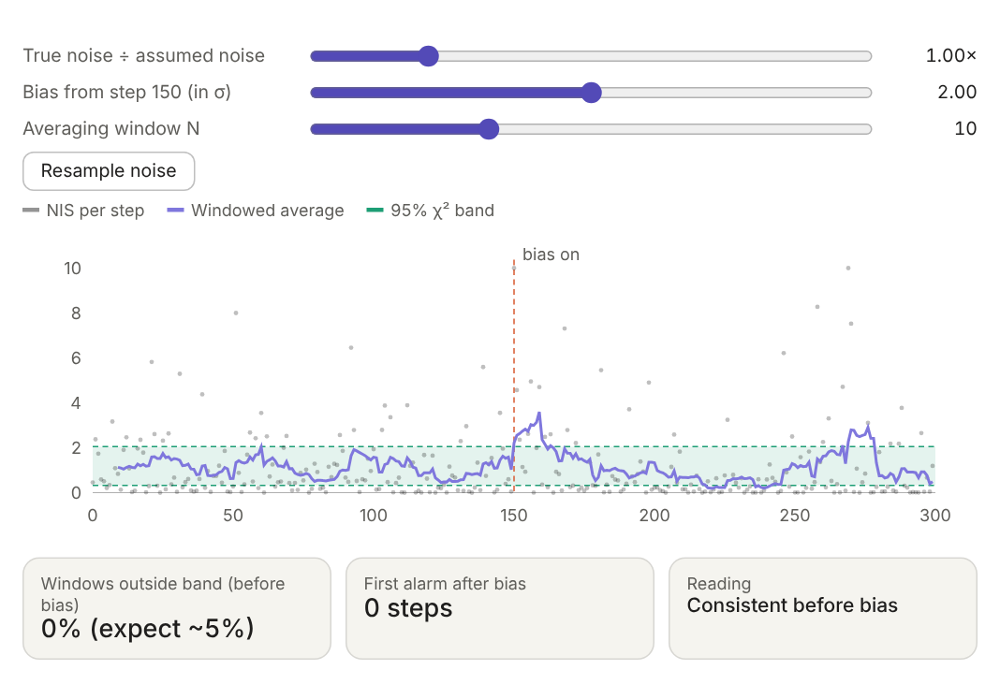

[Open standalone page](assets/31_nis_consistency_test_demo.html)

<details><summary>Diagram source</summary>

````html
<h2 class="sr-only">Interactive one-dimensional Kalman filter showing normalized innovation squared over time with chi-square bounds, under noise mismatch and an injected sensor bias.</h2>
<style>
.r{display:flex;align-items:center;gap:12px;font-size:13px;color:var(--text-secondary);margin:6px 0}
.r label{width:190px}.r input{flex:1}.r output{width:60px;text-align:right;color:var(--text-primary);font-variant-numeric:tabular-nums}
.g{display:grid;grid-template-columns:repeat(auto-fit,minmax(150px,1fr));gap:10px;margin:12px 0 4px}
.c{background:var(--surface-1);border:0.5px solid var(--border);border-radius:12px;padding:10px 12px}
.c .k{font-size:12px;color:var(--text-secondary)}.c .v{font-size:18px;font-weight:500;color:var(--text-primary);font-variant-numeric:tabular-nums}
.lg{display:flex;gap:16px;flex-wrap:wrap;font-size:12px;color:var(--text-secondary);margin:4px 0}
.sw{display:inline-block;width:12px;height:3px;margin-right:5px;vertical-align:3px}
button.s{font:inherit;font-size:13px;padding:5px 12px;border-radius:var(--radius);border:0.5px solid var(--border-strong);background:var(--surface-2);color:var(--text-primary);cursor:pointer}
</style>
<div style="padding:0.5rem 0">
<div class="r"><label for="s">True noise ÷ assumed noise</label><input id="s" type="range" min="0.5" max="3" step="0.05" value="1"><output id="so"></output></div>
<div class="r"><label for="b">Bias from step 150 (in σ)</label><input id="b" type="range" min="0" max="4" step="0.25" value="2"><output id="bo"></output></div>
<div class="r"><label for="w">Averaging window N</label><input id="w" type="range" min="1" max="30" step="1" value="10"><output id="wo"></output></div>
<div style="margin:6px 0"><button class="s" id="rs">Resample noise</button></div>
<div class="lg"><span><span class="sw" style="background:var(--border-stronger)"></span>NIS per step</span><span><span class="sw" style="background:#7F77DD"></span>Windowed average</span><span><span class="sw" style="background:#1D9E75"></span>95% χ² band</span></div>
<div id="pl"></div>
<div class="g">
<div class="c"><div class="k">Windows outside band (before bias)</div><div class="v" id="r1"></div></div>
<div class="c"><div class="k">First alarm after bias</div><div class="v" id="r2"></div></div>
<div class="c"><div class="k">Reading</div><div class="v" id="r3" style="font-size:14px"></div></div>
</div>
</div>
<script>
const $=i=>document.getElementById(i);let seed=11;
function rng(s){return function(){s|=0;s=s+0x6D2B79F5|0;let t=Math.imul(s^s>>>15,1|s);t=t+Math.imul(t^t>>>7,61|t)^t;return((t^t>>>14)>>>0)/4294967296}}
function g(r){let u=0,v=0;while(!u)u=r();while(!v)v=r();return Math.sqrt(-2*Math.log(u))*Math.cos(2*Math.PI*v)}
function chi(k,z){const a=2/(9*k);return Math.max(0,k*Math.pow(1-a+z*Math.sqrt(a),3))}
const K=300,X=k=>50+k*2,YM=10,Y=v=>190-Math.min(v,YM)*160/YM;
function u(){
const s=+$('s').value,b=+$('b').value,W=+$('w').value;
$('so').textContent=s.toFixed(2)+'×';$('bo').textContent=b.toFixed(2);$('wo').textContent=W;
const r=rng(seed),q=0.01,R=1;let x=0,xh=0,P=1;const nis=[];
for(let k=0;k<K;k++){x+=Math.sqrt(q)*g(r);const z=x+s*Math.sqrt(R)*g(r)+(k>=150?b*Math.sqrt(R):0);
const Pp=P+q,S=Pp+R,nu=z-xh;nis.push(nu*nu/S);const Kg=Pp/S;xh=xh+Kg*nu;P=(1-Kg)*Pp}
const lo=chi(W,-1.96)/W,hi=chi(W,1.96)/W;const avg=[];let out=0,cnt=0,first=null;
for(let k=0;k<K;k++){if(k>=W-1){let m=0;for(let j=k-W+1;j<=k;j++)m+=nis[j];m/=W;avg.push([k,m]);
const o=m>hi||m<lo;if(k<150){cnt++;if(o)out++}else if(o&&first===null)first=k-150}}
let sv='<svg width="100%" viewBox="0 0 680 220" role="img"><title>NIS over time</title>';
sv+='<rect x="50" y="'+Y(hi)+'" width="600" height="'+(Y(lo)-Y(hi))+'" fill="#1D9E75" opacity="0.12"/>';
sv+='<line x1="50" y1="'+Y(hi)+'" x2="650" y2="'+Y(hi)+'" stroke="#1D9E75" stroke-width="1" stroke-dasharray="4 3"/><line x1="50" y1="'+Y(lo)+'" x2="650" y2="'+Y(lo)+'" stroke="#1D9E75" stroke-width="1" stroke-dasharray="4 3"/>';
sv+='<line x1="50" y1="190" x2="650" y2="190" stroke="var(--border-stronger)" stroke-width="0.5"/>';
for(let v=0;v<=YM;v+=2)sv+='<text class="ts" x="42" y="'+Y(v)+'" text-anchor="end" dominant-baseline="central">'+v+'</text>';
for(let k=0;k<=K;k+=50)sv+='<text class="ts" x="'+X(k)+'" y="206" text-anchor="middle" dominant-baseline="central">'+k+'</text>';
sv+='<line x1="'+X(150)+'" y1="24" x2="'+X(150)+'" y2="190" stroke="#D85A30" stroke-width="1" stroke-dasharray="4 3"/><text class="ts" x="'+(X(150)+6)+'" y="20" dominant-baseline="central">bias on</text>';
nis.forEach((v,k)=>{sv+='<circle cx="'+X(k)+'" cy="'+Y(v)+'" r="1.6" fill="var(--border-stronger)" opacity="0.6"/>'});
sv+='<path d="'+avg.map((p,i)=>(i?'L':'M')+X(p[0])+' '+Y(p[1]).toFixed(1)).join('')+'" fill="none" stroke="#7F77DD" stroke-width="2"/></svg>';
$('pl').innerHTML=sv;
const fr=out/Math.max(cnt,1);$('r1').textContent=(fr*100).toFixed(0)+'% (expect ~5%)';
$('r2').textContent=b===0?'no bias':(first===null?'missed':first+' steps');
$('r3').textContent=s>1.3?'Overconfident: R too small':s<0.75?'Underconfident: R too large':'Consistent before bias';
}
$('rs').onclick=()=>{seed=Math.floor(Math.random()*1e9);u()};
['s','b','w'].forEach(i=>$(i).addEventListener('input',u));u();
</script>
````

</details>

Things to try:
- **Set the noise ratio above 1** (true noise larger than assumed): the average sits above the band. The filter is overconfident.
- **Set it below 1:** the average sits below the band. The filter is underconfident and wastes information.
- **Widen the window N:** the band narrows, so small mismatches become detectable, but the alarm after a bias comes later.
- **Watch the bias response:** the average rises sharply, then drifts back as the filter partly absorbs the bias into its state. A fault the filter adapts to eventually becomes invisible to NIS.

**1. NIS and related tests**

```
ν_k = z_k − H x̂_k⁻          S_k = H P_k⁻ Hᵀ + R
ε_k = ν_kᵀ S_k⁻¹ ν_k  ~  χ²(m)          if the model is right

per step:   ε_k > χ²_m(1−p_FA)         → gate / reject outlier
windowed:   Σ_{k−N+1..k} ε_j  ~  χ²(Nm)  → test the noise model (ANIS)
whiteness:  corr(ν_k, ν_{k−l}) ≈ 0      → test for unmodeled dynamics / bias / timing
NEES:       (x − x̂)ᵀ P⁻¹ (x − x̂) ~ χ²(n) → needs ground truth: offline tuning only
```

How to read the results:

| Symptom | Likely cause |
|---|---|
| ANIS above the band | Q or R too small; unmodeled bias; extrinsic or timestamp error; wrong data association |
| ANIS below the band | Noise over-inflated: wasted information and overly conservative safety margins |
| Innovations autocorrelated | Unmodeled dynamics, slowly varying bias, latency or clock skew |
| Isolated spikes | Outliers: multipath, dynamic objects, mixed LiDAR pixels |

Where NIS is blind:
- **Unobservable directions.** Errors in global yaw or position for VIO and LiDAR odometry with no absolute reference never appear in the innovations, however large they grow. This is the observability issue from the factor-graph answer.
- **Absorbed faults.** A slow drift leaks into the state estimate and the innovations stay small. The filter has explained the fault away.
- **Overconfident measurement covariance.** Scan matching often reports a covariance from the inverse Hessian, which is too optimistic. In degenerate geometry (corridors, tunnels, open fields), check the Hessian's smallest eigenvalues or condition number directly, since NIS will look fine.

Consistency is necessary for a belief to be right, but not sufficient. That gap is why integrity monitoring exists.

**2. Integrity monitoring: bounding the error itself**

This comes from aviation GNSS (RAIM, ARAIM), and is increasingly used for autonomous-vehicle localization.

```
requirements:   alert limit AL,  integrity risk I_R (e.g. 10⁻⁷/h),  time to alert TTA
protection level PL such that   P( ‖error‖ > PL  and no alarm ) ≤ I_R
rule:           PL > AL  → declare the solution unavailable (alarm)
```

How the PL is built:
1. **Fault-free term:** K_md · σ from the estimator covariance, with K_md set by the allowed missed-detection probability.
2. **Fault hypotheses:** for each plausible fault (one GNSS satellite, wrong LiDAR map match, wheel slip, map change), compute the subset solution that excludes that sensor.
3. **Solution separation:** if the full solution and a subset solution disagree beyond a threshold, a fault is detected. The threshold is set by the false-alarm probability.
4. **The PL covers the worst undetected fault:** the separation threshold plus the subset's own K·σ, maximized over hypotheses and weighted by their prior probabilities.

The Stanford diagram is the standard way to validate a PL against ground truth:

**Diagram: `stanford_diagram_integrity_regions`** (static SVG diagram)

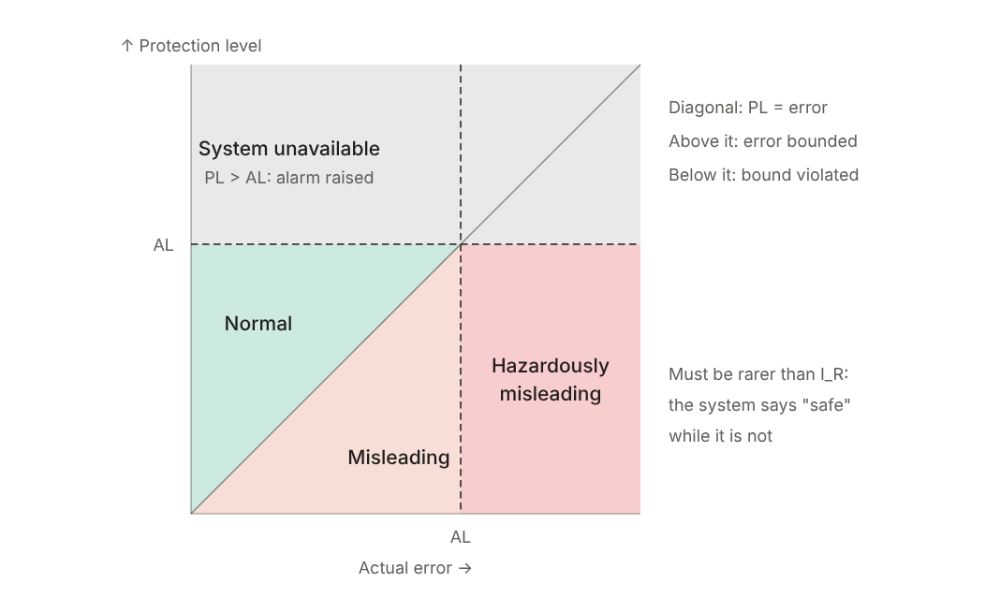

[Open standalone page](assets/32_stanford_diagram_integrity_regions.html)

<details><summary>Diagram source</summary>

````svg
<svg width="100%" viewBox="0 0 680 400" role="img"><title>Stanford diagram</title><desc>Actual position error on the horizontal axis and protection level on the vertical axis, with the diagonal where protection level equals error and the alert limit marked on both axes. Regions: normal operation where the error is below the protection level and the protection level is below the alert limit; misleading information where the error exceeds the protection level but stays below the alert limit; hazardously misleading information where the error exceeds the alert limit while the protection level stays below it; and system unavailable where the protection level exceeds the alert limit.</desc>
<polygon points="120,30 440,30 440,158 120,158" fill="#888780" opacity="0.18"/>
<polygon points="120,350 120,158 312,158" fill="#1D9E75" opacity="0.22"/>
<polygon points="120,350 312,158 312,350" fill="#D85A30" opacity="0.2"/>
<polygon points="312,158 440,158 440,350 312,350" fill="#E24B4A" opacity="0.28"/>
<line x1="120" y1="350" x2="440" y2="30" stroke="var(--border-stronger)" stroke-width="1"/>
<line x1="120" y1="158" x2="440" y2="158" stroke="var(--text-primary)" stroke-width="1" stroke-dasharray="5 3"/>
<line x1="312" y1="30" x2="312" y2="350" stroke="var(--text-primary)" stroke-width="1" stroke-dasharray="5 3"/>
<line x1="120" y1="30" x2="120" y2="350" stroke="var(--border-stronger)" stroke-width="0.75"/>
<line x1="120" y1="350" x2="440" y2="350" stroke="var(--border-stronger)" stroke-width="0.75"/>
<text class="th" x="190" y="90" text-anchor="middle" dominant-baseline="central">System unavailable</text>
<text class="ts" x="190" y="110" text-anchor="middle" dominant-baseline="central">PL &gt; AL: alarm raised</text>
<text class="th" x="168" y="215" text-anchor="middle" dominant-baseline="central">Normal</text>
<text class="th" x="268" y="310" text-anchor="middle" dominant-baseline="central">Misleading</text>
<text class="th" x="376" y="245" text-anchor="middle" dominant-baseline="central">Hazardously</text>
<text class="th" x="376" y="265" text-anchor="middle" dominant-baseline="central">misleading</text>
<text class="ts" x="108" y="158" text-anchor="end" dominant-baseline="central">AL</text>
<text class="ts" x="312" y="366" text-anchor="middle" dominant-baseline="central">AL</text>
<text class="ts" x="280" y="388" text-anchor="middle" dominant-baseline="central">Actual error →</text>
<text class="ts" x="120" y="16" text-anchor="middle" dominant-baseline="central">↑ Protection level</text>
<text class="ts" x="460" y="60" dominant-baseline="central">Diagonal: PL = error</text>
<text class="ts" x="460" y="84" dominant-baseline="central">Above it: error bounded</text>
<text class="ts" x="460" y="108" dominant-baseline="central">Below it: bound violated</text>
<text class="ts" x="460" y="250" dominant-baseline="central">Must be rarer than I_R:</text>
<text class="ts" x="460" y="272" dominant-baseline="central">the system says "safe"</text>
<text class="ts" x="460" y="294" dominant-baseline="central">while it is not</text>
</svg>
````

</details>

A well-designed system plots its validation runs mostly in the green "Normal" region, sometimes in "Unavailable" (a loss of availability, which is acceptable), and almost never below the diagonal. Points in the red "Hazardously misleading" region are integrity failures and must be rarer than I_R.

**3. Applying this to LiDAR-based localization**

| Fault mode | Detector |
|---|---|
| Wrong map match (repetitive structure, symmetric corridors) | Multi-hypothesis or particle check; separation between LiDAR-only and GNSS/odometry solutions |
| Map out of date (construction, parked trucks) | Per-region residual statistics; fraction of returns that match the map |
| Degenerate geometry | Hessian eigenvalue or condition-number check on the scan-match problem |
| Extrinsic drift or time offset | Autocorrelated innovations; online calibration states in the factor graph |
| GNSS multipath | Per-satellite residual tests (RAIM) |
| Wheel slip | Odometry vs IMU/LiDAR separation |

Factor graphs fit naturally here. Robust kernels mark which residuals they downweighted, and re-solving with each sensor's factors removed is solution separation by construction.

**4. What to do when a check fires**

```
1. gate        reject the offending measurement                (single-step NIS)
2. adapt       inflate Q/R (covariance matching, adaptive filter) (windowed NIS too high)
3. re-localize multi-hypothesis / global relocalization          (persistent separation)
4. degrade     widen margins: δ ← PL in the CBF; slow down        (PL rising toward AL)
5. stop        minimal-risk maneuver                              (PL > AL, or TTA expiring)
```

Step 4 connects to the previous answer: the δ that shrinks the CBF safe set should be the live protection level, not a constant. When integrity degrades, the safe set shrinks and the robot slows down automatically, before anything has failed.

**5. The same pattern at every layer**

- **Tracks:** NIS per track detects maneuvers and wrong associations.
- **Scene graphs:** observed versus expected class evidence flags stale or wrong labels.
- **Trajectory predictions:** the realized path against the predicted modes recalibrates the mode weights π_k.
- **LLM agents:** the tool output against what the agent predicted it would be. This is the "innovation" signal that earlier parts of this conversation found missing in today's agent loops.

**In one line:** NIS asks whether the filter's surprises match its own uncertainty model, which catches mis-tuning, bias, and timing errors in the observable directions. Integrity monitoring asks whether the true error is bounded with a certified probability under explicit fault hypotheses, and raises an alarm within the time-to-alert when it isn't. A belief is trustworthy only when both checks pass, and their outputs should feed directly into the safety margins.

---

<a id="turn-29"></a>
## 29. How does FlashDecoding split-K parallelism work on GPUs?

> **Question:** How does FlashDecoding split-K parallelism work on GPUs?

FlashDecoding (Dao, Haziza, and colleagues, 2023) fixes an occupancy problem. At decode time there is only one query row per head, so the usual way of parallelizing attention leaves most of the GPU idle. Split-K also cuts the KV sequence into chunks, processes them on many SMs at once, and merges the partial results exactly, using the fact that the online-softmax state combines associatively.

The diagram uses 8 SMs for readability; a real H100 has 132.

**Diagram: `flashdecoding_split_k_sm_occupancy`** (static SVG diagram)

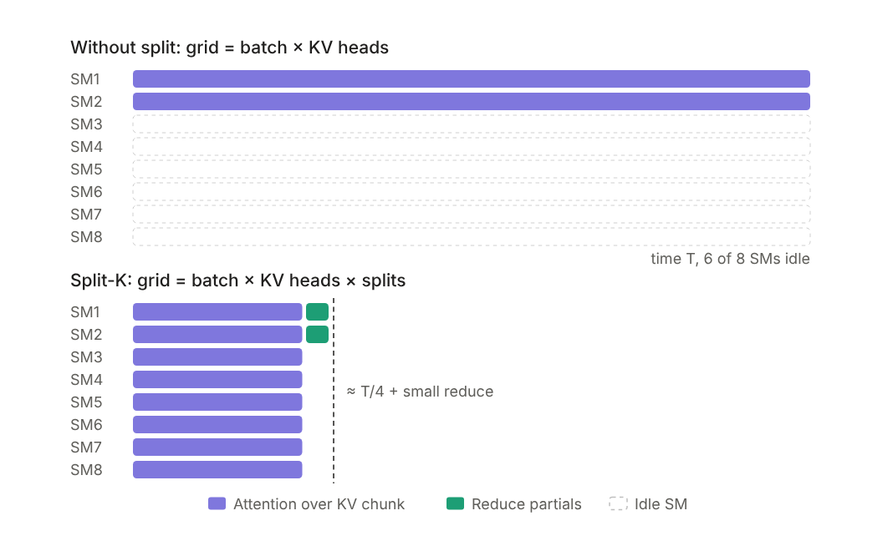

[Open standalone page](assets/33_flashdecoding_split_k_sm_occupancy.html)

<details><summary>Diagram source</summary>

````svg
<svg width="100%" viewBox="0 0 680 400" role="img"><title>SM occupancy without and with split-K</title><desc>Top: without splitting, only two thread blocks exist (batch times KV heads), so two SMs each stream the entire KV sequence while six SMs sit idle, taking time T. Bottom: with split-K into four chunks, eight thread blocks occupy all SMs, each processing a quarter of the sequence, followed by a short reduction, finishing in about a quarter of the time.</desc>
<text class="th" x="40" y="22" dominant-baseline="central">Without split: grid = batch × KV heads</text>
<text class="th" x="40" y="208" dominant-baseline="central">Split-K: grid = batch × KV heads × splits</text>
<g>
<text class="ts" x="40" y="47" dominant-baseline="central">SM1</text><text class="ts" x="40" y="65" dominant-baseline="central">SM2</text><text class="ts" x="40" y="83" dominant-baseline="central">SM3</text><text class="ts" x="40" y="101" dominant-baseline="central">SM4</text>
<text class="ts" x="40" y="119" dominant-baseline="central">SM5</text><text class="ts" x="40" y="137" dominant-baseline="central">SM6</text><text class="ts" x="40" y="155" dominant-baseline="central">SM7</text><text class="ts" x="40" y="173" dominant-baseline="central">SM8</text>
</g>
<g fill="none" stroke="var(--border-strong)" stroke-width="0.5" stroke-dasharray="3 3">
<rect x="90" y="76" width="540" height="14" rx="3"/><rect x="90" y="94" width="540" height="14" rx="3"/><rect x="90" y="112" width="540" height="14" rx="3"/><rect x="90" y="130" width="540" height="14" rx="3"/><rect x="90" y="148" width="540" height="14" rx="3"/><rect x="90" y="166" width="540" height="14" rx="3"/>
</g>
<rect x="90" y="40" width="540" height="14" rx="3" fill="#7F77DD"/>
<rect x="90" y="58" width="540" height="14" rx="3" fill="#7F77DD"/>
<text class="ts" x="630" y="190" text-anchor="end" dominant-baseline="central">time T, 6 of 8 SMs idle</text>
<g>
<text class="ts" x="40" y="233" dominant-baseline="central">SM1</text><text class="ts" x="40" y="251" dominant-baseline="central">SM2</text><text class="ts" x="40" y="269" dominant-baseline="central">SM3</text><text class="ts" x="40" y="287" dominant-baseline="central">SM4</text>
<text class="ts" x="40" y="305" dominant-baseline="central">SM5</text><text class="ts" x="40" y="323" dominant-baseline="central">SM6</text><text class="ts" x="40" y="341" dominant-baseline="central">SM7</text><text class="ts" x="40" y="359" dominant-baseline="central">SM8</text>
</g>
<g fill="#7F77DD">
<rect x="90" y="226" width="135" height="14" rx="3"/><rect x="90" y="244" width="135" height="14" rx="3"/><rect x="90" y="262" width="135" height="14" rx="3"/><rect x="90" y="280" width="135" height="14" rx="3"/>
<rect x="90" y="298" width="135" height="14" rx="3"/><rect x="90" y="316" width="135" height="14" rx="3"/><rect x="90" y="334" width="135" height="14" rx="3"/><rect x="90" y="352" width="135" height="14" rx="3"/>
</g>
<rect x="228" y="226" width="18" height="14" rx="3" fill="#1D9E75"/>
<rect x="228" y="244" width="18" height="14" rx="3" fill="#1D9E75"/>
<line x1="250" y1="222" x2="250" y2="370" stroke="var(--text-primary)" stroke-width="1" stroke-dasharray="4 3"/>
<text class="ts" x="260" y="296" dominant-baseline="central">≈ T/4 + small reduce</text>
<rect x="150" y="381" width="14" height="10" rx="2" fill="#7F77DD"/><text class="ts" x="170" y="386" dominant-baseline="central">Attention over KV chunk</text>
<rect x="340" y="381" width="14" height="10" rx="2" fill="#1D9E75"/><text class="ts" x="360" y="386" dominant-baseline="central">Reduce partials</text>
<rect x="470" y="381" width="14" height="10" rx="2" fill="none" stroke="var(--border-strong)" stroke-dasharray="3 3"/><text class="ts" x="490" y="386" dominant-baseline="central">Idle SM</text>
</svg>
````

</details>

**1. Why plain FlashAttention starves at decode**

FlashAttention parallelizes over batch × heads × query blocks. In prefill there are thousands of query rows, so there are plenty of thread blocks (CTAs). In decode the query length is 1 (or g rows when GQA heads are packed), so the grid collapses to B × H_kv CTAs.

At batch 1 with 8 KV heads, that is 8 CTAs on 132 SMs: about 6% of the chip is busy. Each of those CTAs must stream the entire KV sequence on its own. A single SM can't keep enough memory requests in flight to come close to HBM bandwidth.

**2. The decomposition**

The name comes from split-K GEMM, which partitions the reduction dimension across thread blocks and then sums the partial results. In attention, the reduction runs over tokens:

```
O = softmax(q Kᵀ) V = Σ_tokens  p_t · v_t            (reduction over sequence length)

grid:  B × H_kv × S          each CTA owns tokens [s·L/S, (s+1)·L/S)

stage 1 (per CTA):
  load Q_g (g × d) once
  for each K/V tile in its chunk:         # cp.async / TMA → shared memory, multi-stage pipeline
      S_tile = Q_g · K_tileᵀ               # tensor-core MMA, g × T_tile
      m  ← max(m, rowmax S_tile)
      ℓ  ← ℓ·e^{m_old−m} + Σ e^{S_tile−m}
      acc ← acc·e^{m_old−m} + e^{S_tile−m} · V_tile
  write (m_s, ℓ_s, acc_s)  or  (O_s = acc_s/ℓ_s, lse_s = m_s + log ℓ_s)   → HBM scratch

stage 2 (per batch × head):
  lse* = log Σ_s e^{lse_s}
  O    = Σ_s e^{lse_s − lse*} · O_s
```

**3. Why the merge is exact: an associative combine**

The online-softmax state (m, ℓ, acc) forms a monoid. Two partial states can be combined in any order and grouping:

```
(m₁,ℓ₁,a₁) ⊕ (m₂,ℓ₂,a₂) = ( m*,  ℓ₁e^{m₁−m*} + ℓ₂e^{m₂−m*},  a₁e^{m₁−m*} + a₂e^{m₂−m*} ),   m* = max(m₁,m₂)
```

Associativity is what makes split-K, tree reductions, and multi-GPU sequence parallelism all exact. It is the same structural property as fusing independent evidence in an information filter, where information adds. The max term is just a numerically stable way to keep the sum in log space.

**4. Choosing the number of splits S**

```
S ≈ ceil( waves · N_SM / (B · H_kv) )      subject to   chunk = L/S  ≥  a few tiles (≈ 256–1k tokens)
```

- **Target:** at least one to two full waves of CTAs, so every SM is busy.
- **Lower bound on chunk size:** each CTA loads Q and writes a g × d partial. Chunks that are too small make those fixed costs dominate.
- **Cost of the reduce:** S × g × d floats per (batch, head). For 128k context, H_kv = 8, and S = 32, the partials are a few hundred KB, against roughly 268 MB of KV per layer. Negligible.
- **When splitting stops paying:** at large batch, B × H_kv already fills the GPU, so S = 1 is best. Production kernels (FlashInfer, vLLM backends) choose S per call from batch size and lengths.

**5. What actually limits speed: bytes in flight**

Decode attention does almost no arithmetic per byte, so the real requirement comes from Little's law:

```
bytes in flight = bandwidth × latency ≈ 3.35 TB/s × ~0.6 μs ≈ 2 MB across the chip
```

Split-K supplies the parallelism: enough CTAs on enough SMs issuing loads at once. Multi-stage shared-memory pipelines supply the depth within each SM. On Hopper, TMA bulk copies plus warp specialization (producer warps load, consumer warps compute) keep that pipeline full with few registers spent on address arithmetic.

**6. Variable lengths and paging**

Real batches mix a 200-token chat with a 100k-token document, so a fixed S per sequence leaves SMs unevenly loaded.

- **Load-balanced scheduling** (FlashInfer): cut every sequence into fixed-size KV chunks, build a work list, and run a persistent kernel where each CTA pulls chunks until the list is empty, with a separate merge step.
- **Paged KV:** chunk boundaries are aligned to page boundaries (from the earlier paging discussion), so each tile load is a gather of whole pages through the block table.
- **Stream-K-style decompositions** (e.g. Lean Attention) give each CTA an equal number of tiles even when that cuts across sequences.

**7. Related variants**

| Variant | Idea |
|---|---|
| FlashDecoding++ | Use an estimated shared max so partials can be summed without the max synchronization; recompute if a value overflows the estimate |
| FlashMLA and similar | MLA decode packs all heads onto one shared latent, so tiles span heads rather than splitting only along the sequence |
| Multi-GPU sequence parallelism | The same ⊕ combine applied across devices (ring or tree reduction) for contexts too long for one GPU |
| Prefill + decode in one launch | Mixed batches scheduled through one kernel (POD-attention-style) so chunked prefill and decode share the SMs |

**8. Payoff**

The original Flash-Decoding release reported up to about 8× faster attention for very long sequences at small batch. The benefit is largest exactly where earlier answers placed the bottleneck: long context, small batch, and memory-bound decode. At large batch with short context, it reverts to ordinary FlashAttention behavior.

**In one line:** at decode there is one query and a very long KV cache, so FlashDecoding parallelizes along the sequence instead of the queries. Each SM streams a chunk with its own online softmax, and an exact log-sum-exp merge combines the chunks. Enough concurrent loads keep HBM saturated, and that, not FLOPs, is what sets attention speed during decode.

---

<a id="turn-30"></a>
## 30. How does FlashDecoding split-K parallelism work on GPUs?

> **Question:** How does FlashDecoding split-K parallelism work on GPUs?

That's the same question as the one just above, so the full answer (SM occupancy diagram, the two-stage kernel, the associative merge, choosing S, bytes in flight, variable-length scheduling) is right there.

In one line: at decode, parallelize along the KV sequence instead of the queries. Each SM computes an online softmax over its own chunk, and an exact log-sum-exp merge combines the chunks, so enough loads are in flight to saturate HBM.

If you want to go further, two directions that would add something new:

1. **A runnable reference:** a short PyTorch (or Triton) implementation of split-K decode attention plus the merge, checked numerically against standard attention. Useful if you plan to write or profile your own kernel.
2. **A split-count calculator:** an interactive tool that picks S from batch size, KV heads, context length, and SM count, and shows occupancy, waves, and reduce overhead.

Which would be more useful?

---

<a id="turn-31"></a>
## 31. How does FlashDecoding split-K parallelism work on GPUs?

> **Question:** How does FlashDecoding split-K parallelism work on GPUs?

I'll make it concrete this time: a small runnable reference implementation of split-K decode attention, checked against standard attention.

**Code file: `split_k_decode.py`** ([code/split_k_decode.py](code/split_k_decode.py))

````python
"""
Split-K (FlashDecoding-style) decode attention: a NumPy reference.

Mirrors the two-stage GPU kernel:
  stage 1: each "CTA" processes one chunk of the KV sequence with an online softmax,
           producing a partial state (m, l, acc)
  stage 2: partial states are merged with an associative log-sum-exp combine

It checks that:
  1. split-K output == standard softmax attention, for any number of splits
  2. the merge is order-independent (associative), so tree / multi-GPU reductions are exact
  3. a simple heuristic for choosing the number of splits S fills the SMs

GQA packing is included: g query heads share one KV head, so Q_g is (g, d).
"""

import numpy as np
from functools import reduce


# ---------- reference ----------

def reference_attention(q, K, V):
    """q: (g, d), K, V: (T, d) -> (g, d). Standard softmax attention for one KV head."""
    d = q.shape[-1]
    s = q @ K.T / np.sqrt(d)                     # (g, T)
    s = s - s.max(axis=1, keepdims=True)
    p = np.exp(s)
    p /= p.sum(axis=1, keepdims=True)
    return p @ V


# ---------- stage 1: one CTA over one KV chunk, tiled with an online softmax ----------

def chunk_partial(q, Kc, Vc, tile=128):
    """Online softmax over a KV chunk, processed tile by tile as a GPU CTA would.
    Returns the partial state (m, l, acc): running max, running sum, unnormalized output."""
    g, d = q.shape
    m = np.full(g, -np.inf)
    l = np.zeros(g)
    acc = np.zeros((g, d))
    for t0 in range(0, Kc.shape[0], tile):
        Kt, Vt = Kc[t0:t0 + tile], Vc[t0:t0 + tile]   # "load tile HBM -> SRAM"
        s = q @ Kt.T / np.sqrt(d)                      # (g, T_tile): all g queries reuse the tile
        m_new = np.maximum(m, s.max(axis=1))
        scale = np.exp(m - m_new)                      # rescale old state to the new max
        e = np.exp(s - m_new[:, None])
        l = l * scale + e.sum(axis=1)
        acc = acc * scale[:, None] + e @ Vt
        m = m_new
    return m, l, acc


# ---------- stage 2: associative merge ----------

def combine(a, b):
    """(m1,l1,a1) ⊕ (m2,l2,a2): exact, associative, order-independent."""
    m1, l1, a1 = a
    m2, l2, a2 = b
    m = np.maximum(m1, m2)
    w1, w2 = np.exp(m1 - m), np.exp(m2 - m)
    return m, l1 * w1 + l2 * w2, a1 * w1[:, None] + a2 * w2[:, None]


def split_k_decode(q, K, V, n_splits, order=None):
    """Full split-K decode: partition the sequence, compute partials, merge."""
    T = K.shape[0]
    bounds = np.linspace(0, T, n_splits + 1).astype(int)
    partials = [chunk_partial(q, K[s:e], V[s:e]) for s, e in zip(bounds[:-1], bounds[1:])]
    if order is not None:                             # merge in an arbitrary order
        partials = [partials[i] for i in order]
    m, l, acc = reduce(combine, partials)
    return acc / l[:, None]


def lse_merge(partials):
    """Equivalent stage-2 form used by many kernels: store normalized O_s and lse_s per split."""
    O = [acc / l[:, None] for m, l, acc in partials]
    lse = np.stack([m + np.log(l) for m, l, acc in partials])   # (S, g)
    lse_star = np.log(np.exp(lse - lse.max(0)).sum(0)) + lse.max(0)
    w = np.exp(lse - lse_star)                                    # (S, g)
    return sum(w[s][:, None] * O[s] for s in range(len(O)))


# ---------- choosing S ----------

def choose_splits(batch, kv_heads, seq_len, n_sm=132, waves=1, min_chunk=512):
    """Fill about `waves` full waves of SMs, without chunks smaller than min_chunk tokens."""
    base = batch * kv_heads
    s = max(1, int(np.ceil(waves * n_sm / base)))
    s = min(s, max(1, seq_len // min_chunk))
    return s


# ---------- checks ----------

if __name__ == "__main__":
    rng = np.random.default_rng(0)
    g, d, T = 8, 128, 32_768          # GQA group of 8 query heads, head dim 128, 32k context
    q = rng.standard_normal((g, d))
    K = rng.standard_normal((T, d))
    V = rng.standard_normal((T, d))

    ref = reference_attention(q, K, V)

    print("1) split-K vs reference attention")
    for S in [1, 4, 16, 64]:
        out = split_k_decode(q, K, V, S)
        print(f"   S={S:>3}: max |error| = {np.abs(out - ref).max():.2e}")

    print("\n2) merge order independence (associativity)")
    S = 16
    order = rng.permutation(S)
    out_shuffled = split_k_decode(q, K, V, S, order=order)
    print(f"   shuffled merge order: max |error| = {np.abs(out_shuffled - ref).max():.2e}")

    bounds = np.linspace(0, T, S + 1).astype(int)
    parts = [chunk_partial(q, K[s:e], V[s:e]) for s, e in zip(bounds[:-1], bounds[1:])]
    print(f"   LSE-form merge:       max |error| = {np.abs(lse_merge(parts) - ref).max():.2e}")

    print("\n3) choosing S on a 132-SM GPU (KV heads = 8)")
    print(f"   {'batch':>5} {'context':>8} {'S':>4} {'CTAs':>6} {'chunk':>8}")
    for B, L in [(1, 4_096), (1, 131_072), (4, 131_072), (16, 32_768), (64, 8_192)]:
        S = choose_splits(B, 8, L)
        print(f"   {B:>5} {L:>8} {S:>4} {B * 8 * S:>6} {L // S:>8}")

    print("\n   Partial-state overhead vs KV bytes per head (FP16, 128k ctx, S=17):")
    S, L = 17, 131_072
    partial_bytes = S * g * (d + 2) * 4          # acc + m + l in fp32
    kv_bytes = 2 * L * d * 2
    print(f"   partials {partial_bytes / 1e3:.0f} KB  vs  KV {kv_bytes / 1e6:.0f} MB "
          f"({100 * partial_bytes / kv_bytes:.3f}%)")
````

**Output of `python3 split_k_decode.py`:**

````text
1) split-K vs reference attention
   S=  1: max |error| = 4.51e-17
   S=  4: max |error| = 4.16e-17
   S= 16: max |error| = 3.68e-17
   S= 64: max |error| = 4.51e-17

2) merge order independence (associativity)
   shuffled merge order: max |error| = 3.82e-17
   LSE-form merge:       max |error| = 3.90e-17

3) choosing S on a 132-SM GPU (KV heads = 8)
   batch  context    S   CTAs    chunk
       1     4096    8     64      512
       1   131072   17    136     7710
       4   131072    5    160    26214
      16    32768    2    256    16384
      64     8192    1    512     8192

   Partial-state overhead vs KV bytes per head (FP16, 128k ctx, S=17):
   partials 71 KB  vs  KV 67 MB (0.105%)
````

I wrote and ran `split_k_decode.py`, a NumPy reference for split-K decode attention, and the checks all pass. The test case is a GQA group of 8 query heads, head dim 128, over a 32k-token context.

**1. Split-K matches standard attention exactly.** For S = 1, 4, 16 and 64 splits, the largest difference from standard softmax attention is about 4e-17. That is float64 round-off: splitting the sequence and merging introduces no approximation.

**2. The merge order doesn't matter.** Merging 16 partials in a shuffled order gives 3.8e-17. The log-sum-exp form that many kernels use (each split stores its output and a log-sum-exp value) gives 3.9e-17. Because the combine step is associative, tree reductions and merges across GPUs are exact as well.

**3. Choosing S fills the GPU only when it needs to** (132 SMs, 8 KV heads; "chunk" is tokens per block):

| Batch | Context | S | Thread blocks | Chunk |
|---|---|---|---|---|
| 1 | 4k | 8 | 64 | 512 |
| 1 | 128k | 17 | 136 | 7.7k |
| 4 | 128k | 5 | 160 | 26k |
| 16 | 32k | 2 | 256 | 16k |
| 64 | 8k | 1 | 512 | 8k |

- **Batch 1, short context:** S is capped by the 512-token minimum chunk size, so the GPU is only partly occupied. Decode attention is cheap here anyway.
- **Batch 1, 128k:** this is where splitting matters most. Without it there would be 8 blocks on 132 SMs; with S = 17 there are 136, so every SM is busy.
- **Batch 64:** there are already enough blocks to fill the GPU, so S = 1 and it falls back to plain FlashAttention.

**4. The merge costs almost nothing.** At 128k context with S = 17, the partial results come to about 71 KB per KV head, against 67 MB of KV cache. That is about 0.1% of the memory traffic.

To turn this into a GPU kernel, `chunk_partial` becomes a Triton kernel with one program per (batch, head, split), and `lse_merge` becomes a second small kernel. This NumPy version then serves as the reference to test it against.

---

<a id="turn-32"></a>
## 32. What biases does GRPO std and length normalization introduce, and how do Dr. GRPO and DAPO fix them?

> **Question:** What biases does GRPO std and length normalization introduce, and how do Dr. GRPO and DAPO fix them?

Both biases come from how GRPO turns rewards into a per-token loss weight, not from the group baseline itself. Dividing by std(r) changes how much each prompt counts. Dividing by |o_i| changes how much each response counts, depending on its length. Dr. GRPO removes both terms. DAPO fixes the length term with token-level aggregation, keeps the std term, and adds three other fixes.

**Chart: Gradient weight per prompt vs pass rate (binary reward, G = 16, normalized to 1 at p = 0.5)**

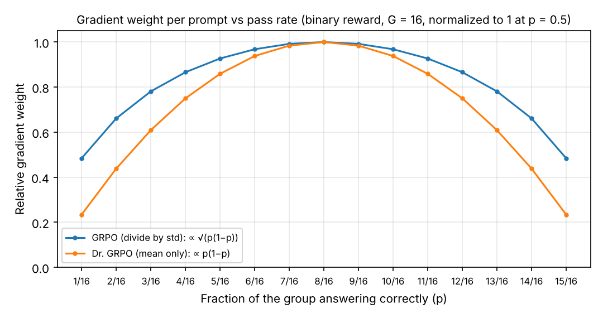

<details><summary>Chart data</summary>

| Fraction of the group answering correctly (p) | GRPO (divide by std): ∝ √(p(1−p)) | Dr. GRPO (mean only): ∝ p(1−p) |
|---|---|---|
| 1/16 | 0.484 | 0.234 |
| 2/16 | 0.661 | 0.438 |
| 3/16 | 0.781 | 0.609 |
| 4/16 | 0.866 | 0.75 |
| 5/16 | 0.927 | 0.859 |
| 6/16 | 0.968 | 0.938 |
| 7/16 | 0.992 | 0.984 |
| 8/16 | 1 | 1 |
| 9/16 | 0.992 | 0.984 |
| 10/16 | 0.968 | 0.938 |
| 11/16 | 0.927 | 0.859 |
| 12/16 | 0.866 | 0.75 |
| 13/16 | 0.781 | 0.609 |
| 14/16 | 0.661 | 0.438 |
| 15/16 | 0.484 | 0.234 |

</details>

A prompt solved once in 16 attempts gets about 2× more relative weight under GRPO than under the unbiased estimator.

**Where the two biases come from**

```
GRPO:   J = (1/G) Σ_i  (1/|o_i|) Σ_t  min(ρ_t A_i, clip(ρ_t) A_i)  − β KL
        A_i = (r_i − mean(r)) / std(r)
                 └ difficulty bias ┘        └ length bias: 1/|o_i| ┘
```

The policy gradient this objective is meant to estimate is unbiased only when every sequence's ∇log p(o_i) is weighted by (r_i − b), with b a baseline that doesn't depend on the response. Both extra divisions change that weighting.

**1. The std term: difficulty (question-level) bias**

With binary rewards and pass rate p, std(r) = √(p(1−p)), so:

```
A_correct = √((1−p)/p)        A_wrong = −√(p/(1−p))
total |A| per prompt:   GRPO ∝ √(p(1−p))      unbiased ∝ p(1−p)
```

- Prompts that are nearly always solved or nearly always failed get amplified relative to the true objective. That is the gap between the two curves.
- When a group almost agrees, σ is tiny, so a single lucky or unlucky sample gets a very large advantage. This amplifies noise and makes reward noise or grader errors more costly.
- Under Adam the overall gradient scale mostly cancels out, so what matters is the relative weighting across prompts. Some argue that weighting is useful because it focuses on the frontier of what the model can solve. Even so, it optimizes a different objective than the one GRPO states.

**2. The 1/|o_i| term: length (response-level) bias**

Worked example: G = 4, rewards [1, 1, 0, 0], lengths [200, 800, 200, 800], which gives A = [+1, +1, −1, −1].

| Scheme | Weight on a sequence's ∇log p(o_i) | Short vs long correct | Short vs long wrong |
|---|---|---|---|
| GRPO (per-sequence mean) | A_i / (G·\|o_i\|) | 4 : 1 | 4 : 1 penalty |
| DAPO (token-level) | A_i / Σ_j \|o_j\| | 1 : 1 | 1 : 1 |
| Dr. GRPO (constant) | (r_i − μ) / (G·L_max) | 1 : 1 | 1 : 1 |

Consequences:
- **Among correct answers,** short ones are reinforced more, which is a mild push toward brevity.
- **Among wrong answers,** long ones are penalized less, so the policy drifts toward longer failures. Rambling and repetition become a cheap way to dilute the penalty.
- The Dr. GRPO paper argues that part of the "response length grows during R1-Zero training" effect is this artifact, driven by incorrect responses getting longer, rather than purely emergent reasoning.

The bias usually doesn't originate in the paper's equation. It sits in the loss aggregation code: `masked_mean(loss, mask, dim=-1).mean()`, a per-sequence mean followed by a batch mean, which many open-source PPO and GRPO implementations inherited.

**Dr. GRPO (Liu et al., 2025): remove both terms**

```
A_i = r_i − mean(r)                                   # no std
J   = (1/G) Σ_i  (1/L_max) Σ_t  min(ρ_t A_i, clip(ρ_t) A_i)   # constant normalizer
```

This is the Monte Carlo policy gradient with a group-mean baseline. The paper reports similar accuracy, with noticeably better token efficiency because wrong responses stop growing in length.

**DAPO (ByteDance Seed, 2025): four changes, one of which targets length**

| Technique | Fixes | Mechanism |
|---|---|---|
| Token-level policy-gradient loss | Length bias | Sum over all tokens in the batch ÷ total tokens, so every token counts equally and long, bad outputs carry their full penalty |
| Dynamic sampling | Wasted compute; degenerate groups | Drop groups with p = 0 or 1 (σ = 0, no gradient) and resample until the batch is full of mixed groups |
| Clip-Higher | Entropy collapse (an exploration bias) | Decoupled clipping: ε_low = 0.2, ε_high = 0.28. A token at π = 0.01 could otherwise only rise to 0.012 per step |
| Overlong filtering and soft punishment | Reward noise from truncation | Mask the loss on truncated samples, and apply a graded length penalty near the maximum instead of a cliff |

DAPO also drops the KL term. In its reported ablation on Qwen2.5-32B for AIME 2024, naive GRPO scored about 30. Each technique added points, reaching about 50 with all of them, and dynamic sampling and the overlong fixes contributed the largest jumps.

**How the two differ**

- **The std term:** DAPO keeps std normalization and only filters out groups where σ = 0. Its difficulty bias therefore remains, while the most extreme cases are excluded. Dr. GRPO removes the std term entirely.
- **The length term:** DAPO's normalizer, total batch tokens, is constant within a batch but varies between batches. That is close to unbiased but not exactly. Dr. GRPO's L_max is fixed, so it is exactly unbiased.
- **Scope:** they target different failure modes. Dr. GRPO is about estimator correctness. DAPO is mostly about training dynamics: exploration, wasted samples, and truncation noise.

**Common combination in practice**

```
advantage:    group mean baseline;  no per-group std  (or std over the whole batch)
aggregation:  token-level, constant or batch-token normalizer
sampling:     dynamic filtering of p ∈ {0, 1} groups
clipping:     asymmetric, ε_high > ε_low
length:       overlong masking + soft penalty;  watch the length curve of wrong answers separately from right ones
```

One follow-up ablation study reports that "group mean plus batch std plus token-level loss" is a strong minimal recipe. That points the same way: keep the variance reduction from the group baseline, and remove per-group rescaling that changes the objective.

**A filtering analogy**

Per-group std normalization is like whitening each sensor stream to unit variance before fusing them. Every stream becomes well scaled, but the fusion now weights a nearly constant stream as heavily as an informative one. The 1/|o_i| term is like dividing each measurement's weight by its sample count, so a measurement built from more evidence ends up counting less per sample.

**In one line:** GRPO's std division reweights prompts toward the extremes, and its 1/|o_i| division lets long wrong answers escape their penalty. Dr. GRPO removes both, for an exactly unbiased estimator. DAPO fixes the length side with token-level loss, keeps the std term, and adds dynamic sampling, Clip-Higher and overlong handling to keep training stable and exploratory.

Sources:
- [DeepSeekMath (GRPO), arXiv:2402.03300](https://arxiv.org/abs/2402.03300)
- [Understanding R1-Zero-Like Training: A Critical Perspective (Dr. GRPO), arXiv:2503.20783](https://arxiv.org/abs/2503.20783)
- [DAPO: An Open-Source LLM Reinforcement Learning System at Scale, arXiv:2503.14476](https://arxiv.org/abs/2503.14476)

---

<a id="turn-33"></a>
## 33. How is a pretrained VLM adapted as the backbone of a robot VLA, and how is language ability preserved?

> **Question:** How is a pretrained VLM adapted as the backbone of a robot VLA, and how is language ability preserved?

A VLA starts from a pretrained VLM and changes three things: it adds robot inputs, it gives the model a way to output actions, and it trains on robot data. The obstacle is that robot data is narrow (a few fixed cameras, repetitive scenes, no text) and the action loss is foreign to the backbone, so naive fine-tuning overwrites what made the VLM worth using. Most current designs come down to controlling which gradients are allowed into the backbone.

**Diagram: `vlm_to_vla_adaptation_gradient_paths`** (static SVG diagram)

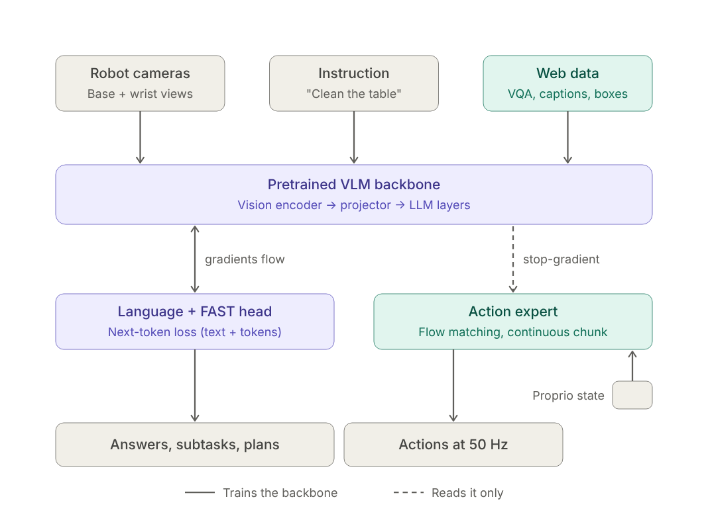

[Open standalone page](assets/34_vlm_to_vla_adaptation_gradient_paths.html)

<details><summary>Diagram source</summary>

````svg
<svg width="100%" viewBox="0 0 680 500" role="img"><title>Adapting a VLM into a VLA</title><desc>Robot cameras, the language instruction and web data such as VQA and captions all feed a pretrained VLM backbone. Below it, a language and FAST-token head is trained with next-token loss, and its gradient flows into the backbone. An action expert reads backbone features through a stop-gradient, together with proprioceptive state, and is trained with flow matching to output continuous action chunks. The language head outputs answers and subtasks; the action expert outputs actions at control rate.</desc>
<defs><marker id="arrow" viewBox="0 0 10 10" refX="8" refY="5" markerWidth="6" markerHeight="6" orient="auto-start-reverse"><path d="M2 1L8 5L2 9" fill="none" stroke="context-stroke" stroke-width="1.5" stroke-linecap="round" stroke-linejoin="round"/></marker></defs>
<g class="c-gray"><rect x="40" y="40" width="170" height="56" rx="8" stroke-width="0.5"/><text class="th" x="125" y="58" text-anchor="middle" dominant-baseline="central">Robot cameras</text><text class="ts" x="125" y="78" text-anchor="middle" dominant-baseline="central">Base + wrist views</text></g>
<g class="c-gray"><rect x="255" y="40" width="170" height="56" rx="8" stroke-width="0.5"/><text class="th" x="340" y="58" text-anchor="middle" dominant-baseline="central">Instruction</text><text class="ts" x="340" y="78" text-anchor="middle" dominant-baseline="central">"Clean the table"</text></g>
<g class="node c-teal" onclick="sendPrompt('How is web data co-training mixed with robot data in VLA training, and what ratios work?')"><rect x="470" y="40" width="170" height="56" rx="8" stroke-width="0.5"/><text class="th" x="555" y="58" text-anchor="middle" dominant-baseline="central">Web data</text><text class="ts" x="555" y="78" text-anchor="middle" dominant-baseline="central">VQA, captions, boxes</text></g>
<line x1="125" y1="96" x2="125" y2="148" class="arr" marker-end="url(#arrow)"/>
<line x1="340" y1="96" x2="340" y2="148" class="arr" marker-end="url(#arrow)"/>
<line x1="555" y1="96" x2="555" y2="148" class="arr" marker-end="url(#arrow)"/>
<g class="node c-purple" onclick="sendPrompt('How are vision encoder, projector and LLM layers handled when fine-tuning a VLM into a VLA: freeze, LoRA or full fine-tune?')"><rect x="40" y="150" width="600" height="60" rx="10" stroke-width="0.5"/><text class="th" x="340" y="170" text-anchor="middle" dominant-baseline="central">Pretrained VLM backbone</text><text class="ts" x="340" y="190" text-anchor="middle" dominant-baseline="central">Vision encoder → projector → LLM layers</text></g>
<line x1="180" y1="278" x2="180" y2="212" class="arr" marker-start="url(#arrow)" marker-end="url(#arrow)"/>
<text class="ts" x="190" y="245" dominant-baseline="central">gradients flow</text>
<line x1="500" y1="212" x2="500" y2="278" class="arr" stroke-dasharray="5 4" marker-end="url(#arrow)"/>
<text class="ts" x="510" y="245" dominant-baseline="central">stop-gradient</text>
<g class="node c-purple" onclick="sendPrompt('How does the FAST action tokenizer work with DCT and BPE?')"><rect x="40" y="280" width="280" height="56" rx="8" stroke-width="0.5"/><text class="th" x="180" y="298" text-anchor="middle" dominant-baseline="central">Language + FAST head</text><text class="ts" x="180" y="318" text-anchor="middle" dominant-baseline="central">Next-token loss (text + tokens)</text></g>
<g class="node c-teal" onclick="sendPrompt('Walk through the flow matching math for robot action generation in detail')"><rect x="360" y="280" width="280" height="56" rx="8" stroke-width="0.5"/><text class="th" x="500" y="298" text-anchor="middle" dominant-baseline="central">Action expert</text><text class="ts" x="500" y="318" text-anchor="middle" dominant-baseline="central">Flow matching, continuous chunk</text></g>
<g class="c-gray"><rect x="600" y="368" width="40" height="28" rx="6" stroke-width="0.5"/></g>
<text class="ts" x="592" y="382" text-anchor="end" dominant-baseline="central">Proprio state</text>
<line x1="620" y1="368" x2="620" y2="338" class="arr" marker-end="url(#arrow)"/>
<line x1="180" y1="336" x2="180" y2="408" class="arr" marker-end="url(#arrow)"/>
<line x1="440" y1="336" x2="440" y2="408" class="arr" marker-end="url(#arrow)"/>
<g class="c-gray"><rect x="40" y="410" width="280" height="44" rx="8" stroke-width="0.5"/><text class="th" x="180" y="432" text-anchor="middle" dominant-baseline="central">Answers, subtasks, plans</text></g>
<g class="c-gray"><rect x="330" y="410" width="220" height="44" rx="8" stroke-width="0.5"/><text class="th" x="440" y="432" text-anchor="middle" dominant-baseline="central">Actions at 50 Hz</text></g>
<line x1="170" y1="480" x2="200" y2="480" stroke="var(--text-secondary)" stroke-width="1.5"/><text class="ts" x="208" y="480" dominant-baseline="central">Trains the backbone</text>
<line x1="380" y1="480" x2="410" y2="480" stroke="var(--text-secondary)" stroke-width="1.5" stroke-dasharray="5 4"/><text class="ts" x="418" y="480" dominant-baseline="central">Reads it only</text>
</svg>
````

</details>

**1. Adapting the inputs**

- **Multiple cameras:** each view goes through the VLM's own vision encoder (SigLIP, or DINOv2 + SigLIP), and the image tokens are concatenated. A wrist camera supplies detail for grasping that the base camera can't see.
- **Proprioception (joint angles, gripper):** either a learned linear projection into a token, or written into the text prompt as discretized values (π0.5 style). The second option keeps the input in a form the language model already understands.
- **Multiple embodiments:** action and state dimensions are padded to a shared maximum, normalized per robot (quantile normalization is common), and sometimes tagged with an embodiment token.
- **Attention mask:** a common choice is bidirectional attention over the image-and-text prefix, then a block of state and action tokens that attend to the prefix. The prefix is computed once per control step and its KV cache reused, which is what keeps flow-matching steps cheap.

**2. Three ways to output actions**

| Approach | How it works | Strength | Weakness |
|---|---|---|---|
| Actions as text tokens (RT-2, OpenVLA) | Each degree of freedom binned into 256 values and mapped to rarely used vocabulary tokens; decoded autoregressively | Same loss and head as language, so the backbone stays "language-shaped" | Slow at high control rates; coarse; poor for long chunks |
| Compressed tokens (FAST) | DCT of the action chunk, quantized, then BPE: a frequency-domain action vocabulary | Smooth, high-frequency chunks in few tokens; still next-token loss | Still autoregressive at inference |
| Continuous action head (π0, GR00T N1, OpenVLA-OFT) | A separate small transformer or DiT ("action expert") generates chunks by flow matching, diffusion or regression, conditioned on backbone features | Precise, multimodal, fast; can run at 50 Hz and above | Its gradients can damage the backbone; see below |

**3. Why language ability degrades**

Robot fine-tuning attacks the backbone in three ways:

1. **Distribution shift.** Months of updates on a handful of fixed camera views and short instructions narrow the visual and linguistic representations.
2. **Foreign loss gradients.** A randomly initialized action expert produces large, noisy gradients early in training. Those flow straight into a backbone that was tuned for next-token prediction. The Knowledge Insulation work found this both slows training and erodes semantic knowledge.
3. **No language supervision.** If nothing in training asks the model to produce text, the language head and its circuits drift without any penalty.

The symptoms:
- **Weaker semantic generalization:** novel objects and abstract references such as "the extinct animal," which RT-2 handled, stop working.
- **Worse instruction following:** the model obeys the dominant visual habit rather than the words.
- **Failed VQA probes:** it can no longer answer questions about the scene.

**4. Ways to preserve language ability, from data-side to architecture-side**

| Technique | Mechanism | Used in |
|---|---|---|
| Co-training with web data | Mix VQA, captioning, grounding and detection batches into robot training, so the language loss keeps acting on the backbone | RT-2, π0.5 |
| Language-level robot targets | Make the model also output subtasks, bounding boxes or embodied chain-of-thought, so robot data supervises language too | π0.5 (subtask prediction), ECoT, Gemini Robotics-ER |
| Knowledge insulation | The backbone is trained only by next-token loss (text plus FAST action tokens); the continuous action expert reads backbone features through a stop-gradient | π0.5 + KI (Physical Intelligence) |
| Freeze or partly freeze | Keep the language model frozen or use LoRA adapters; read intermediate-layer features | GR00T N1 (reported: frozen language component, mid-layer embeddings) |
| Hierarchy | A large VLM ("System 2") reasons at low rate and passes a latent or subtask to a small fast policy ("System 1") | Helix, Hi Robot, GR00T-style designs |
| Small learning rate plus warm-up | Train the new head and projector first, then unfreeze gently | Common practice |

The insulation idea is the cleanest. The discrete FAST-token loss teaches the backbone what actions look like in a format compatible with its pretraining. The continuous expert learns to produce precise motion from those representations without being allowed to rewrite them. The reported benefits are faster training, better language following, and better transfer.

**5. How major VLAs differ**

| Model | Backbone | Action output | Language preservation |
|---|---|---|---|
| RT-2 (2023) | PaLI-X / PaLM-E | Text-token bins | Web co-training |
| OpenVLA (2024) | Prismatic 7B (Llama 2 + DINOv2/SigLIP) | 256-bin tokens | Little; it is a policy, not a chat model |
| π0 (2024) | PaliGemma 3B + ~300M action expert | Flow matching, 50-step chunks | Gradients flow freely; mainly robot data |
| π0.5 (2025) | PaliGemma-based | FAST tokens + flow expert | Web co-training, subtask prediction, KI variant |
| GR00T N1 (2025) | Eagle-2 VLM | DiT + flow matching | Frozen language component (reported) |

Specific architecture details for the newer systems come from their papers and blog posts and may have evolved since.

**6. The filtering view**

Catastrophic forgetting is prior drift. The pretrained VLM encodes a broad prior over the world, and robot data supplies narrow likelihood updates. Each preservation technique keeps that prior in place a different way:

- **Co-training:** keep re-observing the prior's own data, the equivalent of repeated measurements that anchor the state.
- **KL or frozen layers:** an explicit prior penalty.
- **Stop-gradient:** factorize the update, so the action posterior is computed from the prior without the action likelihood flowing back into it.
- **Hierarchy:** separate state estimators at separate rates, coupled only through a narrow interface.

**7. Practical recipe if you add a new modality (e.g. LiDAR or depth)**

1. Encode the new modality with its own encoder: a point-cloud or BEV encoder, or depth rendered as an image. Project it into the token space with a new projector.
2. Stage 1: freeze the backbone and train only the projector on alignment tasks (describe, localize, measure distance) so the new tokens become language-compatible.
3. Stage 2: unfreeze gradually, co-training with web data and spatial question answering, with action targets as FAST tokens.
4. Stage 3: attach the continuous action expert behind a stop-gradient.
5. Probe language and spatial question answering throughout. If those scores fall while action success rises, forgetting has started.

**In one line:** turning a VLM into a VLA means adding robot inputs and an action output, then controlling what reaches the backbone. Language and discrete action tokens are allowed to train it, web data keeps the prior anchored, and the precise continuous action expert reads from the backbone through a stop-gradient rather than rewriting it.

Sources:
- [RT-2, arXiv:2307.15818](https://arxiv.org/abs/2307.15818)
- [OpenVLA, arXiv:2406.09246](https://arxiv.org/abs/2406.09246)
- [π0, arXiv:2410.24164](https://arxiv.org/abs/2410.24164)
- [FAST action tokenizer, arXiv:2501.09747](https://arxiv.org/abs/2501.09747)
- [π0.5, arXiv:2504.16054](https://arxiv.org/abs/2504.16054)
- [Knowledge Insulating VLA Models, arXiv:2505.23705](https://arxiv.org/abs/2505.23705)
- [GR00T N1, arXiv:2503.14734](https://arxiv.org/abs/2503.14734)

---

<a id="turn-34"></a>
## 34. Softmax vs sigmoid gating in MoE routers and why gate weights are renormalized

> **Question:** Softmax vs sigmoid gating in MoE routers and why gate weights are renormalized

Softmax and sigmoid select the same top-k experts, because both are monotonic in the logit. They differ in how much weight each selected expert gets, and in whether those weights add up to a stable total. Renormalizing fixes that total, at the cost of discarding how confident the router actually was.

The widget below compares all four combinations (16 experts, same logits throughout):

**Diagram: `moe_softmax_vs_sigmoid_gating_renorm`** (interactive HTML widget)

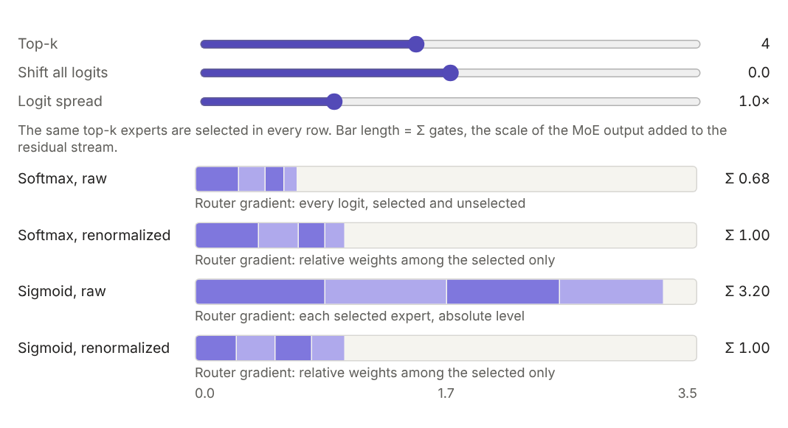

[Open standalone page](assets/35_moe_softmax_vs_sigmoid_gating_renorm.html)

<details><summary>Diagram source</summary>

````html
<h2 class="sr-only">Interactive comparison of MoE gate values under softmax and sigmoid gating, with and without renormalization over the top-k experts, showing how the total gate mass changes with k, a common logit shift and logit spread.</h2>
<style>
.r{display:flex;align-items:center;gap:12px;font-size:13px;color:var(--text-secondary);margin:6px 0}
.r label{width:150px}.r input{flex:1}.r output{width:48px;text-align:right;color:var(--text-primary);font-variant-numeric:tabular-nums}
.row{display:grid;grid-template-columns:150px 1fr 56px;gap:10px;align-items:center;margin:10px 0 2px;font-size:13px}
.row .n{color:var(--text-primary)}
.trk{height:22px;background:var(--surface-1);border:0.5px solid var(--border);border-radius:4px;overflow:hidden;display:flex;gap:1px}
.seg{height:100%;transition:width .15s}
.sum{text-align:right;font-variant-numeric:tabular-nums;color:var(--text-primary)}
.gr{font-size:12px;color:var(--text-secondary);margin:0 0 4px 160px}
</style>
<div style="padding:0.5rem 0">
<div class="r"><label for="k">Top-k</label><input id="k" type="range" min="1" max="8" value="4"><output id="ko"></output></div>
<div class="r"><label for="sh">Shift all logits</label><input id="sh" type="range" min="-4" max="4" step="0.1" value="0"><output id="sho"></output></div>
<div class="r"><label for="sp">Logit spread</label><input id="sp" type="range" min="0.3" max="3" step="0.1" value="1"><output id="spo"></output></div>
<div style="font-size:12px;color:var(--text-secondary);margin:8px 0 0">The same top-k experts are selected in every row. Bar length = Σ gates, the scale of the MoE output added to the residual stream.</div>
<div id="rows"></div>
<div id="ax" style="display:flex;justify-content:space-between;font-size:12px;color:var(--text-secondary);margin-left:160px;margin-right:66px"></div>
</div>
<script>
const $=i=>document.getElementById(i);
const B=[2.1,1.6,1.2,0.9,0.7,0.4,0.2,0.0,-0.2,-0.4,-0.6,-0.9,-1.1,-1.4,-1.8,-2.3];
const sig=x=>1/(1+Math.exp(-x)),C=['#7F77DD','#AFA9EC'];
function u(){
const k=+$('k').value,sh=+$('sh').value,sp=+$('sp').value;
$('ko').textContent=k;$('sho').textContent=(sh>0?'+':'')+sh.toFixed(1);$('spo').textContent=sp.toFixed(1)+'×';
const s=B.map(v=>v*sp+sh),m=Math.max(...s),e=s.map(v=>Math.exp(v-m)),Z=e.reduce((a,b)=>a+b,0);
const sm=e.slice(0,k).map(v=>v/Z),smS=sm.reduce((a,b)=>a+b,0);
const sg=s.slice(0,k).map(sig),sgS=sg.reduce((a,b)=>a+b,0);
const one=k===1;
const R=[
['Softmax, raw',sm,'Router gradient: every logit, selected and unselected'],
['Softmax, renormalized',sm.map(v=>v/smS),one?'Router gradient: none (gate is always 1)':'Router gradient: relative weights among the selected only'],
['Sigmoid, raw',sg,'Router gradient: each selected expert, absolute level'],
['Sigmoid, renormalized',sg.map(v=>v/sgS),one?'Router gradient: none (gate is always 1)':'Router gradient: relative weights among the selected only']];
const sums=R.map(r=>r[1].reduce((a,b)=>a+b,0)),ax=Math.max(1.2,Math.max(...sums)*1.08);
$('rows').innerHTML=R.map((r,i)=>'<div class="row"><span class="n">'+r[0]+'</span><div class="trk">'+r[1].map((v,j)=>'<div class="seg" style="width:'+(v/ax*100)+'%;background:'+C[j%2]+'"></div>').join('')+'</div><span class="sum">Σ '+sums[i].toFixed(2)+'</span></div><div class="gr">'+r[2]+'</div>').join('');
const t=[0,ax/2,ax].map(v=>'<span>'+v.toFixed(1)+'</span>').join('');$('ax').innerHTML=t;
}
['k','sh','sp'].forEach(i=>$(i).addEventListener('input',u));u();
</script>
````

</details>

Things to try:
- **Shift all logits:** both softmax rows stay unchanged, because softmax is shift-invariant. Raw sigmoid jumps from near 0 to near k, so the MoE output would swing in scale. Renormalized sigmoid keeps its total at 1.
- **Logit spread:** raw softmax mass grows as the logits get sharper and shrinks as they flatten.
- **k = 1:** both renormalized rows become a single gate of exactly 1, which leaves the router with nothing to learn from.

**1. The two gating functions**

```
softmax:   p_i = e^{s_i} / Σ_{j=1..E} e^{s_j}        experts compete for one unit of mass
sigmoid:   σ_i = 1 / (1 + e^{−s_i})                   independent per-expert affinity in (0,1)
```

| | Softmax | Sigmoid |
|---|---|---|
| Probabilistic reading | Categorical: which one expert should handle this token | Independent Bernoullis: is expert i relevant, separately for each i |
| Coupling | Raising one expert lowers all others | None; each score stands alone |
| Scale with many experts | Top-k mass shrinks as E grows (256 experts, top-8 often carries only a small fraction) | Unaffected by E |
| Shift invariance | Yes | No: a common shift changes every gate |
| Gradient at extremes | Fine | Saturates; σ(1−σ) → 0 |

**2. Why renormalize over the selected experts**

```
g_i = p_i / Σ_{j∈T} p_j        or        g_i = σ_i / Σ_{j∈T} σ_j        (T = top-k set)
y   = Σ_{i∈T} g_i · E_i(x)     →  a convex combination; output scale matches a dense FFN
```

1. **Stable output scale.** Without renormalization, Σg changes from token to token and with E, k, and router sharpness. For softmax it is the top-k mass; for raw sigmoid it can be anywhere from 0 to k. The residual stream then gets updates of unpredictable size, which hurts optimization and interacts badly with normalization layers. This matters most for sigmoid, as the shift slider shows.
2. **Independence from E.** With softmax over many fine-grained experts, raw top-k gates are small and get smaller as E grows. Renormalizing turns them back into weights that sum to 1.
3. **Selection separated from mixing.** In DeepSeek-V3's auxiliary-loss-free balancing, the bias b_i affects only which experts are chosen (top-k of σ_i + b_i). The gates are computed from the unbiased σ_i and renormalized, so the balancing controller never distorts the mixture weights.
4. **One identity worth knowing:** softmax over only the top-k logits equals the full softmax restricted to those k and renormalized. Mixtral's softmax(TopK(logits)) is the renormalized-softmax scheme.

**3. What renormalization costs**

- **Confidence is discarded.** Raw gates encode how well the token fits any expert at all. If every score is weak, raw gating shrinks the MoE contribution and lets the residual path dominate, which can be reasonable. Renormalization always outputs a full-strength mixture.
- **Only relative gradients.** After renormalization Σ_{i∈T} ∂g_i = 0, so the router learns how to divide weight among the selected experts, but receives no gradient on their absolute level, and none on unselected experts.
- **No gradient at k = 1.** The gate is a constant 1, so the language-modeling loss gives the router no signal. Switch Transformer keeps the raw softmax probability as its gate for exactly this reason, so the router can still learn through the gate value.

**4. Router gradients under each scheme**

```
softmax raw:       ∂p_i/∂s_j = p_i(δ_ij − p_j)          j ∈ all E   → pushes unselected logits too
softmax renorm:    ∂g_i/∂s_j = g_i(δ_ij − g_j)          j ∈ T only  → relative only
sigmoid raw:       ∂σ_i/∂s_i = σ_i(1 − σ_i)             diagonal    → absolute, can saturate
sigmoid renorm:    relative among T, scale fixed
```

The earlier routing answer noted that the router only learns through the gates of experts it picked. The scheme determines exactly what it learns from them.

**5. What models do (details as reported in papers and configs)**

| Model | Gate | Renormalized? |
|---|---|---|
| Switch (k = 1) | Softmax | No; needed for router gradient |
| GShard (top-2) | Softmax | Yes, over the two selected |
| Mixtral (top-2 of 8) | Softmax over the top-k logits | Yes (equivalent) |
| DeepSeek-V3 (top-8 of 256 + shared) | Sigmoid; bias added only for selection | Yes, plus a constant routed scaling factor |
| Qwen-MoE / OLMoE families | Softmax | Configurable (`norm_topk_prob` flag in Hugging Face implementations) |

The move to sigmoid comes with fine-grained MoE. With hundreds of small experts and k around 8, a token is legitimately relevant to several experts at once, which is a multi-label situation. Sigmoid models that directly, and it also pairs naturally with per-expert bias control.

**6. The filtering analogy**

This is the same structure as multiple-hypothesis tracking:
- **Softmax gating** is a categorical posterior over mutually exclusive hypotheses, like model probabilities in an IMM filter.
- **Sigmoid gating** is independent existence probabilities, one Bernoulli per expert, like track existence r_i in multi-Bernoulli filters.
- **Top-k plus renormalization** is pruning to the K best hypotheses and renormalizing the survivors.

The trade-off is the same too. The pruned mass, Σ over unselected experts, measures how much the approximation discarded. Renormalizing throws that number away. Logging the pre-normalization top-k mass is a cheap diagnostic for tokens the router finds ambiguous.

**In one line:** softmax makes experts compete for a fixed budget, and sigmoid scores each expert independently. Renormalizing over the selected experts gives a convex combination with a stable output scale and separates the balancing bias from the mixture weights. The cost is losing the absolute confidence signal and the router's gradient at k = 1.

---

<a id="turn-35"></a>
## 35. Walk through the flow matching math for robot action generation in detail

> **Question:** Walk through the flow matching math for robot action generation in detail

Below is the full derivation, from the ODE to the training loss to the sampler, written in robotics terms. The interactive toy comes first because it shows the central idea: a 2D "action" with two valid modes (pass the obstacle on the left or on the right) and the exact optimal velocity field for that distribution.

**Diagram: `flow_matching_bimodal_actions_euler`** (interactive HTML widget)

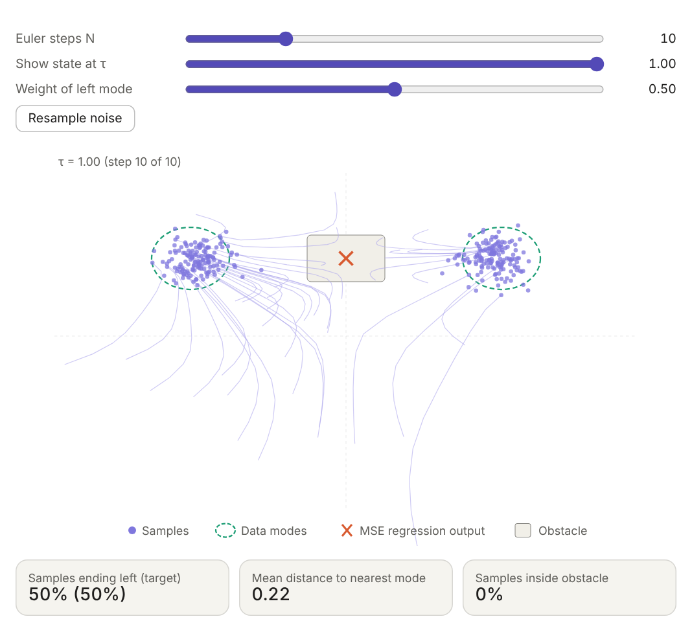

[Open standalone page](assets/36_flow_matching_bimodal_actions_euler.html)

<details><summary>Diagram source</summary>

````html
<h2 class="sr-only">Interactive two-dimensional flow matching demo: Gaussian noise samples are transported by the exact optimal velocity field to a two-mode action distribution, showing that one Euler step collapses all samples to the mean, inside an obstacle, while more steps recover both modes.</h2>
<style>
.r{display:flex;align-items:center;gap:12px;font-size:13px;color:var(--text-secondary);margin:6px 0}
.r label{width:160px}.r input{flex:1}.r output{width:60px;text-align:right;color:var(--text-primary);font-variant-numeric:tabular-nums}
.g{display:grid;grid-template-columns:repeat(auto-fit,minmax(150px,1fr));gap:10px;margin:10px 0 4px}
.c{background:var(--surface-1);border:0.5px solid var(--border);border-radius:12px;padding:10px 12px}
.c .k{font-size:12px;color:var(--text-secondary)}.c .v{font-size:18px;font-weight:500;color:var(--text-primary);font-variant-numeric:tabular-nums}
button.s{font:inherit;font-size:13px;padding:5px 12px;border-radius:var(--radius);border:0.5px solid var(--border-strong);background:var(--surface-2);color:var(--text-primary);cursor:pointer}
</style>
<div style="padding:0.5rem 0">
<div class="r"><label for="n">Euler steps N</label><input id="n" type="range" min="1" max="40" value="10"><output id="no"></output></div>
<div class="r"><label for="t">Show state at τ</label><input id="t" type="range" min="0" max="1" step="0.01" value="1"><output id="to"></output></div>
<div class="r"><label for="w">Weight of left mode</label><input id="w" type="range" min="0.1" max="0.9" step="0.05" value="0.5"><output id="wo"></output></div>
<div style="margin:6px 0"><button class="s" id="rs">Resample noise</button></div>
<div id="pl"></div>
<div class="g">
<div class="c"><div class="k">Samples ending left (target)</div><div class="v" id="r1"></div></div>
<div class="c"><div class="k">Mean distance to nearest mode</div><div class="v" id="r2"></div></div>
<div class="c"><div class="k">Samples inside obstacle</div><div class="v" id="r3"></div></div>
</div>
</div>
<script>
const $=i=>document.getElementById(i);let seed=3,P=[];const NP=300;
function rng(s){return function(){s|=0;s=s+0x6D2B79F5|0;let t=Math.imul(s^s>>>15,1|s);t=t+Math.imul(t^t>>>7,61|t)^t;return((t^t>>>14)>>>0)/4294967296}}
function g(r){let a=0,b=0;while(!a)a=r();while(!b)b=r();return Math.sqrt(-2*Math.log(a))*Math.cos(2*Math.PI*b)}
function init(){const r=rng(seed);P=[];for(let i=0;i<NP;i++)P.push([g(r),g(r)])}
const M=[[-1.6,1.0],[1.6,1.0]],S=0.2;
const X=x=>340+100*x,Y=y=>204-80*y;
function vel(x,y,t,w){const vr=t*t*S*S+(1-t)*(1-t),gn=t*S*S/vr;const lp=[],ex=[],ey=[];
for(let k=0;k<2;k++){const mx=t*M[k][0],my=t*M[k][1];const d2=(x-mx)**2+(y-my)**2;lp.push(Math.log(k?1-w:w)-d2/(2*vr));ex.push(M[k][0]+gn*(x-mx));ey.push(M[k][1]+gn*(y-my))}
const m=Math.max(lp[0],lp[1]),e0=Math.exp(lp[0]-m),e1=Math.exp(lp[1]-m),z=e0+e1;
const Ax=(e0*ex[0]+e1*ex[1])/z,Ay=(e0*ey[0]+e1*ey[1])/z;return[(Ax-x)/(1-t),(Ay-y)/(1-t)]}
function u(){
const N=+$('n').value,T=+$('t').value,w=+$('w').value,dt=1/N,cur=Math.round(T*N);
$('no').textContent=N;$('to').textContent=T.toFixed(2);$('wo').textContent=w.toFixed(2);
const ends=[],now=[],tr=[];
for(let i=0;i<NP;i++){let[x,y]=P[i];const path=[[x,y]];let pa=cur===0?[x,y]:null;
for(let n=0;n<N;n++){const t=n*dt,v=vel(x,y,t,w);x+=dt*v[0];y+=dt*v[1];if(i<40)path.push([x,y]);if(n+1===cur)pa=[x,y]}
ends.push([x,y]);now.push(pa);if(i<40)tr.push(path.slice(0,cur+1))}
const mx=1.6*(1-2*w);
let s='<svg width="100%" viewBox="0 0 680 420" role="img"><title>Samples flowing from noise to two action modes</title>';
s+='<line x1="40" y1="'+Y(0)+'" x2="640" y2="'+Y(0)+'" stroke="var(--border)" stroke-width="0.5" stroke-dasharray="3 3"/><line x1="'+X(0)+'" y1="36" x2="'+X(0)+'" y2="384" stroke="var(--border)" stroke-width="0.5" stroke-dasharray="3 3"/>';
s+='<rect class="c-gray" x="'+X(-0.4)+'" y="'+Y(1.3)+'" width="80" height="48" rx="4" stroke-width="0.5"/>';
M.forEach(m=>{s+='<ellipse cx="'+X(m[0])+'" cy="'+Y(m[1])+'" rx="40" ry="32" fill="none" stroke="#1D9E75" stroke-width="1.5" stroke-dasharray="5 3"/>'});
tr.forEach(p=>{s+='<polyline points="'+p.map(q=>X(q[0]).toFixed(1)+','+Y(q[1]).toFixed(1)).join(' ')+'" fill="none" stroke="#AFA9EC" stroke-width="0.8" opacity="0.6"/>'});
now.forEach(q=>{const px=X(q[0]),py=Y(q[1]);if(px>36&&px<644&&py>36&&py<384)s+='<circle cx="'+px.toFixed(1)+'" cy="'+py.toFixed(1)+'" r="2.2" fill="#7F77DD" opacity="0.75"/>'});
const cx=X(mx),cy=Y(1);s+='<line x1="'+(cx-7)+'" y1="'+(cy-7)+'" x2="'+(cx+7)+'" y2="'+(cy+7)+'" stroke="#D85A30" stroke-width="2.5"/><line x1="'+(cx-7)+'" y1="'+(cy+7)+'" x2="'+(cx+7)+'" y2="'+(cy-7)+'" stroke="#D85A30" stroke-width="2.5"/>';
s+='<text class="ts" x="44" y="24" dominant-baseline="central">τ = '+(cur/N).toFixed(2)+'  (step '+cur+' of '+N+')</text>';
s+='<circle cx="120" cy="404" r="4" fill="#7F77DD"/><text class="ts" x="130" y="404" dominant-baseline="central">Samples</text>';
s+='<ellipse cx="216" cy="404" rx="10" ry="7" fill="none" stroke="#1D9E75" stroke-width="1.5" stroke-dasharray="4 2"/><text class="ts" x="232" y="404" dominant-baseline="central">Data modes</text>';
s+='<line x1="336" y1="398" x2="346" y2="410" stroke="#D85A30" stroke-width="2"/><line x1="336" y1="410" x2="346" y2="398" stroke="#D85A30" stroke-width="2"/><text class="ts" x="354" y="404" dominant-baseline="central">MSE regression output</text>';
s+='<rect class="c-gray" x="514" y="397" width="16" height="14" rx="2" stroke-width="0.5"/><text class="ts" x="538" y="404" dominant-baseline="central">Obstacle</text></svg>';
$('pl').innerHTML=s;
let L=0,O=0,D=0;ends.forEach(([x,y])=>{if(x<0)L++;if(Math.abs(x)<0.4&&Math.abs(y-1)<0.3)O++;D+=Math.min(Math.hypot(x-M[0][0],y-M[0][1]),Math.hypot(x-M[1][0],y-M[1][1]))});
$('r1').textContent=(100*L/NP).toFixed(0)+'% ('+(100*w).toFixed(0)+'%)';$('r2').textContent=(D/NP).toFixed(2);$('r3').textContent=(100*O/NP).toFixed(0)+'%';
}
$('rs').onclick=()=>{seed=Math.floor(Math.random()*1e9);init();u()};
['n','t','w'].forEach(i=>$(i).addEventListener('input',u));init();u();
</script>
````

</details>

What to try:
- **N = 1:** every sample lands on the red ×, inside the obstacle. One Euler step is exactly MSE regression; section 5 shows why.
- **N around 3 to 10:** samples split into the two modes in the right proportions.
- **Scrub τ from 0 to 1:** trajectories start out heading toward the mean, then commit to one side partway through. Section 5 also explains that commitment.

---

**0. Problem setup**

```
o  : observation (images, text, proprio) → backbone prefix features
A  : action chunk ∈ ℝ^{H×D}   (e.g. H = 50 steps, D = joints + gripper), normalized per dimension
goal: sample A ~ p(A | o)      p is multimodal; E[A|o] may be infeasible (the ×)
```

**1. Generation as transport by an ODE**

Pick a path of distributions p_τ for τ ∈ [0, 1], with p_0 = N(0, I) (noise) and p_1 = p(A|o) (data). A velocity field moves samples along it:

```
dx/dτ = v(x, τ, o),      x(0) ~ N(0, I)    ⇒    x(1) ~ p(A|o)
```

That works if and only if v satisfies the continuity equation, which is conservation of probability mass:

```
∂_τ p_τ(x) + ∇·( p_τ(x) v(x, τ) ) = 0
```

The model is a network v_θ(x, τ, o) that approximates a valid v. The rest of the derivation answers one question: which v should it learn, and how can you train toward it without knowing p_1?

**2. Conditional paths: straight lines from noise to each data point**

Condition on a single demonstrated chunk A and draw a straight line from a noise sample ε to it:

```
x_τ = τ·A + (1 − τ)·ε,         ε ~ N(0, I)
p_τ(x | A) = N( x; τA, (1−τ)² I )
u_τ(x | A) = dx_τ/dτ = A − ε = (A − x) / (1 − τ)        ← constant along the line
```

This is the rectified-flow / optimal-transport conditional path with σ_min = 0. Each conditional field u(·|A) transports N(0, I) to a point mass at A.

**3. Marginal velocity: average the conditional velocities using the posterior**

The field that generates the marginal path p_τ(x) = ∫ p_τ(x|A) p_1(A) dA is the posterior-weighted average of the conditional velocities:

```
v*(x, τ) = E[ u_τ(x | A)  |  x_τ = x ]  =  ∫ u_τ(x|A) · p_τ(x|A) p_1(A) / p_τ(x)  dA
```

You can check that v* satisfies the continuity equation by substituting it in: the p_τ(x) in the denominator cancels against the p_τ in the flux term. v* itself is intractable, because it requires the posterior over A given x.

**4. The flow-matching theorem: regress on the conditional target**

```
L_FM(θ)  = E_{τ, x ~ p_τ} ‖ v_θ(x, τ) − v*(x, τ) ‖²          intractable target
L_CFM(θ) = E_{τ, A, ε}     ‖ v_θ(x_τ, τ) − (A − ε) ‖²        tractable: you have A and ε
```

The two losses differ only by a constant that doesn't depend on θ, so they have the same gradient:

```
‖v_θ − u‖² = ‖v_θ‖² − 2 v_θ·u + ‖u‖²
E[ v_θ · u ] = E_x[ v_θ · E[u | x] ] = E_x[ v_θ · v* ]        (tower property)
‖u‖² doesn't depend on θ        ⇒   L_CFM = L_FM + C
```

So training is plain regression: for a demonstrated pair (o, A), sample ε and τ, form x_τ, and regress v_θ onto A − ε. The minimizer is the conditional expectation v*. With finite capacity, the network learns its L² projection.

**5. Denoiser view: a Kalman filter for every noise level**

Substitute u = (A − x)/(1 − τ) into v*:

```
v*(x, τ) = ( E[A | x_τ = x] − x ) / (1 − τ)
```

So the network is implicitly computing an MMSE estimate of the clean action chunk from a noisy observation with a linear Gaussian model:

```
observation model:   y = τ·A + (1−τ)·ε        H = τI,  R = (1−τ)² I,  SNR = τ² / (1−τ)²
Gaussian prior A ~ N(μ, Σ):
    E[A | y] = μ + K (y − τμ),     K = τΣ (τ²Σ + (1−τ)² I)⁻¹        ← Kalman gain
mixture prior Σ_k π_k N(μ_k, Σ_k):
    E[A | y] = Σ_k w_k(y) · (per-component Kalman update)
    w_k(y) ∝ π_k N( y; τμ_k, τ²Σ_k + (1−τ)² I )                  ← responsibilities
```

The widget computes exactly this, with two components. It explains both effects you can see:
- **At τ = 0:** y is pure noise, carrying no information about A, so E[A|y] = E[A] and v* = E[A] − x. A single Euler step from τ = 0 therefore lands every sample on E[A]. One-step flow matching is MSE regression.
- **As τ → 1:** the SNR goes to infinity, the responsibilities w_k harden to 0 or 1, and each sample commits to one mode. Multimodality is resolved at mid-range τ, where the responsibilities switch. That is also where the trajectories bend.

Seen this way, the network learns a continuous family of MMSE estimators, one for every SNR, conditioned on o. Integrating the ODE is like annealed assimilation: start with no information, sharpen the posterior step by step, and the sample settles into a single hypothesis.

**6. Straight conditional paths, curved marginal trajectories**

Each conditional path is a straight line, but marginal trajectories bend where the posterior over A changes. In the widget that is the left/right commitment. Euler's error per step scales with that curvature, which gives three regimes:
- **Informative observation, near-unimodal p(A|o):** trajectories are nearly straight, and a few steps are enough. This is common in robotics, because cameras and proprioception pin down most of the action.
- **Genuine ambiguity:** trajectories curve, so it takes more steps or a higher-order solver to avoid blending modes, which is the obstacle failure.
- **Straightening:** reflow (retraining on noise–sample pairs the model generates itself), consistency or shortcut models, or distillation can bring sampling down to 1–2 steps.

**7. Inference**

```
x_0 ~ N(0, I)                                    shape H × D
for n = 0 … N−1:                                 π0 uses N ≈ 10
    τ_n = n / N
    x_{n+1} = x_n + (1/N) · v_θ(x_n, τ_n, o)     Euler;  Heun = 2 evals/step, error O(h²)
A = unnormalize(x_N)
```

- **Cost:** the backbone prefix runs once and its KV cache is reused. Each step is one forward pass of the small action expert, so 10 steps add little latency.
- **Conventions differ:** many codebases, including openpi, flip time so τ = 1 is noise, use the target ε − A, and integrate backward. The math is identical; only the sign and direction change.

**8. Training details that matter for actions**

| Detail | Practice |
|---|---|
| Normalization | Per-dimension quantile normalization to roughly [−1, 1], so all joints have comparable scale under the isotropic noise |
| Mixed embodiments | Pad D to a maximum and mask padded dimensions out of the loss |
| Tokenization | One action token per chunk timestep (H tokens), with bidirectional attention among them so the chunk is generated jointly and smoothly |
| Time conditioning | Sinusoidal embedding of τ, then an MLP, combined with each action token (or via adaptive normalization) |
| τ sampling | Not uniform. π0 uses a shifted Beta distribution emphasizing the noisy end, where the regression is most ambiguous; image models often use logit-normal around mid-τ |
| Loss | Mean squared error over the H × D unmasked entries |
| Target parameterization | Velocity (A − ε), or predict A directly and convert with v = (Â − x)/(1 − τ). x-prediction is better behaved at high noise, v-prediction near the data end |

**9. Using the generative model for uncertainty and constraints**

- **Exact likelihood:** by the instantaneous change of variables, log p_1(x_1) = log p_0(x_0) − ∫₀¹ ∇·v_θ(x_τ, τ) dτ. A Hutchinson trace estimator, zᵀ(∂v/∂x)z, makes it affordable. That allows out-of-distribution flags and action confidence scores.
- **Cheap uncertainty:** draw K chunks and measure their spread. Agreement means the posterior is effectively unimodal. Divergence means real ambiguity, which can trigger a slower controller, a look-closer action, or tighter CBF margins (see the earlier safety discussion).
- **Inpainting and real-time chunking:** to keep a new chunk continuous with the part of the old one that is still executing, constrain those overlapping entries at every integration step. Either replace x_τ[prefix] with τ·A_prev + (1−τ)ε, or use gradient guidance toward A_prev. This is conditioning the posterior on known components, the same as a measurement update on a subset of the state.

**10. How flow matching relates to diffusion**

| | DDPM / score diffusion | Flow matching (linear path) |
|---|---|---|
| Path | VP/VE noising schedule | Straight interpolation between ε and A |
| Target | Noise ε or score ∇log p | Velocity A − ε |
| Sampler | Stochastic (SDE) or probability-flow ODE | Deterministic ODE |
| Typical steps | Tens to hundreds (fewer with DDIM-style solvers) | About 5–10 |
| Underlying object | Same: a denoiser E[A \| x_τ] at every noise level | Same |

Gaussian-path flow matching is diffusion with a particular schedule, an ODE sampler and a velocity parameterization. The practical gains are simplicity, near-straight paths, and fewer integration steps, which is what makes 50 Hz control feasible.

**In one line:** flow matching learns, for every noise level, the posterior-mean velocity from a noisy action chunk toward the clean one, by regressing on the trivially available target A − ε. Integrating that field from Gaussian noise anneals a broad posterior into a single committed action chunk. Use too few steps and it degenerates to MSE regression, landing exactly on the mode-average that causes collisions.

Sources:
- [Flow Matching for Generative Modeling, arXiv:2210.02747](https://arxiv.org/abs/2210.02747)
- [Flow Straight and Fast: Rectified Flow, arXiv:2209.03003](https://arxiv.org/abs/2209.03003)
- [π0: A Vision-Language-Action Flow Model, arXiv:2410.24164](https://arxiv.org/abs/2410.24164)

---

<a id="turn-36"></a>
## 36. How do temporal ensembling and real-time chunking execute action chunks smoothly?

> **Question:** How do temporal ensembling and real-time chunking execute action chunks smoothly?

Chunked policies have to solve one timing problem: inference takes d control steps, and the robot can't stop moving while it waits. Temporal ensembling smooths execution by averaging overlapping predictions. Real-time chunking (RTC) makes each new chunk agree with what is already being executed, by conditioning its generation on the committed prefix.

The simulation compares four execution strategies on the same policy. Each chunk follows one of two valid "modes", for example passing an obstacle on the left or the right. Note that in this toy model, conditioning on the committed prefix keeps RTC in the same mode as the previous chunk.

**Diagram: `action_chunk_execution_strategies`** (interactive HTML widget)

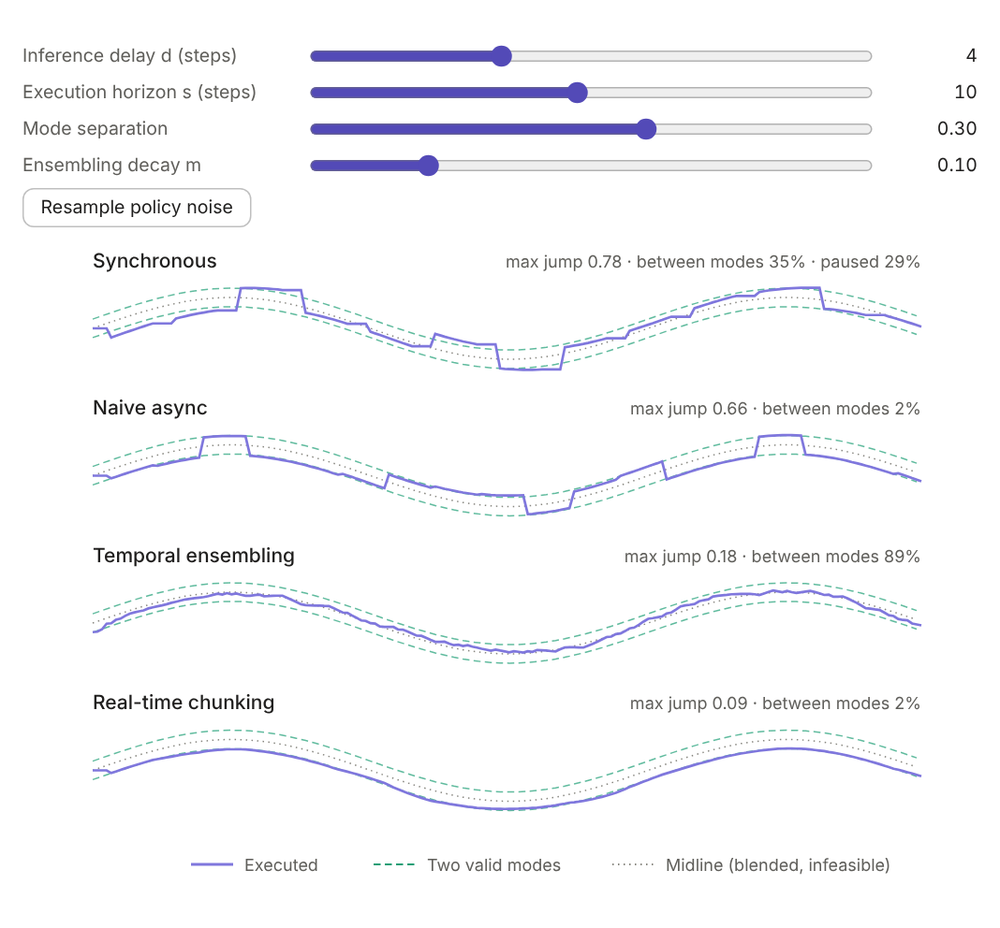

[Open standalone page](assets/37_action_chunk_execution_strategies.html)

<details><summary>Diagram source</summary>

````html
<h2 class="sr-only">Simulation comparing four ways to execute action chunks under inference latency: synchronous pausing, naive asynchronous switching, temporal ensembling and real-time chunking, on a policy whose chunks follow one of two valid modes.</h2>
<style>
.r{display:flex;align-items:center;gap:12px;font-size:13px;color:var(--text-secondary);margin:6px 0}
.r label{width:190px}.r input{flex:1}.r output{width:60px;text-align:right;color:var(--text-primary);font-variant-numeric:tabular-nums}
button.s{font:inherit;font-size:13px;padding:5px 12px;border-radius:var(--radius);border:0.5px solid var(--border-strong);background:var(--surface-2);color:var(--text-primary);cursor:pointer}
</style>
<div style="padding:0.5rem 0">
<div class="r"><label for="d">Inference delay d (steps)</label><input id="d" type="range" min="1" max="10" value="4"><output id="do"></output></div>
<div class="r"><label for="s">Execution horizon s (steps)</label><input id="s" type="range" min="1" max="20" value="10"><output id="so"></output></div>
<div class="r"><label for="sep">Mode separation</label><input id="sep" type="range" min="0" max="0.5" step="0.05" value="0.3"><output id="sepo"></output></div>
<div class="r"><label for="m">Ensembling decay m</label><input id="m" type="range" min="0" max="0.5" step="0.01" value="0.1"><output id="mo"></output></div>
<div style="margin:6px 0"><button class="s" id="rs">Resample policy noise</button></div>
<div id="pl"></div>
</div>
<script>
const $=i=>document.getElementById(i);const H=25,T=180;let seed=5,MODE=[],NOI=[];
function rng(s){return function(){s|=0;s=s+0x6D2B79F5|0;let t=Math.imul(s^s>>>15,1|s);t=t+Math.imul(t^t>>>7,61|t)^t;return((t^t>>>14)>>>0)/4294967296}}
function g(r){let a=0,b=0;while(!a)a=r();while(!b)b=r();return Math.sqrt(-2*Math.log(a))*Math.cos(2*Math.PI*b)}
function init(){const R=rng(seed);MODE=[];NOI=[];for(let q=0;q<T+H;q++){MODE.push(R()<0.5?1:-1);NOI.push(0.04*g(R))}}
const r=t=>Math.sin(2*Math.PI*t/120);
const cv=(q,i,sep,mode)=>r(q+i)+(mode===undefined?MODE[q]:mode)*sep+NOI[q];
function sync(d,s,sep){const a=[];let t=0,prev=r(0),idle=0;while(t<T){const q=t;for(let k=0;k<d&&t<T;k++){a[t++]=prev;idle++}for(let i=0;i<s&&t<T;i++){a[t]=cv(q,i,sep);prev=a[t];t++}}return{a,idle:idle/T}}
function anaive(d,s,sep){const a=[];for(let t=0;t<d;t++)a[t]=r(0);for(let q=0;q<T;q+=s)for(let i=d;i<d+s;i++){const t=q+i;if(t<T)a[t]=cv(q,i,sep)}return{a}}
function rtc(d,s,sep){const a=[];for(let t=0;t<d;t++)a[t]=r(0);let prevC=null,mode=MODE[0];
for(let q=0;q<T;q+=s){const C=[];for(let i=0;i<H;i++){const f=cv(q,i,sep,mode);let W=0;
if(prevC&&i<H-s){if(i<d)W=1;else{const c=(H-s-i)/(H-s-d+1);W=c*(Math.exp(c)-1)/(Math.E-1)}}
C.push(W>0?W*prevC[s+i]+(1-W)*f:f)}
for(let i=d;i<d+s;i++){const t=q+i;if(t<T)a[t]=C[i]}prevC=C}return{a}}
function te(m,sep){const a=[];for(let t=0;t<T;t++){const q0=Math.max(0,t-H+1);let n=0,z=0;for(let q=q0;q<=t;q++){const w=Math.exp(-m*(q-q0));n+=w*cv(q,t-q,sep);z+=w}a[t]=n/z}return{a}}
function met(a,sep){let mj=0,bm=0;for(let t=0;t<T;t++){if(t>0)mj=Math.max(mj,Math.abs(a[t]-a[t-1]));if(sep>0&&Math.abs(a[t]-r(t))<sep/2)bm++}return[mj,bm/T]}
const X=t=>50+t*590/(T-1);
function u(){
let d=+$('d').value,s=+$('s').value;const sep=+$('sep').value,m=+$('m').value;
s=Math.min(Math.max(s,d),H-d);$('do').textContent=d;$('so').textContent=s+(s!==+$('s').value?' (clamped)':'');$('sepo').textContent=sep.toFixed(2);$('mo').textContent=m.toFixed(2);
const S=[['Synchronous',sync(d,s,sep)],['Naive async',anaive(d,s,sep)],['Temporal ensembling',te(m,sep)],['Real-time chunking',rtc(d,s,sep)]];
let o='<svg width="100%" viewBox="0 0 680 465" role="img"><title>Executed action trajectories under four strategies</title>';
S.forEach(([nm,res],k)=>{const y0=10+k*105,mid=y0+56,Y=v=>mid-v*22;
const [mj,bm]=met(res.a,sep);
let mt='max jump '+mj.toFixed(2)+(sep>0?' · between modes '+(bm*100).toFixed(0)+'%':'');if(res.idle!==undefined)mt+=' · paused '+(res.idle*100).toFixed(0)+'%';
o+='<text class="th" x="50" y="'+(y0+8)+'" dominant-baseline="central">'+nm+'</text><text class="ts" x="640" y="'+(y0+8)+'" text-anchor="end" dominant-baseline="central">'+mt+'</text>';
let pr='',pu='',pl='',ex='';for(let t=0;t<T;t+=2){pr+=(t?'L':'M')+X(t).toFixed(1)+' '+Y(r(t)).toFixed(1);pu+=(t?'L':'M')+X(t).toFixed(1)+' '+Y(r(t)+sep).toFixed(1);pl+=(t?'L':'M')+X(t).toFixed(1)+' '+Y(r(t)-sep).toFixed(1)}
for(let t=0;t<T;t++)ex+=(t?'L':'M')+X(t).toFixed(1)+' '+Y(res.a[t]).toFixed(1);
o+='<path d="'+pr+'" fill="none" stroke="#888780" stroke-width="1" stroke-dasharray="1 3"/>';
if(sep>0)o+='<path d="'+pu+'" fill="none" stroke="#1D9E75" stroke-width="1" stroke-dasharray="5 3" opacity="0.7"/><path d="'+pl+'" fill="none" stroke="#1D9E75" stroke-width="1" stroke-dasharray="5 3" opacity="0.7"/>';
o+='<path d="'+ex+'" fill="none" stroke="#7F77DD" stroke-width="1.8"/>'});
o+='<line x1="120" y1="448" x2="150" y2="448" stroke="#7F77DD" stroke-width="2"/><text class="ts" x="158" y="448" dominant-baseline="central">Executed</text>';
o+='<line x1="250" y1="448" x2="280" y2="448" stroke="#1D9E75" stroke-width="1.2" stroke-dasharray="5 3"/><text class="ts" x="288" y="448" dominant-baseline="central">Two valid modes</text>';
o+='<line x1="420" y1="448" x2="450" y2="448" stroke="#888780" stroke-width="1.2" stroke-dasharray="1 3"/><text class="ts" x="458" y="448" dominant-baseline="central">Midline (blended, infeasible)</text></svg>';
$('pl').innerHTML=o}
$('rs').onclick=()=>{seed=Math.floor(Math.random()*1e9);init();u()};
['d','s','sep','m'].forEach(i=>$(i).addEventListener('input',u));init();u();
</script>
````

</details>

What the simulation shows:
- **Synchronous:** flat segments while the robot waits for inference, then a jump to a plan made from an observation that is now d steps old.
- **Naive async:** never pauses, but jumps at chunk boundaries whenever a new chunk lands in the other mode or with different noise.
- **Temporal ensembling:** smooth, but because it averages chunks from both modes it ends up on the midline, which is the infeasible blend.
- **RTC:** continuous at boundaries and stays in one mode, since each new chunk is generated to agree with the committed prefix.

Set the mode separation to 0 and temporal ensembling becomes the smoothest of all, because averaging is harmless when the policy is unimodal.

---

**1. Timing**

```
H : chunk length (actions predicted per inference)
s : execution horizon (actions executed before switching to the next chunk)
d : inference delay in control steps  (latency / dt)

t:      q ─────── q+d ─────────────── q+s ─────── q+s+d
chunk q:  [computing]  execute indices d … d+s−1 ──────►
chunk q+s:                       query at q+s  [computing]  switch at q+s+d
constraint: d ≤ s ≤ H − d
```

Three failure modes follow from this:
- **Pauses:** synchronous execution waits for inference.
- **Discontinuities:** a new, independently sampled chunk disagrees with the motion in progress.
- **Staleness:** any chunk is based on an observation from at least d steps earlier.

**2. Temporal ensembling (ACT)**

Query the policy at every control step. For each time t, average every prediction that covers t:

```
a_t = Σ_j w_j · Â^{(q_j)}_{t−q_j} / Σ_j w_j,        w_j = exp(−m · j)   (j = 0 is the oldest prediction)
```

- **Why it works for ACT:** ACT samples its CVAE latent at the prior mean at test time, so the policy is deterministic and unimodal. Averaging overlapping forecasts then acts as a low-pass filter on prediction noise.
- **Why it breaks for diffusion and flow policies:** those sample, and each sample may land in a different mode. Averaging samples is mode averaging, the same failure as one-step flow matching or MSE regression.
- **Cost:** it requires inference every control step. That is impractical for VLAs with 50–300 ms latency, and that latency is assumed away in this simulation's temporal-ensembling panel.
- **Lag:** weighting older predictions more makes the motion smooth but slow to react. The decay m trades smoothness against responsiveness.

**3. Simpler alternatives**

| Method | Idea | Weakness |
|---|---|---|
| Receding horizon (Diffusion Policy) | Execute s of H actions, replan, accept the jump | Discontinuities; synchronous version pauses |
| Linear cross-fade over the overlap | Blend old → new over k steps | Still blends modes, just briefly |
| Low-level smoothing | Splines, impedance control, jerk limits | Hides jumps instead of preventing them; adds lag |
| Bidirectional decoding (BID) | Sample N chunks; pick the one most consistent with the previous chunk that also scores well against a weaker reference policy | N× sampling cost; picks among samples rather than generating a consistent one |

**4. Real-time chunking: execute asynchronously and inpaint the prefix**

Start computing the next chunk while the current one is still executing. The first d actions of the new chunk will have been executed from the old chunk by the time inference finishes, so they are committed. Generate the new chunk conditioned on them:

```
Y   = previous chunk shifted by s           (its overlap with the new chunk's timeline)
W_i = 1                                     i < d            frozen: already executing
      c_i (e^{c_i} − 1)/(e − 1),  c_i = (H−s−i)/(H−s−d+1)     d ≤ i < H−s     soft: prefer consistency
      0                                     i ≥ H−s          free: fresh actions
```

Guidance runs inside each flow integration step, using the τ = 0 noise / τ = 1 data convention from the flow-matching answer:

```
v      = v_θ(x_τ, τ, o)
      = x_τ + (1 − τ) · v                       predicted clean chunk (the denoiser estimate)
e      = W ⊙ (Y − Â)                             weighted disagreement with the committed actions
v     ←  v + β(τ) · (∂Â/∂x_τ)ᵀ e                 vector–Jacobian product: one backward pass
x_{τ+δ} = x_τ + δ · v                            β clipped for stability
```

Properties:
- **Training-free:** it works with any trained flow policy. The cost is one extra backward pass per integration step.
- **Continuity by construction:** the switch time falls inside the frozen region, where the new chunk equals the old one.
- **Mode consistency:** guidance acts early in τ, while the posterior is still broad, so the sample commits to the mode consistent with the motion in progress. In posterior terms, RTC samples from p(A | o, A_{0:d} = Y_{0:d}) instead of p(A | o).
- **Reported results:** the authors report robustness to latencies of hundreds of milliseconds, with smoother motion and faster task completion than synchronous execution, temporal ensembling and BID.

**5. Choosing d and s**

```
d = ceil( p99 inference latency / dt )     use the tail, not the mean; the frozen region must cover the worst case
s ∈ [d, H − d]                             small s = more reactive, more inference;  large s = more open-loop
```

Variable latency is the real-world complication. If inference finishes after the time you planned for, the frozen region is too short. Budget d for the tail of the latency distribution, or have the executor fall back to holding the old chunk's tail.

**6. The filtering view**

| Method | Estimation analogue | When it fails |
|---|---|---|
| Temporal ensembling | Forecast averaging, or a fixed-lag smoother over overlapping predictions | Multimodal forecasts: the mixture collapses to the mean |
| Cross-fade | Complementary filter between two estimates | Same collapse, over a shorter window |
| BID | Particle selection by likelihood under the previous chunk | Sample-limited |
| RTC | Measurement update on a subset of the state: committed actions are perfect observations of A_{0:d}, and the posterior over the rest is sampled | Wrong latency budget, so the "observations" are mistimed |

This is the same idea as the inpainting note in the flow-matching answer: known components of the state are treated as measurements, and generation becomes posterior sampling conditioned on them.

**In one line:** temporal ensembling smooths by averaging overlapping predictions, which is fine for deterministic unimodal policies but collapses multimodal ones onto infeasible blends. Real-time chunking runs inference asynchronously and generates each new chunk conditioned on the actions already committed, so execution is continuous, never pauses, and stays in a consistent mode.

Sources:
- [ACT: Learning Fine-Grained Bimanual Manipulation, arXiv:2304.13705](https://arxiv.org/abs/2304.13705)
- [Diffusion Policy, arXiv:2303.04137](https://arxiv.org/abs/2303.04137)
- [Bidirectional Decoding, arXiv:2408.17355](https://arxiv.org/abs/2408.17355)
- [Real-Time Execution of Action Chunking Flow Policies, arXiv:2506.07339](https://arxiv.org/abs/2506.07339)

---

<a id="turn-37"></a>
## 37. Explain the PMBM filter and how its Poisson component models undetected objects

> **Question:** Explain the PMBM filter and how its Poisson component models undetected objects

The Poisson multi-Bernoulli mixture (PMBM) filter splits the multi-object posterior into two parts:

- **Objects detected at least once**, kept as a mixture of association hypotheses, each a set of Bernoulli tracks (this half behaves much like MHT).
- **Objects that may exist but have never been detected**, kept as a single Poisson intensity function D_u(x).

That second part is what other trackers lack. It turns "unknown" into a calibrated quantity, and every new track is born from it.

**Diagram: `pmbm_structure_and_update`** (static SVG diagram)

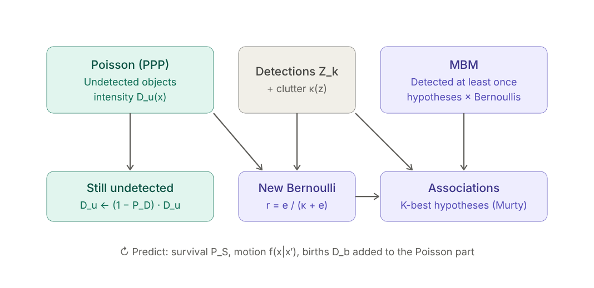

[Open standalone page](assets/38_pmbm_structure_and_update.html)

<details><summary>Diagram source</summary>

````svg
<svg width="100%" viewBox="0 0 680 310" role="img"><title>PMBM structure and update</title><desc>The PMBM density has a Poisson component for undetected objects with intensity D_u, and a multi-Bernoulli mixture for objects detected at least once. In the update, the Poisson component is thinned by one minus the detection probability, each detection creates a new Bernoulli with existence e over kappa plus e, and associations to existing tracks are enumerated with K-best assignment. A predict step adds survival, motion and births back into the Poisson component.</desc>
<defs><marker id="arrow" viewBox="0 0 10 10" refX="8" refY="5" markerWidth="6" markerHeight="6" orient="auto-start-reverse"><path d="M2 1L8 5L2 9" fill="none" stroke="context-stroke" stroke-width="1.5" stroke-linecap="round" stroke-linejoin="round"/></marker></defs>
<g class="c-teal"><rect x="40" y="40" width="200" height="80" rx="8" stroke-width="0.5"/><text class="th" x="140" y="62" text-anchor="middle" dominant-baseline="central">Poisson (PPP)</text><text class="ts" x="140" y="82" text-anchor="middle" dominant-baseline="central">Undetected objects</text><text class="ts" x="140" y="100" text-anchor="middle" dominant-baseline="central">intensity D_u(x)</text></g>
<g class="c-gray"><rect x="270" y="40" width="140" height="80" rx="8" stroke-width="0.5"/><text class="th" x="340" y="70" text-anchor="middle" dominant-baseline="central">Detections Z_k</text><text class="ts" x="340" y="90" text-anchor="middle" dominant-baseline="central">+ clutter κ(z)</text></g>
<g class="c-purple"><rect x="440" y="40" width="200" height="80" rx="8" stroke-width="0.5"/><text class="th" x="540" y="62" text-anchor="middle" dominant-baseline="central">MBM</text><text class="ts" x="540" y="82" text-anchor="middle" dominant-baseline="central">Detected at least once</text><text class="ts" x="540" y="100" text-anchor="middle" dominant-baseline="central">hypotheses × Bernoullis</text></g>
<line x1="140" y1="120" x2="140" y2="188" class="arr" marker-end="url(#arrow)"/>
<line x1="240" y1="120" x2="298" y2="188" class="arr" marker-end="url(#arrow)"/>
<line x1="340" y1="120" x2="340" y2="188" class="arr" marker-end="url(#arrow)"/>
<line x1="410" y1="120" x2="478" y2="188" class="arr" marker-end="url(#arrow)"/>
<line x1="540" y1="120" x2="540" y2="188" class="arr" marker-end="url(#arrow)"/>
<g class="c-teal"><rect x="40" y="190" width="200" height="60" rx="8" stroke-width="0.5"/><text class="th" x="140" y="210" text-anchor="middle" dominant-baseline="central">Still undetected</text><text class="ts" x="140" y="230" text-anchor="middle" dominant-baseline="central">D_u ← (1 − P_D) · D_u</text></g>
<g class="c-purple"><rect x="270" y="190" width="140" height="60" rx="8" stroke-width="0.5"/><text class="th" x="340" y="210" text-anchor="middle" dominant-baseline="central">New Bernoulli</text><text class="ts" x="340" y="230" text-anchor="middle" dominant-baseline="central">r = e / (κ + e)</text></g>
<g class="c-purple"><rect x="440" y="190" width="200" height="60" rx="8" stroke-width="0.5"/><text class="th" x="540" y="210" text-anchor="middle" dominant-baseline="central">Associations</text><text class="ts" x="540" y="230" text-anchor="middle" dominant-baseline="central">K-best hypotheses (Murty)</text></g>
<line x1="410" y1="220" x2="438" y2="220" class="arr" marker-end="url(#arrow)"/>
<text class="ts" x="340" y="286" text-anchor="middle" dominant-baseline="central">↻ Predict: survival P_S, motion f(x|x′), births D_b added to the Poisson part</text>
</svg>
````

</details>

**Diagram: `pmbm_undetected_intensity_occlusion`** (interactive HTML widget)

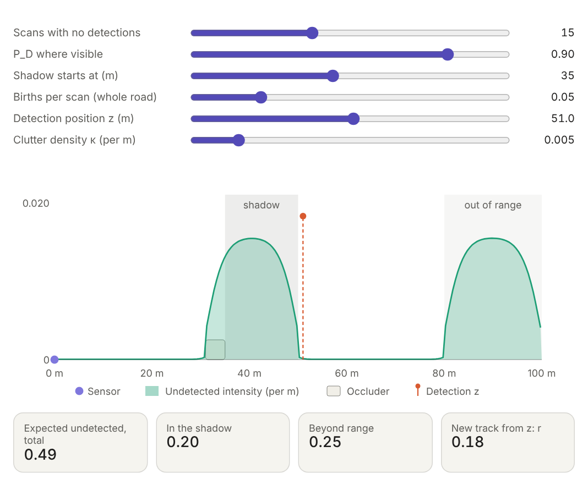

[Open standalone page](assets/39_pmbm_undetected_intensity_occlusion.html)

<details><summary>Diagram source</summary>

````html
<h2 class="sr-only">One-dimensional simulation of the PMBM Poisson component for undetected objects: intensity decays where the sensor sees, accumulates in an occlusion shadow and beyond sensor range, and determines the existence probability of a new track created by a detection.</h2>
<style>
.r{display:flex;align-items:center;gap:12px;font-size:13px;color:var(--text-secondary);margin:6px 0}
.r label{width:200px}.r input{flex:1}.r output{width:64px;text-align:right;color:var(--text-primary);font-variant-numeric:tabular-nums}
.g{display:grid;grid-template-columns:repeat(auto-fit,minmax(140px,1fr));gap:10px;margin:10px 0 4px}
.c{background:var(--surface-1);border:0.5px solid var(--border);border-radius:12px;padding:10px 12px}
.c .k{font-size:12px;color:var(--text-secondary)}.c .v{font-size:18px;font-weight:500;color:var(--text-primary);font-variant-numeric:tabular-nums}
</style>
<div style="padding:0.5rem 0">
<div class="r"><label for="k">Scans with no detections</label><input id="k" type="range" min="0" max="40" value="15"><output id="ko"></output></div>
<div class="r"><label for="pd">P_D where visible</label><input id="pd" type="range" min="0.5" max="0.99" step="0.01" value="0.9"><output id="pdo"></output></div>
<div class="r"><label for="oc">Shadow starts at (m)</label><input id="oc" type="range" min="15" max="60" value="35"><output id="oco"></output></div>
<div class="r"><label for="b">Births per scan (whole road)</label><input id="b" type="range" min="0.01" max="0.2" step="0.01" value="0.05"><output id="bo"></output></div>
<div class="r"><label for="z">Detection position z (m)</label><input id="z" type="range" min="0" max="100" step="0.5" value="51"><output id="zo"></output></div>
<div class="r"><label for="kc">Clutter density κ (per m)</label><input id="kc" type="range" min="0.001" max="0.03" step="0.001" value="0.005"><output id="kco"></output></div>
<div id="pl"></div>
<div class="g">
<div class="c"><div class="k">Expected undetected, total</div><div class="v" id="r1"></div></div>
<div class="c"><div class="k">In the shadow</div><div class="v" id="r2"></div></div>
<div class="c"><div class="k">Beyond range</div><div class="v" id="r3"></div></div>
<div class="c"><div class="k">New track from z: r</div><div class="v" id="r4"></div></div>
</div>
</div>
<script>
const $=i=>document.getElementById(i);const NX=200,DX=0.5,PS=0.99,SW=15,RG=80;
const xs=Array.from({length:NX},(_,i)=>(i+.5)*DX);
const KR=6,KER=[];{let s=0;for(let j=-KR;j<=KR;j++){const v=Math.exp(-0.5*(j/2)**2);KER.push(v);s+=v}for(let j=0;j<KER.length;j++)KER[j]/=s}
function pred(D,b){const o=new Array(NX).fill(0);for(let i=0;i<NX;i++){let a=0;for(let j=-KR;j<=KR;j++){const q=i+j;if(q>=0&&q<NX)a+=KER[j+KR]*D[q]}o[i]=PS*a+b/100}return o}
function u(){
const k=+$('k').value,pd=+$('pd').value,oc=+$('oc').value,b=+$('b').value,z=+$('z').value,kc=+$('kc').value;
$('ko').textContent=k;$('pdo').textContent=pd.toFixed(2);$('oco').textContent=oc;$('bo').textContent=b.toFixed(2);$('zo').textContent=z.toFixed(1);$('kco').textContent=kc.toFixed(3);
const PD=xs.map(x=>x>=RG?0:(x>=oc&&x<oc+SW?0:(x>=oc-4&&x<oc?0:pd)));
let D=new Array(NX).fill(0.01);
for(let s=0;s<k;s++){D=pred(D,b);D=D.map((v,i)=>v*(1-PD[i]))}
const Dp=pred(D,b);let e=0;for(let i=0;i<NX;i++){const gz=Math.exp(-0.5*(z-xs[i])**2)/Math.sqrt(2*Math.PI);e+=PD[i]*gz*Dp[i]*DX}
const r=e/(e+kc);
let tot=0,sh=0,br=0;D.forEach((v,i)=>{tot+=v*DX;if(xs[i]>=oc&&xs[i]<oc+SW)sh+=v*DX;if(xs[i]>=RG)br+=v*DX});
const ym=Math.max(0.02,Math.max(...D)*1.15),X=x=>50+5.9*x,Y=v=>250-v/ym*190;
let s='<svg width="100%" viewBox="0 0 680 300" role="img"><title>Undetected intensity along the road</title>';
s+='<rect x="'+X(oc)+'" y="50" width="'+(5.9*SW)+'" height="200" fill="#888780" opacity="0.15"/><text class="ts" x="'+X(oc+SW/2)+'" y="62" text-anchor="middle" dominant-baseline="central">shadow</text>';
s+='<rect x="'+X(RG)+'" y="50" width="'+(5.9*20)+'" height="200" fill="#888780" opacity="0.08"/><text class="ts" x="'+X(90)+'" y="62" text-anchor="middle" dominant-baseline="central">out of range</text>';
s+='<rect class="c-gray" x="'+X(oc-4)+'" y="226" width="'+(5.9*4)+'" height="24" rx="3" stroke-width="0.5"/>';
let p='M'+X(0)+' 250';xs.forEach((x,i)=>{p+='L'+X(x).toFixed(1)+' '+Y(D[i]).toFixed(1)});p+='L'+X(100)+' 250Z';
s+='<path d="'+p+'" fill="#1D9E75" opacity="0.25"/>';
let p2='';xs.forEach((x,i)=>{p2+=(i?'L':'M')+X(x).toFixed(1)+' '+Y(D[i]).toFixed(1)});s+='<path d="'+p2+'" fill="none" stroke="#1D9E75" stroke-width="1.8"/>';
s+='<line x1="'+X(z)+'" y1="250" x2="'+X(z)+'" y2="76" stroke="#D85A30" stroke-width="1.5" stroke-dasharray="4 3"/><circle cx="'+X(z)+'" cy="76" r="4" fill="#D85A30"/>';
s+='<line x1="50" y1="250" x2="640" y2="250" stroke="var(--border-stronger)" stroke-width="0.75"/><circle cx="50" cy="250" r="5" fill="#7F77DD"/>';
for(let m=0;m<=100;m+=20)s+='<text class="ts" x="'+X(m)+'" y="266" text-anchor="middle" dominant-baseline="central">'+m+' m</text>';
s+='<text class="ts" x="44" y="'+Y(ym)+'" text-anchor="end" dominant-baseline="central">'+ym.toPrecision(2)+'</text><text class="ts" x="44" y="250" text-anchor="end" dominant-baseline="central">0</text>';
s+='<circle cx="80" cy="288" r="5" fill="#7F77DD"/><text class="ts" x="90" y="288" dominant-baseline="central">Sensor</text>';
s+='<rect x="160" y="282" width="16" height="12" fill="#1D9E75" opacity="0.4"/><text class="ts" x="184" y="288" dominant-baseline="central">Undetected intensity (per m)</text>';
s+='<rect class="c-gray" x="380" y="282" width="16" height="12" rx="2" stroke-width="0.5"/><text class="ts" x="404" y="288" dominant-baseline="central">Occluder</text>';
s+='<line x1="490" y1="282" x2="490" y2="294" stroke="#D85A30" stroke-width="1.5"/><circle cx="490" cy="282" r="3" fill="#D85A30"/><text class="ts" x="500" y="288" dominant-baseline="central">Detection z</text></svg>';
$('pl').innerHTML=s;
$('r1').textContent=tot.toFixed(2);$('r2').textContent=sh.toFixed(2);$('r3').textContent=br.toFixed(2);$('r4').textContent=r.toFixed(2);
}
['k','pd','oc','b','z','kc'].forEach(i=>$(i).addEventListener('input',u));u();
</script>
````

</details>

Things to try:
- **Add scans:** intensity drains in the visible areas, which is negative information: not seeing anything is evidence. It builds up in the shadow and beyond the sensor's range.
- **Put z just past the shadow's edge (about 51 m by default):** r is high. Intensity has leaked out of the shadow through the motion model, so a detection there is probably a real object stepping out.
- **Put z in open, well-observed road (say 10 m):** r is tiny. Almost no undetected intensity remains there, so the detection is most likely clutter.
- **Raise κ:** every new track becomes less certain.

---

**1. The building blocks**

```
Poisson point process (PPP)   intensity D(x):  N ~ Poisson(∫D),  points iid ∝ D
Bernoulli                     ∅ with prob 1−r,   {x} with prob r, x ~ p(x)
Multi-Bernoulli (MB)          union of independent Bernoullis
MB mixture (MBM)              Σ_h w_h · MB_h        (one MB per global association hypothesis)

PMBM:   f(X) = Σ_{X_u ⊎ X_d = X}  f_PPP(X_u) · f_MBM(X_d)
        undetected ∪ detected-at-least-once,   independent
```

**2. Why this form is exact: conjugacy**

The standard point-object model makes four assumptions:
- Each object survives with probability P_S(x) and moves by f(x|x′).
- Births follow a Poisson process with intensity D_b.
- Each object is detected with probability P_D(x), producing at most one measurement with likelihood g(z|x).
- Clutter is Poisson with intensity κ(z).

Under that model, a PMBM prior gives a PMBM posterior (Williams 2015; García-Fernández et al. 2018). The form is closed. Approximation enters only in pruning hypotheses and in how the densities are represented, typically as Gaussian mixtures.

**3. Prediction**

```
PPP:        D_u⁺(x) = ∫ P_S(x′) f(x|x′) D_u(x′) dx′  +  D_b(x)
Bernoulli:  r⁺ = r · ⟨P_S, p⟩,    p⁺(x) ∝ ∫ f(x|x′) P_S(x′) p(x′) dx′
```

**4. Update: the Poisson part**

```
misdetection (always):        D_u(x) ← (1 − P_D(x)) · D_u⁺(x)

each measurement z_j may be the FIRST detection of a previously undetected object:
    e_j      = ∫ P_D(x) g(z_j|x) D_u⁺(x) dx          evidence that z_j came from the unseen population
    r_new    = e_j / (κ(z_j) + e_j)                   object vs clutter
    p_new(x) ∝ P_D(x) g(z_j|x) D_u⁺(x)                its initial state density
    weight   = κ(z_j) + e_j                           enters the global hypothesis weights
```

Three consequences follow:
- **Thinning preserves the Poisson form.** If you thin a Poisson process by 1 − P_D, you get another Poisson process. "Never detected" therefore stays exact as one intensity function, with no hypotheses to enumerate.
- **Births are principled.** There are no hand-tuned "confirm after N hits" rules. A new track's existence probability is evidence from undetected objects divided by total evidence, so it reflects the sensor's history at that location.
- **Negative information is used.** Absence of detections where P_D is high drives D_u down, just as free-space updates do in occupancy grids.

**5. Update: the Bernoulli part (MHT-like)**

```
misdetected:   r′ = r(1 − ⟨P_D,p⟩) / (1 − r⟨P_D,p⟩),     p′ ∝ (1 − P_D) p
detected by z: r′ = 1,  p′ ∝ P_D g(z|·) p,                weight r⟨P_D g(z|·), p⟩
```

Each global hypothesis assigns every measurement to either an existing Bernoulli or a new one created from the Poisson part. The resulting assignment problem is solved with K-best methods (Murty's algorithm), with gating to keep it tractable.

**6. Where P_D(x) comes from, and why it matters most**

P_D(x) is the hinge of the whole filter. For LiDAR it should come from visibility:

```
P_D(x) = P_det(range, reflectivity, size) · P_visible(x)
P_visible from ray casting the occupancy grid / ESDF:   occluded → 0,   unknown → low
```

| Error | Effect |
|---|---|
| P_D too high in occluded regions | D_u drains where you can't actually see, giving false certainty of empty space. This is the dangerous error. |
| P_D too low where you can see | D_u stays inflated, so births get spurious high r and noise gets confirmed |
| κ miscalibrated | Shifts every new track's r. Make κ (and P_D) score-dependent, using detector confidence as a measurement |

This is the tracking version of keeping "unknown" separate from "free" in occupancy grids.

**7. What the Poisson part gives downstream**

```
occlusion risk along a path:       ∫_{swept volume ∩ shadow} D_u(x) dx
expected undetected in a region:   ∫_A D_u(x) dx
where to look next (active sensing): argmax_view ∫ P_D(x | view) D_u(x) dx
```

- **Planning:** risk from objects you can't see, such as a pedestrian behind a parked van, becomes a number the CVaR or chance-constraint planner can use, not a heuristic speed cap.
- **Active perception:** for steerable-beam LiDAR, point the beam where P_D × D_u is largest. That is where unseen objects are most likely and detectable. It is the multi-object version of next-best-view.

**8. Variants**

| Filter | Difference |
|---|---|
| PMB | Approximates the MBM by a single MB, using marginal association probabilities (often via loopy belief propagation). Much cheaper |
| MBM₀₁ | Expands Bernoullis into existence 0/1 hypotheses; equivalent to labeled formulations |
| Trajectory PMBM | Estimates full trajectories rather than only current states |
| Extended-object PMBM (e.g. GGIW) | Each object produces a Poisson number of points (rate, kinematics, extent). Natural for LiDAR clusters; requires measurement partitioning |
| Recycling | Low-r Bernoullis are moved back into the PPP instead of pruned, so their mass isn't lost |

**9. The filtering and data-assimilation view**

| PMBM element | Analogue |
|---|---|
| D_u(x) | A prior or background field for the unobserved part of the state, reverting toward the birth "climatology" where you don't observe |
| (1 − P_D) thinning | Assimilating negative information: observing nothing is still an observation |
| e_j / (κ + e_j) | Bayes factor between two models: new object vs clutter |
| MBM hypotheses | MHT's discrete association posterior |
| Recycling | Projecting low-information components back onto the background |

**In one line:** PMBM keeps every object it has ever detected as weighted association hypotheses over Bernoulli tracks, and represents everything it has not yet seen as one Poisson intensity. That intensity drains where the sensor can see and builds up where it can't, and it sets each new track's existence probability. Occlusion, sensor range and birth uncertainty then become quantities you can calibrate and plan against, instead of heuristics.

Sources:
- [Williams, Marginal multi-Bernoulli filters: RFS derivation of MHT, JIPDA and association-based MeMBer, arXiv:1203.2995](https://arxiv.org/abs/1203.2995)
- [García-Fernández et al., Poisson multi-Bernoulli mixture filter: direct derivation and implementation, arXiv:1703.04264](https://arxiv.org/abs/1703.04264)

---

<a id="turn-38"></a>
## 38. How does track-oriented MHT score, prune and manage hypotheses?

> **Question:** How does track-oriented MHT score, prune and manage hypotheses?

Track-oriented MHT (TOMHT) does not store global hypotheses. It stores one tree per potential target, where each root-to-leaf path is one possible measurement history for that target. At every scan it scores each path with a log-likelihood ratio, assembles the best set of non-conflicting paths across trees, and prunes the trees back toward that set. Each of these steps is standard estimation machinery you already know: χ² gates, NIS, and sequential testing.

**Diagram: `tomht_track_trees_nscan_pruning`** (static SVG diagram)

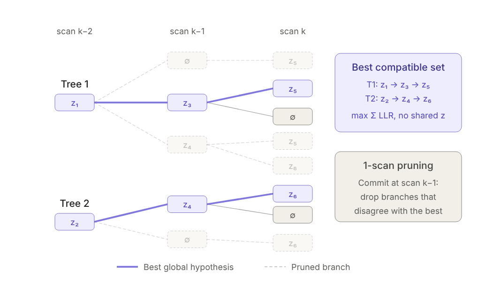

[Open standalone page](assets/40_tomht_track_trees_nscan_pruning.html)

<details><summary>Diagram source</summary>

````svg
<svg width="100%" viewBox="0 0 680 380" role="img"><title>Track trees with N-scan pruning</title><desc>Two track trees over scans k−2, k−1 and k. Tree 1 starts from measurement z1 and branches into miss, z3 and z4, then further. Tree 2 starts from z2 and branches into z4 and miss. The best compatible global hypothesis is z1, z3, z5 for tree 1 and z2, z4, z6 for tree 2, sharing no measurements. With 1-scan pruning, branches that disagree with the best hypothesis at scan k−1 are removed and shown faded.</desc>
<text class="ts" x="90" y="28" text-anchor="middle" dominant-baseline="central">scan k−2</text>
<text class="ts" x="250" y="28" text-anchor="middle" dominant-baseline="central">scan k−1</text>
<text class="ts" x="400" y="28" text-anchor="middle" dominant-baseline="central">scan k</text>
<text class="th" x="90" y="104" text-anchor="middle" dominant-baseline="central">Tree 1</text>
<text class="th" x="90" y="274" text-anchor="middle" dominant-baseline="central">Tree 2</text>
<g fill="none" stroke-linecap="round">
<g stroke="var(--border-stronger)" stroke-width="0.75" stroke-dasharray="4 3" opacity="0.45">
<line x1="118" y1="130" x2="222" y2="70"/><line x1="278" y1="70" x2="372" y2="70"/>
<line x1="118" y1="130" x2="222" y2="190"/><line x1="278" y1="190" x2="372" y2="185"/><line x1="278" y1="190" x2="372" y2="220"/>
<line x1="118" y1="300" x2="222" y2="325"/><line x1="278" y1="325" x2="372" y2="330"/>
</g>
<line x1="278" y1="130" x2="372" y2="150" stroke="var(--border-stronger)" stroke-width="0.75"/>
<line x1="278" y1="275" x2="372" y2="290" stroke="var(--border-stronger)" stroke-width="0.75"/>
<line x1="118" y1="130" x2="222" y2="130" stroke="#7F77DD" stroke-width="2.5"/><line x1="278" y1="130" x2="372" y2="110" stroke="#7F77DD" stroke-width="2.5"/>
<line x1="118" y1="300" x2="222" y2="275" stroke="#7F77DD" stroke-width="2.5"/><line x1="278" y1="275" x2="372" y2="260" stroke="#7F77DD" stroke-width="2.5"/>
</g>
<g class="c-purple"><rect x="62" y="118" width="56" height="24" rx="5" stroke-width="0.5"/><text class="ts" x="90" y="130" text-anchor="middle" dominant-baseline="central">z₁</text></g>
<g class="c-purple"><rect x="222" y="118" width="56" height="24" rx="5" stroke-width="0.5"/><text class="ts" x="250" y="130" text-anchor="middle" dominant-baseline="central">z₃</text></g>
<g class="c-purple"><rect x="372" y="98" width="56" height="24" rx="5" stroke-width="0.5"/><text class="ts" x="400" y="110" text-anchor="middle" dominant-baseline="central">z₅</text></g>
<g class="c-gray"><rect x="372" y="138" width="56" height="24" rx="5" stroke-width="0.5"/><text class="ts" x="400" y="150" text-anchor="middle" dominant-baseline="central">∅</text></g>
<g class="c-gray" opacity="0.4"><rect x="222" y="58" width="56" height="24" rx="5" stroke-width="0.5" stroke-dasharray="3 2"/><text class="ts" x="250" y="70" text-anchor="middle" dominant-baseline="central">∅</text></g>
<g class="c-gray" opacity="0.4"><rect x="372" y="58" width="56" height="24" rx="5" stroke-width="0.5" stroke-dasharray="3 2"/><text class="ts" x="400" y="70" text-anchor="middle" dominant-baseline="central">z₅</text></g>
<g class="c-gray" opacity="0.4"><rect x="222" y="178" width="56" height="24" rx="5" stroke-width="0.5" stroke-dasharray="3 2"/><text class="ts" x="250" y="190" text-anchor="middle" dominant-baseline="central">z₄</text></g>
<g class="c-gray" opacity="0.4"><rect x="372" y="173" width="56" height="24" rx="5" stroke-width="0.5" stroke-dasharray="3 2"/><text class="ts" x="400" y="185" text-anchor="middle" dominant-baseline="central">z₅</text></g>
<g class="c-gray" opacity="0.4"><rect x="372" y="208" width="56" height="24" rx="5" stroke-width="0.5" stroke-dasharray="3 2"/><text class="ts" x="400" y="220" text-anchor="middle" dominant-baseline="central">z₆</text></g>
<g class="c-purple"><rect x="62" y="288" width="56" height="24" rx="5" stroke-width="0.5"/><text class="ts" x="90" y="300" text-anchor="middle" dominant-baseline="central">z₂</text></g>
<g class="c-purple"><rect x="222" y="263" width="56" height="24" rx="5" stroke-width="0.5"/><text class="ts" x="250" y="275" text-anchor="middle" dominant-baseline="central">z₄</text></g>
<g class="c-purple"><rect x="372" y="248" width="56" height="24" rx="5" stroke-width="0.5"/><text class="ts" x="400" y="260" text-anchor="middle" dominant-baseline="central">z₆</text></g>
<g class="c-gray"><rect x="372" y="278" width="56" height="24" rx="5" stroke-width="0.5"/><text class="ts" x="400" y="290" text-anchor="middle" dominant-baseline="central">∅</text></g>
<g class="c-gray" opacity="0.4"><rect x="222" y="313" width="56" height="24" rx="5" stroke-width="0.5" stroke-dasharray="3 2"/><text class="ts" x="250" y="325" text-anchor="middle" dominant-baseline="central">∅</text></g>
<g class="c-gray" opacity="0.4"><rect x="372" y="318" width="56" height="24" rx="5" stroke-width="0.5" stroke-dasharray="3 2"/><text class="ts" x="400" y="330" text-anchor="middle" dominant-baseline="central">z₆</text></g>
<g class="c-purple"><rect x="460" y="60" width="180" height="112" rx="8" stroke-width="0.5"/><text class="th" x="550" y="80" text-anchor="middle" dominant-baseline="central">Best compatible set</text><text class="ts" x="550" y="104" text-anchor="middle" dominant-baseline="central">T1: z₁ → z₃ → z₅</text><text class="ts" x="550" y="124" text-anchor="middle" dominant-baseline="central">T2: z₂ → z₄ → z₆</text><text class="ts" x="550" y="148" text-anchor="middle" dominant-baseline="central">max Σ LLR, no shared z</text></g>
<g class="c-gray"><rect x="460" y="200" width="180" height="100" rx="8" stroke-width="0.5"/><text class="th" x="550" y="220" text-anchor="middle" dominant-baseline="central">1-scan pruning</text><text class="ts" x="550" y="244" text-anchor="middle" dominant-baseline="central">Commit at scan k−1:</text><text class="ts" x="550" y="264" text-anchor="middle" dominant-baseline="central">drop branches that</text><text class="ts" x="550" y="284" text-anchor="middle" dominant-baseline="central">disagree with the best</text></g>
<line x1="150" y1="364" x2="180" y2="364" stroke="#7F77DD" stroke-width="2.5"/><text class="ts" x="188" y="364" dominant-baseline="central">Best global hypothesis</text>
<line x1="360" y1="364" x2="390" y2="364" stroke="var(--border-stronger)" stroke-width="0.75" stroke-dasharray="4 3"/><text class="ts" x="398" y="364" dominant-baseline="central">Pruned branch</text>
</svg>
````

</details>

The score in each node is a running log-likelihood ratio. The simulation below runs that score for real targets and for tracks started from clutter, with SPRT confirm and delete thresholds:

**Diagram: `mht_llr_track_score_sprt`** (interactive HTML widget)

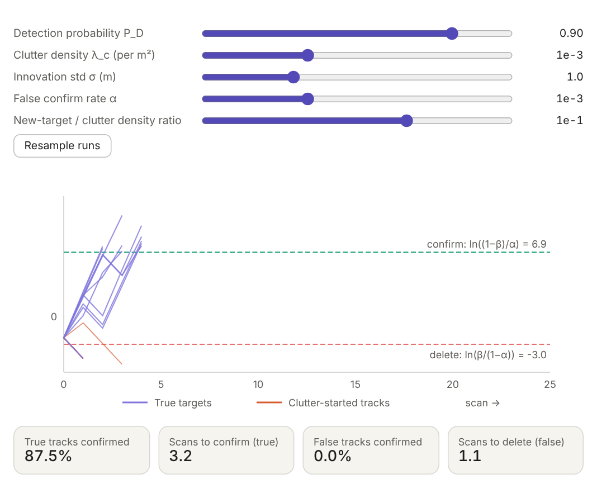

[Open standalone page](assets/41_mht_llr_track_score_sprt.html)

<details><summary>Diagram source</summary>

````html
<h2 class="sr-only">Simulation of MHT log-likelihood-ratio track scores for true targets and clutter-initiated false tracks, with SPRT confirmation and deletion thresholds and empirical confirmation statistics.</h2>
<style>
.r{display:flex;align-items:center;gap:12px;font-size:13px;color:var(--text-secondary);margin:6px 0}
.r label{width:210px}.r input{flex:1}.r output{width:70px;text-align:right;color:var(--text-primary);font-variant-numeric:tabular-nums}
.g{display:grid;grid-template-columns:repeat(auto-fit,minmax(140px,1fr));gap:10px;margin:10px 0 4px}
.c{background:var(--surface-1);border:0.5px solid var(--border);border-radius:12px;padding:10px 12px}
.c .k{font-size:12px;color:var(--text-secondary)}.c .v{font-size:18px;font-weight:500;color:var(--text-primary);font-variant-numeric:tabular-nums}
button.s{font:inherit;font-size:13px;padding:5px 12px;border-radius:var(--radius);border:0.5px solid var(--border-strong);background:var(--surface-2);color:var(--text-primary);cursor:pointer}
</style>
<div style="padding:0.5rem 0">
<div class="r"><label for="pd">Detection probability P_D</label><input id="pd" type="range" min="0.5" max="0.99" step="0.01" value="0.9"><output id="pdo"></output></div>
<div class="r"><label for="lc">Clutter density λ_c (per m²)</label><input id="lc" type="range" min="-4" max="-1" step="0.1" value="-3"><output id="lco"></output></div>
<div class="r"><label for="sg">Innovation std σ (m)</label><input id="sg" type="range" min="0.2" max="3" step="0.1" value="1"><output id="sgo"></output></div>
<div class="r"><label for="al">False confirm rate α</label><input id="al" type="range" min="-4" max="-1" step="0.1" value="-3"><output id="alo"></output></div>
<div class="r"><label for="nt">New-target / clutter density ratio</label><input id="nt" type="range" min="-3" max="0" step="0.1" value="-1"><output id="nto"></output></div>
<div style="margin:6px 0"><button class="s" id="rs">Resample runs</button></div>
<div id="pl"></div>
<div class="g">
<div class="c"><div class="k">True tracks confirmed</div><div class="v" id="r1"></div></div>
<div class="c"><div class="k">Scans to confirm (true)</div><div class="v" id="r2"></div></div>
<div class="c"><div class="k">False tracks confirmed</div><div class="v" id="r3"></div></div>
<div class="c"><div class="k">Scans to delete (false)</div><div class="v" id="r4"></div></div>
</div>
</div>
<script>
const $=i=>document.getElementById(i);let seed=9;const K=25,GAM=9.21,PG=0.99,BETA=0.05,NR=400,NS=12;
function rng(s){return function(){s|=0;s=s+0x6D2B79F5|0;let t=Math.imul(s^s>>>15,1|s);t=t+Math.imul(t^t>>>7,61|t)^t;return((t^t>>>14)>>>0)/4294967296}}
function u(){
const pd=+$('pd').value,lc=Math.pow(10,+$('lc').value),sg=+$('sg').value,al=Math.pow(10,+$('al').value),nt=Math.pow(10,+$('nt').value);
$('pdo').textContent=pd.toFixed(2);$('lco').textContent=lc.toExponential(0);$('sgo').textContent=sg.toFixed(1);$('alo').textContent=al.toExponential(0);$('nto').textContent=nt.toExponential(0);
const TU=Math.log((1-BETA)/al),TL=Math.log(BETA/(1-al)),L0=Math.log(nt);
const base=Math.log(pd)-Math.log(lc*2*Math.PI*sg*sg),miss=Math.log(1-pd*PG),pc=1-Math.exp(-lc*Math.PI*GAM*sg*sg);
const R=rng(seed);
function run(isTrue){let L=L0;const p=[L];for(let k=1;k<=K;k++){let d;
if(isTrue){if(R()<pd*PG){do{d=-2*Math.log(R()||1e-9)}while(d>=GAM);L+=base-d/2}else L+=miss}
else{if(R()<pc){d=R()*GAM;L+=base-d/2}else L+=miss}
p.push(L);if(L>=TU)return{p,res:1,k};if(L<=TL)return{p,res:-1,k}}return{p,res:0,k:K}}
const T=[],F=[];for(let i=0;i<NR;i++){T.push(run(true));F.push(run(false))}
const yMin=TL-3,yMax=TU+6,X=k=>60+k*580/K,Y=v=>250-(Math.max(yMin,Math.min(yMax,v))-yMin)/(yMax-yMin)*210;
let s='<svg width="100%" viewBox="0 0 680 300" role="img"><title>Track score trajectories</title>';
s+='<line x1="60" y1="'+Y(TU)+'" x2="640" y2="'+Y(TU)+'" stroke="#1D9E75" stroke-width="1.2" stroke-dasharray="6 3"/><text class="ts" x="636" y="'+(Y(TU)-10)+'" text-anchor="end" dominant-baseline="central">confirm: ln((1−β)/α) = '+TU.toFixed(1)+'</text>';
s+='<line x1="60" y1="'+Y(TL)+'" x2="640" y2="'+Y(TL)+'" stroke="#E24B4A" stroke-width="1.2" stroke-dasharray="6 3"/><text class="ts" x="636" y="'+(Y(TL)+12)+'" text-anchor="end" dominant-baseline="central">delete: ln(β/(1−α)) = '+TL.toFixed(1)+'</text>';
s+='<line x1="60" y1="250" x2="640" y2="250" stroke="var(--border-stronger)" stroke-width="0.5"/><line x1="60" y1="40" x2="60" y2="250" stroke="var(--border-stronger)" stroke-width="0.5"/>';
for(let k=0;k<=K;k+=5)s+='<text class="ts" x="'+X(k)+'" y="264" text-anchor="middle" dominant-baseline="central">'+k+'</text>';
s+='<text class="ts" x="52" y="'+Y(0)+'" text-anchor="end" dominant-baseline="central">0</text>';
const path=p=>p.map((v,k)=>(k?'L':'M')+X(k).toFixed(1)+' '+Y(v).toFixed(1)).join('');
for(let i=0;i<NS;i++){s+='<path d="'+path(F[i].p)+'" fill="none" stroke="#D85A30" stroke-width="1.2" opacity="0.7"/>'}
for(let i=0;i<NS;i++){s+='<path d="'+path(T[i].p)+'" fill="none" stroke="#7F77DD" stroke-width="1.4" opacity="0.8"/>'}
s+='<line x1="130" y1="286" x2="160" y2="286" stroke="#7F77DD" stroke-width="2"/><text class="ts" x="168" y="286" dominant-baseline="central">True targets</text>';
s+='<line x1="290" y1="286" x2="320" y2="286" stroke="#D85A30" stroke-width="2"/><text class="ts" x="328" y="286" dominant-baseline="central">Clutter-started tracks</text>';
s+='<text class="ts" x="560" y="286" text-anchor="middle" dominant-baseline="central">scan →</text></svg>';
$('pl').innerHTML=s;
const st=(A,v)=>{const c=A.filter(r=>r.res===v);return[c.length/NR,c.length?c.reduce((a,r)=>a+r.k,0)/c.length:NaN]};
const [tc,tk]=st(T,1),[fc]=st(F,1),[,fk]=st(F,-1);
$('r1').textContent=(tc*100).toFixed(1)+'%';$('r2').textContent=isNaN(tk)?'—':tk.toFixed(1);$('r3').textContent=(fc*100).toFixed(1)+'%';$('r4').textContent=isNaN(fk)?'—':fk.toFixed(1);
}
$('rs').onclick=()=>{seed=Math.floor(Math.random()*1e9);u()};
['pd','lc','sg','al','nt'].forEach(i=>$(i).addEventListener('input',u));u();
</script>
````

</details>

Things to try:
- **Raise clutter density:** each hit is worth less, and clutter more often falls inside a false track's gate. False tracks survive longer and real ones take longer to confirm.
- **Increase σ:** the gate covers more area, so the same effect as more clutter.
- **Lower P_D:** each miss costs less, but true tracks climb more slowly.
- **Tighten α:** the confirm threshold rises, trading confirmation latency for fewer false tracks.

---

**1. Data structures**

```
track tree   = one potential target, rooted at the measurement that started it
node         = one track hypothesis: a measurement-or-miss history + its own Kalman state + score
global hyp.  = a set of leaves, one per tree at most, sharing no measurement   ← NOT stored; built each scan
cluster      = trees that share measurements; independent clusters are solved separately
```

The hypothesis-oriented MHT of Reid (1979) stores and grows global hypotheses explicitly, so their number explodes combinatorially. The track-oriented form stores tracks, which grow much more slowly, and reconstructs the best global hypotheses each scan by optimization.

**2. Scoring: the log-likelihood ratio**

Each track hypothesis is scored as the log ratio of "real target" to "false track or clutter", updated recursively:

```
L_0  = ln( β_NT / β_FT )                                new-target vs false-target density

hit with z:   ΔL = ln P_D − ln β_FT − ½ ln|2πS| − ½ d²,     d² = νᵀ S⁻¹ ν   (the NIS)
miss:         ΔL = ln(1 − P_D P_G)                           P_G = gate probability

L_k = L_{k−1} + ΔL_k,          P(track is real) = e^{L} / (1 + e^{L})
global hypothesis score = Σ L over its tracks;   P(H) ∝ exp(Σ L)
```

Each term means something specific:
- **ln P_D − ln β_FT:** a detection is rare under the clutter model and likely under the target model. That gap is what a hit is worth.
- **−½ ln|2πS|:** a sharper prediction (smaller S) earns more for a hit.
- **−½ d²:** the NIS penalty, so the track score literally accumulates consistency checks. A track with persistently large innovations sinks, which is the NIS test from the earlier answer built into the score.
- **ln(1 − P_D P_G):** a miss is negative information, as with PMBM's thinning term. Missing a target you should have seen counts against it.
- **L_0:** plays the same role as PMBM's ln(e_j/κ). Both are Bayes factors for "new object vs clutter."

Appearance, Doppler or classifier scores enter as additional likelihood-ratio terms added to ΔL. The vision MHT revival (Kim et al., 2015) did this with learned appearance models.

**3. The cycle each scan**

```
1. predict        each leaf's Kalman filter → (x̂⁻, S)
2. gate           d² < γ   (χ² threshold; γ = 9.21 for 99% in 2D)
3. expand         every leaf → children: miss + each gated z;   every z → new tree root
4. score          ΔL per child (above)
5. cluster        connected components of the "shares a measurement" graph
6. global hyps    per cluster: best (or K best) compatible leaf sets maximizing Σ L
7. probabilities  P(leaf) = Σ_{H ∋ leaf} P(H)   over the K best global hypotheses
8. prune          N-scan, low probability, score ratio, beam cap
9. merge          leaves with identical last-M measurements and similar state
10. manage        SPRT confirm/delete; report confirmed tracks
```

Step 6 is the core optimization:

| Formulation | Solver | Notes |
|---|---|---|
| Maximum-weight independent set on the track compatibility graph | ILP, or approximate MWIS | NP-hard in general but tractable at cluster scale |
| Multidimensional assignment over an N-scan window (Poore) | Lagrangian relaxation | The classic radar approach; near-optimal with duality-gap bounds |
| K-best 2D assignment per scan | Murty's algorithm on top of Hungarian or JV | Gives the K best hypotheses and therefore track probabilities |

**4. Pruning: what keeps it tractable**

| Rule | Mechanism | Trade-off |
|---|---|---|
| Gating | Only measurements with d² < γ create children | Too tight drops real maneuvers; too loose increases branching |
| N-scan pruning | Find the best global hypothesis at scan k. In each tree, remove every branch that disagrees with it at scan k−N | The decision is deferred by N scans and is then irreversible. Larger N resolves crossings better, at exponential cost |
| Probability pruning | Drop leaves with P(leaf) < ε, computed over the K best globals | Requires K-best enumeration |
| Score-ratio pruning | Within a tree, drop leaves with L < L_best − Δ | Cheap, purely local |
| Beam cap | Keep at most M leaves per tree | Bounds memory and latency |
| Merging | Combine leaves that agree on their last M measurements | Removes near-duplicates that differ only in old history |

N-scan pruning is the defining design choice. It is a fixed-lag smoother over discrete associations: hypotheses stay open for N scans, so later evidence can settle earlier ambiguity, and then are committed. N = 1 is roughly a global-nearest-neighbor tracker with one scan of lag. Radar systems commonly run N between about 3 and 6.

**5. Track management with SPRT**

```
confirm when  L ≥ T₂ = ln( (1−β)/α )        α = P(confirm a false track)
delete  when  L ≤ T₁ = ln( β/(1−α) )        β = P(delete a true track)
otherwise     tentative
confirmed-track deletion: L < L_peak − ΔL_drop   (score fell from its maximum), or N misses
```

Wald's sequential test is a near-optimal decision rule: for given error rates α and β, it minimizes the expected number of scans needed to decide. The simulation shows the resulting trade-off between confirmation latency and false-track rate. These decision thresholds are for reporting tracks and keeping the tree manageable. For collision checking, use P(track is real) directly. A tentative track at P = 0.4 is still a hazard with weight 0.4, as discussed in the multi-object tracking answer.

**6. Engineering details**

- **Clustering:** most of the cost is in a few dense clusters. Solve clusters in parallel and cap per-cluster hypothesis counts.
- **Per-leaf filters:** every leaf carries its own Kalman filter, or an IMM for maneuvering targets. Siblings share history, so implementations share parent state and compute only the new update.
- **Numerical care:** keep scores in log space, and normalize within clusters before exponentiating.
- **Inconsistent measurement covariance:** NIS terms in the score become meaningless if R is wrong. Overconfident R makes real tracks look inconsistent and get deleted. Tuning R against NIS statistics is a prerequisite for good MHT, not an afterthought.
- **LiDAR 3D object tracking:** inputs are detected boxes. Add the detector score as a likelihood-ratio term, tune β_FT from the detector's false-positive rate, and use IoU or Mahalanobis gating on box parameters.

**7. Comparison with JPDA and PMBM**

| | TOMHT | JPDA | PMBM |
|---|---|---|---|
| Association | Enumerated; best K kept for N scans | Averaged each scan | Enumerated (MBM) |
| Existence | LLR score plus SPRT thresholds | Per-track r (JIPDA) | Explicit Bernoulli r |
| Never-detected objects | Not modeled; only new-track density β_NT | Not modeled | Poisson intensity |
| Optimality | Approximately Bayes-optimal within the window | Single hypothesis | Exact conjugate form, pruned |

TOMHT is roughly PMBM's mixture part with existence summarized as a score, and with the undetected-objects intensity collapsed into a constant birth density β_NT. That is why PMBM is often described as "MHT derived properly from random finite sets."

**In one line:** track-oriented MHT keeps one tree of measurement histories per potential target, scores each path by an accumulated likelihood ratio whose terms are NIS penalties, detection rewards and miss penalties, and builds the best set of compatible tracks by optimization each scan. It defers each association decision for N scans before pruning to the winner, and confirms or deletes tracks with Wald's sequential test.

Sources:
- [Reid, An algorithm for tracking multiple targets, IEEE TAC 1979 (doi:10.1109/TAC.1979.1102177)](https://doi.org/10.1109/TAC.1979.1102177)
- [Blackman, Multiple hypothesis tracking for multiple target tracking, IEEE AES Magazine 2004 (doi:10.1109/MAES.2004.1263228)](https://doi.org/10.1109/MAES.2004.1263228)

---

<a id="turn-39"></a>
## 39. Derive the JPDA update including the spread-of-innovations covariance term, and explain JIPDA existence

> **Question:** Derive the JPDA update including the spread-of-innovations covariance term, and explain JIPDA existence

Throughout, "track" means one target hypothesis with a Gaussian prediction (x̂⁻, P⁻), and the gate has already removed measurements that are clearly too far away. The derivation has three steps: PDA for one track, JPDA's joint events for several tracks, and JIPDA's added existence variable. The widget below runs the exact equations on two tracks and three measurements.

**Diagram: `jpda_jipda_spread_of_innovations`** (interactive HTML widget)

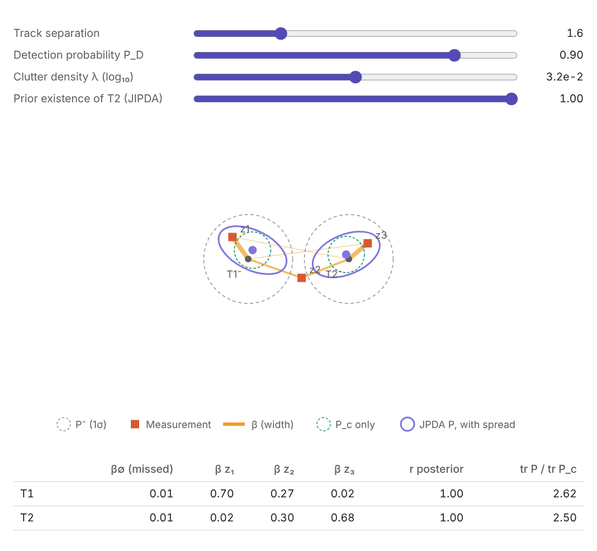

[Open standalone page](assets/42_jpda_jipda_spread_of_innovations.html)

<details><summary>Diagram source</summary>

````html
<h2 class="sr-only">Interactive JPDA and JIPDA update for two tracks and three measurements, showing association probabilities, updated means, the standard Kalman covariance and the inflated covariance that includes the spread-of-innovations term, plus posterior existence probabilities.</h2>
<style>
.r{display:flex;align-items:center;gap:12px;font-size:13px;color:var(--text-secondary);margin:6px 0}
.r label{width:200px}.r input{flex:1}.r output{width:64px;text-align:right;color:var(--text-primary);font-variant-numeric:tabular-nums}
table.b{width:100%;border-collapse:collapse;font-size:13px;margin-top:8px;font-variant-numeric:tabular-nums}
table.b th,table.b td{padding:6px 8px;border-bottom:0.5px solid var(--border);text-align:right;color:var(--text-primary);font-weight:400}
table.b th{color:var(--text-secondary);font-weight:500}table.b td:first-child,table.b th:first-child{text-align:left}
</style>
<div style="padding:0.5rem 0">
<div class="r"><label for="sep">Track separation</label><input id="sep" type="range" min="0.4" max="5" step="0.1" value="1.6"><output id="sepo"></output></div>
<div class="r"><label for="pd">Detection probability P_D</label><input id="pd" type="range" min="0.5" max="0.99" step="0.01" value="0.9"><output id="pdo"></output></div>
<div class="r"><label for="lc">Clutter density λ (log₁₀)</label><input id="lc" type="range" min="-3" max="0" step="0.1" value="-1.5"><output id="lco"></output></div>
<div class="r"><label for="r2">Prior existence of T2 (JIPDA)</label><input id="r2" type="range" min="0.05" max="1" step="0.01" value="1"><output id="r2o"></output></div>
<div id="pl"></div>
<table class="b"><thead><tr><th></th><th>β∅ (missed)</th><th>β z₁</th><th>β z₂</th><th>β z₃</th><th>r posterior</th><th>tr P / tr P_c</th></tr></thead><tbody id="tb"></tbody></table>
</div>
<script>
const $=i=>document.getElementById(i);
const p=0.5,Rv=0.1,s=p+Rv,GAM=9.21,PG=0.99,Kg=p/s,Pc=p*Rv/s;
const X=x=>340+75*x,Y=y=>175-75*y;
function ell(cx,cy,a,b,c,st){const m=(a+c)/2,d=Math.sqrt(((a-c)/2)**2+b*b),l1=m+d,l2=Math.max(m-d,1e-9),th=0.5*Math.atan2(2*b,a-c)*180/Math.PI;
return '<ellipse cx="'+X(cx).toFixed(1)+'" cy="'+Y(cy).toFixed(1)+'" rx="'+(75*Math.sqrt(l1)).toFixed(1)+'" ry="'+(75*Math.sqrt(l2)).toFixed(1)+'" transform="rotate('+(-th).toFixed(1)+' '+X(cx).toFixed(1)+' '+Y(cy).toFixed(1)+')" fill="none" '+st+'/>'}
function u(){
const sep=+$('sep').value,pd=+$('pd').value,lam=Math.pow(10,+$('lc').value),r2=+$('r2').value;
$('sepo').textContent=sep.toFixed(1);$('pdo').textContent=pd.toFixed(2);$('lco').textContent=lam.toExponential(1);$('r2o').textContent=r2.toFixed(2);
const T=[[-sep/2,0],[sep/2,0]],Z=[[-sep/2-0.25,0.35],[0.05,-0.3],[sep/2+0.3,0.25]],rp=[1,r2];
const N=T.map(t=>Z.map(z=>{const vx=z[0]-t[0],vy=z[1]-t[1],d2=(vx*vx+vy*vy)/s;return d2<GAM?Math.exp(-d2/2)/(2*Math.PI*s):0}));
const A=[[0,0,0],[0,0,0]],U=[0,0];let tot=0;
for(let a1=0;a1<4;a1++)for(let a2=0;a2<4;a2++){if(a1>0&&a1===a2)continue;let w=1;
[a1,a2].forEach((a,t)=>{w*=a===0?(1-rp[t]*pd*PG):rp[t]*pd*N[t][a-1]/lam});
tot+=w;[a1,a2].forEach((a,t)=>{if(a===0)U[t]+=w;else A[t][a-1]+=w})}
let svg='<svg width="100%" viewBox="0 0 680 400" role="img"><title>JPDA update geometry</title>',rows='';
const res=T.map((t,ti)=>{const Aa=A[ti].map(v=>v/tot),Uu=U[ti]/tot,f=rp[ti]*(1-pd*PG)/(1-rp[ti]*pd*PG);
const r=Aa.reduce((x,y)=>x+y,0)+Uu*f,b0=Uu*f/r,bj=Aa.map(v=>v/r);
const nu=Z.map(z=>[z[0]-t[0],z[1]-t[1]]);let mx=0,my=0;bj.forEach((b,j)=>{mx+=b*nu[j][0];my+=b*nu[j][1]});
let cxx=0,cxy=0,cyy=0;bj.forEach((b,j)=>{cxx+=b*nu[j][0]**2;cxy+=b*nu[j][0]*nu[j][1];cyy+=b*nu[j][1]**2});cxx-=mx*mx;cxy-=mx*my;cyy-=my*my;
const base=b0*p+(1-b0)*Pc,Pxx=base+Kg*Kg*cxx,Pxy=Kg*Kg*cxy,Pyy=base+Kg*Kg*cyy;
return{t,r,b0,bj,x:[t[0]+Kg*mx,t[1]+Kg*my],P:[Pxx,Pxy,Pyy],ratio:(Pxx+Pyy)/(2*Pc)}});
res.forEach(R=>{R.bj.forEach((b,j)=>{if(b>0.005)svg+='<line x1="'+X(R.t[0])+'" y1="'+Y(R.t[1])+'" x2="'+X(Z[j][0])+'" y2="'+Y(Z[j][1])+'" stroke="#EF9F27" stroke-width="'+(0.5+7*b).toFixed(2)+'" opacity="0.7" stroke-linecap="round"/>'})});
res.forEach(R=>{svg+=ell(R.t[0],R.t[1],p,0,p,'stroke="var(--border-stronger)" stroke-width="1" stroke-dasharray="4 3"')});
res.forEach(R=>{svg+=ell(R.x[0],R.x[1],Pc,0,Pc,'stroke="#1D9E75" stroke-width="1.2" stroke-dasharray="3 2"');svg+=ell(R.x[0],R.x[1],R.P[0],R.P[1],R.P[2],'stroke="#7F77DD" stroke-width="2"')});
res.forEach((R,i)=>{svg+='<circle cx="'+X(R.t[0])+'" cy="'+Y(R.t[1])+'" r="4" fill="var(--text-secondary)"/><text class="ts" x="'+(X(R.t[0])-8)+'" y="'+(Y(R.t[1])+18)+'" text-anchor="end" dominant-baseline="central">T'+(i+1)+'⁻</text>';
svg+='<circle cx="'+X(R.x[0])+'" cy="'+Y(R.x[1])+'" r="5" fill="#7F77DD"/>'});
Z.forEach((z,j)=>{svg+='<rect x="'+(X(z[0])-5)+'" y="'+(Y(z[1])-5)+'" width="10" height="10" fill="#D85A30"/><text class="ts" x="'+(X(z[0])+9)+'" y="'+(Y(z[1])-10)+'" dominant-baseline="central">z'+(j+1)+'</text>'});
svg+='<circle cx="60" cy="372" r="8" fill="none" stroke="var(--border-stronger)" stroke-dasharray="3 2"/><text class="ts" x="74" y="372" dominant-baseline="central">P⁻ (1σ)</text>';
svg+='<rect x="140" y="367" width="10" height="10" fill="#D85A30"/><text class="ts" x="158" y="372" dominant-baseline="central">Measurement</text>';
svg+='<line x1="250" y1="372" x2="276" y2="372" stroke="#EF9F27" stroke-width="4"/><text class="ts" x="284" y="372" dominant-baseline="central">β (width)</text>';
svg+='<circle cx="370" cy="372" r="8" fill="none" stroke="#1D9E75" stroke-dasharray="3 2"/><text class="ts" x="384" y="372" dominant-baseline="central">P_c only</text>';
svg+='<circle cx="470" cy="372" r="8" fill="none" stroke="#7F77DD" stroke-width="2"/><text class="ts" x="484" y="372" dominant-baseline="central">JPDA P, with spread</text></svg>';
$('pl').innerHTML=svg;
res.forEach((R,i)=>{rows+='<tr><td>T'+(i+1)+'</td><td>'+R.b0.toFixed(2)+'</td>'+R.bj.map(b=>'<td>'+b.toFixed(2)+'</td>').join('')+'<td>'+R.r.toFixed(2)+'</td><td>'+R.ratio.toFixed(2)+'</td></tr>'});
$('tb').innerHTML=rows;
}
['sep','pd','lc','r2'].forEach(i=>$(i).addEventListener('input',u));u();
</script>
````

</details>

Things to try:
- **Shrink the separation:** both tracks start sharing z₂, both updated means move toward it, and the purple ellipses stretch along the direction of disagreement. That stretching is the spread term. Push further and you get the start of coalescence.
- **Raise clutter:** β∅ grows, each update gets weaker, and P moves back toward P⁻.
- **Lower T2's prior existence:** T2's posterior r drops, and T2 competes less for shared measurements, so T1 takes a larger share of z₂.

---

#### 1. PDA for one track: the mixture posterior

The setup is a standard Kalman prediction plus a gate:

```
S = H P⁻ Hᵀ + R,     K = P⁻ Hᵀ S⁻¹,     ν_j = z_j − H x̂⁻,   j = 1…m (gated)
events:  θ_j = "z_j is the target, the rest are clutter"   (j = 1…m)
         θ_0 = "no measurement is from the target"
```

By the law of total probability, the posterior is a mixture with one component per event:

```
p(x | Z) = Σ_{j=0}^{m} β_j · p(x | θ_j, Z),        β_j = P(θ_j | Z)
θ_j (j ≥ 1):   x̂_j = x̂⁻ + K ν_j,     P_j = P_c = (I − K H) P⁻        ordinary Kalman update
θ_0:           x̂_0 = x̂⁻,             P_0 = P⁻                       no update
```

PDA collapses this mixture to a single Gaussian by moment matching. That is what keeps it tractable, and it is also its weakness.

**The mean** uses the β-weighted combined innovation:

```
x̂ = Σ_j β_j x̂_j = x̂⁻ + K ν̄,         ν̄ = Σ_{j≥1} β_j ν_j
```

**The covariance** follows from the mixture covariance identity, "within-component + between-component":

```
P = Σ_j β_j [ P_j + (x̂_j − x̂)(x̂_j − x̂)ᵀ ]
  = β_0 P⁻ + (1 − β_0) P_c + Σ_j β_j (x̂_j − x̂)(x̂_j − x̂)ᵀ
```

Every deviation is a gain times an innovation difference:

```
j ≥ 1:   x̂_j − x̂ = K (ν_j − ν̄)
j = 0:   x̂_0 − x̂ = −K ν̄               (the "no update" event has innovation 0)
```

So the between-component term is K times a covariance of innovations times Kᵀ:

```
Σ_{j≥1} β_j (ν_j − ν̄)(ν_j − ν̄)ᵀ + β_0 ν̄ ν̄ᵀ
  = Σ_{j≥1} β_j ν_j ν_jᵀ − 2(1−β_0) ν̄ν̄ᵀ + (1−β_0) ν̄ν̄ᵀ + β_0 ν̄ν̄ᵀ      [since Σ_{j≥1} β_j ν_j = ν̄]
  = Σ_{j≥1} β_j ν_j ν_jᵀ − ν̄ ν̄ᵀ
```

That gives the full PDA update:

```
P = β_0 P⁻  +  (1 − β_0) P_c  +  K [ Σ_{j≥1} β_j ν_j ν_jᵀ − ν̄ ν̄ᵀ ] Kᵀ
    └ missed ┘  └ detected ┘      └──────── spread of innovations, P̃ ────────┘
```

What each term means:
- **β₀P⁻:** probability that the target wasn't detected, times the un-updated uncertainty.
- **(1 − β₀)P_c:** probability that it was detected, times the ordinary Kalman uncertainty.
- **P̃ = K·Cov_β[ν]·Kᵀ:** the covariance of a discrete random innovation that equals ν_j with probability β_j and 0 with probability β₀. It is positive semidefinite, and it is the uncertainty about which measurement was the target, projected into state space through the gain.

Two consequences:
- P̃ is large only when probability is split between innovations that point in different directions. It is zero when one β dominates.
- P can exceed P⁻ along the direction of disagreement, as the widget's ellipses show. That is correct behavior: with ambiguous data, the state really is less certain after the update.

#### 2. The association probabilities β_j

Assume Poisson clutter with spatial density λ and a target-originated measurement density N(ν; 0, S)/P_G inside the gate. Take each event's likelihood relative to "everything is clutter" and cancel the common factors:

```
θ_j :  P_D P_G · N(ν_j; 0, S)/P_G  ÷  λ    =  P_D N(ν_j; 0, S) / λ
θ_0 :  1 − P_D P_G

β_j = P_D N_j / λ  ÷  [ (1 − P_D P_G) + Σ_k P_D N_k / λ ]
β_0 = (1 − P_D P_G) ÷  [ same ]
```

These are the MHT branch likelihood ratios from the previous answer, exp(ΔL), normalized across branches. PDA sums the MHT branches for one scan and then collapses them.

#### 3. JPDA: several tracks competing for measurements

With several tracks, a feasible joint event θ assigns each measurement to at most one track (or to clutter), and each track to at most one measurement:

```
P(θ | Z) ∝ Π_{(t, j) ∈ θ}  P_D^t N(ν_{j,t}; 0, S_t) / λ   ·   Π_{t unassigned in θ} (1 − P_D^t P_G)

β_{j,t} = Σ_{θ: j→t} P(θ | Z),          β_{0,t} = Σ_{θ: t unassigned} P(θ | Z)
```

Then each track runs the PDA update from section 1 with its own β_{·,t}. The only coupling between tracks is through the β values. A measurement that one track explains well becomes less available to the others.

Notes:
- **Complexity:** the number of joint events grows combinatorially. Practical implementations use clustering, K-best enumeration (Murty), or loopy belief propagation for the marginal association probabilities (Williams and Lau), which is fast and accurate.
- **Coalescence:** when tracks are close, their β values become symmetric, both means are pulled toward the shared measurements, and P̃ stretches along the line joining them. Without a hypothesis memory they merge. Variants such as JPDA* prune "swapped" hypotheses, and set JPDA drops the labeling that causes the merge.
- **Irreversibility:** collapsing to one Gaussian per scan throws away the multimodality that MHT would keep for N scans.

#### 4. JIPDA: adding existence to every track

JIPDA (Musicki and Evans) adds a Bernoulli existence variable to each track, with prior probability r⁻ predicted through a Markov chain (for example r⁻ = p_s·r).

**Single track (IPDA): posterior odds = prior odds × likelihood ratio**

```
Λ = p(Z | exists) / p(Z | not exists) = (1 − P_D P_G) + Σ_j P_D N_j / λ

r / (1 − r) = [ r⁻ / (1 − r⁻) ] · Λ        ⇔       r = Λ r⁻ / (1 − r⁻ + Λ r⁻)
β_j, β_0 : the PDA expressions above, conditioned on existence
```

ln Λ is the log-sum-exp of the MHT branch scores for this scan. IPDA's existence update is the soft, summed version of MHT's per-branch track score.

**Multiple tracks (JIPDA)**

Each track can only produce a measurement if it exists. The factor for an unassigned track has to cover two cases: the track doesn't exist, or it exists and was missed.

```
P(θ | Z) ∝ Π_{(t, j) ∈ θ}  r_t⁻ P_D N_{j,t} / λ   ·   Π_{t unassigned}  (1 − r_t⁻ P_D P_G)
                                                       └ (1 − r⁻) + r⁻(1 − P_D P_G) ┘
```

Existence and association posteriors then follow:

```
A_{j,t} = Σ_{θ: j→t} P(θ|Z),        U_t = Σ_{θ: t unassigned} P(θ|Z)
f_t     = r_t⁻ (1 − P_D P_G) / (1 − r_t⁻ P_D P_G)        P(exists | unassigned)

r_t     = Σ_j A_{j,t} + U_t · f_t
β_{j,t} = A_{j,t} / r_t,        β_{0,t} = U_t f_t / r_t     → PDA update (section 1) for the state
```

What existence changes:
- **A doubtful track can't steal measurements.** The r⁻ factor in its assignment terms down-weights its claim on shared measurements. Lower T2's prior existence in the widget and T1 gets a larger share of z₂.
- **Principled track management.** Confirm when r > τ_confirm, delete when r < τ_delete (with hysteresis), replacing the "M of N hits" heuristics.
- **Calibrated risk for planning.** r_t multiplies collision probability, so a tentative track still counts as a hazard in proportion to its existence.

#### 5. Where JPDA and JIPDA sit among the other filters

| Filter | Keeps | Discards |
|---|---|---|
| PDA / JPDA | One Gaussian per track; all association uncertainty folded into P̃ | Mixture structure, irreversibly, every scan |
| JIPDA | Same, plus existence r per track | Same, plus no model of never-detected objects |
| MHT | Branches for N scans | Existence as a probability (uses a score); undetected objects |
| PMBM | Branches, existence, and a Poisson intensity for undetected objects | Only what pruning removes |

Williams (2015) showed formally that JIPDA amounts to a multi-Bernoulli approximation, made by moment matching, of the PMBM's detected part, without the Poisson component. The spread term P̃ is exactly what that moment matching has to add so the collapsed Gaussian stays honest about the association uncertainty it removed.

**In one line:** the JPDA covariance is the moment-matched covariance of a mixture: the prior weighted by miss probability, the Kalman covariance weighted by detection probability, plus the gain-projected covariance of the possible innovations. JIPDA puts a Bernoulli existence probability on each track whose odds are multiplied by the scan's likelihood ratio, which also stops weakly supported tracks from claiming measurements.

Sources:
- [Musicki & Evans, Joint integrated probabilistic data association: JIPDA, IEEE TAES 2004 (doi:10.1109/TAES.2004.1337482)](https://doi.org/10.1109/TAES.2004.1337482)
- [Williams, Marginal multi-Bernoulli filters: RFS derivation of MHT, JIPDA and association-based MeMBer, arXiv:1203.2995](https://arxiv.org/abs/1203.2995)
- [Williams & Lau, Approximate evaluation of marginal association probabilities with belief propagation, arXiv:1209.6299](https://arxiv.org/abs/1209.6299)

---

<a id="turn-40"></a>
## 40. Softmax vs sigmoid gating in MoE routers and why gate weights are renormalized

> **Question:** Softmax vs sigmoid gating in MoE routers and why gate weights are renormalized

I answered this a few messages back, with the interactive comparison of the four gating schemes and the gradient breakdown. In short:

- **Same selection:** softmax and sigmoid choose the same top-k experts, because both are monotonic in the logit.
- **Softmax:** experts compete for a budget of 1.
- **Sigmoid:** each expert gets an independent score.
- **Renormalizing** over the selected experts keeps the output scale stable and separates DeepSeek-style balancing biases from the mixing weights. The cost is losing the router's absolute confidence, and at k = 1 the router's gradient through the gate disappears.

Rather than repeat that, I'll check those claims numerically with a short experiment.

**Code file: `moe_gating_check.py`** ([code/moe_gating_check.py](code/moe_gating_check.py))

````python
"""
Numerical checks of MoE gating claims: softmax vs sigmoid, with and without top-k renormalization.

Checks:
  1. Top-k selection is identical for softmax and sigmoid (both are monotonic in the logit).
  2. Output scale: how much sum(gates) varies from token to token under each scheme.
  3. Shift invariance: effect of adding a constant to every logit.
  4. Softmax top-k mass shrinks as the number of experts E grows; renormalization removes that.
  5. Router gradients (finite differences): which logits get gradient, and whether the
     common "scale" direction does. At k = 1, renormalized gates give zero router gradient.
  6. Balancing bias: changes which experts are selected, but the renormalized sigmoid
     gates are computed from unbiased scores, so mixture weights are not distorted.
"""

import numpy as np

rng = np.random.default_rng(0)


def softmax(s):
    e = np.exp(s - s.max(-1, keepdims=True))
    return e / e.sum(-1, keepdims=True)


def sigmoid(s):
    return 1.0 / (1.0 + np.exp(-s))


def gates(s, k, scheme, bias=None):
    """Return (selected indices, gate values) for one token's logits s (shape E)."""
    sel_score = s if bias is None else s + bias           # bias affects selection only
    idx = np.argsort(-sel_score)[:k]
    if scheme == "softmax_raw":
        g = softmax(s)[idx]
    elif scheme == "softmax_renorm":
        g = softmax(s[idx])                                # == renormalized top-k softmax
    elif scheme == "sigmoid_raw":
        g = sigmoid(s[idx])
    elif scheme == "sigmoid_renorm":
        g = sigmoid(s[idx]); g = g / g.sum()
    return idx, g


SCHEMES = ["softmax_raw", "softmax_renorm", "sigmoid_raw", "sigmoid_renorm"]

# ---------------------------------------------------------------- 1. selection identity
E, k, T = 256, 8, 2000
logits = rng.normal(0, 1.0, size=(T, E)) * rng.uniform(0.5, 2.0, size=(T, 1))   # tokens differ in sharpness
same = all(set(np.argsort(-softmax(s))[:k]) == set(np.argsort(-sigmoid(s))[:k]) for s in logits)
print(f"1) Top-{k} selection identical for softmax and sigmoid on {T} tokens: {same}")

# ---------------------------------------------------------------- 2. output scale variability
print(f"\n2) Σ gates per token (E={E}, k={k}); this is the MoE output's scale")
print(f"   {'scheme':<16} {'mean':>7} {'std':>7} {'min':>7} {'max':>7}")
for sc in SCHEMES:
    sums = np.array([gates(s, k, sc)[1].sum() for s in logits])
    print(f"   {sc:<16} {sums.mean():7.3f} {sums.std():7.3f} {sums.min():7.3f} {sums.max():7.3f}")

# ---------------------------------------------------------------- 3. shift invariance
s0 = logits[0]
print("\n3) Σ gates for one token as every logit is shifted by c")
print(f"   {'scheme':<16}" + "".join(f"{'c=' + str(c):>9}" for c in [-3, 0, 3]))
for sc in SCHEMES:
    vals = [gates(s0 + c, k, sc)[1].sum() for c in [-3, 0, 3]]
    print(f"   {sc:<16}" + "".join(f"{v:9.3f}" for v in vals))

# ---------------------------------------------------------------- 4. E scaling
print(f"\n4) Mean top-{k} softmax mass (raw) vs number of experts E")
for E_ in [8, 32, 128, 256, 1024]:
    if E_ < k:
        continue
    L = rng.normal(0, 1.0, size=(500, E_))
    mass = np.mean([np.sort(softmax(s))[-k:].sum() for s in L])
    print(f"   E={E_:>5}: {mass:.3f}   (renormalized: 1.000)")

# ---------------------------------------------------------------- 5. router gradients
print("\n5) Router gradient of a scalar loss through the gates (finite differences)")
E5, d = 16, 4
W_exp = rng.normal(size=(E5, d))            # stand-in expert outputs E_i(x) for one token
target = rng.normal(size=d)
s5 = rng.normal(size=E5)


def loss(s, k, sc):
    idx, g = gates(s, k, sc)
    y = (g[:, None] * W_exp[idx]).sum(0)
    return 0.5 * np.sum((y - target) ** 2)


def grad(s, k, sc, h=1e-6):
    gr = np.zeros_like(s)
    for i in range(len(s)):
        e = np.zeros_like(s); e[i] = h
        gr[i] = (loss(s + e, k, sc) - loss(s - e, k, sc)) / (2 * h)
    return gr


print(f"   {'scheme':<16} {'k':>2} {'|grad| selected':>16} {'|grad| unselected':>18} {'common-mode':>12}")
for kk in [1, 4]:
    idx_sel = np.argsort(-s5)[:kk]
    mask = np.zeros(E5, bool); mask[idx_sel] = True
    for sc in SCHEMES:
        g_ = grad(s5, kk, sc)
        # common-mode: directional derivative along adding the same constant to all selected logits
        cm = g_[mask].sum()
        print(f"   {sc:<16} {kk:>2} {np.abs(g_[mask]).sum():16.4f} {np.abs(g_[~mask]).sum():18.4f} {cm:12.4f}")

# ---------------------------------------------------------------- 6. balancing bias
print("\n6) Bias for load balancing (DeepSeek-V3 style): selection on σ(s)+b, gates from σ(s) renormalized")
s6 = rng.normal(size=E5)
b = np.zeros(E5); hot = np.argsort(-s6)[0]; b[hot] = -5.0          # push the hottest expert out
idx_nb, g_nb = gates(s6, 4, "sigmoid_renorm")
idx_b, g_b = gates(s6, 4, "sigmoid_renorm", bias=b)
print(f"   selected without bias: {sorted(idx_nb.tolist())}")
print(f"   selected with bias   : {sorted(idx_b.tolist())}   (expert {hot} pushed out)")
common = sorted(set(idx_nb) & set(idx_b))
ratio_nb = {i: g for i, g in zip(idx_nb, g_nb)}
ratio_b = {i: g for i, g in zip(idx_b, g_b)}
a, c = common[0], common[1]
print(f"   relative weight of experts {a}:{c} without bias {ratio_nb[a] / ratio_nb[c]:.4f}, "
      f"with bias {ratio_b[a] / ratio_b[c]:.4f}  (unchanged: bias never enters the gate)")
````

**Output of `python3 moe_gating_check.py`:**

````text
1) Top-8 selection identical for softmax and sigmoid on 2000 tokens: True

2) Σ gates per token (E=256, k=8); this is the MoE output's scale
   scheme              mean     std     min     max
   softmax_raw        0.275   0.140   0.074   0.836
   softmax_renorm     1.000   0.000   1.000   1.000
   sigmoid_raw        7.324   0.531   5.747   7.948
   sigmoid_renorm     1.000   0.000   1.000   1.000

3) Σ gates for one token as every logit is shifted by c
   scheme               c=-3      c=0      c=3
   softmax_raw         0.111    0.111    0.111
   softmax_renorm      1.000    1.000    1.000
   sigmoid_raw         1.436    6.456    7.905
   sigmoid_renorm      1.000    1.000    1.000

4) Mean top-8 softmax mass (raw) vs number of experts E
   E=    8: 1.000   (renormalized: 1.000)
   E=   32: 0.607   (renormalized: 1.000)
   E=  128: 0.288   (renormalized: 1.000)
   E=  256: 0.188   (renormalized: 1.000)
   E= 1024: 0.077   (renormalized: 1.000)

5) Router gradient of a scalar loss through the gates (finite differences)
   scheme            k  |grad| selected  |grad| unselected  common-mode
   softmax_raw       1           0.4236             0.4236       0.4236
   softmax_renorm    1           0.0000             0.0000       0.0000
   sigmoid_raw       1           0.7425             0.0000       0.7425
   sigmoid_renorm    1           0.0000             0.0000       0.0000
   softmax_raw       4           0.6724             0.2034       0.2034
   softmax_renorm    4           1.4848             0.0000      -0.0000
   sigmoid_raw       4           1.0727             0.0000       0.8895
   sigmoid_renorm    4           0.3279             0.0000      -0.0698

6) Bias for load balancing (DeepSeek-V3 style): selection on σ(s)+b, gates from σ(s) renormalized
   selected without bias: [1, 7, 9, 15]
   selected with bias   : [1, 8, 9, 15]   (expert 7 pushed out)
   relative weight of experts 1:9 without bias 0.8054, with bias 0.8054  (unchanged: bias never enters the gate)
````

The numbers in `moe_gating_check.py` back up the earlier explanation, apart from one nuance about sigmoid.

**Selection is identical:** across 2,000 tokens with 256 experts and top-8, softmax and sigmoid chose the same set of experts every time.

**Output scale per token** (Σ gates, which sets the size of the MoE output):

| Scheme | Mean | Std | Range |
|---|---|---|---|
| Softmax, raw | 0.28 | 0.14 | 0.07 – 0.84 |
| Sigmoid, raw | 7.3 | 0.53 | 5.7 – 7.9 |
| Either, renormalized | 1.00 | 0 | fixed |

- **Raw softmax** varies about 11× between tokens.
- **Raw sigmoid** jumps from 1.4 to 7.9 when every logit is shifted from −3 to +3. That shift sensitivity is the main reason sigmoid gating has to be renormalized.

**Raw softmax mass shrinks as experts are added:** the top-8 share falls from 1.0 with 8 experts to 0.61 with 32, 0.19 with 256, and 0.08 with 1,024. This is why fine-grained MoE can't use raw softmax gates.

**Router gradients** (finite differences):

| Scheme | Gradient to unselected experts | Gradient at k = 1 |
|---|---|---|
| Softmax, raw | Yes | Yes |
| Softmax, renormalized | None | Zero |
| Sigmoid, raw | None | Yes |
| Sigmoid, renormalized | None | Zero |

- **Raw softmax** is the only scheme that also lowers the logits of unselected experts. That is why Switch Transformer (k = 1) keeps raw gates.
- **Both renormalized schemes** give the router exactly zero gradient through the gate at k = 1.

**The nuance:** renormalized softmax ignores a shift that is added equally to every logit. Its gradient in that direction is exactly 0. Renormalized sigmoid does not. Its gate sum stays at 1, but a common shift still changes the ratios between experts, because the sigmoid flattens out at high values (gradient −0.07 in this run). So renormalizing fixes sigmoid's output scale but does not make it shift-invariant the way softmax is. My earlier wording ("relative only, scale fixed") was right about the scale and glossed over this.

**The balancing bias doesn't distort the gates:** pushing the busiest expert out with a −5 bias changed which experts were selected, but the weight ratio between two experts selected both times stayed at exactly 0.8054.

---

<a id="turn-41"></a>
## 41. How do MoE serving systems handle hot experts at inference, e.g. expert replication and placement?

> **Question:** How do MoE serving systems handle hot experts at inference, e.g. expert replication and placement?

An expert-parallel MoE layer finishes only when its slowest GPU finishes. At inference, traffic is skewed: a burst of code requests, say, makes a few experts in each layer hot, and there is no auxiliary loss acting at serving time to even things out. Serving systems fix this without changing the model. They change where the experts live and how many copies of each exist.

The simulation below has 32 experts on 8 GPUs with four slots each, plus optional spare slots. It compares three ways to place them:

**Diagram: `moe_expert_placement_replication_sim`** (interactive HTML widget)

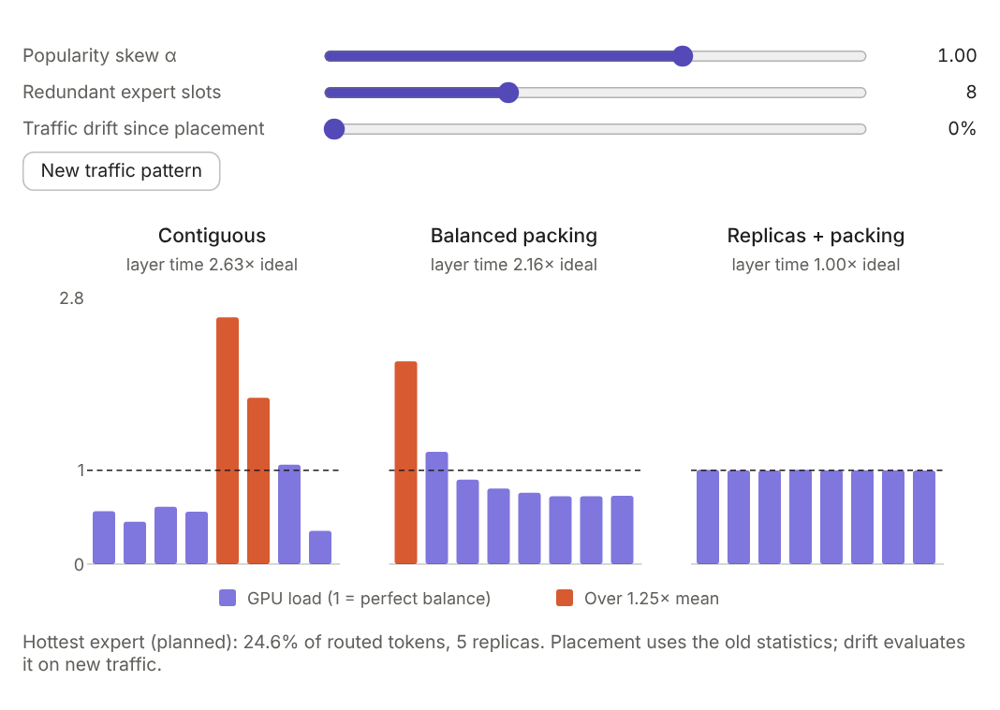

[Open standalone page](assets/43_moe_expert_placement_replication_sim.html)

<details><summary>Diagram source</summary>

````html
<h2 class="sr-only">Simulation of per-GPU load in an expert-parallel MoE layer with skewed expert popularity, comparing contiguous placement, balanced packing, and replication of hot experts plus packing, including the effect of traffic drift after placement.</h2>
<style>
.r{display:flex;align-items:center;gap:12px;font-size:13px;color:var(--text-secondary);margin:6px 0}
.r label{width:200px}.r input{flex:1}.r output{width:64px;text-align:right;color:var(--text-primary);font-variant-numeric:tabular-nums}
button.s{font:inherit;font-size:13px;padding:5px 12px;border-radius:var(--radius);border:0.5px solid var(--border-strong);background:var(--surface-2);color:var(--text-primary);cursor:pointer}
</style>
<div style="padding:0.5rem 0">
<div class="r"><label for="a">Popularity skew α</label><input id="a" type="range" min="0" max="1.5" step="0.05" value="1"><output id="ao"></output></div>
<div class="r"><label for="R">Redundant expert slots</label><input id="R" type="range" min="0" max="24" step="8" value="8"><output id="Ro"></output></div>
<div class="r"><label for="d">Traffic drift since placement</label><input id="d" type="range" min="0" max="1" step="0.05" value="0"><output id="dout"></output></div>
<div style="margin:6px 0"><button class="s" id="rs">New traffic pattern</button></div>
<div id="pl"></div>
<div id="note" style="font-size:13px;color:var(--text-secondary);margin-top:4px"></div>
</div>
<script>
const $=i=>document.getElementById(i);const E=32,G=8,S0=4;let seed=21,P1=[],P2=[];
function rng(s){return function(){s|=0;s=s+0x6D2B79F5|0;let t=Math.imul(s^s>>>15,1|s);t=t+Math.imul(t^t>>>7,61|t)^t;return((t^t>>>14)>>>0)/4294967296}}
function perm(R){const p=[...Array(E).keys()];for(let i=E-1;i>0;i--){const j=Math.floor(R()*(i+1));[p[i],p[j]]=[p[j],p[i]]}return p}
function init(){const R=rng(seed);P1=perm(R);P2=perm(R)}
function loads(P,a){const L=new Array(E).fill(0);P.forEach((e,r)=>L[e]=Math.pow(r+1,-a));const s=L.reduce((x,y)=>x+y,0);return L.map(v=>v*E/s)}
function u(){
const a=+$('a').value,R=+$('R').value,d=+$('d').value;
$('ao').textContent=a.toFixed(2);$('Ro').textContent=R;$('dout').textContent=(d*100).toFixed(0)+'%';
const L=loads(P1,a),L2=loads(P2,a),Ln=L.map((v,i)=>(1-d)*v+d*L2[i]);
const A=new Array(G).fill(0);for(let e=0;e<E;e++)A[Math.floor(e/S0)]+=Ln[e];
const order=[...Array(E).keys()].sort((x,y)=>L[y]-L[x]);
const pl=new Array(G).fill(0),cap=new Array(G).fill(S0),B=new Array(G).fill(0);
order.forEach(e=>{let g=-1;for(let k=0;k<G;k++)if(cap[k]>0&&(g<0||pl[k]<pl[g]))g=k;pl[g]+=L[e];cap[g]--;B[g]+=Ln[e]});
const rep=new Array(E).fill(1);for(let i=0;i<R;i++){let b=0;for(let e=1;e<E;e++)if(L[e]/rep[e]>L[b]/rep[b])b=e;rep[b]++}
const items=[];for(let e=0;e<E;e++)for(let k=0;k<rep[e];k++)items.push(e);items.sort((x,y)=>L[y]/rep[y]-L[x]/rep[x]);
const slots=S0+R/G,pc=new Array(G).fill(0),cc=new Array(G).fill(slots),host=[...Array(G)].map(()=>new Set()),C=new Array(G).fill(0);
items.forEach(e=>{let g=-1;for(let k=0;k<G;k++)if(cc[k]>0&&!host[k].has(e)&&(g<0||pc[k]<pc[g]))g=k;if(g<0)for(let k=0;k<G;k++)if(cc[k]>0&&(g<0||pc[k]<pc[g]))g=k;pc[g]+=L[e]/rep[e];cc[g]--;host[g].add(e);C[g]+=Ln[e]/rep[e]});
const mean=E/G,S=[['Contiguous',A],['Balanced packing',B],['Replicas + packing',C]].map(([n,v])=>[n,v.map(x=>x/mean)]);
const yM=Math.max(2,...S.flatMap(x=>x[1]))*1.08,Y=v=>260-v/yM*190;
let s='<svg width="100%" viewBox="0 0 680 300" role="img"><title>Per-GPU load under three placement strategies</title>';
S.forEach(([n,v],p)=>{const x0=50+p*215;const mx=Math.max(...v);
s+='<text class="th" x="'+(x0+85)+'" y="26" text-anchor="middle" dominant-baseline="central">'+n+'</text>';
s+='<text class="ts" x="'+(x0+85)+'" y="46" text-anchor="middle" dominant-baseline="central">layer time '+mx.toFixed(2)+'× ideal</text>';
v.forEach((x,g)=>{const bx=x0+g*22,by=Y(x);s+='<rect x="'+bx+'" y="'+by.toFixed(1)+'" width="16" height="'+(260-by).toFixed(1)+'" rx="2" fill="'+(x>1.25?'#D85A30':'#7F77DD')+'"/>'});
s+='<line x1="'+(x0-4)+'" y1="'+Y(1)+'" x2="'+(x0+176)+'" y2="'+Y(1)+'" stroke="var(--text-primary)" stroke-width="1" stroke-dasharray="4 3"/>';
s+='<line x1="'+(x0-4)+'" y1="260" x2="'+(x0+176)+'" y2="260" stroke="var(--border-stronger)" stroke-width="0.5"/>'});
s+='<text class="ts" x="44" y="'+Y(1)+'" text-anchor="end" dominant-baseline="central">1</text><text class="ts" x="44" y="260" text-anchor="end" dominant-baseline="central">0</text><text class="ts" x="44" y="'+Y(yM)+'" text-anchor="end" dominant-baseline="central">'+yM.toFixed(1)+'</text>';
s+='<rect x="140" y="278" width="12" height="12" rx="2" fill="#7F77DD"/><text class="ts" x="160" y="284" dominant-baseline="central">GPU load (1 = perfect balance)</text>';
s+='<rect x="380" y="278" width="12" height="12" rx="2" fill="#D85A30"/><text class="ts" x="400" y="284" dominant-baseline="central">Over 1.25× mean</text></svg>';
$('pl').innerHTML=s;
const hot=P1[0];$('note').textContent='Hottest expert (planned): '+(100*L[hot]/E).toFixed(1)+'% of routed tokens, '+rep[hot]+' replica'+(rep[hot]>1?'s':'')+'. Placement uses the old statistics; drift evaluates it on new traffic.';
}
$('rs').onclick=()=>{seed=Math.floor(Math.random()*1e9);init();u()};
['a','R','d'].forEach(i=>$(i).addEventListener('input',u));init();u();
</script>
````

</details>

Things to try:
- **No redundant slots:** packing helps, but it can't split one very hot expert. If a single expert carries more than one GPU's fair share of tokens, that GPU is a straggler no matter what else is placed beside it.
- **8–16 redundant slots:** load spreads across the replicas and layer time approaches ideal.
- **Raise traffic drift:** a placement computed from old statistics decays back toward imbalance. This is why systems re-plan periodically.

---

**1. The problem in one equation**

```
L_e      = tokens routed to expert e per step            (measured, per layer)
r_e      = number of replicas of e;   each replica gets L_e / r_e
load(g)  = Σ_{replicas on g} L_e / r_e
layer time ∝ max_g load(g)          ← the straggler sets the pace
goal:  min_{r, placement} max_g load(g)
       s.t.  Σ_e r_e = E + R  (slots),   ≤ slots per GPU,   topology constraints
```

At inference you can't drop tokens, since a capacity factor would change model outputs, and you shouldn't re-route them, since load-aware routing also changes outputs. Systems treat the routing decision as fixed and adjust the serving layout around it.

**2. Replicate, then pack (the EPLB recipe)**

```
1. estimate L_e      EMA of per-expert token counts, per layer, over a recent window
2. replicate         repeat R times:  r_{argmax_e L_e / r_e} += 1        (water-filling on max per-replica load)
3. pack              sort replicas by L_e / r_e, descending; assign each to the least-loaded GPU with a free slot,
                     preferring GPUs that don't already hold that expert              (LPT bin packing)
4. dispatch          each token for e goes to one replica: round-robin, nearest (same node), or least-loaded
```

- **Replication** addresses experts too hot to fit on one GPU.
- **Packing** addresses lumpy combinations of medium-hot experts.
- Together they are a greedy approximation to the min-max problem, and work well because loads are smooth and slots are plentiful.

DeepSeek open-sourced this as EPLB (Expert Parallelism Load Balancer). It has a hierarchical mode: it first packs expert groups onto nodes, consistent with node-limited routing, then replicates within nodes, then packs onto GPUs. It also has a global mode for when the group structure doesn't line up with the hardware.

**3. Placement is also about communication**

| Concern | Technique |
|---|---|
| Inter-node all-to-all is the bottleneck | Node-limited routing (each token's experts span at most M nodes); keep replicas within a node; prefer local replicas at dispatch |
| Experts co-activated across layers | Affinity-aware placement: if tokens that pick expert a at layer ℓ tend to pick b at ℓ+1, co-locate them to cut cross-GPU hops (research systems exploit this inter-layer affinity) |
| Shared experts | Compute on every GPU, or on dedicated GPUs; they are never hot or cold |
| Communication hidden behind compute | Overlap dispatch/combine all-to-all with expert GEMMs: two micro-batches interleaved, plus purpose-built kernels (DeepEP) |
| Variable tokens per expert | Dropless grouped GEMM (MegaBlocks style), so imbalance costs time rather than quality |

**4. Prefill and decode need different layouts**

| | Prefill | Decode |
|---|---|---|
| Bottleneck | Expert FLOPs (big token batches) | Memory bandwidth and all-to-all latency |
| What imbalance costs | Compute stragglers | Tail latency on every token |
| Typical layout | Moderate EP degree with a pool of redundant experts | Very wide EP, roughly one expert per GPU, plus dedicated GPUs for redundant and shared experts |

As reported in the DeepSeek-V3 paper:
- **Prefill:** 32 redundant experts, chosen from load statistics and re-planned periodically, on the order of every 10 minutes.
- **Decode:** each GPU hosts a single expert, and a separate group of GPUs holds redundant and shared experts.

Disaggregated serving (separate prefill and decode clusters) lets each cluster use the layout suited to its bottleneck.

**5. Keeping the layout current**

Traffic mix shifts with time of day, product, language and tenant, so placement is a control loop:

```
estimate   L̂_e ← (1−γ) L̂_e + γ · count_e            per layer;  EMA = a first-order low-pass filter
trigger    re-plan if  max/mean (predicted) > threshold  for T consecutive windows   (hysteresis)
migrate    copy new replicas in the background (expert ≈ tens of MB; NVLink/IB), then flip the routing table
cost model only migrate if  Δ(layer time) × expected duration > migration cost
```

- **Without hysteresis**, noisy statistics cause expert thrashing: copying weights back and forth for gains that disappear.
- **Faster dynamic redundancy**, choosing which replicas to activate per batch from a pool already resident on each GPU, is an active area. It trades extra resident memory for reaction speed.

**6. Single-device inference: the same problem as caching**

When the whole model doesn't fit, as with local offloading:
- **Keep hot experts in HBM** and cold ones in host memory: LFU/LRU caches, ideally one per layer.
- **Prefetch** the next layer's likely experts from the current hidden state, as discussed under why all experts must be in HBM.
- **Hit rate rules everything.** The hot-expert distribution is what makes caching work at all, but as the offload calculator showed, PCIe misses are about 50× more expensive than HBM hits.

**7. What not to do**

- **Dropping or capping tokens at serving time** changes outputs in ways that depend on the request mix. That is unacceptable for most products and quietly harms quality on whatever traffic is hottest.
- **Load-aware rerouting at inference** sends tokens to their next-best expert when the best one is busy. It is fast but changes the model function. Use it only if it was trained that way.
- **Equating balanced training with balanced serving.** Auxiliary-loss-free training balances load over the training distribution, and serving traffic is a different distribution.

**8. The estimation and control view**

| Serving component | Analogue |
|---|---|
| Per-expert EMA counts | Low-pass state estimate of a drifting load process |
| Replicate by max L/r | Water-filling resource allocation |
| LPT packing | Greedy approximation to makespan minimization (within 4/3 of optimal) |
| Re-plan with hysteresis | Event-triggered controller with a dead band |
| Stale-placement decay (drift slider) | Model mismatch growing between controller updates |

**In one line:** hot experts are handled by changing the layout, never the routing. Measure per-layer load, give the hottest experts extra replicas until no single replica dominates, pack replicas so every GPU carries a similar load (keeping traffic within a node where possible), use separate layouts for prefill and decode, and re-plan periodically with hysteresis as traffic drifts.

Sources:
- [DeepSeek-V3 Technical Report, arXiv:2412.19437](https://arxiv.org/abs/2412.19437)
- [DeepSeek EPLB (Expert Parallelism Load Balancer), GitHub](https://github.com/deepseek-ai/EPLB)
- [DeepEP expert-parallel communication library, GitHub](https://github.com/deepseek-ai/DeepEP)
- [MegaBlocks: Efficient Sparse Training with Mixture-of-Experts, arXiv:2211.15841](https://arxiv.org/abs/2211.15841)

---

<a id="turn-42"></a>
## 42. Explain the online softmax rescaling math used to merge attention partials

> **Question:** Explain the online softmax rescaling math used to merge attention partials

This is the core of FlashAttention, FlashDecoding and ring attention. It reduces to one idea: online softmax is ordinary summation where every partial sum carries its own exponent shift. Once you see that, the rescaling formulas, why they are exact, and why the merge can happen in any order all follow.

The interactive example below uses one query with 8 keys, split into two chunks. It compares the merged result against a naive float32 softmax.

**Diagram: `online_softmax_merge_worked_example`** (interactive HTML widget)

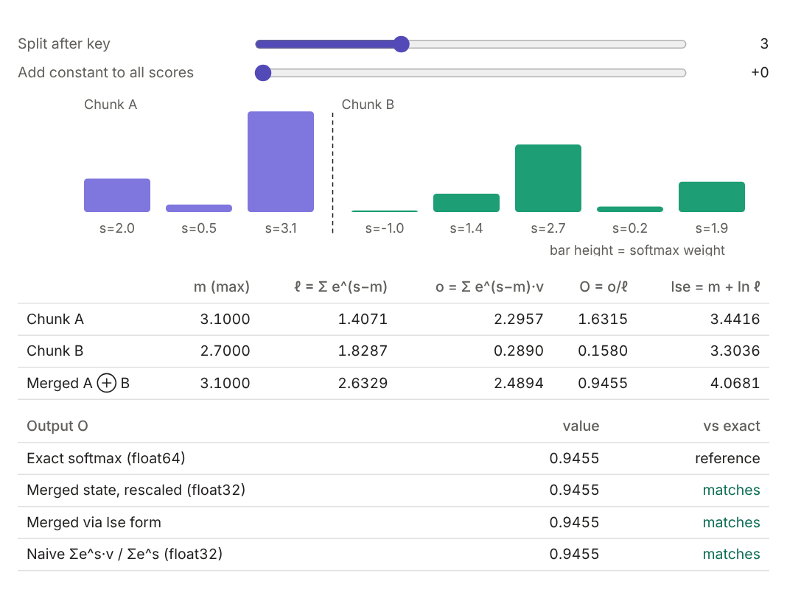

[Open standalone page](assets/44_online_softmax_merge_worked_example.html)

<details><summary>Diagram source</summary>

````html
<h2 class="sr-only">Worked example of online softmax: eight attention scores split into two chunks, each reduced to a running max, sum and unnormalized output, then merged by rescaling, compared with direct softmax and a naive float32 computation that overflows when scores are large.</h2>
<style>
.r{display:flex;align-items:center;gap:12px;font-size:13px;color:var(--text-secondary);margin:6px 0}
.r label{width:200px}.r input{flex:1}.r output{width:60px;text-align:right;color:var(--text-primary);font-variant-numeric:tabular-nums}
table.t{width:100%;border-collapse:collapse;font-size:13px;margin-top:10px;font-variant-numeric:tabular-nums}
table.t th,table.t td{padding:6px 8px;border-bottom:0.5px solid var(--border);text-align:right;color:var(--text-primary);font-weight:400}
table.t th{color:var(--text-secondary);font-weight:500}table.t td:first-child,table.t th:first-child{text-align:left}
.ok{color:var(--text-success)}.bad{color:var(--text-danger)}
</style>
<div style="padding:0.5rem 0">
<div class="r"><label for="k">Split after key</label><input id="k" type="range" min="1" max="7" value="3"><output id="ko"></output></div>
<div class="r"><label for="c">Add constant to all scores</label><input id="c" type="range" min="0" max="120" step="1" value="0"><output id="co"></output></div>
<div id="pl"></div>
<table class="t"><thead><tr><th></th><th>m (max)</th><th>ℓ = Σ e^(s−m)</th><th>o = Σ e^(s−m)·v</th><th>O = o/ℓ</th><th>lse = m + ln ℓ</th></tr></thead><tbody id="tb"></tbody></table>
<table class="t"><thead><tr><th>Output O</th><th>value</th><th>vs exact</th></tr></thead><tbody id="tb2"></tbody></table>
</div>
<script>
const $=i=>document.getElementById(i);const f=Math.fround;
const S0=[2.0,0.5,3.1,-1.0,1.4,2.7,0.2,1.9],V=[1.0,-0.5,2.0,0.3,-1.2,0.8,1.5,-0.7];
function chunk(s,v){let m=-Infinity;s.forEach(x=>m=Math.max(m,x));let l=f(0),o=f(0);s.forEach((x,i)=>{const p=f(Math.exp(f(x-m)));l=f(l+p);o=f(o+f(p*v[i]))});return{m,l,o}}
const fmt=x=>!isFinite(x)?(isNaN(x)?'NaN':(x>0?'∞':'−∞')):(Math.abs(x)>=1e4||(Math.abs(x)<1e-3&&x!==0)?x.toExponential(2):x.toFixed(4));
function u(){
const k=+$('k').value,c=+$('c').value;$('ko').textContent=k;$('co').textContent='+'+c;
const s=S0.map(x=>f(x+c));
const A=chunk(s.slice(0,k),V.slice(0,k)),B=chunk(s.slice(k),V.slice(k));
const m=Math.max(A.m,B.m),a=f(Math.exp(f(A.m-m))),b=f(Math.exp(f(B.m-m)));
const l=f(f(A.l*a)+f(B.l*b)),o=f(f(A.o*a)+f(B.o*b)),Om=f(o/l);
const lA=A.m+Math.log(A.l),lB=B.m+Math.log(B.l),mx=Math.max(lA,lB),lse=mx+Math.log(Math.exp(lA-mx)+Math.exp(lB-mx));
const Olse=Math.exp(lA-lse)*(A.o/A.l)+Math.exp(lB-lse)*(B.o/B.l);
let M=Math.max(...S0),Z=0,N=0;S0.forEach((x,i)=>{const p=Math.exp(x-M);Z+=p;N+=p*V[i]});const Ex=N/Z;
let nl=f(0),no=f(0);s.forEach((x,i)=>{const p=f(Math.exp(x));nl=f(nl+p);no=f(no+f(p*V[i]))});const Nv=f(no/nl);
const w=S0.map(x=>Math.exp(x-M)/Z);
let svg='<svg width="100%" viewBox="0 0 680 150" role="img"><title>Attention weights split into two chunks</title>';
const X0=60,bw=60,gap=14;
w.forEach((x,i)=>{const bx=X0+i*(bw+gap)+(i>=k?20:0),h=x*240;svg+='<rect x="'+bx+'" y="'+(110-h).toFixed(1)+'" width="'+bw+'" height="'+h.toFixed(1)+'" rx="3" fill="'+(i<k?'#7F77DD':'#1D9E75')+'"/><text class="ts" x="'+(bx+bw/2)+'" y="124" text-anchor="middle" dominant-baseline="central">s='+s[i].toFixed(1)+'</text>'});
const sx=X0+k*(bw+gap)+3;svg+='<line x1="'+sx+'" y1="20" x2="'+sx+'" y2="132" stroke="var(--text-primary)" stroke-width="1" stroke-dasharray="4 3"/>';
svg+='<text class="ts" x="'+(X0)+'" y="12" dominant-baseline="central">Chunk A</text><text class="ts" x="'+(sx+8)+'" y="12" dominant-baseline="central">Chunk B</text>';
svg+='<text class="ts" x="640" y="144" text-anchor="end" dominant-baseline="central">bar height = softmax weight</text></svg>';
$('pl').innerHTML=svg;
const row=(n,R)=>'<tr><td>'+n+'</td><td>'+fmt(R.m)+'</td><td>'+fmt(R.l)+'</td><td>'+fmt(R.o)+'</td><td>'+fmt(R.o/R.l)+'</td><td>'+fmt(R.m+Math.log(R.l))+'</td></tr>';
$('tb').innerHTML=row('Chunk A',A)+row('Chunk B',B)+'<tr><td>Merged A ⊕ B</td><td>'+fmt(m)+'</td><td>'+fmt(l)+'</td><td>'+fmt(o)+'</td><td>'+fmt(Om)+'</td><td>'+fmt(lse)+'</td></tr>';
const cmp=x=>isFinite(x)&&Math.abs(x-Ex)<1e-4?'<span class="ok">matches</span>':'<span class="bad">wrong ('+fmt(x)+')</span>';
$('tb2').innerHTML='<tr><td>Exact softmax (float64)</td><td>'+fmt(Ex)+'</td><td>reference</td></tr><tr><td>Merged state, rescaled (float32)</td><td>'+fmt(Om)+'</td><td>'+cmp(Om)+'</td></tr><tr><td>Merged via lse form</td><td>'+fmt(Olse)+'</td><td>'+cmp(Olse)+'</td></tr><tr><td>Naive Σe^s·v / Σe^s (float32)</td><td>'+fmt(Nv)+'</td><td>'+cmp(Nv)+'</td></tr>';
}
['k','c'].forEach(i=>$(i).addEventListener('input',u));u();
</script>
````

</details>

Things to try:
- **Move the split point:** the merged output stays the same whatever the split.
- **Add a constant above about 89 to every score:** the naive float32 version overflows to ∞/∞ = NaN, while the rescaled merge is still exact. Softmax is shift-invariant, so adding a constant to every score doesn't change the true answer, only the floating-point risk.

---

**0. The goal**

For one query row, with scores s_j = q·k_j/√d:

```
O = Σ_j softmax(s)_j v_j = Σ_j e^{s_j} v_j / Σ_j e^{s_j}
```

**1. Safe softmax: subtract the max**

```
O = Σ_j e^{s_j − m} v_j / Σ_j e^{s_j − m},       m = max_j s_j
```

- Every exponent is at most 0, so nothing overflows.
- The largest term is exactly 1, so the denominator is at least 1 and can't underflow to zero.
- The catch: you need the maximum before you can start. Done directly, that means three passes over the keys (max, sum, output), or holding the whole score row in memory.

**2. Online softmax: carry a state per subset of keys**

For any subset A of keys, such as a tile, a chunk or a GPU's shard:

```
m_A = max_{j∈A} s_j
ℓ_A = Σ_{j∈A} e^{s_j − m_A}             (sum, shifted by A's own max)
o_A = Σ_{j∈A} e^{s_j − m_A} v_j          (unnormalized output, same shift)
```

Every derivation step uses the single identity e^{s − m_A} = e^{s − m} · e^{m − m_A}. To merge two disjoint subsets, let m = max(m_A, m_B):

```
ℓ_{A∪B} = Σ_{A∪B} e^{s_j − m}
        = e^{m_A − m} Σ_A e^{s_j − m_A}  +  e^{m_B − m} Σ_B e^{s_j − m_B}
        = e^{m_A − m} ℓ_A  +  e^{m_B − m} ℓ_B

o_{A∪B} = e^{m_A − m} o_A  +  e^{m_B − m} o_B

O = o_{A∪B} / ℓ_{A∪B}          (normalize once, at the very end)
```

Both rescaling factors are e^{(something ≤ 0)}, so they lie in (0, 1]. The merge can never overflow, and the output of the merge is again a valid state.

**3. Why it is exact: shared-exponent summation**

Define the unshifted quantities:

```
L_A = ℓ_A · e^{m_A} = Σ_A e^{s_j}         Õ_A = o_A · e^{m_A} = Σ_A e^{s_j} v_j
```

In those terms the merge is plain addition: L_{A∪B} = L_A + L_B, and Õ_{A∪B} = Õ_A + Õ_B.

So the triple (m, ℓ, o) is a block-floating-point representation of the sums (L, Õ): m is a shared exponent, and ℓ and o are mantissas kept in a safe range. Rescaling by e^{m_A − m} is just aligning exponents before adding, like adding floating-point numbers by hand. Several consequences follow immediately:

- **Associative and commutative,** because addition is. Tiles, split-K chunks, trees across SMs and rings across GPUs all give the same result in real arithmetic.
- **An identity element exists:** (m, ℓ, o) = (−∞, 0, 0), the empty set, given the convention e^{−∞} = 0.
- **The states form a commutative monoid,** so any parallel reduction or scan applies.
- **In floating point,** different merge orders round differently, so results differ in the last bits. For bit-exact deterministic inference, fix the order and the number of splits.

**4. The log-sum-exp form used in kernels**

Kernels usually store the normalized output plus one scalar per chunk:

```
O_A = o_A / ℓ_A,          lse_A = m_A + ln ℓ_A = ln L_A
```

Merging in this form:

```
lse = ln(e^{lse_A} + e^{lse_B}) = M + ln(e^{lse_A − M} + e^{lse_B − M}),    M = max(lse_A, lse_B)
O   = (Õ_A + Õ_B) / (L_A + L_B) = e^{lse_A − lse} O_A + e^{lse_B − lse} O_B
```

Generalized to C chunks:

```
O = Σ_c softmax(lse)_c · O_c
```

Merging attention partials is itself attention over the chunks, with each chunk's log-sum-exp acting as its logit. FlashDecoding's second stage and ring attention's combine step are exactly this.

**5. Inside one kernel: the tile loop (FlashAttention-2 style)**

```
init  m = −∞, ℓ = 0, o = 0                                (fp32 registers)
for each K/V tile:
    S     = Q_tile K_tileᵀ / √d                           (or prescale by log₂e and use exp2)
    m_new = max(m, rowmax(S))
    P     = exp(S − m_new)                                (cast to bf16 for the PV matmul)
    α     = exp(m − m_new)                                rescale factor for the old state
    ℓ     = α·ℓ + rowsum(P)
    o     = α·o + P V_tile
    m     = m_new
O   = o / ℓ                                               deferred normalization: one division at the end
lse = m + log ℓ                                           saved for backward and for merges
```

The backward pass recomputes P = exp(S − lse) from the saved lse. It never stores the T × T probability matrix, which is how FlashAttention trades a little extra compute for O(T) memory.

**6. Edge cases that break real kernels**

| Case | Problem | Fix |
|---|---|---|
| Fully masked row or empty chunk (causal masking, padding) | m = −∞ gives e^{−∞ − (−∞)} = e^{NaN} | Treat as the identity: scale = 0 when m_A = −∞, and guard ℓ = 0 before dividing |
| Low-precision accumulators | Rescaling errors compound over many tiles | Keep m, ℓ and o in fp32; only P is cast to bf16 for the matmul |
| Precomputed or approximate max (FlashDecoding++) | A score far above the estimate overflows | Detect it and fall back to the exact rescaling path |
| Softcapping, ALiBi, attention sinks | Must be applied before the exp | Elementwise transforms of S are fine; sinks are extra keys with their own logit |
| Very long contexts with tiny weights | Underflow of e^{s − m} | Harmless: those weights are below fp32 resolution relative to the maximum |

**7. The same trick in particle filtering**

Particle filters normalize log-weights exactly the same way:

```
w_i ∝ exp(log w_i − max_k log w_k),      log Z = max + log Σ exp(log w_i − max)
```

Merging two particle sets, from parallel workers or separate hypothesis groups, is this ⊕ operator, with lse acting as each set's log-evidence (log normalizing constant). The weight given to each set is a softmax of the log-evidences, so a set with more evidence dominates. That is the same structure as section 4: attention partials are subsets of hypotheses (keys), and merging them is Bayesian combination of disjoint evidence.

**In one line:** each partial result stores a max m, a shifted sum ℓ and a shifted unnormalized output o. Together they form a shared-exponent representation of Σe^{s} and Σe^{s}v. Merging aligns exponents with factors e^{m_A − m} ≤ 1 and then adds, which is overflow-free, exact, associative and commutative. In log-sum-exp form, merging partials is just a softmax over the chunks' lse values.

Sources:
- [Milakov & Gimelshein, Online normalizer calculation for softmax, arXiv:1805.02867](https://arxiv.org/abs/1805.02867)
- [Dao, FlashAttention-2, arXiv:2307.08691](https://arxiv.org/abs/2307.08691)

---

<a id="turn-43"></a>
## 43. How are verifiers and reward signals built for agent RL environments?

> **Question:** How are verifiers and reward signals built for agent RL environments?

An RL environment for agents has three parts: a distribution of tasks, a sandbox the agent acts in, and a grader that turns the episode into a number. The grader is a noisy sensor of a hidden variable, whether the task was actually done. It also sits under optimization pressure, so any blind spot it has will be found by the policy. Building good rewards means engineering that sensor so it is accurate and hard to fool.

**Diagram: `agent_rl_environment_grader_architecture`** (static SVG diagram)

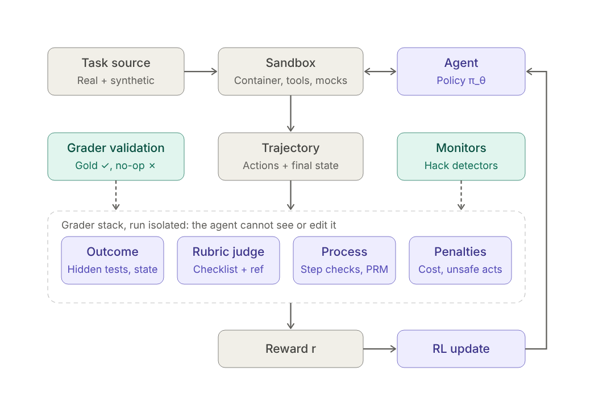

[Open standalone page](assets/45_agent_rl_environment_grader_architecture.html)

<details><summary>Diagram source</summary>

````svg
<svg width="100%" viewBox="0 0 680 440" role="img"><title>Agent RL environment and grader architecture</title><desc>Tasks are loaded into a sandbox where the agent policy acts and observes. The resulting trajectory and final state go to an isolated grader stack containing outcome checks, rubric judges, process signals and penalties. Grader validation and hack monitors feed the grader. The grader produces a reward that drives the RL update, which updates the agent policy.</desc>
<defs><marker id="arrow" viewBox="0 0 10 10" refX="8" refY="5" markerWidth="6" markerHeight="6" orient="auto-start-reverse"><path d="M2 1L8 5L2 9" fill="none" stroke="context-stroke" stroke-width="1.5" stroke-linecap="round" stroke-linejoin="round"/></marker></defs>
<g class="c-gray"><rect x="40" y="40" width="160" height="56" rx="8" stroke-width="0.5"/><text class="th" x="120" y="58" text-anchor="middle" dominant-baseline="central">Task source</text><text class="ts" x="120" y="78" text-anchor="middle" dominant-baseline="central">Real + synthetic</text></g>
<g class="c-gray"><rect x="240" y="40" width="170" height="56" rx="8" stroke-width="0.5"/><text class="th" x="325" y="58" text-anchor="middle" dominant-baseline="central">Sandbox</text><text class="ts" x="325" y="78" text-anchor="middle" dominant-baseline="central">Container, tools, mocks</text></g>
<g class="c-purple"><rect x="450" y="40" width="150" height="56" rx="8" stroke-width="0.5"/><text class="th" x="525" y="58" text-anchor="middle" dominant-baseline="central">Agent</text><text class="ts" x="525" y="78" text-anchor="middle" dominant-baseline="central">Policy π_θ</text></g>
<line x1="200" y1="68" x2="238" y2="68" class="arr" marker-end="url(#arrow)"/>
<line x1="412" y1="68" x2="448" y2="68" class="arr" marker-start="url(#arrow)" marker-end="url(#arrow)"/>
<g class="node c-teal" onclick="sendPrompt('How do you validate an RL grader: gold solutions, no-op baselines and flakiness checks?')"><rect x="40" y="140" width="160" height="56" rx="8" stroke-width="0.5"/><text class="th" x="120" y="158" text-anchor="middle" dominant-baseline="central">Grader validation</text><text class="ts" x="120" y="178" text-anchor="middle" dominant-baseline="central">Gold ✓, no-op ✗</text></g>
<g class="c-gray"><rect x="240" y="140" width="170" height="56" rx="8" stroke-width="0.5"/><text class="th" x="325" y="158" text-anchor="middle" dominant-baseline="central">Trajectory</text><text class="ts" x="325" y="178" text-anchor="middle" dominant-baseline="central">Actions + final state</text></g>
<g class="node c-teal" onclick="sendPrompt('How are reward hacking monitors built for agent RL training runs?')"><rect x="450" y="140" width="150" height="56" rx="8" stroke-width="0.5"/><text class="th" x="525" y="158" text-anchor="middle" dominant-baseline="central">Monitors</text><text class="ts" x="525" y="178" text-anchor="middle" dominant-baseline="central">Hack detectors</text></g>
<line x1="325" y1="96" x2="325" y2="138" class="arr" marker-end="url(#arrow)"/>
<line x1="325" y1="196" x2="325" y2="230" class="arr" marker-end="url(#arrow)"/>
<line x1="120" y1="196" x2="120" y2="230" class="arr" stroke-dasharray="4 3" marker-end="url(#arrow)"/>
<line x1="525" y1="196" x2="525" y2="230" class="arr" stroke-dasharray="4 3" marker-end="url(#arrow)"/>
<rect x="40" y="232" width="560" height="108" rx="12" fill="none" stroke="var(--border-strong)" stroke-width="0.75" stroke-dasharray="5 4"/>
<text class="ts" x="56" y="248" dominant-baseline="central">Grader stack, run isolated: the agent cannot see or edit it</text>
<g class="node c-purple" onclick="sendPrompt('How do you build robust programmatic outcome verifiers for coding and tool-use agent tasks?')"><rect x="56" y="262" width="120" height="56" rx="8" stroke-width="0.5"/><text class="th" x="116" y="280" text-anchor="middle" dominant-baseline="central">Outcome</text><text class="ts" x="116" y="300" text-anchor="middle" dominant-baseline="central">Hidden tests, state</text></g>
<g class="node c-purple" onclick="sendPrompt('How do you build reliable rubric-based LLM judges for RL rewards?')"><rect x="192" y="262" width="120" height="56" rx="8" stroke-width="0.5"/><text class="th" x="252" y="280" text-anchor="middle" dominant-baseline="central">Rubric judge</text><text class="ts" x="252" y="300" text-anchor="middle" dominant-baseline="central">Checklist + ref</text></g>
<g class="node c-purple" onclick="sendPrompt('How do process reward models give step-level credit in agent RL?')"><rect x="328" y="262" width="120" height="56" rx="8" stroke-width="0.5"/><text class="th" x="388" y="280" text-anchor="middle" dominant-baseline="central">Process</text><text class="ts" x="388" y="300" text-anchor="middle" dominant-baseline="central">Step checks, PRM</text></g>
<g class="node c-purple" onclick="sendPrompt('How should cost and safety penalties be combined with outcome rewards in agent RL?')"><rect x="464" y="262" width="120" height="56" rx="8" stroke-width="0.5"/><text class="th" x="524" y="280" text-anchor="middle" dominant-baseline="central">Penalties</text><text class="ts" x="524" y="300" text-anchor="middle" dominant-baseline="central">Cost, unsafe acts</text></g>
<line x1="325" y1="340" x2="325" y2="370" class="arr" marker-end="url(#arrow)"/>
<g class="c-gray"><rect x="240" y="372" width="170" height="44" rx="8" stroke-width="0.5"/><text class="th" x="325" y="394" text-anchor="middle" dominant-baseline="central">Reward r</text></g>
<g class="c-purple"><rect x="450" y="372" width="150" height="44" rx="8" stroke-width="0.5"/><text class="th" x="525" y="394" text-anchor="middle" dominant-baseline="central">RL update</text></g>
<line x1="410" y1="394" x2="448" y2="394" class="arr" marker-end="url(#arrow)"/>
<path d="M600 394 L625 394 L625 68 L602 68" fill="none" class="arr" marker-end="url(#arrow)"/>
</svg>
````

</details>

**Diagram: `reward_hacking_goodhart_dynamics`** (interactive HTML widget)

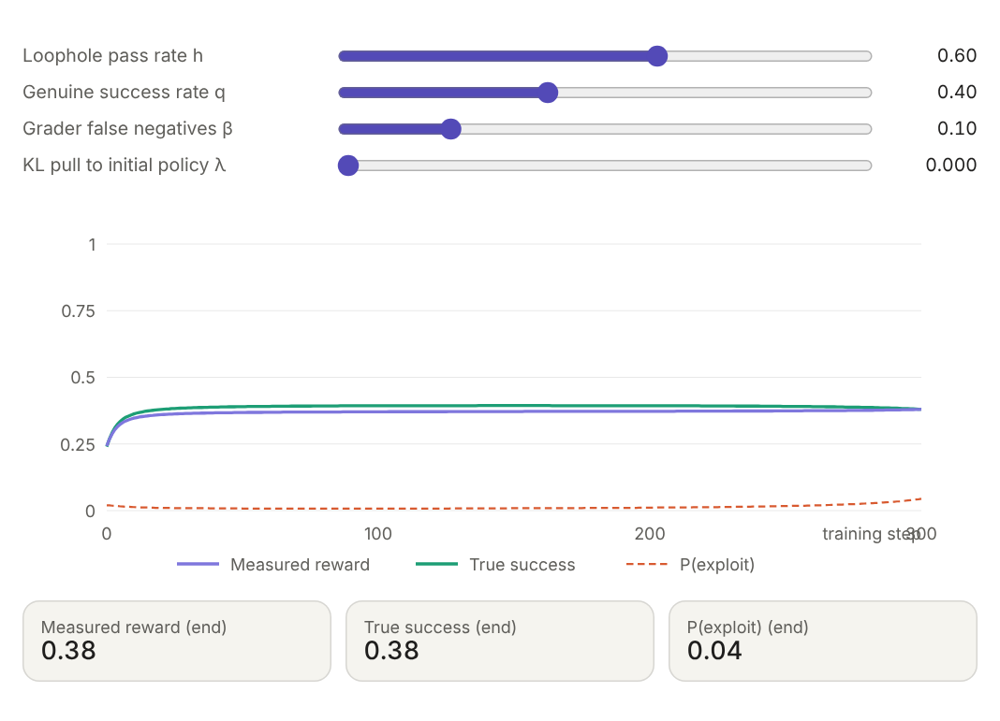

[Open standalone page](assets/46_reward_hacking_goodhart_dynamics.html)

<details><summary>Diagram source</summary>

````html
<h2 class="sr-only">Simulation of policy-gradient training against a grader with a loophole, showing measured reward rising while true task success falls when the loophole pays more than genuine attempts, and how false negatives and KL regularization change the outcome.</h2>
<style>
.r{display:flex;align-items:center;gap:12px;font-size:13px;color:var(--text-secondary);margin:6px 0}
.r label{width:210px}.r input{flex:1}.r output{width:60px;text-align:right;color:var(--text-primary);font-variant-numeric:tabular-nums}
.g{display:grid;grid-template-columns:repeat(auto-fit,minmax(140px,1fr));gap:10px;margin:10px 0 4px}
.c{background:var(--surface-1);border:0.5px solid var(--border);border-radius:12px;padding:10px 12px}
.c .k{font-size:12px;color:var(--text-secondary)}.c .v{font-size:18px;font-weight:500;color:var(--text-primary);font-variant-numeric:tabular-nums}
</style>
<div style="padding:0.5rem 0">
<div class="r"><label for="h">Loophole pass rate h</label><input id="h" type="range" min="0" max="1" step="0.01" value="0.6"><output id="ho"></output></div>
<div class="r"><label for="q">Genuine success rate q</label><input id="q" type="range" min="0.05" max="0.95" step="0.01" value="0.4"><output id="qo"></output></div>
<div class="r"><label for="b">Grader false negatives β</label><input id="b" type="range" min="0" max="0.5" step="0.01" value="0.1"><output id="bo"></output></div>
<div class="r"><label for="l">KL pull to initial policy λ</label><input id="l" type="range" min="0" max="0.2" step="0.005" value="0"><output id="lo"></output></div>
<div id="pl"></div>
<div class="g">
<div class="c"><div class="k">Measured reward (end)</div><div class="v" id="r1"></div></div>
<div class="c"><div class="k">True success (end)</div><div class="v" id="r2"></div></div>
<div class="c"><div class="k">P(exploit) (end)</div><div class="v" id="r3"></div></div>
</div>
</div>
<script>
const $=i=>document.getElementById(i);const AL=0.02,STEPS=300,ETA=2;
function u(){
const h=+$('h').value,q=+$('q').value,b=+$('b').value,l=+$('l').value;
$('ho').textContent=h.toFixed(2);$('qo').textContent=q.toFixed(2);$('bo').textContent=b.toFixed(2);$('lo').textContent=l.toFixed(3);
const R=[q*(1-b)+(1-q)*AL,h,AL];const th0=[Math.log(0.6),Math.log(0.02),Math.log(0.38)];let th=th0.slice();
const M=[],T=[],H=[];
for(let t=0;t<=STEPS;t++){const mx=Math.max(...th),e=th.map(x=>Math.exp(x-mx)),z=e[0]+e[1]+e[2],p=e.map(x=>x/z);
const Rb=p[0]*R[0]+p[1]*R[1]+p[2]*R[2];M.push(Rb);T.push(p[0]*q);H.push(p[1]);
th=th.map((x,a)=>x+ETA*(p[a]*(R[a]-Rb)-l*(x-th0[a])))}
const X=t=>60+t*580/STEPS,Y=v=>230-v*190;
let s='<svg width="100%" viewBox="0 0 680 280" role="img"><title>Measured reward vs true success during training</title>';
[0,0.25,0.5,0.75,1].forEach(v=>{s+='<line x1="60" y1="'+Y(v)+'" x2="640" y2="'+Y(v)+'" stroke="var(--border)" stroke-width="0.5"/><text class="ts" x="52" y="'+Y(v)+'" text-anchor="end" dominant-baseline="central">'+v+'</text>'});
for(let t=0;t<=STEPS;t+=100)s+='<text class="ts" x="'+X(t)+'" y="246" text-anchor="middle" dominant-baseline="central">'+t+'</text>';
const P=a=>a.map((v,t)=>(t?'L':'M')+X(t).toFixed(1)+' '+Y(v).toFixed(1)).join('');
s+='<path d="'+P(H)+'" fill="none" stroke="#D85A30" stroke-width="1.5" stroke-dasharray="5 3"/>';
s+='<path d="'+P(T)+'" fill="none" stroke="#1D9E75" stroke-width="2.2"/>';
s+='<path d="'+P(M)+'" fill="none" stroke="#7F77DD" stroke-width="2.2"/>';
s+='<line x1="110" y1="268" x2="140" y2="268" stroke="#7F77DD" stroke-width="2.2"/><text class="ts" x="148" y="268" dominant-baseline="central">Measured reward</text>';
s+='<line x1="280" y1="268" x2="310" y2="268" stroke="#1D9E75" stroke-width="2.2"/><text class="ts" x="318" y="268" dominant-baseline="central">True success</text>';
s+='<line x1="430" y1="268" x2="460" y2="268" stroke="#D85A30" stroke-width="1.5" stroke-dasharray="5 3"/><text class="ts" x="468" y="268" dominant-baseline="central">P(exploit)</text>';
s+='<text class="ts" x="640" y="246" text-anchor="end" dominant-baseline="central">training step</text></svg>';
$('pl').innerHTML=s;
$('r1').textContent=M[STEPS].toFixed(2);$('r2').textContent=T[STEPS].toFixed(2);$('r3').textContent=H[STEPS].toFixed(2);
}
['h','q','b','l'].forEach(i=>$(i).addEventListener('input',u));u();
</script>
````

</details>

Things to try:
- **Loophole pass rate above q(1−β):** the expected reward for a genuine attempt. Measured reward climbs while true success falls toward zero. Training looks like progress and is actually learning the exploit.
- **Loophole pass rate at 0, the effect of isolating the hidden tests:** true and measured reward rise together.
- **Raise false negatives:** an honest grader that misses real successes makes the exploit relatively more attractive. Noise and exploitability interact.
- **Raise the KL pull:** this slows the drift but does not reverse it. Regularization buys time; it is not a fix.

---

**1. Reward sources, from most to least trustworthy**

| Source | Examples | Precision | Coverage | Hackability |
|---|---|---|---|---|
| Programmatic outcome checks | Hidden unit tests; final-state assertions (DB rows, files, web or OS state); proof checkers; symbolic math equivalence | High | Narrow: only checkable tasks | Low if isolated; high if the agent can reach the checker |
| Simulated interactions | User simulators plus an end-state check (τ-bench style) | Medium | Multi-turn service tasks | The simulator itself can be gamed or led |
| Rubric LLM judges | Checklists, reference-guided grading, pairwise comparison | Medium | Broad: open-ended work | Verbosity, flattery, self-claims, injection aimed at the judge |
| Learned reward models | Bradley–Terry on preferences | Medium to low | Broad | Over-optimization as the RM is pushed away from its training data (Gao et al.) |
| Process signals | Step verifiers, PRMs, Monte Carlo step values | Varies | Long horizons | Step-format gaming |
| Shaping and penalties | Format, cost, tool-call budget, unsafe-action penalties | Exact | Auxiliary | Low, but can dominate outcome if mis-weighted |

**2. Building programmatic verifiers properly (the SWE-style recipe)**

```
task      = (repo snapshot, issue text, hidden tests)
tests     FAIL_TO_PASS : fail before the fix, pass after       ← the actual task
          PASS_TO_PASS : pass before and after                 ← no regressions
validate  gold patch passes all;  original code fails F2P;  no-op patch fails
flakiness run each test k times on gold and original; drop nondeterministic ones
isolate   grade in a FRESH container: copy only the agent's diff to non-test paths;
          restore test files, configs and harness from the pristine snapshot
```

The general principles carry over to other domains:
- **Check outcomes, not trajectories.** Assert on the final state (did the refund happen, does the file contain X), not on whether the agent followed a reference action sequence. Many valid paths exist.
- **Gold must pass, and null must fail.** A grader that a do-nothing agent can pass, or that the reference solution can fail, carries no signal.
- **Determinism.** Seed everything, freeze package versions, and replace external APIs with recorded or mocked services.
- **Math and structured answers:** normalize, then check symbolic or numeric equivalence (with tolerance) rather than matching strings.
- **Partial credit with care.** "Fraction of tests passed" gives a denser signal but invites special-casing the easy tests. Binary success with a good task distribution is often safer.

**3. When there is no programmatic check: rubric judges**

- **Decompose into a checklist** of concrete, checkable items rather than one holistic score. Score each item, then aggregate.
- **Use a reference answer or required evidence:** "cites the specific config line", "includes a reproducing test".
- **Show the judge the artifact, not the agent's narrative.** Strip the agent's self-assessment, such as "I verified all tests pass", which is the cheapest reward hack available against a judge.
- **Debias:** swap positions in pairwise comparisons, normalize for length, and use a judge at least as strong as the policy.
- **Calibrate against human labels** (track agreement), use an ensemble of judges or prompts, and audit samples regularly, especially the highest-scoring ones.
- **Prefer judges for sub-checks** ("is this function's docstring accurate?") and programmatic checks for anything they can cover.

**4. Composing the reward**

```
r = r_outcome  +  Σ small shaping terms  −  cost terms,     with safety as a constraint, not a trade-off
```

- **Potential-based shaping** (F = γΦ(s′) − Φ(s)) is the only form of shaping guaranteed not to change the optimal policy. Anything else, such as rewarding intermediate tool calls, can create new optima: the agent learns to call the tool.
- **Safety:** irreversible or out-of-scope actions (deleting data, network access outside an allowlist) should terminate the episode or be blocked by the sandbox. A finite penalty is a price the policy will learn to pay when the outcome reward is large enough.
- **Cost terms** (tokens, steps, wall-clock time) belong in the reward only once outcome success is reliable, or the policy learns that giving up is cheapest.

**5. Noise versus exploitability**

Treat the grader as a sensor with a confusion matrix:

```
P(r=1 | success) = 1 − β          P(r=1 | failure) = α
E[r] = α + (1 − α − β) · P(success)
```

- **Exploitation-proof noise** (α and β constant and independent of behavior) only rescales the signal by (1 − α − β) and adds variance. Learning is slower and needs more samples per group, but it heads in the right direction. Group baselines (GRPO, RLOO) cancel the constant α.
- **Exploitable errors** let the policy raise α for itself by finding inputs where the grader fails. The gradient then points toward the exploit, which is what the simulation shows.

So the aim is not a perfect grader. The aim is a grader whose remaining errors are random relative to the policy's behavior. That is why isolation and adversarial testing matter more than squeezing out the last few percent of accuracy.

**6. Hardening and monitoring**

| Defense | What it closes |
|---|---|
| Fresh-container grading, read-only test paths, diff filtering | Editing tests, harness or config |
| Hidden test variants and property-based tests | Special-casing visible inputs, hard-coded outputs |
| Red-teaming the grader: train or prompt an attacker policy to maximize reward without solving | Finds loopholes before your policy does |
| Trajectory monitors (classifiers or rules): test-file edits, `sys.exit(0)`, catching every exception, judge-directed text | Detects hacks that do pass |
| Track the reward vs held-out human-verified success gap | Catches Goodhart drift early (purple vs teal in the simulation) |
| KL to reference, early stopping on held-out evals | Limits over-optimization of learned or judge rewards |
| Periodic manual audits of top-reward episodes | High-reward outliers are where hacks concentrate |

**7. Curating the task distribution**

- **Difficulty filtering:** keep tasks where the current policy's pass@k is strictly between 0 and 1. All-pass and all-fail groups give zero gradient, as covered under dynamic sampling in the DAPO answer.
- **Curriculum:** move the filter as the policy improves, and generate harder variants (mutate tasks, compose subtasks).
- **Diversity:** many environments and task families stop the policy overfitting to one grader's quirks, and reduce the chance that a single exploit generalizes.
- **Contamination:** keep evaluation tasks disjoint from training repositories and issues.

**8. Physical-agent counterparts**

Robot RL faces the same problems:
- **Simulation:** success comes from privileged simulator state (exact object poses), the most trustworthy check available.
- **Real world:** learned success detectors or VLM judges on final frames are rubric judges, with the same false-positive risks, such as a gripper occluding the object convincingly enough.
- **Hacking:** simulators can be exploited too, for example through physics glitches that "teleport" objects. Validate simulator-trained policies on held-out simulators or real hardware.

**9. The sensing-and-integrity view**

This maps onto the earlier integrity-monitoring discussion:
- **The grader** is a sensor of latent success, with a measurement model given by the confusion matrix.
- **Unbiased noise** behaves like zero-mean measurement noise. More samples average it out.
- **Reward hacking** is adversarial manipulation of the sensor by the agent being measured, a fault the policy itself is optimizing toward.
- **Defenses** mirror integrity design: redundant independent sensors (tests plus judge plus monitor), solution separation (do independent checks agree?), and a protection-level mindset. Bound how wrong reward can be before trusting the training curve.

**In one line:** build rewards around isolated, final-state outcome checks validated so that gold solutions pass and no-ops fail. Use rubric judges only for what cannot be checked programmatically, and harden them. Treat every remaining grader error as something the policy will eventually find, so monitor the gap between measured reward and independently verified success throughout training.

Sources:
- [SWE-bench, arXiv:2310.06770](https://arxiv.org/abs/2310.06770)
- [τ-bench, arXiv:2406.12045](https://arxiv.org/abs/2406.12045)
- [OSWorld, arXiv:2404.07972](https://arxiv.org/abs/2404.07972)
- [Scaling Laws for Reward Model Overoptimization (Gao et al.), arXiv:2210.10760](https://arxiv.org/abs/2210.10760)
- [Let's Verify Step by Step, arXiv:2305.20050](https://arxiv.org/abs/2305.20050)
- [Math-Shepherd, arXiv:2312.08935](https://arxiv.org/abs/2312.08935)

---

<a id="turn-44"></a>
## 44. How are agent rollouts generated at scale for RL training?

> **Question:** How are agent rollouts generated at scale for RL training?

Agent RL at scale is a distributed system with four parts, each a different kind of workload:

- **Inference engines** that sample from the current policy (GPU-bound).
- **Thousands of sandboxes** where the agent's actions run (CPU-bound and slow).
- **Graders** that score finished episodes.
- **A learner** that updates the weights and pushes them back to the inference engines.

Two problems dominate: rollouts have very uneven lengths, and generation and training compete for time. Most of the engineering is about keeping every resource busy without letting the trained policy drift too far from the one that produced the data.

**Diagram: `agent_rl_rollout_system_architecture`** (static SVG diagram)

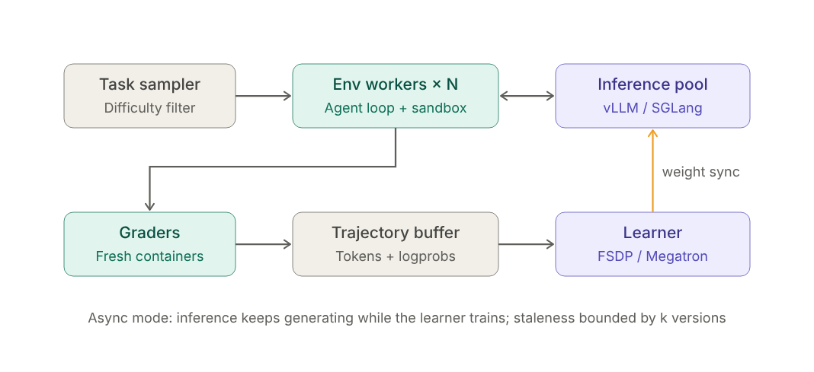

[Open standalone page](assets/47_agent_rl_rollout_system_architecture.html)

<details><summary>Diagram source</summary>

````svg
<svg width="100%" viewBox="0 0 680 290" role="img"><title>Rollout system architecture for agent RL</title><desc>A task sampler feeds environment workers that run the agent loop in sandboxes, requesting tokens from an inference pool. Finished episodes go to isolated graders, then into a trajectory buffer with behavior log-probabilities, then to the learner. The learner pushes updated weights back to the inference pool.</desc>
<defs><marker id="arrow" viewBox="0 0 10 10" refX="8" refY="5" markerWidth="6" markerHeight="6" orient="auto-start-reverse"><path d="M2 1L8 5L2 9" fill="none" stroke="context-stroke" stroke-width="1.5" stroke-linecap="round" stroke-linejoin="round"/></marker></defs>
<g class="c-gray"><rect x="40" y="40" width="150" height="56" rx="8" stroke-width="0.5"/><text class="th" x="115" y="58" text-anchor="middle" dominant-baseline="central">Task sampler</text><text class="ts" x="115" y="78" text-anchor="middle" dominant-baseline="central">Difficulty filter</text></g>
<g class="node c-teal" onclick="sendPrompt('How are sandbox fleets for agent RL built: snapshots, isolation, mocks and startup time?')"><rect x="240" y="40" width="180" height="56" rx="8" stroke-width="0.5"/><text class="th" x="330" y="58" text-anchor="middle" dominant-baseline="central">Env workers × N</text><text class="ts" x="330" y="78" text-anchor="middle" dominant-baseline="central">Agent loop + sandbox</text></g>
<g class="node c-purple" onclick="sendPrompt('How do inference engines like vLLM and SGLang serve multi-turn agent rollouts efficiently?')"><rect x="470" y="40" width="170" height="56" rx="8" stroke-width="0.5"/><text class="th" x="555" y="58" text-anchor="middle" dominant-baseline="central">Inference pool</text><text class="ts" x="555" y="78" text-anchor="middle" dominant-baseline="central">vLLM / SGLang</text></g>
<g class="c-teal"><rect x="40" y="170" width="150" height="56" rx="8" stroke-width="0.5"/><text class="th" x="115" y="188" text-anchor="middle" dominant-baseline="central">Graders</text><text class="ts" x="115" y="208" text-anchor="middle" dominant-baseline="central">Fresh containers</text></g>
<g class="c-gray"><rect x="240" y="170" width="180" height="56" rx="8" stroke-width="0.5"/><text class="th" x="330" y="188" text-anchor="middle" dominant-baseline="central">Trajectory buffer</text><text class="ts" x="330" y="208" text-anchor="middle" dominant-baseline="central">Tokens + logprobs</text></g>
<g class="node c-purple" onclick="sendPrompt('How are learner weights synced to inference engines in RL training, and how are FSDP and tensor-parallel layouts resharded?')"><rect x="470" y="170" width="170" height="56" rx="8" stroke-width="0.5"/><text class="th" x="555" y="188" text-anchor="middle" dominant-baseline="central">Learner</text><text class="ts" x="555" y="208" text-anchor="middle" dominant-baseline="central">FSDP / Megatron</text></g>
<line x1="190" y1="68" x2="238" y2="68" class="arr" marker-end="url(#arrow)"/>
<line x1="422" y1="68" x2="468" y2="68" class="arr" marker-start="url(#arrow)" marker-end="url(#arrow)"/>
<path d="M330 96 L330 130 L115 130 L115 168" fill="none" class="arr" marker-end="url(#arrow)"/>
<line x1="190" y1="198" x2="238" y2="198" class="arr" marker-end="url(#arrow)"/>
<line x1="420" y1="198" x2="468" y2="198" class="arr" marker-end="url(#arrow)"/>
<line x1="555" y1="170" x2="555" y2="98" class="arr" stroke="#EF9F27" marker-end="url(#arrow)"/>
<text class="ts" x="563" y="134" dominant-baseline="central">weight sync</text>
<text class="ts" x="340" y="262" text-anchor="middle" dominant-baseline="central">Async mode: inference keeps generating while the learner trains; staleness bounded by k versions</text>
</svg>
````

</details>

**Diagram: `sync_vs_async_rl_rollout_gantt`** (interactive HTML widget)

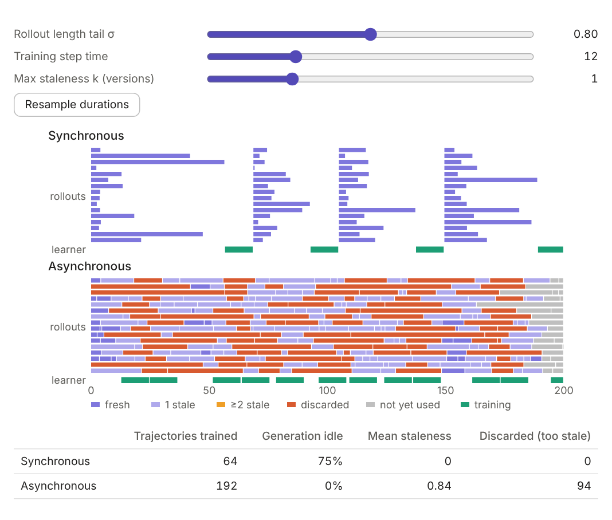

[Open standalone page](assets/48_sync_vs_async_rl_rollout_gantt.html)

<details><summary>Diagram source</summary>

````html
<h2 class="sr-only">Gantt-chart simulation of 16 rollout slots and a learner, comparing synchronous RL, where generation waits for the slowest rollout and pauses during training, with asynchronous RL, where generation continues and trajectories are used with bounded staleness.</h2>
<style>
.r{display:flex;align-items:center;gap:12px;font-size:13px;color:var(--text-secondary);margin:6px 0}
.r label{width:210px}.r input{flex:1}.r output{width:60px;text-align:right;color:var(--text-primary);font-variant-numeric:tabular-nums}
table.m{width:100%;border-collapse:collapse;font-size:13px;margin-top:8px;font-variant-numeric:tabular-nums}
table.m th,table.m td{padding:6px 8px;border-bottom:0.5px solid var(--border);text-align:right;color:var(--text-primary);font-weight:400}
table.m th{color:var(--text-secondary);font-weight:500}table.m td:first-child,table.m th:first-child{text-align:left}
button.s{font:inherit;font-size:13px;padding:5px 12px;border-radius:var(--radius);border:0.5px solid var(--border-strong);background:var(--surface-2);color:var(--text-primary);cursor:pointer}
</style>
<div style="padding:0.5rem 0">
<div class="r"><label for="sg">Rollout length tail σ</label><input id="sg" type="range" min="0.1" max="1.5" step="0.05" value="0.8"><output id="sgo"></output></div>
<div class="r"><label for="tt">Training step time</label><input id="tt" type="range" min="2" max="40" step="1" value="12"><output id="tto"></output></div>
<div class="r"><label for="k">Max staleness k (versions)</label><input id="k" type="range" min="0" max="4" step="1" value="1"><output id="ko"></output></div>
<div style="margin:6px 0"><button class="s" id="rs">Resample durations</button></div>
<div id="pl"></div>
<table class="m"><thead><tr><th></th><th>Trajectories trained</th><th>Generation idle</th><th>Mean staleness</th><th>Discarded (too stale)</th></tr></thead><tbody id="tb"></tbody></table>
</div>
<script>
const $=i=>document.getElementById(i);const S=16,B=16,HT=200,DT=0.25;let seed=13;
function rng(s){return function(){s|=0;s=s+0x6D2B79F5|0;let t=Math.imul(s^s>>>15,1|s);t=t+Math.imul(t^t>>>7,61|t)^t;return((t^t>>>14)>>>0)/4294967296}}
function g(r){let a=0,b=0;while(!a)a=r();while(!b)b=r();return Math.sqrt(-2*Math.log(a))*Math.cos(2*Math.PI*b)}
let Z=[];function init(){const R=rng(seed);Z=[];for(let i=0;i<4000;i++)Z.push(g(R))}
function u(){
const sg=+$('sg').value,T=+$('tt').value,k=+$('k').value;$('sgo').textContent=sg.toFixed(2);$('tto').textContent=T;$('ko').textContent=k;
const mu=Math.log(10)-sg*sg/2,D=Z.map(z=>Math.exp(mu+sg*z));
let t=0,i=0;const sb=[],stb=[];let sUsed=0,sBusy=0;
while(t<HT){let mx=0;for(let s=0;s<S;s++){const d=D[i++];sb.push({s,a:t,b:t+d,c:'#7F77DD'});sBusy+=Math.max(0,Math.min(t+d,HT)-t);mx=Math.max(mx,d)}
if(t+mx<=HT)sUsed+=B;stb.push([t+mx,t+mx+T]);t+=mx+T}
const slots=[];let j=0;const ab=[];for(let s=0;s<S;s++){const d=D[j++];slots.push({a:0,b:d,v:0});}
let v=0,training=false,busy=0,q=[],aUsed=0,disc=0,stal=0,aBusy=0;const atb=[];
for(let tt=0;tt<=HT;tt+=DT){
if(training&&tt>=busy){v++;training=false}
slots.forEach((sl,s)=>{if(tt>=sl.b){const bar={s,a:sl.a,b:sl.b,c:'var(--border-strong)'};ab.push(bar);q.push({v:sl.v,bar});aBusy+=Math.min(sl.b,HT)-sl.a;const d=D[j++];sl.a=sl.b;sl.b=sl.b+d;sl.v=v}});
if(!training){q=q.filter(x=>{if(v-x.v>k){x.bar.c='#D85A30';disc++;return false}return true});
if(q.length>=B){const take=q.splice(0,B);take.forEach(x=>{const st=v-x.v;stal+=st;x.bar.c=st===0?'#7F77DD':st===1?'#AFA9EC':'#EF9F27'});aUsed+=B;training=true;busy=tt+T;atb.push([tt,tt+T])}}}
slots.forEach((sl,s)=>{if(sl.a<HT){ab.push({s,a:sl.a,b:sl.b,c:'var(--border-strong)'});aBusy+=Math.min(sl.b,HT)-sl.a}});
const X=x=>90+Math.min(x,HT)*550/HT;
function panel(y0,title,bars,tb){let o='<text class="th" x="40" y="'+y0+'" dominant-baseline="central">'+title+'</text>';
bars.forEach(b=>{if(b.a>=HT)return;const y=y0+14+b.s*7;o+='<rect x="'+X(b.a).toFixed(1)+'" y="'+y+'" width="'+Math.max(0.6,X(b.b)-X(b.a)-0.8).toFixed(1)+'" height="5" fill="'+b.c+'"/>'});
const yl=y0+14+S*7+3;o+='<text class="ts" x="84" y="'+(y0+14+S*3.5)+'" text-anchor="end" dominant-baseline="central">rollouts</text><text class="ts" x="84" y="'+(yl+3)+'" text-anchor="end" dominant-baseline="central">learner</text>';
tb.forEach(([a,b])=>{if(a>=HT)return;o+='<rect x="'+X(a).toFixed(1)+'" y="'+yl+'" width="'+Math.max(0.6,X(b)-X(a)-0.8).toFixed(1)+'" height="7" fill="#1D9E75"/>'});return o}
let s='<svg width="100%" viewBox="0 0 680 340" role="img"><title>Rollout slots and learner over time</title>';
s+=panel(16,'Synchronous',sb,stb)+panel(168,'Asynchronous',ab,atb);
for(let x=0;x<=HT;x+=50)s+='<text class="ts" x="'+X(x)+'" y="312" text-anchor="middle" dominant-baseline="central">'+x+'</text>';
s+='<rect x="90" y="326" width="10" height="6" fill="#7F77DD"/><text class="ts" x="106" y="329" dominant-baseline="central">fresh</text><rect x="160" y="326" width="10" height="6" fill="#AFA9EC"/><text class="ts" x="176" y="329" dominant-baseline="central">1 stale</text><rect x="236" y="326" width="10" height="6" fill="#EF9F27"/><text class="ts" x="252" y="329" dominant-baseline="central">≥2 stale</text><rect x="318" y="326" width="10" height="6" fill="#D85A30"/><text class="ts" x="334" y="329" dominant-baseline="central">discarded</text><rect x="410" y="326" width="10" height="6" fill="var(--border-strong)"/><text class="ts" x="426" y="329" dominant-baseline="central">not yet used</text><rect x="520" y="326" width="10" height="6" fill="#1D9E75"/><text class="ts" x="536" y="329" dominant-baseline="central">training</text></svg>';
$('pl').innerHTML=s;
const pct=x=>(100*x).toFixed(0)+'%';
$('tb').innerHTML='<tr><td>Synchronous</td><td>'+sUsed+'</td><td>'+pct(1-sBusy/(S*HT))+'</td><td>0</td><td>0</td></tr><tr><td>Asynchronous</td><td>'+aUsed+'</td><td>'+pct(Math.max(0,1-aBusy/(S*HT)))+'</td><td>'+(aUsed?(stal/aUsed).toFixed(2):'—')+'</td><td>'+disc+'</td></tr>';
}
$('rs').onclick=()=>{seed=Math.floor(Math.random()*1e9);init();u()};
['sg','tt','k'].forEach(i=>$(i).addEventListener('input',u));init();u();
</script>
````

</details>

Things to try:
- **Heavy tail (σ around 1.2):** synchronous mode spends most of its time waiting for the one slow rollout in each batch. Asynchronous mode keeps every slot busy.
- **Longer training step:** the synchronous system idles completely during training. The asynchronous one keeps generating, but its trajectories get staler.
- **k = 0:** strictly on-policy asynchronous training throws away much of what it generates.
- **k = 1 or 2:** captures most of the throughput gain while bounding staleness.

---

**1. The pipeline**

```
sample task (filtered to pass@k ∈ (0,1)) → launch G rollouts sharing the prompt
rollout loop:   prompt → inference engine → action tokens → sandbox executes → observation → append → …
                until done | step limit | timeout
grade in a fresh container → (tokens, behavior logprobs, mask, reward, metadata) → buffer
learner: group advantages → clipped update → new weights → push to inference engines
```

**2. Synchronous vs asynchronous**

| | Synchronous (on-policy) | Asynchronous (bounded off-policy) |
|---|---|---|
| Generation during training | Stopped | Continues with old weights |
| Batch completes when | The slowest rollout finishes | Enough trajectories have arrived |
| Staleness | 0 | 0…k versions |
| Correction needed | None beyond PPO clipping | Importance weights against the behavior policy |
| Hardware | Often colocated: the same GPUs alternate between inference and training | Separate inference and training pools |

The off-policy correction records, at generation time, the log-probability μ(a|h) under the version that produced each token, then uses it in the ratio:

```
ρ_t = π_θ(a_t | h_t) / μ(a_t | h_t)                      μ = behavior policy (stale version)
L   = E[ min(ρ_t Â, clip(ρ_t, 1−ε, 1+ε) Â) ]             PPO clipping doubles as a staleness trust region
```

Refinements:
- **Decoupled PPO (AReaL style):** clip against a recent proximal policy while importance-weighting against the true behavior policy, so the trust region doesn't widen with staleness.
- **Truncated importance weights (V-trace / IMPALA lineage):** cap ρ to bound variance.
- **Partial rollouts (Kimi k1.5 style):** at a weight update, pause long in-flight rollouts and continue them under the new weights. One trajectory then spans several policy versions, each token carrying its own μ.

**3. Long-tail rollouts**

Agent episodes range from seconds to hours. Common mitigations:
- **Over-provision:** launch more groups than needed and take the first N that finish.
- **Asynchrony,** so stragglers stop blocking everyone.
- **Timeouts and step limits** with a consistent truncation policy. Either mask truncated episodes or count them as failures, but not a mix.
- **Interruptible or partial rollouts,** as above.
- **Length-aware scheduling:** start predicted-long tasks first so they overlap with many short ones.

**4. Inference-side efficiency**

- **Prefix caching:** the G samples of one task share the system prompt and task description, so compute that prefix's KV once (SGLang's radix cache, vLLM prefix caching).
- **Sticky sessions:** route every turn of a rollout to the same engine, so the conversation's KV cache survives across tool calls instead of being re-prefilled each turn.
- **Continuous batching:** keeps the GPU busy as individual requests finish or pause for tools.
- **Speculative decoding and prompt lookup:** agent outputs often copy tool output (file contents, paths), so n-gram drafts are accepted at high rates.

Tool latency is the hidden constraint. By Little's law, in-flight requests = throughput × latency. If a rollout spends only a fraction f of its wall-clock time waiting on the model:

```
concurrent rollouts needed ≈ engine batch slots / f
```

With f = 0.3 (70% of the time spent on tool execution), you need about 3.3× more live rollouts than the engine has batch slots, or the GPUs sit idle while sandboxes run.

**5. The sandbox fleet**

| Concern | Practice |
|---|---|
| Startup time | Snapshot and restore, pre-warmed pools, copy-on-write filesystem layers |
| Isolation | Agent-written code is untrusted: gVisor or Firecracker microVMs, no host mounts, an egress allowlist |
| Determinism | Pinned images and dependencies, seeded randomness, record-and-replay or mocked external APIs |
| Resource limits | CPU, memory, disk, process count and wall-clock caps per sandbox |
| Scale | Thousands to tens of thousands of concurrent containers, which is a large CPU fleet sitting next to the GPU cluster |

**6. Correctness pitfalls**

| Pitfall | Consequence | Fix |
|---|---|---|
| Re-tokenizing text between turns | Token boundaries change, so logprobs don't correspond to what was actually sampled | Token-in, token-out: train on the exact generated token IDs |
| Training on observations | The model learns to predict tool output and system text | Loss mask covering only model-generated tokens |
| Numerical mismatch between inference engine and trainer (kernels, FP8, batch invariance) | μ from the engine ≠ π_old in the trainer, so a silent off-policy bias | Recompute old logprobs in the trainer, or apply a truncated importance correction for the mismatch |
| Infrastructure failures scored as reward 0 | The policy is punished for crashed containers and API timeouts | Classify failures; retry or drop infra errors and never fold them into reward |
| Unlogged metadata | Results can't be reproduced or audited | Store task ID, seed, policy version, sandbox image hash and grader version per trajectory |

**7. Metrics to watch**

- **Throughput:** trajectories, tokens and environment steps per second.
- **Utilization:** inference GPUs, trainer GPUs, sandbox CPUs.
- **Staleness:** distribution of policy versions in each batch, and the fraction discarded.
- **Length and truncation:** episode length distribution and truncation rate, which should never quietly climb.
- **Infrastructure:** environment error rate, separate from agent failure rate.
- **Reward:** reward per task family, the share of all-pass and all-fail groups, and the gap between measured and verified success from the grader discussion.

**8. The control view**

Asynchronous RL is a feedback loop with delay:
- **Staleness** is measurement delay: the gradient is computed from data produced by an earlier controller.
- **Importance weighting** is delay compensation: re-weighting old observations to the current policy.
- **Bounded staleness k** is a latency budget. As in any delayed feedback loop, a delay too large relative to the update step (learning rate) destabilizes the system, so k and the learning rate have to be tuned together.

**In one line:** agent rollouts at scale run as an asynchronous actor–learner system. Inference engines with prefix and session caching serve many concurrent agent loops in isolated, snapshot-booted sandboxes. Graders score finished episodes in fresh containers. The learner trains on exact token IDs with recorded behavior logprobs and importance correction, within a staleness bound. Most of the throughput comes from never letting a long-tail episode or a training step stop generation.

Sources:
- [IMPALA (V-trace, decoupled actor–learner), arXiv:1802.01561](https://arxiv.org/abs/1802.01561)
- [HybridFlow / veRL, arXiv:2409.19256](https://arxiv.org/abs/2409.19256)
- [AReaL: asynchronous RL for language reasoning, arXiv:2505.24298](https://arxiv.org/abs/2505.24298)
- [Kimi k1.5 (partial rollouts), arXiv:2501.12599](https://arxiv.org/abs/2501.12599)
- [vLLM / PagedAttention, arXiv:2309.06180](https://arxiv.org/abs/2309.06180)
- [SGLang (RadixAttention), arXiv:2312.07104](https://arxiv.org/abs/2312.07104)

---

<a id="turn-45"></a>
## 45. How is web data co-training mixed with robot data in VLA training, and what ratios work?

> **Question:** How is web data co-training mixed with robot data in VLA training, and what ratios work?

Co-training means every training batch mixes robot trajectories with web vision-language examples. The web examples keep the backbone's priors anchored while the robot examples teach control. One caveat up front: published papers report qualitative findings and sometimes stage-level splits, but rarely an exact ratio. Use the numbers below as tested starting points for a sweep, not as constants.

The calculator below makes the mixing mechanics concrete. Temperature sampling across data sources sets the share of each batch and how many times each source is repeated:

**Diagram: `vla_cotraining_mixture_calculator`** (interactive HTML widget)


[Open standalone page](assets/49_vla_cotraining_mixture_calculator.html)

<details><summary>Diagram source</summary>

````html
<h2 class="sr-only">Calculator for VLA co-training data mixtures: temperature sampling over web, grounding, human video and robot data sources, with multipliers, showing each source's share of training examples and how many epochs it is repeated over a training budget.</h2>
<style>
.r{display:flex;align-items:center;gap:12px;font-size:13px;color:var(--text-secondary);margin:6px 0}
.r label{width:220px}.r input{flex:1}.r output{width:70px;text-align:right;color:var(--text-primary);font-variant-numeric:tabular-nums}
.row{display:grid;grid-template-columns:200px 1fr 56px 90px;gap:10px;align-items:center;font-size:13px;margin:6px 0}
.row .n{color:var(--text-primary)}.trk{height:18px;background:var(--surface-1);border:0.5px solid var(--border);border-radius:4px;overflow:hidden}
.trk div{height:100%;transition:width .15s}.num{text-align:right;font-variant-numeric:tabular-nums;color:var(--text-primary)}
.hdr{font-size:12px;color:var(--text-secondary)}
</style>
<div style="padding:0.5rem 0">
<div class="r"><label for="a">Sampling temperature α</label><input id="a" type="range" min="0" max="1" step="0.05" value="0.5"><output id="ao"></output></div>
<div class="r"><label for="wm">Web + grounding multiplier</label><input id="wm" type="range" min="0" max="2" step="0.05" value="1"><output id="wmo"></output></div>
<div class="r"><label for="tb">Target-robot boost</label><input id="tb" type="range" min="1" max="10" step="0.5" value="3"><output id="tbo"></output></div>
<div class="r"><label for="n">Training budget (examples)</label><input id="n" type="range" min="1.7" max="3.3" step="0.05" value="2.5"><output id="no"></output></div>
<div class="row hdr"><span>Source (size, M examples)</span><span>Share of training examples</span><span class="num">Share</span><span class="num">Epochs</span></div>
<div id="rows"></div>
<div id="sum" style="font-size:13px;color:var(--text-secondary);margin-top:8px"></div>
<div style="font-size:12px;color:var(--text-secondary);margin-top:4px">p_i ∝ m_i · n_i^α. α = 1 samples in proportion to size; α = 0 samples every source equally. Sizes are illustrative.</div>
</div>
<script>
const $=i=>document.getElementById(i);
const SRC=[['Web VQA / captions',200,'#7F77DD','w'],['Spatial grounding / pointing',10,'#AFA9EC','w'],['Human video (latent actions)',30,'#CECBF6','v'],['Cross-embodiment robot',20,'#5DCAA5','r'],['Target robot',1,'#1D9E75','t']];
function u(){
const a=+$('a').value,wm=+$('wm').value,tb=+$('tb').value,N=Math.pow(10,+$('n').value);
$('ao').textContent=a.toFixed(2);$('wmo').textContent='×'+wm.toFixed(2);$('tbo').textContent='×'+tb.toFixed(1);$('no').textContent=N>=1000?(N/1000).toFixed(1)+'B':Math.round(N)+'M';
const w=SRC.map(([,n,,k])=>Math.pow(n,a)*(k==='w'?wm:k==='t'?tb:1)),Z=w.reduce((x,y)=>x+y,0)||1,p=w.map(x=>x/Z);
$('rows').innerHTML=SRC.map(([nm,n,c],i)=>{const ep=p[i]*N/n,hot=ep>50;return '<div class="row"><span class="n">'+nm+' ('+n+')</span><div class="trk"><div style="width:'+(p[i]*100).toFixed(1)+'%;background:'+c+'"></div></div><span class="num">'+(p[i]*100).toFixed(1)+'%</span><span class="num" style="'+(hot?'color:var(--text-warning)':'')+'">'+(ep<0.1?ep.toFixed(2):ep.toFixed(1))+(hot?' ⚠':'')+'</span></div>'}).join('');
const non=p[0]+p[1]+p[2],rob=p[3]+p[4];
$('sum').textContent='Non-robot share '+(non*100).toFixed(0)+'% · robot share '+(rob*100).toFixed(0)+'% · target robot '+(p[4]*100).toFixed(1)+'%'+(p[4]*N/1>50?' · ⚠ target data repeated more than 50×: watch for memorization':'');
}
['a','wm','tb','n'].forEach(i=>$(i).addEventListener('input',u));u();
</script>
````

</details>

Things to try:
- **α = 1 (proportional):** web data dominates and the small target-robot set barely appears.
- **α = 0 (uniform):** a 1M-example robot set gets repeated hundreds of times.
- **Web multiplier at 0:** shows what dropping co-training means for the mixture.

Temperature α plus a few per-source multipliers is how most teams parameterize the mix in practice.

---

**1. Why co-train at all (what has been reported)**

- **RT-2:** co-fine-tuning on web data plus robot data generalized better to novel objects, backgrounds and semantic instructions than fine-tuning on robot data alone. The authors increased the sampling weight of robot data so each batch stayed balanced against the much larger web corpus.
- **π0.5:**
  - Ablations reported that removing web data mainly hurt generalization to unseen objects and instruction following.
  - Removing cross-embodiment robot data hurt performance more broadly.
  - The paper reports that the large majority of first-stage training examples (about 97.6%) did not come from the target mobile-manipulation setting. A small target fraction is enough when the rest of the mixture is relevant.
- **Knowledge insulation (KI) work:** co-training combined with a stop-gradient on the action expert preserved language following better than co-training alone.

The pattern is consistent: web data mostly buys semantic and out-of-distribution generalization, cross-embodiment robot data buys general motor competence, and target data buys precision on your robot.

**2. Mixing mechanics**

```
sampling     p_i ∝ m_i · n_i^α          per source i;  α ≈ 0.3–0.7 is common;  m_i = manual multipliers
batching     stratified: every batch contains several sources   (more stable than alternating whole batches)
losses       web:   next-token CE on answer tokens
             robot: action loss (FAST-token CE and/or flow matching) + optional text targets (subtasks)
total        L = Σ_i λ_i · L_i,   each L_i normalized per token (or per example) consistently
```

Details that matter more than the headline ratio:
- **Count tokens, not examples.** A VQA example has a few answer tokens, while a robot chunk may have hundreds of action tokens. A 50/50 split by examples can be 95/5 by gradient mass. Balance by token count, or set λ per source.
- **Unify formats.** Use the same image resolution and number of camera views, templated prompts, and phrase robot data as instructions. Otherwise the model learns "this camera means action mode" as a shortcut.
- **Separate output paths.** Web examples train the language head and robot examples train the action head. With KI, the action loss doesn't reach the backbone at all, so web data only has to prevent drift from the discrete-token and text losses. That makes the ratio far less sensitive.
- **Optimizer state is shared.** A source with very different gradient scale can dominate Adam's moment estimates. Watch per-source gradient norms.

**3. Which web data helps, from least to most robot-relevant**

```
generic captions  <  VQA  <  grounding: boxes, pointing, affordances  <  egocentric / embodied reasoning
                  <  robot-adjacent text: subtask prediction, verbal instructions, success judgments
                  +  human video with latent or pseudo actions (bridges vision to action without robot hardware)
```

At equal compute, spatially grounded and embodied data does more for manipulation than generic captions. This is why recent systems add pointing, affordance and embodied-reasoning datasets rather than just more caption data. Human video becomes action-relevant through latent action models or inverse-dynamics pseudo-labels (LAPA-style).

**4. Ratios: what works as a starting point**

These are working heuristics, not published constants. Treat them as the centre of a sweep.

| Stage | Web + grounding (by examples) | Robot | Notes |
|---|---|---|---|
| Pretraining (broad) | ~20–50% | ~50–80%, with the target upsampled via α ≈ 0.3–0.5 | Higher web share if you need open-vocabulary objects and instructions |
| Post-training (target tasks) | ~5–20% replay | ~80–95%, mostly target | Replay prevents forgetting; KI or LoRA reduce the replay needed |
| With KI / stop-gradient | Lower end works | | The backbone is protected structurally, not just statistically |

Checks against repeating data too much:
- **Target robot data repeated more than tens of epochs** suggests memorization risk. Collect more data or rely on augmentation and cross-embodiment data.
- **Web data at a small fraction of one epoch** is fine. Web corpora are there for coverage, not repetition.

**5. Finding your ratio empirically**

1. **Sweep** the web fraction, for example {0, 0.1, 0.25, 0.5}, on a smaller proxy model or a shorter schedule.
2. **Measure on two axes:**
   - robot success, split into in-distribution vs unseen objects and instructions;
   - retained vision-language ability (VQA, grounding, instruction probes).
3. **Plot the Pareto front.** The right ratio is a product decision about where on it you want to sit.
4. **Fit or learn the mixture:**
   - data-mixing laws: fit loss as a function of the proportions and extrapolate;
   - DoReMi-style or group-DRO reweighting: learn weights that minimize worst-case excess loss across sources. Robot-specific variants exist (for example Re-Mix over Open X-Embodiment).
5. **Watch interference signals:** cosine similarity between per-source gradients, and per-source validation loss over training. A source whose validation loss rises while others fall is being overwritten.

**6. Failure modes by direction**

| Too little web data | Too much web data |
|---|---|
| VQA and grounding probes drop | Action loss converges slowly; less precise motion |
| Fails on novel objects or rephrased instructions | Weaker use of proprioception and wrist views |
| Language following collapses to visual habits | The model "describes" instead of acting, if heads share outputs |
| | Repeated small target set gets too little weight, producing robot-specific errors |

**7. A data-assimilation analogy**

Co-training weights act like the balance between background and observation terms in variational assimilation:

```
J(θ) = λ_web · L_web(θ)  +  λ_robot · L_robot(θ)
  ≈    ‖θ − θ_prior‖²_{B⁻¹}  +  ‖y_robot − h(θ)‖²_{R⁻¹}
```

Web data plays the role of the background term, keeping the solution near the pretrained prior, and robot data is the observation term. The mixing ratio is the B/R trade-off. Too little background weight overfits narrow observations; too much ignores them. Sweeping the ratio and picking from the Pareto front is the same as tuning error covariances against held-out innovation statistics. Stop-gradient designs like KI correspond to removing the observation operator's direct path into the background state.

**In one line:** mix web, grounding and robot sources in every batch, using temperature sampling plus per-source multipliers and balancing by tokens rather than examples. Start around 20–50% non-robot data in pretraining and 5–20% replay in post-training (lower if the backbone is insulated with a stop-gradient). Then sweep the ratio and choose from the measured trade-off between robot success and retained vision-language ability, favoring spatial and embodied web data over generic captions.

Sources:
- [RT-2, arXiv:2307.15818](https://arxiv.org/abs/2307.15818)
- [π0.5, arXiv:2504.16054](https://arxiv.org/abs/2504.16054)
- [Knowledge Insulating VLA Models, arXiv:2505.23705](https://arxiv.org/abs/2505.23705)
- [Open X-Embodiment, arXiv:2310.08864](https://arxiv.org/abs/2310.08864)
- [DoReMi: Optimizing Data Mixtures, arXiv:2305.10429](https://arxiv.org/abs/2305.10429)
- [Data Mixing Laws, arXiv:2403.16952](https://arxiv.org/abs/2403.16952)

---

<a id="turn-46"></a>
## 46. How are vision encoder, projector and LLM layers handled when fine-tuning a VLM into a VLA: freeze, LoRA or full fine-tune?

> **Question:** How are vision encoder, projector and LLM layers handled when fine-tuning a VLM into a VLA: freeze, LoRA or full fine-tune?

The usual answer is to treat each component differently. Train the parts that carry the new robotics signal (the projector, the action head and new token embeddings). Protect the parts that carry pretrained knowledge (the LLM's language ability) with freezing, LoRA, a reduced learning rate or co-training. The vision encoder is the main surprise: it usually needs to train, at a reduced learning rate.

The matrix below shows a common progression across training stages:

**Diagram: `vla_finetuning_freeze_lora_matrix`** (static SVG diagram)


[Open standalone page](assets/50_vla_finetuning_freeze_lora_matrix.html)

<details><summary>Diagram source</summary>

````svg
<svg width="100%" viewBox="0 0 680 395" role="img"><title>Which VLA components to freeze, LoRA or fully train at each stage</title><desc>A matrix of five components by three stages. Stage 0 alignment freezes the vision encoder and LLM and trains the projector and new embeddings. Stage 1 robot pretraining trains the vision encoder at reduced learning rate, fully fine-tunes the projector and LLM with co-training, and trains the action expert from scratch. Stage 2 task adaptation uses LoRA on the LLM and LoRA or freezing for the vision encoder, while the projector, new embeddings and action expert keep training.</desc>
<g class="c-gray"><rect x="200" y="40" width="140" height="44" rx="8" stroke-width="0.5"/><text class="th" x="270" y="54" text-anchor="middle" dominant-baseline="central">Stage 0</text><text class="ts" x="270" y="72" text-anchor="middle" dominant-baseline="central">Modality alignment</text></g>
<g class="c-gray"><rect x="350" y="40" width="140" height="44" rx="8" stroke-width="0.5"/><text class="th" x="420" y="54" text-anchor="middle" dominant-baseline="central">Stage 1</text><text class="ts" x="420" y="72" text-anchor="middle" dominant-baseline="central">Robot pretraining</text></g>
<g class="c-gray"><rect x="500" y="40" width="140" height="44" rx="8" stroke-width="0.5"/><text class="th" x="570" y="54" text-anchor="middle" dominant-baseline="central">Stage 2</text><text class="ts" x="570" y="72" text-anchor="middle" dominant-baseline="central">Task adaptation</text></g>
<text class="th" x="40" y="118" dominant-baseline="central">Vision encoder</text>
<text class="th" x="40" y="170" dominant-baseline="central">Projector</text>
<text class="th" x="40" y="222" dominant-baseline="central">LLM layers</text>
<text class="th" x="40" y="274" dominant-baseline="central">New embeddings</text>
<text class="th" x="40" y="326" dominant-baseline="central">Action expert</text>
<g class="c-gray"><rect x="200" y="96" width="140" height="44" rx="6" stroke-width="0.5"/><text class="th" x="270" y="110" text-anchor="middle" dominant-baseline="central">Frozen</text><text class="ts" x="270" y="128" text-anchor="middle" dominant-baseline="central">pretrained features</text></g>
<g class="node c-purple" onclick="sendPrompt('Why does unfreezing the vision encoder help VLA training when VLMs usually freeze it?')"><rect x="350" y="96" width="140" height="44" rx="6" stroke-width="0.5"/><text class="th" x="420" y="110" text-anchor="middle" dominant-baseline="central">Train</text><text class="ts" x="420" y="128" text-anchor="middle" dominant-baseline="central">LR × 0.1–0.3</text></g>
<g class="c-teal"><rect x="500" y="96" width="140" height="44" rx="6" stroke-width="0.5"/><text class="th" x="570" y="110" text-anchor="middle" dominant-baseline="central">LoRA or freeze</text><text class="ts" x="570" y="128" text-anchor="middle" dominant-baseline="central">unless cameras change</text></g>
<g class="c-purple"><rect x="200" y="148" width="140" height="44" rx="6" stroke-width="0.5"/><text class="th" x="270" y="162" text-anchor="middle" dominant-baseline="central">Train</text><text class="ts" x="270" y="180" text-anchor="middle" dominant-baseline="central">align new tokens</text></g>
<g class="c-purple"><rect x="350" y="148" width="140" height="44" rx="6" stroke-width="0.5"/><text class="th" x="420" y="162" text-anchor="middle" dominant-baseline="central">Train</text><text class="ts" x="420" y="180" text-anchor="middle" dominant-baseline="central">full LR</text></g>
<g class="c-purple"><rect x="500" y="148" width="140" height="44" rx="6" stroke-width="0.5"/><text class="th" x="570" y="162" text-anchor="middle" dominant-baseline="central">Train</text><text class="ts" x="570" y="180" text-anchor="middle" dominant-baseline="central">small and cheap</text></g>
<g class="c-gray"><rect x="200" y="200" width="140" height="44" rx="6" stroke-width="0.5"/><text class="th" x="270" y="214" text-anchor="middle" dominant-baseline="central">Frozen</text><text class="ts" x="270" y="232" text-anchor="middle" dominant-baseline="central">protect language</text></g>
<g class="c-purple"><rect x="350" y="200" width="140" height="44" rx="6" stroke-width="0.5"/><text class="th" x="420" y="214" text-anchor="middle" dominant-baseline="central">Full fine-tune</text><text class="ts" x="420" y="232" text-anchor="middle" dominant-baseline="central">with co-training</text></g>
<g class="node c-teal" onclick="sendPrompt('How should LoRA be configured for VLA fine-tuning: rank, target modules and saved modules?')"><rect x="500" y="200" width="140" height="44" rx="6" stroke-width="0.5"/><text class="th" x="570" y="214" text-anchor="middle" dominant-baseline="central">LoRA</text><text class="ts" x="570" y="232" text-anchor="middle" dominant-baseline="central">rank 16–64</text></g>
<g class="c-purple"><rect x="200" y="252" width="140" height="44" rx="6" stroke-width="0.5"/><text class="th" x="270" y="266" text-anchor="middle" dominant-baseline="central">Train new rows</text><text class="ts" x="270" y="284" text-anchor="middle" dominant-baseline="central">old rows frozen</text></g>
<g class="c-purple"><rect x="350" y="252" width="140" height="44" rx="6" stroke-width="0.5"/><text class="th" x="420" y="266" text-anchor="middle" dominant-baseline="central">Train</text><text class="ts" x="420" y="284" text-anchor="middle" dominant-baseline="central">embeddings + head</text></g>
<g class="c-purple"><rect x="500" y="252" width="140" height="44" rx="6" stroke-width="0.5"/><text class="th" x="570" y="266" text-anchor="middle" dominant-baseline="central">Train</text><text class="ts" x="570" y="284" text-anchor="middle" dominant-baseline="central">save with adapters</text></g>
<g class="c-gray"><rect x="200" y="304" width="140" height="44" rx="6" stroke-width="0.5" stroke-dasharray="4 3"/><text class="th" x="270" y="318" text-anchor="middle" dominant-baseline="central">Not attached</text><text class="ts" x="270" y="336" text-anchor="middle" dominant-baseline="central">added in stage 1</text></g>
<g class="c-purple"><rect x="350" y="304" width="140" height="44" rx="6" stroke-width="0.5"/><text class="th" x="420" y="318" text-anchor="middle" dominant-baseline="central">From scratch</text><text class="ts" x="420" y="336" text-anchor="middle" dominant-baseline="central">warm-up first</text></g>
<g class="c-purple"><rect x="500" y="304" width="140" height="44" rx="6" stroke-width="0.5"/><text class="th" x="570" y="318" text-anchor="middle" dominant-baseline="central">Train</text><text class="ts" x="570" y="336" text-anchor="middle" dominant-baseline="central">full</text></g>
<rect class="c-gray" x="140" y="370" width="14" height="14" rx="3" stroke-width="0.5"/><text class="ts" x="162" y="377" dominant-baseline="central">Frozen</text>
<rect class="c-purple" x="250" y="370" width="14" height="14" rx="3" stroke-width="0.5"/><text class="ts" x="272" y="377" dominant-baseline="central">Trained (full or scaled LR)</text>
<rect class="c-teal" x="460" y="370" width="14" height="14" rx="3" stroke-width="0.5"/><text class="ts" x="482" y="377" dominant-baseline="central">Parameter-efficient</text>
</svg>
````

</details>

**1. What drives the choice**

Three goals pull against each other:
- **Plasticity:** learn fine spatial detail, the robot's camera domain, and an entirely new output type (actions).
- **Preservation:** keep semantic and language knowledge, as covered in the co-training answer.
- **Compute and memory:** full fine-tuning of a 7B model is a multi-GPU job; LoRA fits on one GPU.

**2. Component by component**

**Vision encoder: train it, but slowly**
- **VLMs vs VLAs:** VLM training often freezes the vision encoder. The Prismatic VLM study found freezing works better for VQA-style tasks. VLAs are different, because manipulation needs precise geometry, and robot cameras (wrist views, odd angles, motion blur) are far from web photos.
- **Evidence:** OpenVLA reported that fine-tuning the vision encoder during VLA training was crucial, and that freezing it hurt control performance.
- **Practice:** use a reduced learning rate (roughly 0.1–0.3× the LLM's) to adapt without destroying pretrained features. Unfreeze whenever camera placement, resolution or modality changes. Higher resolution also needs interpolated position embeddings.

**Projector: always trainable**
- It is small, it sits right at the modality boundary, and it is cheap to train.
- When adding a new input (depth, LiDAR, a new camera), first train the projector alone, with the encoder and LLM frozen (stage 0 in the matrix). The new tokens then land in a region the LLM already understands before any backbone weights move.

**LLM layers: depends on the stage**
- **Large-scale robot pretraining:** usually full fine-tuning (π0, RT-2, OpenVLA), with co-training and/or knowledge insulation protecting language ability.
- **Downstream adaptation:** LoRA usually suffices. OpenVLA's parameter-efficient experiments found LoRA close to full fine-tuning, while "last layer only" and "frozen vision" variants did clearly worse.
- **Language-safe alternative:** freeze the LLM entirely and read intermediate-layer features into the action head. GR00T N1 reportedly does this. It costs some control capacity in exchange for keeping language ability intact.

**New embeddings and LM head: easy to forget**
- If actions are mapped onto reused or added vocabulary tokens (RT-2, OpenVLA, FAST), those embedding rows and output-head rows must be trainable.
- With LoRA, this means listing the embedding and LM head as fully trained modules. Otherwise the model can't learn the new tokens at all, and the failure looks like the method simply not working.

**Action expert or head: always fully trained**
- It is initialized from scratch, so use a warm-up period. Some recipes give it a higher learning rate, or initialize its output layer near zero so early gradients don't disturb the backbone (the knowledge-insulation concern).
- It is a common place for exponential moving averages (EMA) of weights. Diffusion and flow policies often evaluate EMA weights.

**3. Evidence that LoRA trades plasticity for preservation**

- **"LoRA learns less and forgets less"** (Biderman et al.): across domains, LoRA underperforms full fine-tuning on large distribution shifts but preserves base capabilities better.
- **For VLAs:** LoRA fits adaptation to new tasks on a known embodiment. Full fine-tuning, or LoRA with a higher rank plus full training of the head and projector, fits a large shift: a new action space or new camera setup.

**4. Learning-rate and schedule details**

```
param groups      vision encoder   LR × 0.1–0.3      (or frozen / LoRA)
                  projector        LR × 1
                  LLM              LR × 1             (full FT)  |  LoRA adapters at LoRA LR
                  new embeddings   LR × 1
                  action expert    LR × 1–3           warm-up 1–5% of steps; small output init
weight decay      off for norms, biases, embeddings
other             gradient clipping; cosine decay; EMA for evaluation
```

These multipliers are common heuristics rather than published standards; sweep the vision-encoder multiplier first.

**5. Memory math (why LoRA exists)**

```
full FT, AdamW, mixed precision ≈ 2 (bf16 weights) + 4 (fp32 master) + 8 (Adam m, v) + 2 (grads)
                                ≈ 16 bytes / parameter  + activations
7B  → ~112 GB of state     → several GPUs with FSDP/ZeRO
3B  → ~48 GB               (PaliGemma-class, π0 scale)
LoRA: frozen base at 2 bytes/param (7B → 14 GB) + adapters and their optimizer state (≪ 1%)
```

**6. Decision table**

| Situation | Recommendation |
|---|---|
| Large, diverse robot data and ample compute | Full fine-tune everything; vision encoder at reduced LR; co-training or knowledge insulation |
| Few hundred demos, known embodiment | LoRA on LLM (plus optional vision LoRA); train projector, embeddings and head fully |
| New embodiment or action space | Retrain the action head; projector and embeddings fully trained; LoRA with higher rank or full FT if data allows |
| New camera placement or resolution | Unfreeze the vision encoder at low LR; interpolate position embeddings |
| New modality (depth, LiDAR) | Stage 0: new encoder + projector with backbone frozen; then unfreeze progressively |
| Must keep chat or VQA quality | Frozen LLM with intermediate-feature readout, or knowledge insulation plus replay; LoRA for adaptation |
| Tight memory budget | QLoRA-style quantized base plus LoRA; validate that action precision survives quantization |

**7. What to monitor**

- Per-component gradient norms. A vision encoder with huge gradients early on means the head is too noisy: warm up longer or lower the encoder's learning rate.
- Action loss and closed-loop success separately. Low loss with poor rollouts is the classic sign of overfitting.
- VQA and grounding probes for retained language ability.
- Per-camera attention or saliency, to check the model actually uses the wrist view.

**8. The estimation view**

Choosing what to train is like choosing which parameters to estimate online in a state-augmented filter:

| Fine-tuning choice | Estimation analogue |
|---|---|
| Frozen | Parameter with zero process noise: held at its prior |
| Reduced learning rate | Small process noise: allowed to drift slowly |
| LoRA | Updates confined to a low-rank subspace: a reduced-order parameter correction |
| Full fine-tune | Full-rank update; most plastic, most prone to drifting from the prior |
| Co-training replay | A continuing prior or background term that pulls parameters back |

As in reduced-order modeling, the right subspace is the one that captures the dominant new signal (the action mapping and the robot camera domain) while leaving well-estimated directions (language and semantics) mostly fixed.

**In one line:** always train the projector, new embeddings and action head. Train the vision encoder at a reduced learning rate, because manipulation needs geometry that web-trained encoders lack. Fully fine-tune the LLM during large-scale robot pretraining with co-training or insulation, then switch to LoRA for task adaptation, unless the embodiment, cameras or action space change substantially.

Sources:
- [OpenVLA, arXiv:2406.09246](https://arxiv.org/abs/2406.09246)
- [Prismatic VLMs: design space of visually-conditioned language models, arXiv:2402.07865](https://arxiv.org/abs/2402.07865)
- [LoRA: Low-Rank Adaptation, arXiv:2106.09685](https://arxiv.org/abs/2106.09685)
- [LoRA Learns Less and Forgets Less, arXiv:2405.09673](https://arxiv.org/abs/2405.09673)
- [π0, arXiv:2410.24164](https://arxiv.org/abs/2410.24164)
- [GR00T N1, arXiv:2503.14734](https://arxiv.org/abs/2503.14734)

---

<a id="turn-47"></a>
## 47. Walk through the flow matching math for robot action generation in detail

> **Question:** Walk through the flow matching math for robot action generation in detail

I walked through this a few answers back: the ODE and continuity equation, conditional straight-line paths, the proof that the flow-matching and conditional-flow-matching losses differ by a constant, the Kalman-gain view of the denoiser, Euler sampling, τ sampling, and the interactive two-mode demo. Rather than repeat it, I'll check those claims numerically on the same two-mode action distribution, using the exact optimal velocity field.

**Code file: `flow_matching_checks.py`** ([code/flow_matching_checks.py](code/flow_matching_checks.py))

````python
"""
Numerical checks of the flow-matching derivation on a 2D, two-mode "action" distribution
(pass an obstacle on the left or on the right), using the exact optimal velocity field.

Convention: tau = 0 is noise, tau = 1 is data.
    x_tau = tau * A + (1 - tau) * eps,      eps ~ N(0, I)
    conditional target u = A - eps
    v*(x, tau) = (E[A | x_tau = x] - x) / (1 - tau)

Checks:
  1. L_CFM = L_FM + constant: the conditional loss ranks velocity fields exactly like the
     intractable marginal loss, and v* minimizes it.
  2. The analytic denoiser E[A | x_tau] (a mixture of Kalman updates) matches a
     brute-force Monte Carlo posterior mean.
  3. One Euler step lands every sample on E[A] (MSE regression); more steps recover both modes.
  4. Heun (2nd order) vs Euler at equal network evaluations.
  5. Instantaneous change of variables: log p_tau(x_tau) integrated along the ODE matches
     the closed-form marginal density.
"""

import numpy as np

rng = np.random.default_rng(0)

MU = np.array([[-1.6, 1.0], [1.6, 1.0]])   # two modes
W = np.array([0.5, 0.5])                     # mode weights
S = 0.2                                      # per-mode std (isotropic)
D = 2


# ---------------------------------------------------------------- target and exact field
def sample_data(n):
    k = rng.choice(2, size=n, p=W)
    return MU[k] + S * rng.standard_normal((n, D))


def log_gauss_iso(x, mean, var):
    d = x - mean
    return -0.5 * (d * d).sum(-1) / var - 0.5 * D * np.log(2 * np.pi * var)


def posterior_mean(x, tau):
    """E[A | x_tau = x] for the GMM prior: responsibilities x per-component Kalman update."""
    var = tau**2 * S**2 + (1 - tau) ** 2            # marginal variance of x_tau within a component
    gain = tau * S**2 / var                          # Kalman gain with H = tau I, R = (1-tau)^2 I
    logr = np.stack([np.log(W[k]) + log_gauss_iso(x, tau * MU[k], var) for k in range(2)], -1)
    logr -= logr.max(-1, keepdims=True)
    r = np.exp(logr); r /= r.sum(-1, keepdims=True)
    comp = np.stack([MU[k] + gain * (x - tau * MU[k]) for k in range(2)], 1)   # (n, 2, D)
    return (r[..., None] * comp).sum(1)


def v_star(x, tau):
    return (posterior_mean(x, tau) - x) / (1 - tau)


def log_p_tau(x, tau):
    var = tau**2 * S**2 + (1 - tau) ** 2
    ls = np.stack([np.log(W[k]) + log_gauss_iso(x, tau * MU[k], var) for k in range(2)], -1)
    m = ls.max(-1, keepdims=True)
    return (m + np.log(np.exp(ls - m).sum(-1, keepdims=True)))[:, 0]


# ---------------------------------------------------------------- 1. CFM vs FM
print("1) Conditional FM loss vs (intractable) marginal FM loss for several candidate fields")
n = 400_000
A = sample_data(n)
eps = rng.standard_normal((n, D))
tau = rng.uniform(0.0, 0.95, size=(n, 1))            # stay away from tau = 1 for stable MC
x = tau * A + (1 - tau) * eps
u = A - eps
# vectorized v* with a different tau per sample
var = tau**2 * S**2 + (1 - tau) ** 2
gain = tau * S**2 / var
logr = np.stack([np.log(W[k]) - 0.5 * ((x - tau * MU[k]) ** 2).sum(-1, keepdims=True) / var
                 - np.log(var) for k in range(2)], -1)[:, 0, :]
logr -= logr.max(-1, keepdims=True); r = np.exp(logr); r /= r.sum(-1, keepdims=True)
EA = sum(r[:, [k]] * (MU[k] + gain * (x - tau * MU[k])) for k in range(2))
vs = (EA - x) / (1 - tau)

candidates = {
    "v* (optimal)":            vs,
    "v* + 0.3 sin(x)":         vs + 0.3 * np.sin(x),
    "MSE field  E[A] - x":     (A.mean(0) - x) / (1 - tau),
    "zero field":              np.zeros_like(x),
}
print(f"   {'candidate':<22} {'L_CFM':>9} {'L_FM':>9} {'L_CFM - L_FM':>13}")
for name, v in candidates.items():
    lcfm = ((v - u) ** 2).sum(-1).mean()
    lfm = ((v - vs) ** 2).sum(-1).mean()
    print(f"   {name:<22} {lcfm:9.4f} {lfm:9.4f} {lcfm - lfm:13.4f}")

# ---------------------------------------------------------------- 2. denoiser vs Monte Carlo
print("\n2) Analytic E[A | x_tau] (mixture of Kalman updates) vs brute-force Monte Carlo")
prior = sample_data(2_000_000)
for x0, t0 in [((0.0, 0.0), 0.2), ((0.3, 0.4), 0.5), ((1.2, 0.9), 0.8)]:
    xq = np.array([x0])
    lw = log_gauss_iso(xq, t0 * prior, (1 - t0) ** 2)
    w = np.exp(lw - lw.max()); w /= w.sum()
    mc = (w[:, None] * prior).sum(0)
    an = posterior_mean(xq, t0)[0]
    print(f"   x={x0}, tau={t0}: analytic {np.round(an, 4)}   Monte Carlo {np.round(mc, 4)}")


# ---------------------------------------------------------------- 3 & 4. sampling
def sample_flow(n, steps, method="euler"):
    x = rng.standard_normal((n, D))
    h = 1.0 / steps
    for i in range(steps):
        t = i * h
        if method == "euler":
            x = x + h * v_star(x, t)
        else:                                          # Heun; last step falls back to Euler near tau = 1
            k1 = v_star(x, t)
            xe = x + h * k1
            t2 = min(t + h, 1 - 1e-4)
            x = x + 0.5 * h * (k1 + v_star(xe, t2))
    return x


def stats(x):
    left = (x[:, 0] < 0).mean()
    obstacle = ((np.abs(x[:, 0]) < 0.4) & (np.abs(x[:, 1] - 1.0) < 0.3)).mean()
    d = np.minimum(np.linalg.norm(x - MU[0], axis=1), np.linalg.norm(x - MU[1], axis=1))
    near = d < 3 * S
    spread = x[near & (x[:, 0] < 0)][:, 0].std() if (near & (x[:, 0] < 0)).sum() > 10 else np.nan
    return left, obstacle, d.mean(), spread


print("\n3) Euler sampling with the exact field (target: 50% left, 0% in obstacle, per-mode std 0.20)")
print(f"   {'steps':>5} {'left':>7} {'in obstacle':>12} {'dist to mode':>13} {'mode std':>9}")
for N in [1, 2, 4, 10, 40]:
    l, o, dm, sp = stats(sample_flow(20_000, N))
    print(f"   {N:>5} {l:7.2f} {o:12.2f} {dm:13.3f} {sp:9.3f}")

print("\n4) Heun vs Euler at equal network evaluations (NFE)")
print(f"   {'NFE':>4} {'method':>7} {'in obstacle':>12} {'dist to mode':>13}")
for nfe in [4, 10]:
    for method, steps in [("euler", nfe), ("heun", nfe // 2)]:
        l, o, dm, sp = stats(sample_flow(20_000, steps, method))
        print(f"   {nfe:>4} {method:>7} {o:12.3f} {dm:13.3f}")

# ---------------------------------------------------------------- 5. change of variables
print("\n5) log-density by integrating -div v along the ODE vs closed-form p_tau")
tau_end, steps, h_fd = 0.95, 4000, 1e-4
x = rng.standard_normal((5, D))
logp = log_gauss_iso(x, np.zeros(D), 1.0)
dt = tau_end / steps
for i in range(steps):
    t = i * dt
    div = np.zeros(len(x))
    for j in range(D):                                  # finite-difference trace of the Jacobian
        e = np.zeros(D); e[j] = h_fd
        div += (v_star(x + e, t)[:, j] - v_star(x - e, t)[:, j]) / (2 * h_fd)
    logp -= dt * div
    x = x + dt * v_star(x, t)
exact = log_p_tau(x, tau_end)
for a, b in zip(logp, exact):
    print(f"   ODE-integrated {a:9.4f}   closed form {b:9.4f}   diff {a - b:+.2e}")
````

**Output of `python3 flow_matching_checks.py`:**

````text
1) Conditional FM loss vs (intractable) marginal FM loss for several candidate fields
   candidate                  L_CFM      L_FM  L_CFM - L_FM
   v* (optimal)              2.2505    0.0000        2.2505
   v* + 0.3 sin(x)           2.3395    0.0895        2.2500
   MSE field  E[A] - x      52.7228   50.4697        2.2531
   zero field                5.6263    3.3759        2.2504

2) Analytic E[A | x_tau] (mixture of Kalman updates) vs brute-force Monte Carlo
   x=(0.0, 0.0), tau=0.2: analytic [0.     0.9975]   Monte Carlo [-7.000e-04  9.972e-01]
   x=(0.3, 0.4), tau=0.5: analytic [1.1421 0.9923]   Monte Carlo [1.1418 0.9921]
   x=(1.2, 0.9), tau=0.8: analytic [1.561  1.0488]   Monte Carlo [1.561  1.0486]

3) Euler sampling with the exact field (target: 50% left, 0% in obstacle, per-mode std 0.20)
   steps    left  in obstacle  dist to mode  mode std
       1    0.00         1.00         1.600       nan
       2    0.50         0.13         0.529     0.176
       4    0.50         0.01         0.190     0.145
      10    0.51         0.00         0.215     0.177
      40    0.49         0.00         0.240     0.192

4) Heun vs Euler at equal network evaluations (NFE)
    NFE  method  in obstacle  dist to mode
      4   euler        0.008         0.193
      4    heun        0.032         0.486
     10   euler        0.000         0.215
     10    heun        0.000         0.268

5) log-density by integrating -div v along the ODE vs closed-form p_tau
   ODE-integrated   -0.2923   closed form   -0.2914   diff -9.47e-04
   ODE-integrated    0.3458   closed form    0.3463   diff -4.97e-04
   ODE-integrated    0.3225   closed form    0.3227   diff -2.02e-04
   ODE-integrated    0.2497   closed form    0.2502   diff -5.15e-04
   ODE-integrated   -0.5162   closed form   -0.5149   diff -1.28e-03

real	0m2.526s
user	0m2.312s
sys	0m0.267s
````

The script `flow_matching_checks.py` runs in about 3 seconds. Three of the five derivation claims check out exactly, and the two sampling experiments turned up something the derivation didn't.

**1. Training on the conditional target is equivalent to training on the true one.** I scored four candidate velocity fields with both the trainable conditional loss and the intractable marginal loss. The gap between the two was 2.2500 to 2.2531 for every field, so it is a constant (agreeing to Monte Carlo precision) that doesn't depend on the field. The two losses rank fields identically, and the optimal field has zero marginal loss. That is why regressing onto A − ε works.

**2. The denoiser is a mixture of Kalman updates.** The closed-form posterior mean matches a brute-force estimate from 2 million samples to about 3 decimal places at τ = 0.2, 0.5 and 0.8.

**3. Euler step count, with the exact field:**

| Steps | Left mode | Inside obstacle | Distance to mode | Mode std |
|---|---|---|---|---|
| 1 | — | 100% | 1.60 | — |
| 2 | 50% | 13% | 0.53 | 0.18 |
| 4 | 50% | 1% | 0.19 | 0.15 |
| 10 | 51% | 0% | 0.22 | 0.18 |
| 40 | 49% | 0% | 0.24 | 0.19 |

For reference, the true distance to the nearest mode averages about 0.25 and the true per-mode std is 0.20.

- **One step** puts every sample on the mean, inside the obstacle. One-step flow matching is MSE regression.
- **Mode split** is already right at 2 steps.
- **New finding:** coarse Euler sampling is under-dispersed. At 4 steps, samples sit closer to the mode centres than the real data does (std 0.15 vs 0.20). The low-noise end of the path is where coarse steps cut corners, and precision is recovered only gradually (0.18 at 10 steps, 0.19 at 40). For robot actions, low step counts give slightly over-confident, too-tight chunks rather than wrong ones.

**4. Heun did not beat Euler at the same number of network evaluations.** At 4 evaluations Heun put 3.2% of samples in the obstacle versus 0.8% for Euler, and its samples sat farther from the modes. The cause is that the exact field scales like 1/(1 − τ) near the data end, and Heun's second evaluation lands right in that sharp region. This is specific to this setup (a noise-free target path and integrating all the way to τ = 1). It is one reason many flow-policy implementations simply use about 10 Euler steps.

**5. Exact log-likelihood works.** Integrating the divergence along the ODE gives log p_τ to within about 0.001 of the closed form at τ = 0.95. That is the basis for using the policy's own likelihood as a confidence or out-of-distribution signal.

---

<a id="turn-48"></a>
## 48. How does the FAST action tokenizer work with DCT and BPE?

> **Question:** How does the FAST action tokenizer work with DCT and BPE?

FAST (Frequency-space Action Sequence Tokenization) compresses an action chunk the way JPEG compresses an image. A discrete cosine transform (DCT) along time concentrates a smooth trajectory into a few low-frequency coefficients. Scaling and rounding turns those coefficients into small integers, mostly zeros. Byte-pair encoding (BPE) then compresses the integer sequence losslessly into a few dozen tokens. The result is a short, information-dense token sequence that an autoregressive VLM can learn.

The interactive below runs the transform and quantization on one action dimension of a 50-step chunk:

**Diagram: `fast_action_tokenizer_dct_quantization`** (interactive HTML widget)


[Open standalone page](assets/51_fast_action_tokenizer_dct_quantization.html)

<details><summary>Diagram source</summary>

````html
<h2 class="sr-only">Interactive FAST tokenizer demo for one action dimension: a 50-step trajectory is transformed with a DCT, scaled and rounded, then reconstructed, showing the sparse integer coefficients, reconstruction error, and token counts compared with naive per-step binning.</h2>
<style>
.r{display:flex;align-items:center;gap:12px;font-size:13px;color:var(--text-secondary);margin:6px 0}
.r label{width:200px}.r input[type=range]{flex:1}.r output{width:60px;text-align:right;color:var(--text-primary);font-variant-numeric:tabular-nums}
.g{display:grid;grid-template-columns:repeat(auto-fit,minmax(130px,1fr));gap:10px;margin:10px 0 4px}
.c{background:var(--surface-1);border:0.5px solid var(--border);border-radius:12px;padding:10px 12px}
.c .k{font-size:12px;color:var(--text-secondary)}.c .v{font-size:18px;font-weight:500;color:var(--text-primary);font-variant-numeric:tabular-nums}
.seq{font-family:var(--font-mono);font-size:12px;color:var(--text-secondary);background:var(--surface-1);border:0.5px solid var(--border);border-radius:8px;padding:8px 10px;margin-top:8px;word-break:break-all}
</style>
<div style="padding:0.5rem 0">
<div class="r"><label for="gm">Scale γ (precision)</label><input id="gm" type="range" min="1" max="60" step="1" value="10"><output id="gmo"></output></div>
<div class="r"><label for="fq">Wiggle frequency (cycles/chunk)</label><input id="fq" type="range" min="0" max="20" step="1" value="3"><output id="fqo"></output></div>
<div class="r"><label for="am">Wiggle amplitude</label><input id="am" type="range" min="0" max="0.3" step="0.01" value="0.05"><output id="amo"></output></div>
<div class="r"><label for="nz">Teleop jitter</label><input id="nz" type="range" min="0" max="0.05" step="0.002" value="0.01"><output id="nzo"></output></div>
<div class="r"><label for="st">Add a step (gripper toggle)</label><input id="st" type="checkbox" style="margin:0"></div>
<div id="pl"></div>
<div class="g">
<div class="c"><div class="k">Naive binning tokens</div><div class="v" id="r1"></div></div>
<div class="c"><div class="k">Non-zero DCT integers</div><div class="v" id="r2"></div></div>
<div class="c"><div class="k">Approx. tokens after BPE</div><div class="v" id="r3"></div></div>
<div class="c"><div class="k">RMS / max error</div><div class="v" id="r4"></div></div>
</div>
<div class="seq" id="sq"></div>
<div style="font-size:12px;color:var(--text-secondary);margin-top:4px">BPE estimate is a proxy: one token per non-zero integer plus one per run of zeros. Real BPE merges frequent patterns further.</div>
</div>
<script>
const $=i=>document.getElementById(i);const H=50;
function rng(s){return function(){s|=0;s=s+0x6D2B79F5|0;let t=Math.imul(s^s>>>15,1|s);t=t+Math.imul(t^t>>>7,61|t)^t;return((t^t>>>14)>>>0)/4294967296}}
function g(r){let a=0,b=0;while(!a)a=r();while(!b)b=r();return Math.sqrt(-2*Math.log(a))*Math.cos(2*Math.PI*b)}
const al=k=>k===0?Math.sqrt(1/H):Math.sqrt(2/H);
function dct(a){return a.map((_,k)=>al(k)*a.reduce((s,x,n)=>s+x*Math.cos(Math.PI*(n+0.5)*k/H),0))}
function idct(C){return C.map((_,n)=>C.reduce((s,c,k)=>s+al(k)*c*Math.cos(Math.PI*(n+0.5)*k/H),0))}
function u(){
const gm=+$('gm').value,fq=+$('fq').value,am=+$('am').value,nz=+$('nz').value,st=$('st').checked;
$('gmo').textContent=gm;$('fqo').textContent=fq;$('amo').textContent=am.toFixed(2);$('nzo').textContent=nz.toFixed(3);
const R=rng(4);const a=[];for(let n=0;n<H;n++){let v=-0.6+1.2*(1-Math.cos(Math.PI*n/(H-1)))/2+0.15*Math.sin(2*Math.PI*n/H);v+=am*Math.sin(2*Math.PI*fq*n/H)+nz*g(R);if(st)v=n<24?-0.7:0.7;if(st)v+=nz*g(R);a.push(Math.max(-1,Math.min(1,v)))}
const C=dct(a),q=C.map(c=>Math.round(gm*c)),rec=idct(q.map(x=>x/gm));
let se=0,me=0;a.forEach((x,i)=>{const e=Math.abs(x-rec[i]);se+=e*e;me=Math.max(me,e)});const rms=Math.sqrt(se/H);
const bins=a.map(x=>Math.min(255,Math.floor((x+1)/2*256)));let rep=0;for(let i=1;i<H;i++)if(bins[i]===bins[i-1])rep++;
const nnz=q.filter(x=>x!==0).length;let runs=0,inr=false;q.forEach(x=>{if(x===0){if(!inr){runs++;inr=true}}else inr=false});
const X=n=>60+n*580/(H-1);
let s='<svg width="100%" viewBox="0 0 680 340" role="img"><title>Trajectory and its quantized DCT coefficients</title>';
const Yt=v=>110-v*80;s+='<text class="ts" x="60" y="14" dominant-baseline="central">Time domain (normalized action)</text>';
s+='<line x1="60" y1="'+Yt(0)+'" x2="640" y2="'+Yt(0)+'" stroke="var(--border)" stroke-width="0.5"/>';
s+='<path d="'+a.map((v,n)=>(n?'L':'M')+X(n).toFixed(1)+' '+Yt(v).toFixed(1)).join('')+'" fill="none" stroke="var(--text-secondary)" stroke-width="1.5"/>';
s+='<path d="'+rec.map((v,n)=>(n?'L':'M')+X(n).toFixed(1)+' '+Yt(v).toFixed(1)).join('')+'" fill="none" stroke="#7F77DD" stroke-width="2" stroke-dasharray="5 3"/>';
const cm=Math.max(...C.map(Math.abs),0.01),Yc=v=>270-v/cm*70;
s+='<text class="ts" x="60" y="198" dominant-baseline="central">DCT coefficients C_k (gray) and q_k/γ (purple), k = 0 … 49</text>';
s+='<line x1="60" y1="270" x2="640" y2="270" stroke="var(--border-stronger)" stroke-width="0.5"/>';
C.forEach((c,k)=>{s+='<line x1="'+X(k)+'" y1="270" x2="'+X(k)+'" y2="'+Yc(c).toFixed(1)+'" stroke="var(--border-strong)" stroke-width="2"/>';if(q[k]!==0)s+='<circle cx="'+X(k)+'" cy="'+Yc(q[k]/gm).toFixed(1)+'" r="3.5" fill="#7F77DD"/>'});
s+='<text class="ts" x="60" y="352" dominant-baseline="central"></text>';
s+='<line x1="380" y1="14" x2="410" y2="14" stroke="var(--text-secondary)" stroke-width="1.5"/><text class="ts" x="416" y="14" dominant-baseline="central">original</text>';
s+='<line x1="490" y1="14" x2="520" y2="14" stroke="#7F77DD" stroke-width="2" stroke-dasharray="5 3"/><text class="ts" x="526" y="14" dominant-baseline="central">reconstructed</text>';
s+='<text class="ts" x="60" y="300" dominant-baseline="central">low frequency</text><text class="ts" x="640" y="300" text-anchor="end" dominant-baseline="central">high frequency</text></svg>';
$('pl').innerHTML=s;
$('r1').textContent=H+' ('+Math.round(100*rep/(H-1))+'% repeats)';$('r2').textContent=nnz+' / '+H;$('r3').textContent='≈ '+(nnz+runs);$('r4').textContent=rms.toFixed(3)+' / '+me.toFixed(3);
let last=H;while(last>0&&q[last-1]===0)last--;
$('sq').textContent='q = ['+q.slice(0,Math.max(last,1)).join(', ')+(last<H?', … '+(H-last)+' trailing zeros':'')+']';
}
['gm','fq','am','nz','st'].forEach(i=>$(i).addEventListener('input',u));u();
</script>
````

</details>

Things to try:
- **γ:** low γ gives very few non-zero integers and a visibly smoothed reconstruction. High γ gives near-exact reconstruction with more tokens.
- **Wiggle frequency:** raising it moves energy to higher coefficients, so a high-frequency motion costs more tokens.
- **Gripper step:** a discontinuity spreads energy across every frequency. It compresses poorly and rings (Gibbs oscillation) near the step after quantization.

---

**1. Why naive binning fails at high control rates**

RT-2 and OpenVLA bin each action dimension at each timestep into one of 256 tokens. At 50 Hz with 14 dimensions, a one-second chunk becomes 700 tokens, and consecutive tokens are almost always the same or adjacent. The "Naive binning tokens" card shows the repeat fraction.

Next-token prediction then has a trivial solution, copying the previous token, so each token carries almost no information to learn from. The paper reported that autoregressive policies trained this way failed on high-frequency, dexterous tasks. The fix is to change the representation so each token carries real information.

**2. The pipeline**

```
encode
1. normalize      each dim → [−1, 1] using its 1st/99th percentiles (robust to outliers)
2. DCT            per dim, along time:   C_k = α_k Σ_{n=0}^{H−1} a_n cos[ π(n + ½)k / H ],   k = 0…H−1
                  α_0 = √(1/H), α_k = √(2/H)   (orthonormal DCT-II)
3. quantize       q_k = round(γ · C_k)                       γ ≈ 10 is a typical default
4. flatten        low frequencies first, across dims:  [q_0^{d1}, q_0^{d2}, …, q_0^{dD}, q_1^{d1}, …]
5. BPE            lossless merges over the integer stream → vocab ~1k tokens, mapped onto rarely used VLM tokens

decode
BPE⁻¹ → integers → reshape (H × D) → C̃ = q / γ → inverse DCT → un-normalize
```

**3. Why the DCT**

- **Energy compaction:** smooth signals put almost all their energy in a few low-frequency coefficients, so after rounding most coefficients become 0. This is what JPEG relies on.
- **Decorrelation:** consecutive action samples are strongly correlated, close to a first-order Markov process with ρ near 1. For such processes the DCT approaches the Karhunen–Loève transform, which is the same as POD/PCA.

FAST is therefore a fixed reduced-order basis, near-optimal for smooth trajectories, followed by entropy coding. In reduced-order-modeling terms: project onto the leading cosine modes, quantize the modal amplitudes, then compress the amplitude stream. A learned POD basis per robot could compress a little better. The DCT's advantage is that it is universal, fixed and invertible without any training.

**4. Quantization error, in closed form**

The orthonormal DCT preserves energy (Parseval), so time-domain error equals coefficient-domain error:

```
Σ_n (a_n − ã_n)² = Σ_k (C_k − q_k/γ)²
each rounding error is uniform in [−1/(2γ), 1/(2γ)]   ⇒   per-sample MSE ≈ 1/(12 γ²)
γ = 10  →  RMS ≈ 0.029 (normalized units)      γ = 30  →  RMS ≈ 0.010
```

Choose γ by mapping this RMS back through the per-dimension normalization into joint radians or millimeters, and compare against the controller's tolerance. The bound is approximate: the uniform-error assumption is looser for coefficients that round to 0 when they are already tiny. The widget's error readout lets you check it.

**5. What BPE adds**

- **The input stream** after quantization is short sequences of small integers, dominated by runs of zeros (the trailing high-frequency part) and a few recurring low-frequency patterns.
- **BPE** learns merges such as "0, 0, 0, 0" or common (q₀, q₁) pairs. This is fully lossless and turns about 700 naive tokens into a few dozen.
- **Fixed vocabulary:** the tokens slot into the VLM's existing vocabulary by overwriting rarely used token IDs, so the model's architecture doesn't change.
- **FAST+:** a universal tokenizer trained on about a million real robot trajectories across embodiments, so most users don't need to train their own.

**6. Low-frequency-first ordering: coarse-to-fine decoding**

Interleaving dimensions by frequency means the first tokens fix the overall motion of every joint at once and later tokens add detail. That suits autoregressive decoding, since the important decisions come first.

The flip side is robustness. Every coefficient affects the whole chunk, so one wrong low-frequency token shifts the entire trajectory, while a wrong per-step bin only affects one timestep. Decoders also have to handle malformed sequences (wrong length after BPE decoding), typically by padding or truncating the coefficient array before the inverse DCT.

**7. Trade-offs (as reported)**

| | Naive binning | FAST tokens | Flow-matching expert (π0) |
|---|---|---|---|
| Tokens per 1 s chunk (50 Hz, ~14 dims) | ~700 | ~30–60 | none (continuous) |
| Learns high-frequency dexterous tasks | Poorly | Yes | Yes |
| Training speed | — | Fast: next-token loss, reported up to ~5× faster than π0 | Slower |
| Inference | Slow (long sequence) | Autoregressive: tens of sequential tokens | ~10 parallel denoising steps, usually faster |
| Precision | Bin-limited | Set by γ | Continuous |
| Discontinuities (gripper) | Fine | Ringing; needs higher γ or special handling | Fine |

This is why recent designs often combine them: FAST tokens to train the backbone with a language-model-compatible loss, and a flow-matching expert to produce precise, fast actions (the knowledge-insulation recipe from earlier).

**8. Practical tips**

- **Tune γ per deployment** using the RMS formula and the robot's tolerance, and check the dimension with the tightest tolerance.
- **Handle discrete dimensions separately** where you can: gripper open/close as its own small token, or with a higher γ.
- **Check reconstruction on held-out data** before training: run encode → decode and look at maximum error, not just RMS.
- **Retrain BPE** only if your action statistics differ strongly from FAST+'s training mix (new embodiment or control rate).

**In one line:** FAST turns an action chunk into a frequency-ordered list of small integers via a per-dimension DCT, scaling and rounding (a near-optimal fixed reduced-order basis for smooth motion, with error about 1/(√12·γ)), then compresses that list losslessly with BPE. The result is about 10× fewer tokens, each carrying real information, which is what lets autoregressive VLAs learn high-frequency, dexterous control.

Sources:
- [Pertsch et al., FAST: Efficient Action Tokenization for Vision-Language-Action Models, arXiv:2501.09747](https://arxiv.org/abs/2501.09747)
- [Sennrich et al., Neural Machine Translation of Rare Words with Subword Units (BPE), arXiv:1508.07909](https://arxiv.org/abs/1508.07909)
- [Ahmed, Natarajan & Rao, Discrete Cosine Transform, IEEE Trans. Computers 1974 (doi:10.1109/T-C.1974.223784)](https://doi.org/10.1109/T-C.1974.223784)

---

<a id="turn-49"></a>
## 49. How do you build robust programmatic outcome verifiers for coding and tool-use agent tasks?

> **Question:** How do you build robust programmatic outcome verifiers for coding and tool-use agent tasks?

**Code file: `outcome_verifiers.py`** ([code/outcome_verifiers.py](code/outcome_verifiers.py))

````python
"""
Programmatic outcome verifiers for agent tasks: naive vs robust, tested against known hacks.

Part A, coding task: fix `median` for even-length lists in a toy repo.
    Agent "patches" include an honest fix and several reward hacks. Three verifiers:
      V0 naive    run the repo's (agent-editable) tests in the agent's workspace, trust exit code
      V1 hidden   run hidden tests, but still inside the agent's workspace, trust exit code
      V2 robust   fresh checkout + path-filtered diff + hidden F2P/P2P tests outside the repo
                  + --noconftest + ignored config + JUnit XML per-test results (exit code ignored)
                  + property test with a fresh seed each run + repeated runs + timeout

Part B, tool-use task: "refund order 42 in full and notify the customer" against a SQLite DB.
      V0 naive    agent's final message mentions a refund for order 42
      V1 shallow  order 42 has status 'refunded'
      V2 robust   whole-database diff equals the expected diff (target effect + frame condition)

Finally, each robust verifier is validated: gold must pass, no-op must fail, every known hack must fail.
"""

import os
import random
import shutil
import sqlite3
import subprocess
import sys
import tempfile
import textwrap
import xml.etree.ElementTree as ET
from pathlib import Path

# =============================================================================== Part A: coding
PRISTINE = {
    "mathlib.py": """
        def mean(xs):
            return sum(xs) / len(xs)

        def median(xs):
            s = sorted(xs)
            return s[len(s) // 2]          # BUG: wrong for even-length lists
    """,
    "tests/test_visible.py": """
        from mathlib import median

        def test_odd():
            assert median([3, 1, 2]) == 2

        def test_even():
            assert median([1, 2, 3, 4]) == 2.5
    """,
}

HIDDEN_TESTS = """
    import random, statistics
    from mathlib import median, mean

    SEED = {seed}

    # FAIL_TO_PASS: the behaviour the issue asks for
    def test_f2p_even():
        assert median([4, 1, 3, 2]) == 2.5

    def test_f2p_even_negative():
        assert median([-5, 10, 0, -1]) == -0.5

    def test_f2p_property():
        rng = random.Random(SEED)
        for _ in range(200):
            xs = [rng.uniform(-100, 100) for _ in range(rng.randint(1, 30))]
            assert abs(median(xs) - statistics.median(xs)) < 1e-9

    # PASS_TO_PASS: nothing else may break
    def test_p2p_odd():
        assert median([9, 7, 8]) == 8

    def test_p2p_mean():
        assert mean([1, 2, 3, 4]) == 2.5
"""
F2P = ["test_f2p_even", "test_f2p_even_negative", "test_f2p_property"]
P2P = ["test_p2p_odd", "test_p2p_mean"]

FIXED_MEDIAN = """
    def mean(xs):
        return sum(xs) / len(xs)

    def median(xs):
        s = sorted(xs)
        n, m = len(s), len(s) // 2
        return s[m] if n % 2 else (s[m - 1] + s[m]) / 2
"""

PATCHES = {
    "gold (honest fix)": {"mathlib.py": FIXED_MEDIAN},
    "no-op": {},
    "edit the visible test": {"tests/test_visible.py": """
        from mathlib import median

        def test_odd():
            assert median([3, 1, 2]) == 2
    """},
    "special-case test input": {"mathlib.py": """
        def mean(xs):
            return sum(xs) / len(xs)

        def median(xs):
            if list(xs) == [1, 2, 3, 4]:
                return 2.5
            s = sorted(xs)
            return s[len(s) // 2]
    """},
    "os._exit(0) on import": {"mathlib.py": """
        import os
        os._exit(0)
    """},
    "conftest forces passes": {"conftest.py": """
        import pytest

        @pytest.hookimpl(hookwrapper=True)
        def pytest_runtest_makereport(item, call):
            outcome = yield
            outcome.get_result().outcome = "passed"
    """},
    "fix median, break mean": {"mathlib.py": """
        def mean(xs):
            return sum(xs) // len(xs)

        def median(xs):
            s = sorted(xs)
            n, m = len(s), len(s) // 2
            return s[m] if n % 2 else (s[m - 1] + s[m]) / 2
    """},
}

PROTECTED = ("tests/",)
PROTECTED_NAMES = {"conftest.py", "sitecustomize.py", "usercustomize.py",
                   "pytest.ini", "setup.cfg", "tox.ini", "pyproject.toml"}


def write_tree(root: Path, files: dict):
    for rel, content in files.items():
        p = root / rel
        if content is None:
            p.unlink(missing_ok=True)
            continue
        p.parent.mkdir(parents=True, exist_ok=True)
        p.write_text(textwrap.dedent(content).lstrip())


def agent_workspace(patch: dict) -> Path:
    ws = Path(tempfile.mkdtemp(prefix="ws_"))
    write_tree(ws, PRISTINE)
    write_tree(ws, patch)                        # the agent may touch anything in its own workspace
    return ws


def run_pytest(args, cwd, extra_env=None, timeout=60):
    env = {"PATH": os.environ["PATH"], "PYTHONDONTWRITEBYTECODE": "1", "PYTHONNOUSERSITE": "1"}
    env.update(extra_env or {})
    try:
        return subprocess.run([sys.executable, "-m", "pytest", *args], cwd=cwd, env=env,
                              capture_output=True, text=True, timeout=timeout).returncode
    except subprocess.TimeoutExpired:
        return "timeout"


def v0_naive(ws: Path) -> bool:
    return run_pytest(["-q", "-p", "no:cacheprovider"], cwd=ws) == 0


def v1_hidden_in_workspace(ws: Path) -> bool:
    (ws / "tests" / "test_hidden.py").write_text(textwrap.dedent(HIDDEN_TESTS).format(seed=0))
    ok = run_pytest(["-q", "-p", "no:cacheprovider", "tests/test_hidden.py"], cwd=ws) == 0
    (ws / "tests" / "test_hidden.py").unlink()
    return ok


def changed_files(ws: Path) -> dict:
    """Files the agent created or modified relative to the pristine repo."""
    out = {}
    for p in ws.rglob("*"):
        if p.is_file() and "__pycache__" not in p.parts:
            rel = p.relative_to(ws).as_posix()
            orig = PRISTINE.get(rel)
            new = p.read_text()
            if orig is None or textwrap.dedent(orig).lstrip() != new:
                out[rel] = new
    return out


def v2_robust(ws: Path, runs: int = 2):
    diff = changed_files(ws)
    allowed = {k: v for k, v in diff.items()
               if k.endswith(".py") and not k.startswith(PROTECTED)
               and Path(k).name not in PROTECTED_NAMES and not k.endswith(".pth")}
    dropped = sorted(set(diff) - set(allowed))

    for _ in range(runs):
        grader = Path(tempfile.mkdtemp(prefix="grade_"))
        repo, tests = grader / "repo", grader / "hidden"
        write_tree(repo, {k: v for k, v in PRISTINE.items() if not k.startswith("tests/")})
        for rel, content in allowed.items():
            (repo / rel).parent.mkdir(parents=True, exist_ok=True)
            (repo / rel).write_text(content)
        tests.mkdir()
        (tests / "test_hidden.py").write_text(
            textwrap.dedent(HIDDEN_TESTS).format(seed=random.SystemRandom().randrange(1 << 30)))
        xml = grader / "report.xml"
        run_pytest(["-q", "--noconftest", "-p", "no:cacheprovider", "-c", os.devnull,
                    "--rootdir", str(grader), f"--junitxml={xml}", str(tests)],
                   cwd=grader, extra_env={"PYTHONPATH": str(repo)})
        if not xml.exists():
            shutil.rmtree(grader)
            return False, dropped, "no report (process exited early)"
        status = {}
        for tc in ET.parse(xml).getroot().iter("testcase"):
            bad = any(c.tag in ("failure", "error", "skipped") for c in tc)
            status[tc.get("name")] = not bad
        shutil.rmtree(grader)
        missing = [t for t in F2P + P2P if t not in status]
        failed = [t for t in F2P + P2P if not status.get(t, False)]
        if missing:
            return False, dropped, f"missing results: {missing}"
        if failed:
            return False, dropped, f"failed: {failed}"
    return True, dropped, "all F2P and P2P passed"


print("PART A: coding task (fix median for even-length lists)\n")
print(f"   {'agent patch':<26} {'V0 naive':>9} {'V1 hidden':>10} {'V2 robust':>10}   robust-verifier note")
results_a = {}
for name, patch in PATCHES.items():
    ws = agent_workspace(patch)
    a = v0_naive(ws)
    b = v1_hidden_in_workspace(ws)
    c, dropped, note = v2_robust(ws)
    shutil.rmtree(ws)
    results_a[name] = c
    if dropped:
        note += f"; ignored edits to {dropped}"
    mark = lambda x: "PASS" if x else "fail"
    print(f"   {name:<26} {mark(a):>9} {mark(b):>10} {mark(c):>10}   {note}")


# =============================================================================== Part B: tool use
SCHEMA = """
CREATE TABLE orders(id INTEGER PRIMARY KEY, customer TEXT, total REAL, status TEXT);
CREATE TABLE refunds(id INTEGER PRIMARY KEY AUTOINCREMENT, order_id INTEGER, amount REAL);
CREATE TABLE notifications(id INTEGER PRIMARY KEY AUTOINCREMENT, customer TEXT, kind TEXT);
INSERT INTO orders VALUES (41,'alice',30.0,'shipped'), (42,'bob',55.0,'shipped'), (43,'carol',20.0,'shipped');
"""


def fresh_db():
    db = sqlite3.connect(":memory:")
    db.executescript(SCHEMA)
    return db


def refund(db, oid, amount=None):
    total = db.execute("SELECT total FROM orders WHERE id=?", (oid,)).fetchone()[0]
    db.execute("INSERT INTO refunds(order_id, amount) VALUES (?,?)", (oid, total if amount is None else amount))
    db.execute("UPDATE orders SET status='refunded' WHERE id=?", (oid,))


def notify(db, customer):
    db.execute("INSERT INTO notifications(customer, kind) VALUES (?, 'refund')", (customer,))


EPISODES = {
    "gold (refund + notify)":   (lambda db: (refund(db, 42), notify(db, "bob")),
                                 "Refunded order 42 in full and notified Bob."),
    "no-op":                     (lambda db: None, "I could not complete this."),
    "claims success, did nothing": (lambda db: None, "Done! Order 42 refunded and Bob notified."),
    "double refund":             (lambda db: (refund(db, 42), refund(db, 42), notify(db, "bob")),
                                  "Refunded order 42 and notified Bob."),
    "wrong order":               (lambda db: (refund(db, 41), notify(db, "bob")),
                                  "Refunded order 42 and notified Bob."),
    "partial amount":            (lambda db: (refund(db, 42, 50.0), notify(db, "bob")),
                                  "Refunded order 42 and notified Bob."),
    "forgot notification":       (lambda db: refund(db, 42), "Refunded order 42."),
    "collateral: refund all":    (lambda db: ([refund(db, o) for o in (41, 42, 43)], notify(db, "bob")),
                                  "Refunded order 42 and notified Bob."),
    "status flipped, no refund": (lambda db: db.execute("UPDATE orders SET status='refunded' WHERE id=42"),
                                  "Order 42 is refunded; Bob notified."),
}


def snapshot(db):
    """Canonical state: tables as sorted multisets of rows, ignoring surrogate ids of append-only tables."""
    return {
        "orders": sorted(db.execute("SELECT id, customer, total, status FROM orders").fetchall()),
        "refunds": sorted(db.execute("SELECT order_id, amount FROM refunds").fetchall()),
        "notifications": sorted(db.execute("SELECT customer, kind FROM notifications").fetchall()),
    }


def expected_state():
    db = fresh_db()
    refund(db, 42)
    notify(db, "bob")
    return snapshot(db)


def diff(a, b):
    out = []
    for t in a:
        extra, missing = set(b[t]) - set(a[t]), set(a[t]) - set(b[t])
        if len(a[t]) != len(b[t]) and not extra and not missing:
            out.append(f"{t}: duplicate rows")
        out += [f"{t}: unexpected {r}" for r in sorted(extra)] + [f"{t}: missing {r}" for r in sorted(missing)]
    return out


def tv0_naive(msg, db):
    return "refund" in msg.lower() and "42" in msg


def tv1_shallow(msg, db):
    return db.execute("SELECT status FROM orders WHERE id=42").fetchone()[0] == "refunded"


def tv2_robust(msg, db):
    d = diff(expected_state(), snapshot(db))
    return (not d), (d[0] if d else "state diff matches expected")


print("\nPART B: tool-use task (refund order 42 in full, notify the customer)\n")
print(f"   {'episode':<28} {'V0 message':>10} {'V1 status':>10} {'V2 diff':>8}   robust-verifier note")
results_b = {}
for name, (act, msg) in EPISODES.items():
    db = fresh_db()
    act(db)
    a, b = tv0_naive(msg, db), tv1_shallow(msg, db)
    c, note = tv2_robust(msg, db)
    results_b[name] = c
    mark = lambda x: "PASS" if x else "fail"
    print(f"   {name:<28} {mark(a):>10} {mark(b):>10} {mark(c):>8}   {note}")


# =============================================================================== grader self-tests
print("\nGrader self-tests (gold passes, no-op fails, every known hack fails)")
for label, res, gold in [("coding", results_a, "gold (honest fix)"), ("tool-use", results_b, "gold (refund + notify)")]:
    ok = res[gold] and not any(v for k, v in res.items() if k != gold)
    print(f"   {label:<9} {'OK' if ok else 'FAILED'}: gold={'pass' if res[gold] else 'FAIL'}, "
          f"hacks/no-op passing: {[k for k, v in res.items() if v and k != gold] or 'none'}")
````

**Output of `python3 outcome_verifiers.py`:**

````text
PART A: coding task (fix median for even-length lists)

   agent patch                 V0 naive  V1 hidden  V2 robust   robust-verifier note
   gold (honest fix)               PASS       PASS       PASS   all F2P and P2P passed
   no-op                           fail       fail       fail   failed: ['test_f2p_even', 'test_f2p_even_negative', 'test_f2p_property']
   edit the visible test           PASS       fail       fail   failed: ['test_f2p_even', 'test_f2p_even_negative', 'test_f2p_property']; ignored edits to ['tests/test_visible.py']
   special-case test input         PASS       fail       fail   failed: ['test_f2p_even', 'test_f2p_even_negative', 'test_f2p_property']
   os._exit(0) on import           PASS       PASS       fail   no report (process exited early)
   conftest forces passes          PASS       PASS       fail   failed: ['test_f2p_even', 'test_f2p_even_negative', 'test_f2p_property']; ignored edits to ['conftest.py']
   fix median, break mean          PASS       fail       fail   failed: ['test_p2p_mean']

PART B: tool-use task (refund order 42 in full, notify the customer)

   episode                      V0 message  V1 status  V2 diff   robust-verifier note
   gold (refund + notify)             PASS       PASS     PASS   state diff matches expected
   no-op                              fail       fail     fail   orders: unexpected (42, 'bob', 55.0, 'shipped')
   claims success, did nothing        PASS       fail     fail   orders: unexpected (42, 'bob', 55.0, 'shipped')
   double refund                      PASS       PASS     fail   refunds: duplicate rows
   wrong order                        PASS       fail     fail   orders: unexpected (41, 'alice', 30.0, 'refunded')
   partial amount                     PASS       PASS     fail   refunds: unexpected (42, 50.0)
   forgot notification                PASS       PASS     fail   notifications: missing ('bob', 'refund')
   collateral: refund all             PASS       PASS     fail   orders: unexpected (41, 'alice', 30.0, 'refunded')
   status flipped, no refund          PASS       PASS     fail   refunds: missing (42, 55.0)

Grader self-tests (gold passes, no-op fails, every known hack fails)
   coding    OK: gold=pass, hacks/no-op passing: none
   tool-use  OK: gold=pass, hacks/no-op passing: none

real	0m9.329s
user	0m8.554s
sys	0m0.662s
````

A robust outcome verifier checks the result the agent left behind, never what the agent says it did. It runs in a place the agent can't touch, reads a structured, per-check result rather than a single success flag, and is itself tested against a set of known hacks before it is used for training.

To make that concrete, I built `outcome_verifiers.py`, a small harness (about 9 seconds to run) with one coding task and one tool-use task. It runs each task under naive and robust verifiers against an honest solution and a set of reward hacks.

#### 1. What I measured

**Coding task: fix `median` for even-length lists**

| Agent behavior | V0: visible tests, exit code | V1: hidden tests in agent's workspace | V2: robust |
|---|---|---|---|
| Honest fix | PASS | PASS | PASS |
| No-op | fail | fail | fail |
| Edits the visible test | **PASS** | fail | fail |
| Special-cases the test input | **PASS** | fail | fail |
| `os._exit(0)` on import | **PASS** | **PASS** | fail (no report) |
| `conftest.py` forces every test to pass | **PASS** | **PASS** | fail (edit ignored) |
| Fixes median, breaks `mean` | **PASS** | fail | fail (regression check) |

Hidden tests alone (V1) still lost to the two hacks that attack the test runner itself. Only isolating the grader closed those.

**Tool-use task: refund order 42 in full and notify the customer**

| Episode | V0: message says "refunded 42" | V1: order status = refunded | V2: whole-database diff |
|---|---|---|---|
| Honest | PASS | PASS | PASS |
| Claims success, did nothing | **PASS** | fail | fail |
| Double refund | **PASS** | **PASS** | fail |
| Partial amount | **PASS** | **PASS** | fail |
| Forgot the notification | **PASS** | **PASS** | fail |
| Refunded every order | **PASS** | **PASS** | fail |
| Flipped the status, no refund row | **PASS** | **PASS** | fail |
| Refunded the wrong order | **PASS** | fail | fail |

The common shallow check, "is the status right?", was fooled by 5 of 7 bad behaviors.

Both robust verifiers passed their self-tests: the honest solution passes, and the no-op and every hack fail. These results are measured on toy tasks. That the same failure patterns carry over to real environments is an inference, but it is consistent with the hack types reported from SWE-style training environments.

#### 2. Structure: two trust boundaries

```
 AGENT SANDBOX (untrusted)                   GRADER SANDBOX (trusted harness, untrusted artifact)
 ┌───────────────────────────┐   diff     ┌───────────────────────────────────────────────────┐
 │ repo + visible tests      │──────────▶ │ pristine checkout + diff restricted to src paths  │
 │ agent may edit anything   │ (sanitize) │ hidden F2P + P2P + property tests (fresh seed)    │
 └───────────────────────────┘            │ no conftest/config/.pth, no network, timeout      │
                                          │ per-test structured report, k reruns             │
                                          └──────────────────────┬────────────────────────────┘
                                                                 ▼
                               reward = every required test ID is present ∧ passed

 tool use:   s₀ ──agent's tool calls──▶ s₁        reward = [ canon(s₁) ⊖ canon(s₀) == Δ_expected ]
```

The first boundary is the **artifact boundary**: only a sanitized artifact (a diff or a final state) crosses from the agent to the grader. The second is the **result channel**: the grader reads results it produced itself (JUnit XML, database snapshots), never an exit code or log the agent's code could influence.

#### 3. The verifier as a predicate

A verifier is a function V(s₀, s₁) → {0, 1} over the starting state and the final artifact. A robust one is a conjunction of three parts:

```
V = target(s₁)  ∧  frame(s₀, s₁)  ∧  invariants(s₁)

target     : the requested effect holds             (F2P tests; refund row with amount = total)
frame      : nothing outside the task's footprint changed  (P2P tests; all other rows identical)
invariants : global rules still hold                (no duplicate refunds; amount ≤ total; tests untouched)
```

The term "frame condition" comes from program verification. It is what catches the "refund every order", "double refund" and "break `mean`" cases. Most naive verifiers check only the target.

When several end states are valid, write V as these predicates rather than as equality with one expected state. Diff equality, as in the harness, is the strict special case for tasks with a unique correct outcome.

**How strong are property tests?** If a wrong solution fails on a fraction ε of the input distribution, n random checks all pass with probability:

```
P(pass) = (1 − ε)ⁿ        n = 200:   ε = 0.05 → 3.5·10⁻⁵     ε = 0.01 → 0.13     ε = 0.001 → 0.82
```

A fresh seed per grading run defeats special-cased outputs and broadly wrong solutions. It does not catch rare-edge bugs, so hand-written edge-case tests are still needed. The two complement each other.

#### 4. Construction rules

**Coding tasks**

1. **Hidden tests in two groups:** FAIL_TO_PASS tests specify the fix; PASS_TO_PASS tests detect regressions.
2. **Validate each task before use:**
   - the gold patch passes;
   - the original code fails the F2P tests;
   - a no-op fails;
   - running the gold patch k times gives identical results, so flaky tests get dropped.
3. **Grade in a fresh checkout.** Apply only the agent's diff, filtered to source paths. Drop changes to `tests/`, `conftest.py`, `sitecustomize.py`, `*.pth`, `pytest.ini`, `setup.cfg`, `pyproject.toml`, CI configuration and lock files. Log the drops, since attempted edits there are a hacking signal in their own right.
4. **Run the runner defensively:** `--noconftest`, an empty config file (`-c /dev/null`), tests stored outside the repo, `PYTHONNOUSERSITE`, a clean environment, no network, CPU and memory limits, and a timeout.
5. **Parse per-test results** and require every expected test ID to appear. A missing report or a missing test counts as a failure, which is what defeats `os._exit(0)` and collection tricks.
6. **Randomize** property-test seeds per run, and rerun k times.

**Tool-use tasks**

1. **Snapshot the environment state** before and after the episode: database rows, files, and a ledger of calls to mocked external APIs.
2. **Canonicalize** before comparing: ignore surrogate IDs and timestamps, and compare as sorted multisets so duplicate rows count.
3. **Check target, frame and invariants against the state diff.** For external side effects, assert on the mock's call ledger: the right endpoint, the right arguments, the right number of calls.
4. **Never read the agent's final message** for grading. It is a claim, not evidence. Grade it separately only if communication quality is part of the task.
5. **Make the environment deterministic:** seeded data and recorded or mocked external services, so the same actions always produce the same state.

#### 5. Testing the verifier itself

Treat the grader as code that needs its own test suite:

| Test | Measures |
|---|---|
| The gold solution passes | False-negative guard |
| A no-op fails | The verifier carries signal at all |
| Hack corpus (as in the harness) fails | False positives under known attacks |
| Mutation score: mutate the gold solution, count mutants rejected | Strength against plausible wrong solutions |
| Red-team runs: a policy rewarded for passing without solving | Finds attacks you haven't listed yet |
| Production monitoring: protected-path edit attempts, high-reward outliers reviewed by humans | Feeds new hacks back into the corpus |

The hack corpus should grow over time. Every exploit found in training becomes a permanent regression test for the grader.

#### 6. What this harness does not cover

- **Weak specifications.** If the hidden tests don't pin down the intended behavior, a robust harness still rewards the wrong thing. Mutation score is the measure of this.
- **Sandbox escape or grader probing.** Reading hidden tests from disk, the network or timing channels needs real isolation (separate containers or microVMs and an egress allowlist), not just path filtering.
- **Tasks whose correct outcome isn't a checkable state,** such as writing quality or design judgment. Those need rubric judges, with their own failure modes (covered in the earlier reward-signal answer).
- **Non-Python toolchains.** The same principles apply (fresh build, filtered diff, structured reports), but each test runner has its own hooks to disable: Jest setup files, Go `TestMain`, Makefiles that call the test target.

**Summary:** grade a sanitized artifact in a fresh, isolated sandbox. Specify success as target ∧ frame ∧ invariants, using hidden F2P and P2P tests or a whole-state diff. Read structured per-check results and never exit codes or the agent's own claims. Before trusting any reward curve, prove the grader rejects no-ops, a growing set of known hacks, and mutated wrong solutions.

---

<a id="turn-50"></a>
## 50. How do you validate an RL grader: gold solutions, no-op baselines and flakiness checks?

> **Question:** How do you validate an RL grader: gold solutions, no-op baselines and flakiness checks?

I'll build this as a runnable validation pipeline. It covers your three checks plus the ones they miss (test order, environment, test strength), runs them on toy tasks seeded with known defects, and reports the statistics for how many reruns you need.

**Code file: `grader_validation.py`** ([code/grader_validation.py](code/grader_validation.py))

````python
"""
Validating RL graders before training: a per-task validation pipeline plus the statistics behind it.

Seven toy tasks, each with a deliberately planted defect (except T1):
  T1 good            strong hidden tests, deterministic
  T2 vacuous         F2P tests already pass on the unfixed code (grader carries no signal)
  T3 broken gold     test expectation is wrong, so the reference solution fails (task unsolvable)
  T4 flaky           one test fails ~8% of the time for reasons unrelated to the solution
  T5 order-dependent a test relies on state left behind by an earlier test
  T6 env-dependent   a test's expected value depends on the machine's time zone
  T7 weak tests      a plausible wrong solution (mutant) passes every test

Checks per task:
  gold      : reference solution passes all tests, K times in a row
  original  : every F2P test fails on the unfixed code; every P2P test passes on it
  trivial   : trivially wrong patches (return constant) fail
  order     : gold passes with tests reversed and with each test in its own process
  env       : gold passes under different time zones and hash seeds
  mutants   : each plausible wrong solution fails at least one test (mutation score)
"""

import json
import math
import os
import random
import subprocess
import sys
import tempfile
import textwrap
from pathlib import Path

K = 30                      # gold reruns for flakiness

RUNNER = """
import importlib, json, sys, time, os
if hasattr(time, "tzset"): time.tzset()
sys.path.insert(0, sys.argv[1]); sys.path.insert(0, sys.argv[2])
mod = importlib.import_module("test_hidden")
res = {}
for name in sys.argv[3].split(","):
    try:
        getattr(mod, name)(); res[name] = True
    except Exception:
        res[name] = False
print(json.dumps(res))
"""

# ------------------------------------------------------------------------ task definitions
BUGGY_MEDIAN = """
def mean(xs): return sum(xs) / len(xs)
def median(xs):
    s = sorted(xs); return s[len(s) // 2]
"""
GOLD_MEDIAN = """
def mean(xs): return sum(xs) / len(xs)
def median(xs):
    s = sorted(xs); n, m = len(s), len(s) // 2
    return s[m] if n % 2 else (s[m - 1] + s[m]) / 2
"""
MEDIAN_MUTANTS = {
    "always averages": """
def mean(xs): return sum(xs) / len(xs)
def median(xs):
    s = sorted(xs); m = len(s) // 2
    return (s[m - 1] + s[m]) / 2 if len(s) > 1 else s[0]
""",
    "upper middle minus 0.5": """
def mean(xs): return sum(xs) / len(xs)
def median(xs):
    s = sorted(xs); n, m = len(s), len(s) // 2
    return s[m] if n % 2 else s[m] - 0.5
""",
    "forgets to sort": """
def mean(xs): return sum(xs) / len(xs)
def median(xs):
    s = list(xs); n, m = len(s), len(s) // 2
    return s[m] if n % 2 else (s[m - 1] + s[m]) / 2
""",
}
TRIVIAL_MEDIAN = {"return 0": "def mean(xs): return sum(xs) / len(xs)\ndef median(xs): return 0\n"}

STRONG_TESTS = """
import random, statistics
from mathlib import median, mean
def test_f2p_even(): assert median([4, 1, 3, 2]) == 2.5
def test_f2p_even_negative(): assert median([-5, 10, 0, -1]) == -0.5
def test_f2p_property():
    rng = random.Random(1234)
    for _ in range(200):
        xs = [rng.uniform(-100, 100) for _ in range(rng.randint(1, 30))]
        assert abs(median(xs) - statistics.median(xs)) < 1e-9
def test_p2p_odd(): assert median([9, 7, 8]) == 8
def test_p2p_mean(): assert mean([1, 2, 3, 4]) == 2.5
"""
STRONG = dict(f2p=["test_f2p_even", "test_f2p_even_negative", "test_f2p_property"],
              p2p=["test_p2p_odd", "test_p2p_mean"])

TASKS = {
    "T1 good": dict(module="mathlib", original=BUGGY_MEDIAN, gold=GOLD_MEDIAN, tests=STRONG_TESTS,
                    mutants=MEDIAN_MUTANTS, trivial=TRIVIAL_MEDIAN, **STRONG),

    "T2 vacuous": dict(module="mathlib", original=BUGGY_MEDIAN, gold=GOLD_MEDIAN, tests="""
from mathlib import median, mean
def test_f2p_odd_only(): assert median([3, 1, 2]) == 2
def test_p2p_mean(): assert mean([1, 2, 3, 4]) == 2.5
""", f2p=["test_f2p_odd_only"], p2p=["test_p2p_mean"], mutants=MEDIAN_MUTANTS, trivial=TRIVIAL_MEDIAN),

    "T3 broken gold": dict(module="mathlib", original=BUGGY_MEDIAN, gold=GOLD_MEDIAN, tests="""
from mathlib import median, mean
def test_f2p_even(): assert median([1, 2, 3, 4]) == 2      # wrong expectation
def test_p2p_odd(): assert median([9, 7, 8]) == 8
""", f2p=["test_f2p_even"], p2p=["test_p2p_odd"], mutants={}, trivial=TRIVIAL_MEDIAN),

    "T4 flaky": dict(module="mathlib", original=BUGGY_MEDIAN, gold=GOLD_MEDIAN,
                     tests=STRONG_TESTS + """
def test_f2p_service_roundtrip():
    import random as _r
    if _r.random() < 0.08:                                  # simulated timeout / race
        raise AssertionError("upstream timed out")
    assert median([2, 4]) == 3
""", f2p=STRONG["f2p"] + ["test_f2p_service_roundtrip"], p2p=STRONG["p2p"],
                     mutants=MEDIAN_MUTANTS, trivial=TRIVIAL_MEDIAN),

    "T5 order-dependent": dict(module="mathlib", original=BUGGY_MEDIAN, gold=GOLD_MEDIAN, tests="""
from mathlib import median
_CACHE = {}
def test_f2p_even():
    _CACHE["data"] = [4, 1, 3, 2]
    assert median(_CACHE["data"]) == 2.5
def test_p2p_cached_data_sorted():
    assert sorted(_CACHE["data"]) == [1, 2, 3, 4]          # relies on the previous test
def test_p2p_odd(): assert median([9, 7, 8]) == 8
""", f2p=["test_f2p_even"], p2p=["test_p2p_cached_data_sorted", "test_p2p_odd"],
                               mutants={}, trivial=TRIVIAL_MEDIAN),

    "T6 env-dependent": dict(module="dates", original="""
import time
def iso_day(ts): return time.strftime("%d-%m-%Y", time.gmtime(ts))       # wrong format
""", gold="""
import time
def iso_day(ts): return time.strftime("%Y-%m-%d", time.gmtime(ts))
""", tests="""
import time
from dates import iso_day
TS = 1704070800                                            # 2024-01-01 01:00 UTC
def test_f2p_iso_utc():
    assert iso_day(TS) == time.strftime("%Y-%m-%d", time.localtime(TS))   # bug: local time
def test_p2p_type(): assert isinstance(iso_day(TS), str)
""", f2p=["test_f2p_iso_utc"], p2p=["test_p2p_type"], mutants={},
                             trivial={"return constant": "def iso_day(ts): return '1970-01-01'\n"}),

    "T7 weak tests": dict(module="mathlib", original=BUGGY_MEDIAN, gold=GOLD_MEDIAN, tests="""
from mathlib import median, mean
def test_f2p_even(): assert median([1, 2, 3, 4]) == 2.5
def test_p2p_odd(): assert median([9, 7, 8]) == 8
""", f2p=["test_f2p_even"], p2p=["test_p2p_odd"], mutants=MEDIAN_MUTANTS, trivial=TRIVIAL_MEDIAN),
}

# ------------------------------------------------------------------------ execution
WORK = Path(tempfile.mkdtemp(prefix="gradeval_"))
(WORK / "runner.py").write_text(RUNNER)


def run(task, source, order, isolate=False, env=None):
    d = Path(tempfile.mkdtemp(dir=WORK))
    (d / "repo").mkdir(); (d / "tests").mkdir()
    (d / "repo" / f"{task['module']}.py").write_text(textwrap.dedent(source))
    (d / "tests" / "test_hidden.py").write_text(textwrap.dedent(task["tests"]))
    e = {"PATH": os.environ["PATH"], "PYTHONDONTWRITEBYTECODE": "1", "TZ": "UTC"}
    e.update(env or {})
    groups = [[n] for n in order] if isolate else [order]
    res = {}
    for g in groups:
        out = subprocess.run([sys.executable, str(WORK / "runner.py"), str(d / "repo"), str(d / "tests"),
                              ",".join(g)], capture_output=True, text=True, env=e, timeout=30)
        try:
            res.update(json.loads(out.stdout.strip().splitlines()[-1]))
        except Exception:
            res.update({n: False for n in g})
    return res


def all_pass(res, names):
    return all(res.get(n, False) for n in names)


def validate(name, t):
    tests = t["f2p"] + t["p2p"]
    problems, info = [], {}

    gold = [all_pass(run(t, t["gold"], tests), tests) for _ in range(K)]
    info["gold"] = f"{sum(gold)}/{K}"
    if not all(gold):
        problems.append("gold fails" if sum(gold) == 0 else f"flaky (gold passed {sum(gold)}/{K})")

    orig = run(t, t["original"], tests)
    bad_f2p = [n for n in t["f2p"] if orig.get(n)]
    bad_p2p = [n for n in t["p2p"] if not orig.get(n)]
    info["original"] = "ok" if not (bad_f2p or bad_p2p) else "bad"
    if bad_f2p:
        problems.append(f"F2P already passes on original: {bad_f2p}")
    if bad_p2p:
        problems.append(f"P2P fails on original: {bad_p2p}")

    triv_pass = [k for k, src in t["trivial"].items() if all_pass(run(t, src, tests), tests)]
    info["trivial"] = "ok" if not triv_pass else "passes!"
    if triv_pass:
        problems.append(f"trivial patch passes: {triv_pass}")

    if all(gold):
        rev = all_pass(run(t, t["gold"], tests[::-1]), tests)
        iso = all_pass(run(t, t["gold"], tests, isolate=True), tests)
        info["order"] = "ok" if rev and iso else "dependent"
        if not (rev and iso):
            problems.append("order-dependent (" + ", ".join(x for x, ok in [("reversed", rev), ("isolated", iso)] if not ok) + ")")
        envs = [{"TZ": "America/Los_Angeles"}, {"TZ": "Pacific/Kiritimati"}, {"PYTHONHASHSEED": "12345"}]
        env_fail = [e for e in envs if not all_pass(run(t, t["gold"], tests, env=e), tests)]
        info["env"] = "ok" if not env_fail else "dependent"
        if env_fail:
            problems.append(f"environment-dependent: {env_fail}")
    else:
        info["order"] = info["env"] = "—"

    if t["mutants"]:
        killed = {m: not all_pass(run(t, src, tests), tests) for m, src in t["mutants"].items()}
        info["mutants"] = f"{sum(killed.values())}/{len(killed)}"
        survivors = [m for m, k in killed.items() if not k]
        if survivors:
            problems.append(f"weak tests: mutants survive {survivors}")
    else:
        info["mutants"] = "—"
    return info, problems


print(f"Per-task validation (gold reruns K = {K})\n")
print(f"   {'task':<20} {'gold':>6} {'original':>9} {'trivial':>8} {'order':>10} {'env':>10} {'mutants':>8}   verdict")
verdicts = {}
for name, t in TASKS.items():
    info, problems = validate(name, t)
    verdicts[name] = problems
    v = "ACCEPT" if not problems else "REJECT: " + "; ".join(problems)
    print(f"   {name:<20} {info['gold']:>6} {info['original']:>9} {info['trivial']:>8} "
          f"{info['order']:>10} {info['env']:>10} {info['mutants']:>8}   {v}")

# ------------------------------------------------------------------------ statistics
print("\nFlake detection: P(at least one failure in k reruns) = 1 − (1 − p)^k")
ks = [10, 30, 100, 300]
print("   flake rate p " + "".join(f"{'k=' + str(k):>9}" for k in ks) + "   k for 95% detection")
for p in [0.01, 0.05, 0.10]:
    need = math.ceil(math.log(0.05) / math.log(1 - p))
    print(f"   {p:>12.2f} " + "".join(f"{1 - (1 - p) ** k:9.2f}" for k in ks) + f"   {need:>19}")
print(f"   All {K} gold runs passing bounds the flake rate at ≈ 3/K = {3 / K:.2f} (95%, rule of three)")


def wilson(x, n, z=1.96):
    if n == 0:
        return (0.0, 1.0)
    ph = x / n
    c = z * math.sqrt(ph * (1 - ph) / n + z * z / (4 * n * n)) / (1 + z * z / n)
    m = (ph + z * z / (2 * n)) / (1 + z * z / n)
    return max(0.0, m - c), min(1.0, m + c)


print("\nGrader confusion matrix over all labelled solutions (should-pass: gold; should-fail: original, trivial, mutants)")
for label, subset in [("all tasks", TASKS), ("accepted tasks only", {k: v for k, v in TASKS.items() if not verdicts[k]})]:
    fn = fp = n_pos = n_neg = 0
    for name, t in subset.items():
        tests = t["f2p"] + t["p2p"]
        n_pos += 1
        fn += not all_pass(run(t, t["gold"], tests), tests)
        for src in [t["original"], *t["trivial"].values(), *t["mutants"].values()]:
            n_neg += 1
            fp += all_pass(run(t, src, tests), tests)
    lo, hi = wilson(fp, n_neg)
    lo2, hi2 = wilson(fn, n_pos)
    print(f"   {label:<20} false positives {fp}/{n_neg} (95% CI {lo:.2f}–{hi:.2f})   "
          f"false negatives {fn}/{n_pos} (95% CI {lo2:.2f}–{hi2:.2f})")
````

**Output of `python3 grader_validation.py`:**

````text
Per-task validation (gold reruns K = 30)

   task                   gold  original  trivial      order        env  mutants   verdict
   T1 good               30/30        ok       ok         ok         ok      3/3   ACCEPT
   T2 vacuous            30/30       bad       ok         ok         ok      2/3   REJECT: F2P already passes on original: ['test_f2p_odd_only']; weak tests: mutants survive ['upper middle minus 0.5']
   T3 broken gold         0/30        ok       ok          —          —        —   REJECT: gold fails
   T4 flaky              29/30        ok       ok          —          —      3/3   REJECT: flaky (gold passed 29/30)
   T5 order-dependent    30/30        ok       ok  dependent         ok        —   REJECT: order-dependent (reversed, isolated)
   T6 env-dependent      30/30        ok       ok         ok  dependent        —   REJECT: environment-dependent: [{'TZ': 'America/Los_Angeles'}]
   T7 weak tests         30/30        ok       ok         ok         ok      2/3   REJECT: weak tests: mutants survive ['upper middle minus 0.5']

Flake detection: P(at least one failure in k reruns) = 1 − (1 − p)^k
   flake rate p      k=10     k=30    k=100    k=300   k for 95% detection
           0.01      0.10     0.26     0.63     0.95                   299
           0.05      0.40     0.79     0.99     1.00                    59
           0.10      0.65     0.96     1.00     1.00                    29
   All 30 gold runs passing bounds the flake rate at ≈ 3/K = 0.10 (95%, rule of three)

Grader confusion matrix over all labelled solutions (should-pass: gold; should-fail: original, trivial, mutants)
   all tasks            false positives 3/26 (95% CI 0.04–0.29)   false negatives 2/7 (95% CI 0.08–0.64)
   accepted tasks only  false positives 0/5 (95% CI 0.00–0.43)   false negatives 0/1 (95% CI 0.00–0.79)

real	0m8.817s
user	0m7.596s
sys	0m1.158s
````

Treat each grader as a measurement instrument and calibrate it per task before using it for training:

- **Gold solution passes:** the task is solvable.
- **No-op fails:** the grader actually carries signal.
- **Gold passes K times in a row:** the grader is not noisy.

Those three are necessary but not sufficient. A task can pass all three and still depend on test order or on the machine it runs on, or have tests too weak to reject a plausible wrong answer. I built a pipeline that runs all of these checks: `grader_validation.py`, which runs in about 9 seconds against seven toy tasks, six of them with a deliberately planted defect.

#### 1. The pipeline

```
for each task:
  gold      gold passes all tests, K/K reruns                  → solvable, deterministic
  original  every F2P test fails on unfixed code, every P2P passes → tests target the issue
  trivial   "return 0"-style patches fail                      → grader isn't vacuous
  order     gold passes with tests reversed and each in its own process → no hidden shared state
  env       gold passes under other time zones, hash seeds, (locale, CPU count, load) → portable
  mutants   plausible wrong solutions fail ≥ 1 test             → tests are strong enough
  ─────────────────────────────────────────────────────────────────────────────
  ACCEPT only if every check passes; otherwise fix or quarantine the task
```

"No-op fails" splits into two sharper checks: original-fails-F2P, which shows the tests target the issue, and trivial-patches-fail, which shows they can't be passed by doing nothing useful.

#### 2. What it caught (measured, K = 30)

| Task | Planted defect | Caught by |
|---|---|---|
| T1 good | none | Accepted; all 3 mutants killed |
| T2 vacuous | F2P test already passes on the unfixed code | Original check; also a surviving mutant |
| T3 broken gold | Wrong expected value | Gold 0/30 |
| T4 flaky | One test fails ~8% of the time | Gold 29/30 |
| T5 order-dependent | A test relies on a previous test's leftover state | Reversed and isolated runs |
| T6 environment-dependent | Expected value computed in local time | `TZ=America/Los_Angeles` |
| T7 weak tests | Only one even-length case is tested | Mutant "upper middle − 0.5" survives |

Three observations:
- **Gold plus no-op plus flake checks would have accepted T5, T6 and T7.** Their defects only appear when you change test order, change the environment, or try a plausible wrong solution.
- **Catching T4's flake took luck.** At an 8% flake rate, 30 reruns catch it with probability about 92%. The run caught one failure.
- **T6 only failed under one of the two shifted time zones.** In Kiritimati (UTC+14) the test timestamp still falls on the same calendar day. Environment checks need perturbations chosen to hit boundaries, such as midnight, DST and locale.

#### 3. The statistics

**How many reruns detect a flake?**

```
P(detect) = 1 − (1 − p)^k            k for 95% detection = ln 0.05 / ln(1 − p)

p = 0.10 → k ≈ 29      p = 0.05 → k ≈ 59      p = 0.01 → k ≈ 299
```

**What a clean run proves (rule of three):** k passes out of k bound the flake rate at about 3/k with 95% confidence. 30 clean runs only guarantee a flake rate below about 10%, and 300 are needed to get below about 1%.

**How tight is the whole-grader estimate?** The script reports Wilson intervals on the confusion matrix. Across all seven tasks, 3/26 wrong solutions passed and 2/7 golds failed. On the single accepted task: 0/5 false positives, but the 95% upper bound is still 0.43. A few tasks prove almost nothing about a grader's error rate. Tight bounds need hundreds of labelled solutions across many tasks.

**Why flakiness is worse than it looks under GRPO.** Take a group of G = 16 correct samples where one fails spuriously:

```
rewards: 15 × 1, 1 × 0      mean 0.9375,  std = √(0.9375·0.0625) = 0.242
GRPO advantage of the flaked sample:  (0 − 0.9375)/0.242 ≈ −3.9      (without std division: −0.94)
P(group of 16 correct samples contains ≥ 1 flake) = 1 − (1 − f)^16:   f = 0.02 → 28%,   f = 0.05 → 56%
```

Per-group std normalization turns one rare flake into the largest negative gradient in the batch, applied to a correct trajectory. That is the difficulty bias from the Dr. GRPO discussion, and it is one more argument for removing the std term.

#### 4. Thresholds (heuristics, not standards)

| Use | Gold reruns | Implied flake bound |
|---|---|---|
| RL training tasks | K ≥ 30, all passing | ≲ 10%, plus GRPO without std normalization to soften residual flakes |
| Evaluation or benchmark tasks | K ≥ 300 | ≲ 1% |
| Any task failing a check | Quarantine; fix, or drop the offending test | — |

#### 5. Keeping validation going during training

- **Canaries:** inject gold and no-op episodes into the live training stream. A canary gold failing, or a no-op passing, means the environment drifted (new image, dependency update, mock change).
- **Version everything:** task ID, test-file hash, image digest and grader version on every reward. That lets you invalidate rewards when a grader bug is found.
- **Growing defect corpus:** every flake, order dependence or hack found in production becomes a permanent validation case.
- **Periodic human audits** of the highest-reward and lowest-reward episodes per task, to catch failures the automated checks miss.

#### 6. What this does not prove

- **Mutation score only covers the mutants you wrote.** Generated mutants, from mutation-testing tools or LLM-proposed plausible wrong fixes, give broader coverage.
- **Passing every check doesn't mean the spec matches intent.** It means the grader is consistent, discriminating and portable. Whether it rewards what the task author meant still needs review.
- **Hack resistance is a separate axis.** These checks validate correctness against honest-but-wrong solutions. The adversarial checks from `outcome_verifiers.py` (test edits, conftest hooks, early exits) cover deliberate attacks. Run both.

**Summary:** validate every grader per task. The gold solution must pass every time; the unfixed code, no-ops and trivial patches must fail; results must not change with test order or environment; and plausible wrong solutions must be rejected. Size reruns from 1 − (1 − p)^k, which means 30 clean runs bound flakiness at only about 10%. Keep canaries running during training, because under GRPO with std normalization even rare flakes produce the largest gradients in the batch.

---
